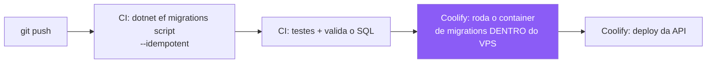

# Docker e Aspire — poligraph

> **.NET 10 · Aspire 13.** Duas coisas que parecem a mesma e não são:
> **Aspire orquestra o desenvolvimento local. Docker + Coolify orquestram produção.**

---

## 1. Dockerfile — o padrão do projeto

### 1.1 ⭐ API (.NET 10)

```dockerfile
# ─── build ────────────────────────────────────────────────────────────
FROM mcr.microsoft.com/dotnet/sdk:10.0 AS build
WORKDIR /src

# ⭐ copiar SÓ os .csproj primeiro: o restore vira camada cacheada
COPY ["src/api/Poligraph.Api/Poligraph.Api.csproj", "src/api/Poligraph.Api/"]
RUN dotnet restore "src/api/Poligraph.Api/Poligraph.Api.csproj"

COPY . .
RUN dotnet publish "src/api/Poligraph.Api/Poligraph.Api.csproj" \
    -c Release -o /app --no-restore

# ─── runtime ──────────────────────────────────────────────────────────
FROM mcr.microsoft.com/dotnet/aspnet:10.0-noble-chiseled AS final
WORKDIR /app
COPY --from=build /app .

USER $APP_UID
EXPOSE 8080
ENTRYPOINT ["dotnet", "Poligraph.Api.dll"]
```

| Decisão | Por quê |
|---|---|
| ⭐ **`.csproj` antes do resto** | Mudou só código? O `restore` sai do cache. Economiza minutos por deploy |
| ⭐ **`-chiseled`** | ~100 MB em vez de ~220 MB. **Sem shell** — superfície de ataque menor |
| **`USER $APP_UID`** | Não roda como root. A variável já vem definida na imagem |
| **`--no-restore` no publish** | Não refaz o que a camada anterior já fez |
| `EXPOSE 8080` | .NET 8+ usa 8080 por padrão em container, não 80 |

⚠️ **`-chiseled` não tem shell.** `docker exec -it ... bash` **não funciona**. Se precisar
depurar dentro do container, troque temporariamente para `mcr.microsoft.com/dotnet/aspnet:10.0`.

### 1.2 ETL Python

```dockerfile
FROM python:3.13-slim
WORKDIR /etl

# ⭐ mesmo princípio: dependências antes do código
COPY requirements.txt .
RUN pip install --no-cache-dir -r requirements.txt

COPY . .
RUN useradd -m etl && chown -R etl /etl
USER etl

ENTRYPOINT ["python", "main.py"]
```

⚠️ **O ETL não é serviço.** Roda como *Scheduled Task* do Coolify, executa e morre —
`ENTRYPOINT`, sem `CMD` de servidor, sem `EXPOSE`.

### 1.3 Front React

```dockerfile
FROM node:22-alpine AS build
WORKDIR /web
COPY package*.json ./
RUN npm ci
COPY . .

# 🔴 o Vite CONGELA isto no bundle — precisa ser build arg, não env var
ARG VITE_GOOGLE_CLIENT_ID
ENV VITE_GOOGLE_CLIENT_ID=$VITE_GOOGLE_CLIENT_ID
RUN npm run build

FROM nginx:alpine AS final
COPY --from=build /web/dist /usr/share/nginx/html
COPY nginx.conf /etc/nginx/conf.d/default.conf
```

⚠️ **No Coolify, declare `VITE_GOOGLE_CLIENT_ID` como *build variable*.** Como env var
comum não funciona — o valor já foi embutido no `npm run build`. **Sintoma: o botão do
Google não aparece, sem erro nenhum.**

### 1.4 🔴 `.dockerignore` — não é opcional

Sem ele, `COPY . .` manda `bin/`, `obj/`, `node_modules/` e o `.git` inteiro para o
*build context*. Deixa o build lento e pode **vazar `.env` para dentro da imagem**.

```
**/bin/
**/obj/
**/node_modules/
**/.git/
**/.vs/
**/.env*
**/*.user
docs/
```

---

## 2. Aspire — o AppHost

### 2.1 O que o Aspire resolve, e o que não resolve

| ✅ Resolve | ⛔ Não resolve |
|---|---|
| Subir Postgres, API, front e ETL com **um `dotnet run`** | Deploy — quem faz isso é o Coolify |
| Injetar connection string sem `.env` local | Configuração de produção |
| Dashboard com log, trace e métrica de tudo junto | Monitoramento em produção (é o Grafana) |
| Ordem de subida e *health check* | — |

⭐ **Ganho de coerência:** o Aspire roda **os mesmos containers** que vão para produção.

### 2.2 ⭐ O AppHost

```csharp
var builder = DistributedApplication.CreateBuilder(args);

// ─── infraestrutura ───────────────────────────────────────────────
var postgres = builder.AddPostgres("postgres")
    .WithDataVolume()          // ⭐ o banco sobrevive ao restart
    .WithPgAdmin();            // opcional, útil para inspecionar

var bancoPoligraph = postgres.AddDatabase("poligraph");

// ─── migrations: roda ANTES da API e precisa TERMINAR ─────────────
var migracoes = builder.AddProject<Projects.Poligraph_Data>("migracoes")
    .WithReference(bancoPoligraph)
    .WaitFor(postgres);

// ─── API ──────────────────────────────────────────────────────────
var api = builder.AddProject<Projects.Poligraph_Api>("api")
    .WithReference(bancoPoligraph)
    .WaitForCompletion(migracoes);   // 🔴 não sobe antes do schema existir

// ─── front ────────────────────────────────────────────────────────
builder.AddNpmApp("web", "../../web", "dev")
    .WithReference(api)
    .WaitFor(api)
    .WithHttpEndpoint(env: "PORT")
    .WithExternalHttpEndpoints();

// ─── ETL: sob demanda, não sobe junto ─────────────────────────────
builder.AddDockerfile("etl", "../../etl")
    .WithReference(bancoPoligraph)
    .WaitFor(postgres)
    .WithExplicitStart();            // ⭐ só roda quando você mandar

builder.Build().Run();
```

### 2.3 🔴 `WaitFor` × `WaitForCompletion`

> **Por padrão o Aspire sobe tudo em paralelo.** Sem isto, a API tenta conectar antes de o
> Postgres aceitar conexão — e a migration falha em silêncio.

| | Significa | Use para |
|---|---|---|
| `.WaitFor(x)` | Espera **x ficar saudável** | Postgres, API |
| ⭐ `.WaitForCompletion(x)` | Espera **x terminar e sair com sucesso** | **Migrations, seeds** |

⚠️ **Migration é `WaitForCompletion`, não `WaitFor`.** Ela não fica "saudável" — ela
**acaba**.

### 2.4 ⭐ O projeto de migrations existe por dois motivos

Um projeto separado que só aplica migration e encerra:

📐 **O código dele está na §3.1** — inclui a guarda de ambiente para o seed.

| Motivo | |
|---|---|
| 1 | Local: o Aspire garante ordem com `WaitForCompletion` |
| 2 | 🔴 **Produção:** o deploy zero-downtime do Coolify sobe **dois containers ao mesmo tempo** — `Migrate()` dentro da API teria corrida. Aqui roda **um executor só** |

⭐ **É o mesmo binário nos dois ambientes.** Em produção vira um comando do Coolify antes
do deploy.

### 2.5 ServiceDefaults

```csharp
builder.AddServiceDefaults();   // OpenTelemetry, health checks, resiliência HTTP
// ...
app.MapDefaultEndpoints();      // /health e /alive
```

⭐ **`/health` é o que o Coolify usa** para decidir se o container novo pode substituir o
antigo — e o que o UptimeRobot vai pingar de fora.

---

## 3. ✅ Quando a migration roda — o fluxo decidido

> **Local (`Environment != Production`):** aplica sozinha, junto com dados de teste.
> **Produção:** fluxo externo, script aplicado via CI/CD. ⛔ **A API nunca migra em
> produção.**

| | Local | Produção |
|---|---|---|
| Quem dispara | ⭐ O projeto `Poligraph.Data`, pelo Aspire | O pipeline, antes do deploy |
| Como | `Database.MigrateAsync()` | `migration.sql` idempotente |
| Dados de teste | ✅ Sim, se ainda não existirem | ⛔ **Nunca** |
| Se falhar | Você vê no dashboard do Aspire | 🔴 **O deploy não acontece** |

### 3.1 O projeto de migrations, com os dois caminhos

```csharp
var builder = Host.CreateApplicationBuilder(args);
builder.AddNpgsqlDbContext<PoligraphDb>("poligraph");
var host = builder.Build();

using var escopo = host.Services.CreateScope();
var db = escopo.ServiceProvider.GetRequiredService<PoligraphDb>();

await db.Database.MigrateAsync();          // idempotente por natureza

if (!builder.Environment.IsProduction())
    await SemeadorDesenvolvimento.SemearAsync(db);   // §3.2
```

⭐ **`MigrateAsync()` já é idempotente** — o EF consulta `__EFMigrationsHistory` e aplica só
o que falta. Rodar duas vezes não faz nada na segunda.

### 3.2 🔴 Dados de teste — o erro que quase todo mundo comete

> ⛔ **Não use `HasData()` do EF para dados de teste.**
> `HasData` entra **dentro da migration** — e a migration roda em produção. Seus deputados
> fictícios iriam para o ar.

Dados de teste ficam em **código, fora da migration, atrás da guarda de ambiente**:

```csharp
public static class SemeadorDesenvolvimento
{
    public static async Task SemearAsync(PoligraphDb db, CancellationToken ct = default)
    {
        // ⭐ guarda de idempotência: já semeado? sai.
        if (await db.Pessoas.AnyAsync(ct)) return;

        var pessoas = GerarParlamentares();
        var votacoes = GerarVotacoes();
        var perguntas = GerarPerguntas();   // 🔴 com polaridade dos dois sinais

        db.AddRange(pessoas);
        db.AddRange(votacoes);
        db.AddRange(perguntas);
        await db.SaveChangesAsync(ct);
    }

    private static IReadOnlyList<Pessoa> GerarParlamentares() => /* ... */;
    private static IReadOnlyList<Votacao> GerarVotacoes() => /* ... */;
    private static IReadOnlyList<Pergunta> GerarPerguntas() => /* ... */;
}
```

⚠️ **O seed precisa conter perguntas com `polaridade = -1`.** Semear só polaridade `+1`
faz o bug mais perigoso do sistema ficar invisível durante todo o desenvolvimento.

| Guarda | |
|---|---|
| `if (await db.Pessoas.AnyAsync()) return;` | Simples e suficiente |
| Alternativa | Uma linha em `execucao` marcando `SEED_DEV`, se o seed crescer |

### 3.3 🔴 Produção: o script não pode ser aplicado do GitHub Actions

Aqui a decisão esbarra em outra, tomada antes:

> **A porta 5432 nunca é exposta à internet.** O runner do GitHub **não alcança o banco** —
> pelo mesmo motivo que tirou o ETL do Actions.

**Três caminhos, e o que sobra:**

| | Caminho | Veredito |
|---|---|---|
| A | Actions conecta direto no Postgres | ⛔ Exige abrir a 5432. **Descartado** |
| B | Actions entra por SSH e roda | 🟡 Coloca a chave do servidor no GitHub |
| ⭐ **C** | **CI gera e valida o script · o VPS aplica** | ✅ **Escolhido** |



⭐ **O container de migrations já está na rede Docker** — ele alcança `postgres:5432` sem
que nada seja exposto. É o mesmo binário do desenvolvimento, com `Environment=Production`,
o que faz o seed **não** rodar.

```bash
# no CI — gera o artefato e falha se a migration estiver quebrada
dotnet ef migrations script --idempotent -o migration.sql

# no Coolify — comando de pré-deploy
docker compose run --rm migracoes
```

### 3.4 🔴 A migration tem que ser compatível com a versão ANTIGA

Consequência do deploy zero-downtime: por alguns segundos, **o container antigo ainda está
servindo com o schema novo já aplicado**.

| ⛔ Quebra o container antigo | ✅ Seguro |
|---|---|
| `ADD COLUMN ... NOT NULL` sem default | `ADD COLUMN` anulável, preencher depois |
| `DROP COLUMN` | Parar de usar agora, **remover no deploy seguinte** |
| `RENAME COLUMN` | Adicionar a nova, migrar dado, remover a velha depois |

> 🔑 **Regra: uma mudança destrutiva leva dois deploys.** Expandir, migrar, contrair.

---

## 4. Erros que este projeto pode cometer

| ⛔ | Consequência |
|---|---|
| `Database.Migrate()` no `Program.cs` da API | Corrida no deploy zero-downtime |
| `HasData()` para dado de teste | 🔴 Vai junto na migration e **semeia produção** |
| Seed sem perguntas de polaridade `-1` | O bug mais perigoso fica invisível no dev |
| Migration destrutiva num deploy só | Derruba o container antigo durante a troca |
| Esquecer `.WithDataVolume()` | O banco local zera a cada restart |
| `VITE_*` como env var em vez de build arg | Botão do Google some, sem erro |
| Rodar como root no container | Achado óbvio em revisão de segurança |
| Sem `.dockerignore` | Build lento e risco de vazar `.env` |
| `WaitFor` onde precisava `WaitForCompletion` | Migration corre junto com a API |
