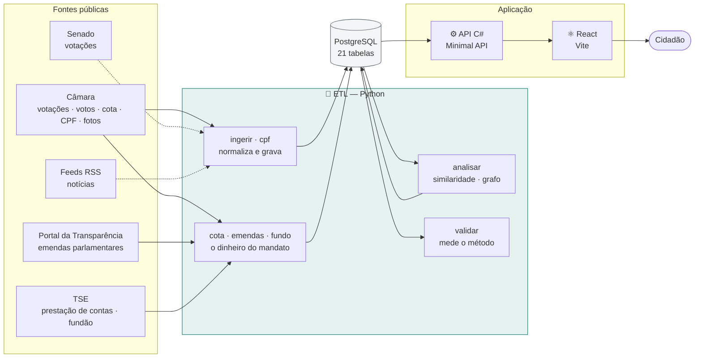
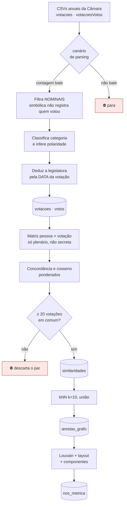
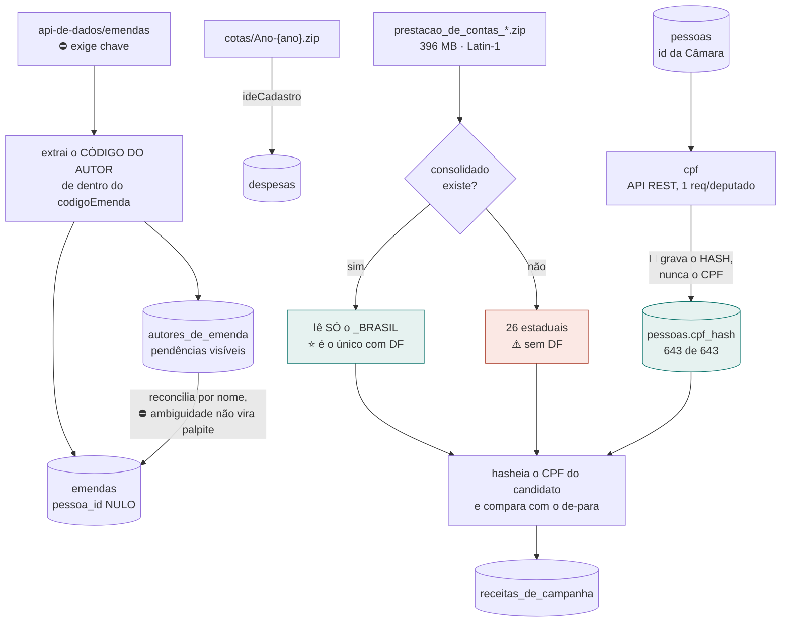
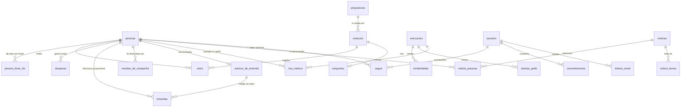

# poligraph

> **Arquitetura ETL e Modelagem em Grafos para Recomendação de Notícias e Mensuração de
> Afinidade Política em Redes Sociais** — TCC.

Descobre quais deputados votam como você, comparando suas respostas com o **registro
nominal de votação** da Câmara. Afinidade medida por **comportamento revelado de voto**,
⛔ não por autodeclaração ideológica.

> ⚠️ **Ferramenta acadêmica. Não é recomendação de voto.**

---

## Estado atual — medido em 2026-08-27

Tudo abaixo saiu de `count(*)` no banco depois de rodar o ETL contra as fontes reais.

| Voto — o núcleo | |
|---|---|
| **Votos ingeridos** | 470.727 — legislatura 57 completa (2023–2026) |
| **Deputados com voto** | 643 |
| **Votações** | 1.594 |
| **Pares de similaridade** | 2.327.880 |
| **Arestas do grafo** | 36.017 |
| **Perguntas curadas ativas** | 21 |

| Dinheiro — o perfil do parlamentar | |
|---|---|
| **Despesas de cota** (CEAP) | 208.188 |
| **Emendas parlamentares** | 24.810 — **21.349 (86%) com autor resolvido** |
| **Autores de emenda** | 792 resolvidos · 159 sem vínculo (comissões e bancadas) |
| **Receitas de campanha** (TSE) | 22.511, de **642 dos 643** deputados |
| **Fundo Especial — o "fundão"** | R$ 907,7 mi · R$ 1.163,4 mi arrecadados no total |
| **Deputados com `cpf_hash`** | 643 — 100%, e ⛔ nenhum CPF em claro |

| | |
|---|---|
| **Notícias** | 0 — ⛔ o coletor ainda não rodou |
| **Testes** | **91 .NET · 282 Python · 37 front** |

⛔ **O Senado ainda não é ingerido** — ver [PL42](docs/PENDENCIAS.md).

⭐ **O único deputado sem receita de campanha** é um suplente com 6 votos, que ⛔ não foi
candidato a deputado federal em 2022. 642 de 643 é o teto real, ⛔ não uma falha.

---

## Como rodar

### O que você precisa

| | |
|---|---|
| **.NET 10 SDK** | A API, as migrations e o AppHost |
| **Node 20+** | O front |
| **Podman ou Docker** | Postgres e o ETL rodam em container |
| **Client ID do Google** | Sem ele o login não funciona — [como obter](docs/plano/08-obter-as-chaves.md) |

⛔ **Python no host é dispensável** — o ETL roda pela mesma imagem que o VPS executa.

### 1. O segredo do Google

```bash
dotnet user-secrets set "Google:ClientId" "SEU_ID.apps.googleusercontent.com" \
  --project src/Poligraph.Api
```

> 🔴 **Nunca em `appsettings.json`** — o arquivo é versionado.

### 2. Suba tudo

```bash
dotnet run --project src/Poligraph.AppHost
```

O Aspire sobe **Postgres → migrations → API → front**, nessa ordem, e imprime o link do
painel. O front fica em **http://localhost:5173**.

### 3. Popule o banco

⚠️ **O banco sobe vazio.** Não há mais seed de desenvolvimento: o dado local é a Câmara
de verdade.

No painel do Aspire, inicie **`etl-ingerir`** e depois **`etl-analisar`**.

> ⭐ Eles não rodam sozinhos, de propósito: a ingestão baixa dezenas de MB, e disparar
> isso a cada `dotnet run` deixaria o ambiente inutilizável por minutos.

### Os comandos do ETL

| Comando | O que faz | Duração |
|---|---|---|
| `ingerir --anos 2023 2024 2025 2026` | Deputados, votações e votos | ~2 min |
| `analisar --legislatura 57` | Similaridade, kNN, comunidades, componentes | ~40 s |
| `cota --anos 2025` | Cota parlamentar (CEAP) | ~11 s |
| `cpf` | 🔴 Completa `cpf_hash` — chave para conciliar com o TSE | ~4 min |
| `emendas --anos 2023 2024 2025 2026` | Emendas + reconciliação de autor | ~10 min |
| `fundo --eleicao 2022` | 🔴 Financiamento de campanha e fundão | ~2 min |
| `validar --legislatura 57` | ⭐ Mede discriminação e comunidade × partido | ~2 s |

🔴 **A ordem importa entre `cpf` e `fundo`.** O join com o TSE é por hash de CPF; sem
`cpf` executado antes, o de-para sai vazio e **toda** receita é descartada — 396 MB lidos
para gravar zero. O comando barra isso com erro claro, ⛔ em vez de logar sucesso.

⛔ **`emendas` exige chave do Portal da Transparência**, pessoal e atrelada ao CPF de quem
a pede ([como obter](docs/plano/08-obter-as-chaves.md)). Ela vem de
`PORTAL_TRANSPARENCIA_CHAVE`, ⛔ **nunca** do código ou de `appsettings`.

`cota` e `validar` ainda não estão no painel — rodam pelo container:

```bash
podman run --rm --network "container:<postgres>" \
  -e "ConnectionStrings__poligraph=Host=localhost;Port=5432;Database=poligraph;Username=postgres;Password=..." \
  poligraph-etl:local cota --anos 2025
```

### Testes

```bash
dotnet test                              # 91 — Testcontainers com Postgres real
cd src/etl && python -m pytest           # 282
cd src/web && npm test                   # 37
```

### ⚠️ Com Podman: os dois suítes querem `DOCKER_HOST` DIFERENTE

Medido em 2026-08-27, no Windows. **A mesma variável, dois formatos incompatíveis:**

| Suíte | Formato que funciona | Barras |
|---|---|---|
| `dotnet test` | `npipe://./pipe/podman-machine-default` | **duas** |
| `python -m pytest` | `npipe:////./pipe/podman-machine-default` | **quatro** |

🔴 **E o formato errado ⛔ não dá erro claro em nenhum dos dois.** No Python, os 9 testes
que precisam de Postgres viram **`SKIPPED`** e a suíte fica verde com 273 em vez de 282 —
a contagem é a **única** pista. No .NET, `TypeInitializationException` no construtor da
classe de teste.

⭐ **Com Docker Desktop o problema ⛔ não existe** — o socket padrão é encontrado sozinho,
e ⛔ nem é preciso definir a variável. ⚠️ Rode um suíte de cada vez, ou exporte a variável
certa em cada shell.

⭐ **Sem container algum, os testes que dependem dele são PULADOS, ⛔ não vermelhos** —
o CI tem container, a máquina de quem desenvolve pode não ter, e um vermelho por falta de
ambiente treina a pessoa a ignorar vermelho.

---

## Desenho macro



⚠️ **Linha tracejada = ainda não implementado.** O Senado e o coletor de notícias estão
levantados e documentados, ⛔ mas não ingerem.

⭐ **Os dois ramos do ETL respondem perguntas diferentes sobre a mesma pessoa.** O ramo do
**voto** sustenta o título do TCC — afinidade e grafo. O ramo do **dinheiro** ⛔ não entra
em cálculo nenhum de afinidade: ele povoa o perfil, e existe porque o critério do autor foi
*o que não se associa ao perfil do político não entra*.

🔴 **O EF é dono do schema; o Python nunca cria tabela.** Quebrar isso já custou caro —
o ETL inteiro foi escrito com nomes de tabela errados e nunca falou com o banco. Hoje
`src/etl/tests/test_contrato_schema.py` trava a divergência, inclusive de colunas.

---

## O processo de ETL



### E o ramo do dinheiro — três chaves diferentes



🔴 **O join com o TSE acontece entre HASHES.** O CPF em claro do candidato existe só em
memória, durante a leitura do CSV. RNF-13 sem abrir mão da chave forte.

⚠️ **A armadilha do consolidado, medida no ZIP real de 2022:** são **26** arquivos
estaduais mais um `_BRASIL`, ⛔ não 27 estaduais. O `_BRASIL` **duplica** os estaduais
linha por linha (SP: 17.609 × 17.609) **e é o único que traz o DF**. Ler só os estaduais
perdia **R$ 17,2 milhões e 10 parlamentares em silêncio**; ler os dois dobraria o resto.

### Três armadilhas que o desenho trata

| | |
|---|---|
| 🔴 **Polaridade** | Em **14%** das votações nominais, "Sim" significa **rejeitar**. Sinal invertido ⛔ não aparece na tela — aparece como número plausível e errado. [Achado #12](docs/achados/012-polaridade-nao-e-constante.md) |
| ⚠️ **Quebra de linha no CSV** | Parsing ingênuo por linha inflou a contagem em até **26%**. O canário compara com o volume medido |
| ⚠️ **Ausência ≠ discordância** | Tratar falta como voto contrário faria o instrumento medir **presença**, não afinidade |

📐 A matemática completa: [`plano/07 §3.2`](docs/plano/07-grafo-e-afinidade.md).
📐 O que cada número significa: [`metodos.md`](docs/metodos.md).

---

## Fontes consumidas

| Fonte | O que traz | Estado |
|---|---|---|
| **Câmara — CSVs anuais** | Votações e votos nominais | ✅ Ingerindo |
| **Câmara — `deputados.csv`** | Cadastro e id de-para | ✅ Ingerindo |
| **Câmara — `cotas/Ano-{ano}.zip`** | Cota parlamentar (CEAP) | ✅ Ingerindo |
| **Câmara — `bandep/{id}.jpg`** | Foto oficial | ✅ URL guardada |
| **TSE — `prestacao_de_contas_*`** | ⭐ **Fundão (FEFC) e doadores** | ✅ Ingerindo |
| **Portal — `api-de-dados/emendas`** | ⭐ **Emendas parlamentares** | ✅ Ingerindo |
| **Senado** | Votações e votos | ⛔ [PL42](docs/PENDENCIAS.md) |
| **TSE — `consulta_cand_*`** | Candidaturas, patrimônio, escolaridade | 🔵 Levantado |
| **Feeds RSS** | Notícias por parlamentar | ⛔ Coletor não rodou |

⚠️ **Licitações, PNCP e servidores federais foram REPROVADOS** por não se ligarem a um
parlamentar — [`14-fontes-de-gasto`](docs/14-fontes-de-gasto.md) registra o motivo medido.

### 🔴 Como cada fonte encontra o parlamentar

O critério que decidiu o que entra: **o que não se associa ao perfil do político não
entra.** Cada fonte usa uma chave diferente, e a força delas ⛔ não é a mesma:

| Fonte | Chave | Força | Cobertura medida |
|---|---|---|---|
| Câmara — votos | `id` da Câmara | 🟢 Determinística | 100% |
| Cota (CEAP) | `ideCadastro` = o mesmo id | 🟢 Determinística | 99,6% das linhas |
| **TSE — receitas** | **hash de CPF** | 🟢 Determinística | **642 de 643** |
| **Portal — emendas** | **código do autor** no `codigoEmenda` | 🟡 Estável, mas indireta | **86% das emendas** |

⭐ **A emenda ⛔ não usa o nome do autor como chave.** O `codigoEmenda` embute um
identificador de **mandato**:

```
202541840004
 │   │    └── numeroEmenda
 │   └─────── 4184 ← código do autor
 └─────────── ano
```

**Medido:** 173 de 173 autores com código estável dentro de 2025, **zero colisões**; entre
2023 e 2025 mudou para dois — ⭐ e os dois viraram **senadores**, o que confirma que o
código identifica o mandato. É por isso que ele serve à Câmara **e** ao Senado.

⚠️ **Nada é descartado por falta de dono.** Emenda de comissão e de bancada entra com
`pessoa_id` nulo e vira **pendência visível** em `autores_de_emenda` — 159 hoje, quase
todas coletivas. Atribuí-las a alguém seria inventar autoria.

---

## Schema do banco



### As 21 tabelas, por bloco

| Bloco | Tabelas | Quem escreve |
|---|---|---|
| **Ingestão** | `pessoas` · `pessoa_fonte_ids` · `proposicoes` · `votacoes` · `votos` | 🐍 ETL |
| **Dinheiro** | `despesas` · `emendas` · `autores_de_emenda` · `receitas_de_campanha` | 🐍 ETL |
| **Análise** | `execucoes` · `similaridades` · `arestas_grafo` · `nos_metrica` | 🐍 ETL |
| **Produto** | `perguntas` · `noticias` · `noticia_pessoas` · `noticia_temas` | Curadoria e coletor |
| **Conta** | `usuarios` · `segue` · `consentimentos` · `tokens_email` · `avaliacoes` | ⚙️ API |

### 🔴 Regras que o banco garante, não o código

> **Onde a regra puder virar `CHECK`, `UNIQUE` ou `FK`, ela vira.** Um bug que o banco
> rejeita custa minutos; um que ele aceita custa um capítulo do TCC.

| Constraint | O que impede |
|---|---|
| `ck_sim_minimo` — `n_votacoes_comuns >= 20` | Similaridade calculada sobre base insuficiente (RN-02) |
| `ck_sim_ordem` — `pessoa_a < pessoa_b` | O mesmo par gravado duas vezes, invertido |
| `ck_pergunta_polaridade` — `polaridade IN (-1,1)` | Pergunta sem sinal definido |
| `ck_voto_valor` — `valor IN (-1,0,1)` | Domínio de voto aberto (RN-03) |
| `ck_despesa_valor` — `valor_liquido <> 0` | Lançamento sem efeito. ⚠️ Negativo é **estorno** e fica |
| `ck_receita_valor` — `valor <> 0` | Receita sem efeito. ⚠️ O lote inteiro seria recusado por uma linha |
| `ck_autor_metodo` — `metodo IN (…)` | Reconciliação com procedência indefinida |
| `ux_emenda_autor_codigo` — `(codigo_autor, codigo_emenda)` | A mesma emenda gravada duas vezes ao reingerir |
| **FK `segue → pessoas`** com **`RESTRICT`** | 🔴 Apagar em silêncio registro de convicção política |
| **FKs do grafo → `pessoas`** com **`CASCADE`** | Nó órfão desenhado sem nome — **já aconteceu** |

### Exclusão: lógica por padrão, física para dado pessoal

| Onde | Como | Por quê |
|---|---|---|
| `pessoas` | **Lógica** (`excluido_em`) | O voto é registro histórico; apagar levaria o grafo junto |
| `usuarios` · `segue` | 🔴 **Física** | LGPD art. 18, VI dá direito à **eliminação**, ⛔ não à ocultação |

📐 Detalhe em [`plano/04 §2.2c`](docs/plano/04-esqueleto.md).

---

## A API

Minimal API, ⛔ sem controllers, sem MediatR, sem Repository.

| Método | Rota | O que faz |
|---|---|---|
| `GET` | `/api/parlamentares` | Lista, com filtro de nome, partido e UF |
| `GET` | `/api/parlamentares/{id}` | Ficha: dados, votos recentes, mais similares |
| `GET` | `/api/parlamentares/{id}/gastos` | 💰 Cota agregada por categoria e fornecedor |
| `GET` | `/api/parlamentares/{id}/emendas` | 💰 Emendas por destino e função — **empenhado ⛔ ≠ pago** |
| `GET` | `/api/parlamentares/{id}/financiamento` | 💰 Campanha — **fundão e fundo partidário separados** |
| `GET` | `/api/parlamentares/{id}/noticias` | Notícias que mencionam a pessoa |
| `GET` | `/api/afinidade/perguntas` | As perguntas ativas, em ordem |
| `POST` | `/api/afinidade` | ⭐ Calcula afinidade e **posiciona o cidadão no grafo** |
| `GET` | `/api/grafo` | 🕸️ Nós e arestas da execução mais recente |
| `GET` | `/api/seguidos` · `PUT`/`DELETE` `/{id}` | 🔴 Lista de acompanhamento — dado sensível |
| `POST` | `/api/auth/google` · `/logout` · `/sair-de-todos` | Sessão |
| `GET` | `/api/auth/eu` | Quem está logado |
| `DELETE` | `/api/auth/conta` | 🔴 LGPD art. 18, VI — exclusão física |
| `POST` | `/api/avaliacao` | Feedback ⛔ **sem vínculo com a conta** |

### 🔴 Três decisões que atravessam a API

**⛔ Nenhum token é armazenado.** O `id_token` do Google é validado e descartado; a sessão
é um cookie `HttpOnly` assinado. ⛔ Não existe tabela de sessão — a revogação global sai de
um `sessao_versao` no usuário.

**⛔ Nunca percentual solto.** A resposta traz `acordos` e `comparaveis` separados, e a
tela monta *"concordaram em 4 de 5"*. "80%" esconderia que a base foram 5 perguntas
(RF-29).

**⛔ A polaridade nunca sai da API.** Expô-la deixaria o cidadão inferir o voto do
parlamentar **antes** de responder.

**⛔ Nenhum documento de pessoa física sai da API.** CPF de fornecedor e de doador vive
hasheado no banco (RNF-13) e ⛔ nem o hash é serializado. A tela marca *"pessoa física"* e
para aí. **CNPJ fica legível**, de propósito: é dado público de empresa, e sem ele ⛔ não
dá para cruzar quem financiou a campanha com quem recebeu verba de gabinete depois.

**⛔ Somas que afirmam coisas não são feitas pela API.** `FundoEspecial` (o "fundão", FEFC)
e `FundoPartidario` são fundos **diferentes** e saem separados; `Empenhado` e `Pago` também.
Somar é uma afirmação — quem a fizer que a assine.

---

## Estrutura

```
src/
  Poligraph.Api/          ⚙️ Minimal API · dono do schema (EF Core)
  Poligraph.Migrations/   Aplica migrations e carrega a curadoria
  Poligraph.AppHost/      Aspire — orquestra o ambiente local
  Poligraph.Tests/        xUnit + Testcontainers
  etl/                    🐍 Python — ingestão e análise
  web/                    ⚛️ React + Vite
docker/                   Dockerfiles (fora de src/, por decisão)
docs/                     📚 Documentação
```

---

## Documentação

| | |
|---|---|
| 📚 [**Índice completo**](docs/README.md) | Os quatro tipos de documento e a regra do dono único |
| 🔬 [**Achados**](docs/achados/README.md) | Os 24 achados medidos — **é o que a parte teórica cita** |
| 💰 [**Fontes de gasto**](docs/14-fontes-de-gasto.md) | Cota, emendas e fundão — e o que foi **reprovado**, com o motivo |
| 📐 [**Métodos**](docs/metodos.md) | O que cada número significa — `r`, ARI, modularidade |
| ⭐ [**Grafo e afinidade**](docs/plano/07-grafo-e-afinidade.md) | O núcleo técnico: fórmulas, pesos, comunidades |
| 🔴 [**Pendências**](docs/PENDENCIAS.md) | O que está aberto e o que bloqueia |
| ⏳ [**Revisar antes da conclusão**](docs/REVISAR-ANTES-DA-CONCLUSAO.md) | Fatos com prazo de validade |

> ⚠️ **Regra metodológica do projeto:** *medir um ano e generalizar foi a origem de quase
> todos os erros cometidos aqui.* Antes de afirmar um número, meça — e diga sobre qual
> período.
