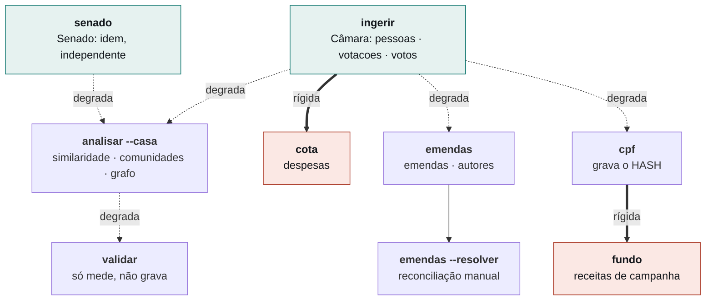
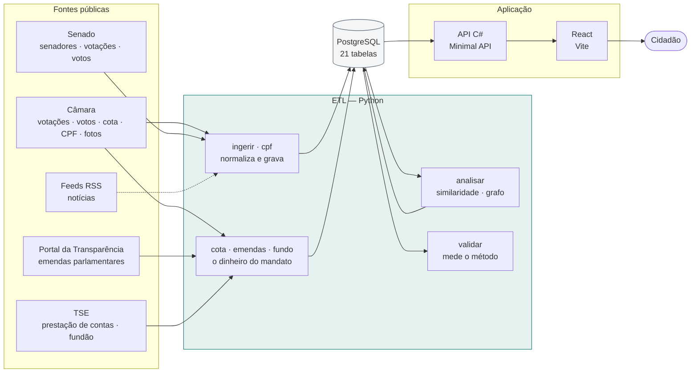
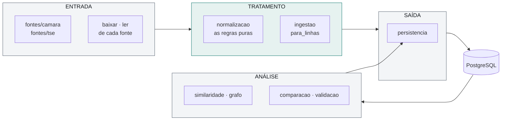
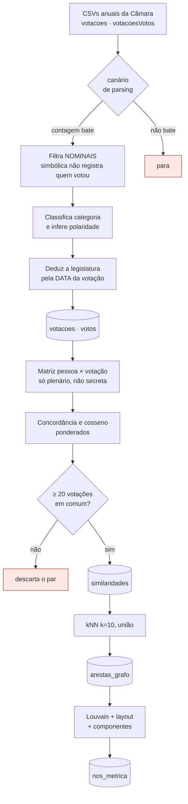
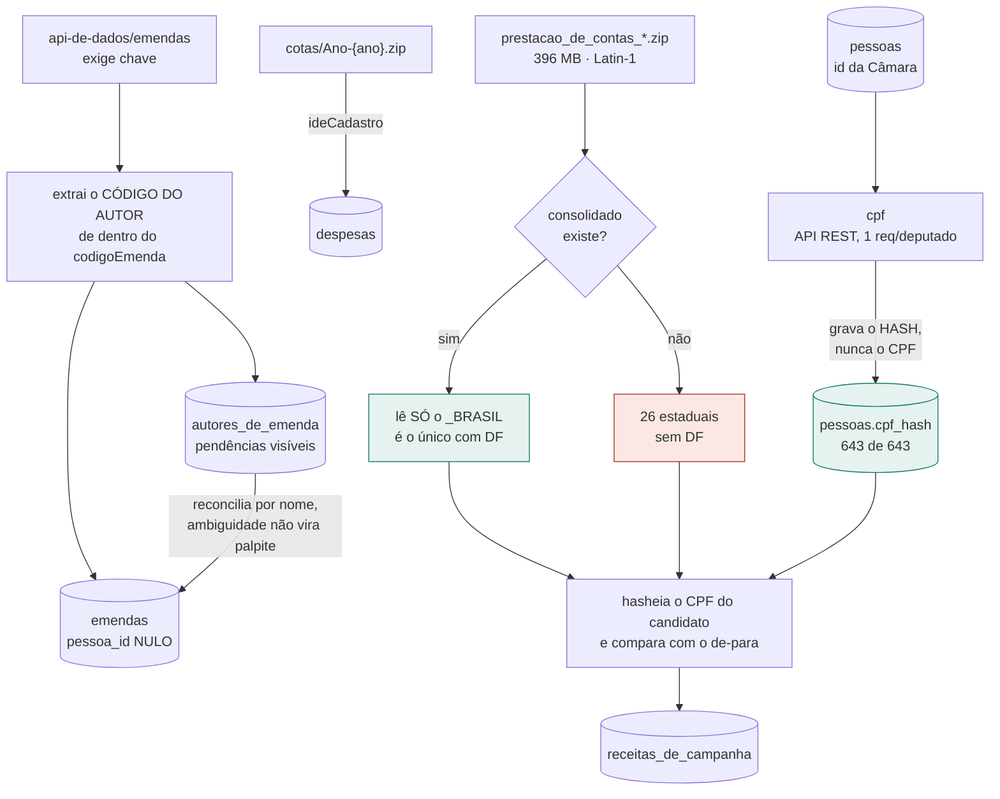

# poligraph

> **Arquitetura ETL e Modelagem em Grafos para Recomendação de Notícias e Mensuração de
> Afinidade Política em Redes Sociais** — TCC.

Descobre quais deputados votam como você, comparando suas respostas com o **registro
nominal de votação** da Câmara. Afinidade medida por **comportamento revelado de voto**,
não por autodeclaração ideológica.

> **Ferramenta acadêmica. Não é recomendação de voto.**

---

## Estado atual — medido em 2026-08-27

Tudo abaixo saiu de `count(*)` no banco depois de rodar o ETL contra as fontes reais.

| Voto — o núcleo | Câmara | Senado |
|---|---:|---:|
| **Votações** | 1.594 | 421 — **239 secretas** |
| **Votos** | 470.727 | 34.101 |
| **Votos com posição utilizável** | 463.994 (98,6%) | **11.881 (34,8%)** |
| **Parlamentares com voto** | 643 | 104 |
| **Nós do grafo** | 643 | 104 |
| **Arestas** | 5.271 | 594 |
| **Comunidades detectadas** | 17 | 24 |
| **Perguntas curadas ativas** | 21 | — |

As duas casas geram grafos **independentes**, e nenhuma aresta liga deputado a senador:
elas não votam as mesmas matérias, então não há denominador para comparar um com o outro
([achado #7](docs/achados/007-casas-nao-sao-comparaveis.md)).

No Senado, **56,8% das votações são secretas**, e só 34,8% dos registros de voto são
posição utilizável — contra 98,6% na Câmara. O valor mais frequente é `Votou`, que
registra que houve voto sem revelar qual
([achado #17](docs/achados/017-senado-maioria-secreta.md)).

| Dinheiro — o perfil do parlamentar | |
|---|---|
| **Despesas de cota** (CEAP) | **773.716** — 2023 a 2026 |
| **Emendas parlamentares** | 24.810 — **21.358 (86,1%) com autor resolvido** |
| **Autores de emenda** | 793 resolvidos · 158 sem vínculo (comissões e bancadas) |
| **Receitas de campanha** (TSE) | 22.511, de **642 dos 643** deputados |
| **Fundo Especial — o "fundão"** | R$ 907,7 mi · R$ 1.163,4 mi arrecadados no total |
| **Deputados com `cpf_hash`** | 643 — 100%, e nenhum CPF em claro |

### Cobertura por fonte — e o que falta em cada uma

Cada lacuna abaixo foi investigada caso a caso.

| Fonte | Cobre | Falta | O que é a lacuna |
|---|---:|---:|---|
| `cpf_hash` · foto · grafo | **643** | 0 | — |
| **Cota (CEAP)** | **642** | 1 | Suplente com 48 votos — **0 linhas no arquivo da Câmara**, conferido. Ausência real |
| **Receitas (TSE)** | **642** | 1 | Suplente com 6 votos que não foi candidato a deputado federal em 2022 |
| **Emendas** | **551** | 92 | Ver abaixo — a única lacuna que não está fechada |

Até 2026-08-27 apenas a cota de 2025 havia sido ingerida, o que reduzia a cobertura
aparente a 560 de 643. Os 83 ausentes eram, na maioria, deputados em exercício em 2023,
2024 ou 2026 — suplentes e parlamentares que deixaram o mandato. A ingestão dos quatro
anos elevou a cobertura a 642. A limitação era parâmetro do comando, não da fonte.

**Os 92 sem emenda não têm explicação única.** Emenda individual é impositiva desde
2015, então um deputado de mandato inteiro sem nenhuma é suspeito. Dos 12 com mais de 600
votos, a checagem manual achou **um** caso real de nome divergente — `DR. ALLAN GARCES` no
Portal, *Allan Garcês* na Câmara — resolvido pelo caminho manual da
[PL45](docs/PENDENCIAS.md). Os demais aparentes foram **ruído de casamento aproximado**:
senadores homônimos. [PL47](docs/PENDENCIAS.md) segue o resto.

| | |
|---|---|
| **Notícias** | 0 — o coletor ainda não rodou |
| **Testes** | **93 .NET · 311 Python · 37 front** |

O questionário e a página do parlamentar ainda cobrem apenas a Câmara: a ingestão do
Senado está pronta, o produto não — ver [PL42](docs/PENDENCIAS.md).
**O único deputado sem receita de campanha** é um suplente com 6 votos, que não foi
candidato a deputado federal em 2022. 642 de 643 é o teto real, não uma falha.

---

## Como rodar

### O que você precisa

| | |
|---|---|
| **.NET 10 SDK** | A API, as migrations e o AppHost |
| **Node 20+** | O front |
| **Podman ou Docker** | Postgres e o ETL rodam em container |
| **Client ID do Google** | Sem ele o login não funciona — [como obter](docs/plano/08-obter-as-chaves.md) |

Python no host é dispensável: o ETL roda pela mesma imagem que o VPS executa.

### 1. O segredo do Google

```bash
dotnet user-secrets set "Google:ClientId" "SEU_ID.apps.googleusercontent.com" \
  --project src/Poligraph.Api
```

> **Nunca em `appsettings.json`** — o arquivo é versionado.

### 2. Suba tudo

```bash
dotnet run --project src/Poligraph.AppHost
```

O Aspire sobe **Postgres → migrations → API → front**, nessa ordem, e imprime o link do
painel. O front fica em **http://localhost:5173**.

### 3. Popule o banco

**O banco sobe vazio.** Não há mais seed de desenvolvimento: o dado local é a Câmara
de verdade.

No painel do Aspire, inicie **`etl-ingerir`** e depois **`etl-analisar`**. Os demais
recursos aparecem aninhados sob eles, na ordem em que fazem sentido:

```

etl-ingerir          deputados, votações e votos      ← comece por aqui
├── etl-analisar     similaridade, grafo, comunidades
├── etl-cota         cota parlamentar (CEAP)
├── etl-emendas      emendas — exige chave do Portal
└── etl-cpf          completa cpf_hash
    └── etl-fundo    financiamento de campanha e fundão
```

Os comandos não são disparados automaticamente: a ingestão baixa dezenas de MB, o que
tornaria cada `dotnet run` inviável.

**`etl-fundo` aparece aninhado sob `etl-cpf` porque depende dele de verdade**: o join
com o TSE é por hash de CPF, e sem `cpf` executado antes o de-para sai vazio e **toda**
receita é descartada. O painel não impede o clique fora de ordem — quem impede é o
comando, com erro claro antes de ler os 396 MB.

**`etl-emendas` precisa da chave do Portal**, que o AppHost lê de
`PortalTransparencia:Chave`:

```bash
dotnet user-secrets set "PortalTransparencia:Chave" "SUA_CHAVE" --project src/Poligraph.AppHost
```

> **Nunca em `appsettings.json`** — a chave é **pessoal e atrelada ao seu CPF**, e o
> arquivo é versionado. [Como obter](docs/plano/08-obter-as-chaves.md).

### Os comandos do ETL

| Comando | O que faz | Duração |
|---|---|---|
| `ingerir --anos 2023 2024 2025 2026` | Deputados, votações e votos | ~2 min |
| `analisar --legislatura 57 [--casa SENADO]` | Similaridade, kNN, comunidades | ~90 s |
| `cota --anos 2023 2024 2025 2026` | Cota parlamentar (CEAP) | ~50 s |
| `cpf` | Completa `cpf_hash` — chave para conciliar com o TSE | ~4 min |
| `emendas --anos 2023 2024 2025 2026` | Emendas + reconciliação de autor | ~10 min |
| `fundo --eleicao 2022` | Financiamento de campanha e fundão | ~2 min |
| `emendas --resolver 2815=883` | Vincula autor de emenda **à mão** — [PL45](docs/PENDENCIAS.md) | instantâneo |
| `senado --anos 2023 2024 2025 2026` | Senadores, votações e votos do Senado | ~5 s |
| `validar --legislatura 57` | Mede discriminação e comunidade × partido | ~2 s |

### A ordem de execução



| | |
|---|---|
| **⟹ traço grosso** | Dependência rígida: o comando interrompe e informa o pré-requisito |
| **⟶ tracejado** | Degrada em silêncio |

Duas dependências são rígidas: o comando interrompe e informa o que executar antes.
As demais degradam sem aviso.

| Comando | Sem o pré-requisito |
|---|---|
| `cota` | Interrompe: *"De-para de pessoas vazio. Rode `ingerir` antes"* |
| `fundo` | Interrompe: *"Nenhuma pessoa com `cpf_hash`. Rode `cpf` antes"* |
| `analisar` | Registra aviso e encerra sem calcular |
| `emendas` | Ingere normalmente e resolve zero autores, sem aviso |
| `validar` | Registra aviso e encerra |

Sem esses dois `raise`, `fundo` leria 396 MB, descartaria todas as linhas por não
encontrar o titular e terminaria com log de sucesso. Esse formato de falha já ocorreu:
quando o `id` mudou de posição no CSV, o ETL registrou `0 deputados` e `0 votos` em
nível `INFO` e prosseguiu.

No painel do Aspire, `etl-fundo` aparece aninhado sob `etl-cpf`. O painel não impede a
execução fora de ordem; quem impede é o comando.

**`emendas` exige chave do Portal da Transparência**, pessoal e atrelada ao CPF de quem
a pede ([como obter](docs/plano/08-obter-as-chaves.md)). Ela vem de
`PORTAL_TRANSPARENCIA_CHAVE`, **nunca** do código ou de `appsettings`.
`validar` não está no painel: é medição para o trabalho, não etapa do pipeline, e não
escreve no banco. Executa pelo container:

```bash
podman run --rm --network "container:<postgres>" \
  -e "ConnectionStrings__poligraph=Host=localhost;Port=5432;Database=poligraph;Username=postgres;Password=..." \
  poligraph-etl:local validar --legislatura 57
```

### Testes

```bash
dotnet test                              # 91 — Testcontainers com Postgres real
cd src/etl && python -m pytest           # 282
cd src/web && npm test                   # 37
```

### Com Podman: os dois suítes querem `DOCKER_HOST` DIFERENTE

Medido em 2026-08-27, no Windows. **A mesma variável, dois formatos incompatíveis:**

| Suíte | Formato que funciona | Barras |
|---|---|---|
| `dotnet test` | `npipe://./pipe/podman-machine-default` | **duas** |
| `python -m pytest` | `npipe:////./pipe/podman-machine-default` | **quatro** |

**E o formato errado não dá erro claro em nenhum dos dois.** No Python, os 9 testes
que precisam de Postgres viram **`SKIPPED`** e a suíte fica verde com 273 em vez de 282 —
a contagem é a **única** pista. No .NET, `TypeInitializationException` no construtor da
classe de teste.
**Com Docker Desktop o problema não existe** — o socket padrão é encontrado sozinho,
e nem é preciso definir a variável. Rode um suíte de cada vez, ou exporte a variável
certa em cada shell.
**Sem container algum, os testes que dependem dele são PULADOS, não vermelhos** —
o CI tem container, a máquina de quem desenvolve pode não ter, e um vermelho por falta de
ambiente treina a pessoa a ignorar vermelho.

---

## Desenho macro



**Linha tracejada = ainda não implementado.** Só o coletor de notícias está nesse
estado: levantado e documentado, mas sem ingerir.
**Os dois ramos do ETL respondem perguntas diferentes sobre a mesma pessoa.** O ramo do
**voto** sustenta o título do TCC — afinidade e grafo. O ramo do **dinheiro** não entra
em cálculo nenhum de afinidade: ele povoa o perfil, e existe porque o critério do autor foi
*o que não se associa ao perfil do político não entra*.
**O EF é dono do schema; o Python nunca cria tabela.** Quebrar isso já custou caro —
o ETL inteiro foi escrito com nomes de tabela errados e nunca falou com o banco. Hoje
`src/etl/tests/test_contrato_schema.py` trava a divergência, inclusive de colunas.

---

## O processo de ETL

### Três fases, sempre separadas

Esta é a *"Arquitetura ETL"* do título. A separação **não é organização de arquivo**: é
o que permite dizer, para cada número que aparece na tela, de qual arquivo ele veio, o que
foi feito com ele e em que coluna foi parar.



| Fase | Responsabilidade | Onde |
|---|---|---|
| **ENTRADA** | Baixar e ler. Não interpreta, não descarta | `fontes/camara` · `fontes/tse` · `baixar`/`ler` de cada fonte |
| **TRATAMENTO** | Normalizar, classificar, descartar o que não entra | `normalizacao` · `ingestao` · `para_linhas` de cada fonte |
| **SAÍDA** | Gravar. Não decide nada | `persistencia` |
| **ANÁLISE** | Ler do banco, calcular, gravar de volta | `similaridade` · `grafo` · `comparacao` · `validacao` |

**Nenhum módulo de ENTRADA toca o banco, e `persistencia` não decide o que gravar.**
Quando as três primeiras se misturam, um descarte silencioso vira um número plausível e
errado.
**A ANÁLISE tem contrato próprio:** a entrada não é arquivo, são tabelas já
tratadas; a saída vem sempre atrelada a uma `execucao`, que é o que torna cada retrato do
grafo reproduzível. `validacao` é a exceção — **não grava nada**, só mede.
**Todo módulo de fonte abre com o mesmo bloco** — *Entrada · Tratamento · Saída* — com
formato, encoding, chave de ligação, o que é descartado, a tabela de destino, a constraint
que o banco impõe e a estratégia de idempotência. A revisão não depende de ler o código.

| Fonte | Entrada | Liga por | Saída |
|---|---|---|---|
| `ingestao` | CSVs anuais da Câmara | `id` da Câmara | `votacoes` · `votos` · `pessoas` |
| `ingestao_senado` | `legis.senado.leg.br/votacao` | `CodigoParlamentar` | `votacoes` · `votos` · `pessoas` |
| `cota` | `cotas/Ano-{ano}.csv.zip` | `ideCadastro` | `despesas` |
| `emendas` | `api-de-dados/emendas` | **código do autor** | `emendas` · `autores_de_emenda` |
| `receitas` | `prestacao_de_contas_*.zip` | **hash de CPF** | `receitas_de_campanha` |

### O fluxo do voto



### E o ramo do dinheiro — três chaves diferentes



**O join com o TSE acontece entre HASHES.** O CPF em claro do candidato existe só em
memória, durante a leitura do CSV. RNF-13 sem abrir mão da chave forte.
**A armadilha do consolidado, medida no ZIP real de 2022:** são **26** arquivos
estaduais mais um `_BRASIL`, não 27 estaduais. O `_BRASIL` **duplica** os estaduais
linha por linha (SP: 17.609 × 17.609) **e é o único que traz o DF**. Ler só os estaduais
perdia **R$ 17,2 milhões e 10 parlamentares em silêncio**; ler os dois dobraria o resto.

### Três armadilhas que o desenho trata

| | |
|---|---|
| **Polaridade** | Em **14%** das votações nominais, "Sim" significa **rejeitar**. Sinal invertido não aparece na tela — aparece como número plausível e errado. [Achado #12](docs/achados/012-polaridade-nao-e-constante.md) |
| **Quebra de linha no CSV** | Parsing ingênuo por linha inflou a contagem em até **26%**. O canário compara com o volume medido |
| **Ausência ≠ discordância** | Tratar falta como voto contrário faria o instrumento medir **presença**, não afinidade |

A matemática completa: [`plano/07 §3.2`](docs/plano/07-grafo-e-afinidade.md).
O que cada número significa: [`metodos.md`](docs/metodos.md).

---

## Fontes consumidas

| Fonte | O que traz | Estado |
|---|---|---|
| **Câmara — CSVs anuais** | Votações e votos nominais | Ingerindo |
| **Câmara — `deputados.csv`** | Cadastro e id de-para | Ingerindo |
| **Câmara — `cotas/Ano-{ano}.zip`** | Cota parlamentar (CEAP) | Ingerindo — 4 anos |
| **Câmara — `bandep/{id}.jpg`** | Foto oficial | URL guardada |
| **TSE — `prestacao_de_contas_*`** | **Fundão (FEFC) e doadores** | Ingerindo |
| **Portal — `api-de-dados/emendas`** | **Emendas parlamentares** | Ingerindo |
| **Senado — `legis.senado.leg.br`** | Senadores, votações e votos | Ingerindo |
| **TSE — `consulta_cand_*`** | Candidaturas, patrimônio, escolaridade | Levantado |
| **Feeds RSS** | Notícias por parlamentar | Coletor não rodou |

**Licitações, PNCP e servidores federais foram REPROVADOS** por não se ligarem a um
parlamentar — [`14-fontes-de-gasto`](docs/14-fontes-de-gasto.md) registra o motivo medido.

### Como cada fonte encontra o parlamentar

O critério que decidiu o que entra: **o que não se associa ao perfil do político não
entra.** Cada fonte usa uma chave diferente, e a força delas não é a mesma:

| Fonte | Chave | Força | Cobertura medida |
|---|---|---|---|
| Câmara — votos | `id` da Câmara | Determinística | 100% |
| Cota (CEAP) | `ideCadastro` = o mesmo id | Determinística | **642 de 643** deputados |
| **TSE — receitas** | **hash de CPF** | Determinística | **642 de 643** |
| **Portal — emendas** | **código do autor** no `codigoEmenda` | Estável, mas indireta | **86% · 551 de 643** |

**A emenda não usa o nome do autor como chave.** O `codigoEmenda` embute um
identificador de **mandato**:

```

202541840004
 │   │    └── numeroEmenda
 │   └─────── 4184 ← código do autor
 └─────────── ano
```

**Medido:** 173 de 173 autores com código estável dentro de 2025, **zero colisões**; entre
2023 e 2025 mudou para dois — e os dois viraram **senadores**, o que confirma que o
código identifica o mandato. É por isso que ele serve à Câmara **e** ao Senado.
**Nada é descartado por falta de dono.** Emenda de comissão e de bancada entra com
`pessoa_id` nulo e vira **pendência visível** em `autores_de_emenda` — 159 hoje, quase
todas coletivas. Atribuí-las a alguém seria inventar autoria.

---

## Schema do banco


### As 21 tabelas, por bloco

| Bloco | Tabelas | Quem escreve |
|---|---|---|
| **Ingestão** | `pessoas` · `pessoa_fonte_ids` · `proposicoes` · `votacoes` · `votos` | ETL |
| **Dinheiro** | `despesas` · `emendas` · `autores_de_emenda` · `receitas_de_campanha` | ETL |
| **Análise** | `execucoes` · `similaridades` · `arestas_grafo` · `nos_metrica` | ETL |
| **Produto** | `perguntas` · `noticias` · `noticia_pessoas` · `noticia_temas` | Curadoria e coletor |
| **Conta** | `usuarios` · `segue` · `consentimentos` · `tokens_email` · `avaliacoes` | API |

### Regras que o banco garante, não o código

Toda regra que possa ser expressa como `CHECK`, `UNIQUE` ou `FK` é declarada no banco.
Um erro que o banco rejeita aparece na primeira execução; um que ele aceita permanece nos
dados.

| Constraint | O que impede |
|---|---|
| `ck_sim_minimo` — `n_votacoes_comuns >= 20` | Similaridade calculada sobre base insuficiente (RN-02) |
| `ck_sim_ordem` — `pessoa_a < pessoa_b` | O mesmo par gravado duas vezes, invertido |
| `ck_pergunta_polaridade` — `polaridade IN (-1,1)` | Pergunta sem sinal definido |
| `ck_voto_valor` — `valor IN (-1,0,1)` | Domínio de voto aberto (RN-03) |
| `ck_despesa_valor` — `valor_liquido <> 0` | Lançamento sem efeito. Negativo é **estorno** e fica |
| `ck_receita_valor` — `valor <> 0` | Receita sem efeito. O lote inteiro seria recusado por uma linha |
| `ck_autor_metodo` — `metodo IN (…)` | Reconciliação com procedência indefinida |
| `ux_emenda_autor_codigo` — `(codigo_autor, codigo_emenda)` | A mesma emenda gravada duas vezes ao reingerir |
| **FK `segue → pessoas`** com **`RESTRICT`** | Apagar em silêncio registro de convicção política |
| **FKs do grafo → `pessoas`** com **`CASCADE`** | Nó órfão desenhado sem nome — **já aconteceu** |

### Exclusão: lógica por padrão, física para dado pessoal

| Onde | Como | Por quê |
|---|---|---|
| `pessoas` | **Lógica** (`excluido_em`) | O voto é registro histórico; apagar levaria o grafo junto |
| `usuarios` · `segue` | **Física** | LGPD art. 18, VI dá direito à **eliminação**, não à ocultação |

Detalhe em [`plano/04 §2.2c`](docs/plano/04-esqueleto.md).

---

## A API

Minimal API, sem controllers, sem MediatR, sem Repository.

| Método | Rota | O que faz |
|---|---|---|
| `GET` | `/api/parlamentares` | Lista, com filtro de nome, partido e UF |
| `GET` | `/api/parlamentares/{id}` | Ficha: dados, votos recentes, mais similares |
| `GET` | `/api/parlamentares/{id}/gastos` | Cota agregada por categoria e fornecedor |
| `GET` | `/api/parlamentares/{id}/emendas` | Emendas por destino e função — **empenhado ≠ pago** |
| `GET` | `/api/parlamentares/{id}/financiamento` | Campanha — **fundão e fundo partidário separados** |

### A página do parlamentar

A página teve seis abas, três delas nomeadas pela fonte de dado — *Gastos*, *Emendas*,
*Campanha*. Nomear pela fonte expõe a estrutura interna do sistema, não a pergunta do
leitor, que é quanto recurso público transita por aquele parlamentar.

A separação por fonte também inviabilizava o cruzamento que justifica ingerir as três:
verificar se o parlamentar remunera, com verba de gabinete, fornecedores que financiaram
a própria campanha exige observar campanha e cota simultaneamente.

A organização adotada separa por profundidade, não por fonte:

| Onde | O quê |
|---|---|
| **Duas abas** | *Como vota* (votos + quem vota parecido) · *Notícias* |
| **Uma linha no perfil** | As contas existem e estão a um clique |
| **Um modal** | A comparação dos três totais no topo, e o detalhe das três abaixo |

O padrão anterior era a aba *Notícias*, e o coletor ainda não rodou: a primeira
coisa que a página mostrava era estado vazio.
| `GET` | `/api/parlamentares/{id}/noticias` | Notícias que mencionam a pessoa |
| `GET` | `/api/afinidade/perguntas` | As perguntas ativas, em ordem |
| `POST` | `/api/afinidade` | Calcula afinidade e **posiciona o cidadão no grafo** |
| `GET` | `/api/grafo` | Nós e arestas da execução mais recente |
| `GET` | `/api/seguidos` · `PUT`/`DELETE` `/{id}` | Lista de acompanhamento — dado sensível |
| `POST` | `/api/auth/google` · `/logout` · `/sair-de-todos` | Sessão |
| `GET` | `/api/auth/eu` | Quem está logado |
| `DELETE` | `/api/auth/conta` | LGPD art. 18, VI — exclusão física |
| `POST` | `/api/avaliacao` | Feedback **sem vínculo com a conta** |

### Três decisões que atravessam a API

**Nenhum token é armazenado.** O `id_token` do Google é validado e descartado; a sessão
é um cookie `HttpOnly` assinado. Não existe tabela de sessão — a revogação global sai de
um `sessao_versao` no usuário.

**Nunca percentual solto.** A resposta traz `acordos` e `comparaveis` separados, e a
tela monta *"concordaram em 4 de 5"*. "80%" esconderia que a base foram 5 perguntas
(RF-29).

**A polaridade nunca sai da API.** Expô-la deixaria o cidadão inferir o voto do
parlamentar **antes** de responder.

**Nenhum documento de pessoa física sai da API.** CPF de fornecedor e de doador é
armazenado sob hash (RNF-13), e nem o hash é serializado; a interface indica apenas
*"pessoa física"*. O CNPJ permanece legível por ser dado público de empresa: sem ele não é
possível cruzar financiador de campanha com fornecedor de gabinete.

**A API não agrega valores de naturezas distintas.** `FundoEspecial` (FEFC) e
`FundoPartidario` são fundos diferentes e são devolvidos separados, assim como
`Empenhado` e `Pago`. A agregação é uma interpretação, e cabe a quem a formula.

---

## Estrutura

```

src/
  Poligraph.Api/          Minimal API · dono do schema (EF Core)
  Poligraph.Migrations/   Aplica migrations e carrega a curadoria
  Poligraph.AppHost/      Aspire — orquestra o ambiente local
  Poligraph.Tests/        xUnit + Testcontainers
  etl/                    Python — ingestão e análise
  web/                    React + Vite
docker/                   Dockerfiles (fora de src/, por decisão)
docs/                     Documentação
```

---

## Documentação

| | |
|---|---|
| [**Índice completo**](docs/README.md) | Os quatro tipos de documento e a regra do dono único |
| [**Achados**](docs/achados/README.md) | Os 24 achados medidos — **é o que a parte teórica cita** |
| [**Fontes de gasto**](docs/14-fontes-de-gasto.md) | Cota, emendas e fundão — e o que foi **reprovado**, com o motivo |
| [**Métodos**](docs/metodos.md) | O que cada número significa — `r`, ARI, modularidade |
| [**Grafo e afinidade**](docs/plano/07-grafo-e-afinidade.md) | O núcleo técnico: fórmulas, pesos, comunidades |
| [**Pendências**](docs/PENDENCIAS.md) | O que está aberto e o que bloqueia |
| [**Revisar antes da conclusão**](docs/REVISAR-ANTES-DA-CONCLUSAO.md) | Fatos com prazo de validade |

> **Regra metodológica do projeto:** *medir um ano e generalizar foi a origem de quase
> todos os erros cometidos aqui.* Antes de afirmar um número, meça — e diga sobre qual
> período.
