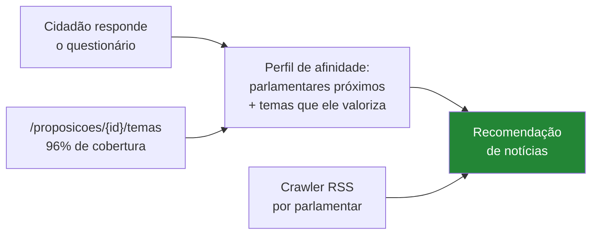
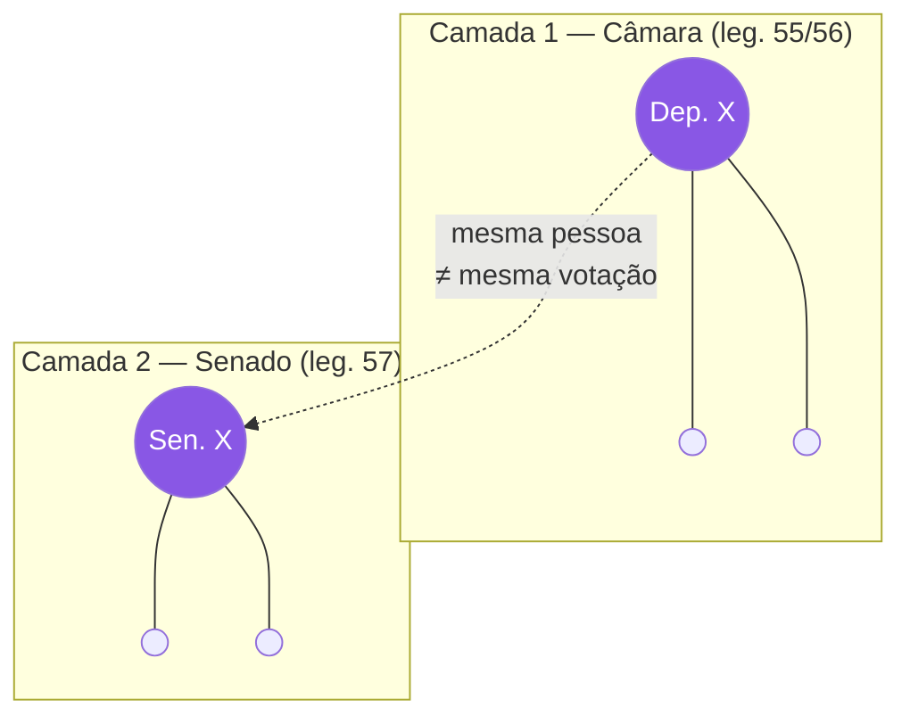

# Poligraph — Documento de Discovery

> ## Título do TCC
>
> **Arquitetura ETL e Modelagem em Grafos para Recomendação de Notícias e Mensuração de
> Afinidade Política em Redes Sociais**
>
> ⚠️ **O título tem consequências que este documento ainda não refletia** — ver §2.1.

> **Status:** rascunho (v0.14)
> **Data:** 2026-08-22
> **Mudanças na v0.2:** volume real medido (seção 4.1.1); achado #6 (CSVs consolidados,
> resolve R4); achado #7 (as duas casas não são comparáveis, seção 4.5); decisão D3
> reescrita — a justificativa da v0.1 estava errada; Senado subiu de F8 para F6.
> **v0.3:** seção 6.1 — rotatividade não exige tabela de mandatos nem base externa;
> partido/UF ficam desnormalizados no voto; R8 rebaixado para Baixo.
> **v0.4:** seções 4.1.2 e 4.1.3 — como chegar na matéria votada (achados #8 a #12);
> 58% das votações nominais são procedimentais; polaridade de "Sim" não é constante;
> seção 7.2 reescrita com o funil real. Documentos institucionais em `01-` e `02-`.
> **v0.5:** seção 7.5 (era 7.4) — viés de seleção das votações nominais (a pergunta mais provável
> da banca); votações simbólicas não trazem nem contagem agregada.
> **v0.6:** seção 4.1.4 — dados de comissão (achado #14: o ponto cego se repete dentro
> da comissão); achado #13 — frentes saem do grafo, comissão em comum entra.
> **v0.7:** achado #15 (seção 4.1.5) — votações de comissão **não** servem como reserva:
> mediana de 29 votos e confundimento com partido. Corrige afirmação da v0.2.
> **v0.8:** seção 4.1.6 — insumos aproveitáveis das comissões; achado #16: **relatoria**
> (4.694 designações, 455 deputados, mediana 7) é o melhor sinal não-votação disponível.
> **v0.9:** achado #15 reescrito — a justificativa da v0.7 ("confundimento com partido")
> estava ERRADA: comissões espelham a casa. O motivo real é que votações de comissão são
> 3x mais consensuais (39% quase-unânimes vs 12%), inflando seletivamente quem as tem.
> **v0.10:** seção 7.4 — ponderação: soma ponderada não resolve o problema das comissões
> (é estrutural, não de magnitude); a versão hierárquica funciona; peso por divisividade
> é onde a ponderação realmente agrega. Antiga 7.4 renumerada para 7.5.
> **v0.11:** título do TCC registrado; seções 2.1 e 2.2 — "Recomendação de Notícias" é
> metade do título mas estava em F8; achado #17 no Senado: 56% das votações são secretas.
> **v0.12:** ✅ **D3 DECIDIDA** (§11.1) — o Senado entra como grafo independente. Cenário C
> escolhido. Senado sai de "fora do MVP" e vira escopo confirmado na F6.
> **v0.13:** A1 resolvida (§4.1.1.1) — série de 2001 a 2026; a legislatura 57 tem 1.103
> votações de plenário e 182 abertas no Senado, o triplo do que eu media com um ano só.
> Achado #18 — 41 dos 81 senadores já foram deputados (ponte temporal entre os grafos).
> §7.4.1 — posições são estáveis na legislatura (r=0,86): não ponderar por recência.
> **v0.14:** §5.1 corrige o número de nós (644, não ~500); §5.2 define a cadência de
> coleta e o achado #19 (CSVs reconstruídos toda madrugada); RQ8 resolvida — "Redes
> Sociais" é o grafo.
> **Objetivo deste documento:** registrar o entendimento do problema, o escopo, as
> fontes de dados (já validadas) e as decisões em aberto, para servir de contexto
> permanente do TCC.

---

## 1. Visão geral

**Poligraph** é uma plataforma que transforma dados públicos do legislativo brasileiro
em uma **rede de relações entre políticos** e permite que um cidadão descubra
**com quais parlamentares ele mais concorda**, com base em votações reais — não em
opinião ou autodeclaração ideológica.

Em uma frase:

> *"Um mapa de afinidade política construído a partir do comportamento real de voto
> de deputados e senadores."*

### Perguntas que o produto responde

| Pergunta | Entregável |
|---|---|
| Com qual político eu mais me pareço? | Questionário de votações reais + ranking de afinidade |
| Quais políticos votam parecido entre si? | Grafo de similaridade + detecção de comunidades |
| O partido explica o voto? | Comparação entre comunidades detectadas e filiação partidária |
| O que estão falando sobre o político X? | Agregador de notícias (crawler) na ficha do parlamentar |

---

## 2. Objetivos

### Objetivo geral

Construir uma plataforma de dados que integre múltiplas fontes públicas do sistema
político brasileiro e derive, a partir do comportamento de voto nominal, medidas de
similaridade entre parlamentares e entre parlamentares e cidadãos.

### Objetivos específicos

1. Projetar e implementar um **pipeline ETL** capaz de ingerir e reconciliar dados de
   três fontes heterogêneas (TSE, Câmara, Senado).
2. Resolver o problema de **entity resolution**: identificar que o mesmo indivíduo
   aparece nas três bases com identificadores diferentes.
3. Modelar o legislativo como um **grafo** com múltiplos tipos de aresta.
4. Implementar e avaliar um **algoritmo de afinidade** entre um vetor de preferências
   do usuário e o histórico de votos dos parlamentares.
5. Coletar, via **crawler**, referências noticiosas associadas a cada parlamentar.
6. Expor tudo em uma aplicação web consultável.

### 2.1 ⚠️ O que o título exige e o roadmap não entregava

O título define quatro entregas de peso igual. Confrontando com o que este documento
planejava:

| Elemento do título | Situação no roadmap | Veredito |
|---|---|---|
| **Arquitetura ETL** | F1–F2, núcleo do trabalho | ✅ Alinhado |
| **Modelagem em Grafos** | F3, núcleo | ✅ Alinhado |
| **Mensuração de Afinidade Política** | F4, núcleo | ✅ Alinhado |
| **Recomendação de Notícias** | **F8 — última fase, "a mais frágil e a menos essencial ao argumento"** | 🔴 **Desalinhado** |

**O crawler estava tratado como enfeite opcional e é metade do título.**

Duas correções decorrem disso:

**1. Prioridade.** Recomendação de notícias precisa subir no roadmap e deixar de ser
"se sobrar tempo". Um TCC que entrega três dos quatro elementos do próprio título tem um
problema difícil de contornar na defesa.

**2. Escopo — "recomendação" ≠ "agregação".** O documento
[arq/20-crawler-noticias.md](arq/20-crawler-noticias.md) descreve explicitamente um
**agregador**: *"não é análise de sentimento… o valor entregue é modesto: uma lista de
links"*. Isso **não é um sistema de recomendação**. Recomendar implica personalizar: usar
o perfil do usuário para escolher o que mostrar.

→ **A boa notícia é que as duas metades do título se encaixam naturalmente**, e o dado
para isso já existe:



Cada pergunta do questionário já carrega **temas oficiais** (achado #10). As respostas do
usuário, portanto, revelam não só *com quem* ele concorda, mas *sobre o que* ele se
importa. Isso é exatamente o insumo de um recomendador — e fecha o arco entre "Afinidade"
e "Recomendação de Notícias" que o título propõe.

⚠️ **Pendência nova (RQ7):** definir o mecanismo de recomendação — por parlamentar afim,
por tema de interesse, ou híbrido — e como avaliá-lo. Sem métrica de avaliação, "recomendação"
vira "listagem filtrada".

### 2.2 "Redes Sociais" — ambiguidade a resolver

O título termina em *"em Redes Sociais"*, e o termo é ambíguo em português:

| Leitura | Significa | Consistência com o resto |
|---|---|---|
| **Rede social como grafo** (análise de redes) | A rede de parlamentares que o projeto modela | ✅ Coerente com "Modelagem em Grafos" e com o pedido original ("rede social de políticos") |
| **Rede social como plataforma** (X, Instagram…) | Coletar e analisar posts de parlamentares | ⛔ Fora de tudo que foi planejado; APIs fechadas/pagas |

✅ **RESOLVIDO — 2026-08-23 (RQ8).** Confirmado pelo autor: **é o grafo**. O projeto **não**
coleta nem analisa conteúdo de plataformas.

E o sentido é duplo, o que reforça a escolha:

1. **Rede social como estrutura analítica** — o grafo de similaridade entre parlamentares.
2. **Rede social como produto** — páginas por político, com a possibilidade de **seguir**
   (RF-42) e acompanhar notícias. Ver
   [arq/30-pagina-do-parlamentar.md](arq/30-pagina-do-parlamentar.md).

→ As duas leituras convergem, e nenhuma delas envolve X, Instagram ou Facebook como fonte.

*(Nota: a API da Câmara expõe `redeSocial[]` por deputado — perfis oficiais, com 64% de
cobertura. Serve no máximo para **linkar** a partir da ficha, nunca como fonte de dado.
O Senado não expõe nada equivalente.)*

---

## 3. Escopo

### Dentro do MVP

- Câmara dos Deputados como fonte primária (57ª legislatura, 2023–2026).
- Votações **nominais** de plenário.
- Cálculo de similaridade parlamentar ↔ parlamentar.
- Questionário de afinidade cidadão ↔ parlamentar.
- Grafo com layout e comunidades.
- Ficha individual do parlamentar.

- **Senado Federal** — ✅ **decidido em 2026-08-22 (D3)**: entra como **grafo
  independente**, com as 56 votações abertas por ano. Ver §11.1. Entregue na F6, depois
  de a fatia da Câmara estar fechada.

### Fora do MVP (fases posteriores)

- TSE (enriquecimento: bens declarados, histórico de candidaturas, votação recebida).
- Crawler de notícias.
- Análise de despesas (cota parlamentar).
- Assembleias estaduais / câmaras municipais.

### Explicitamente fora

- Qualquer juízo de valor sobre parlamentares ("bom"/"ruim", ranking de qualidade).
- Recomendação de voto. **Ver risco R7.**

---

## 4. Fontes de dados

> Todos os endpoints abaixo foram testados em **2026-08-22**. Os achados marcados com
> ⚠️ são armadilhas reais já observadas, não hipóteses.

### 4.1 Câmara dos Deputados — `https://dadosabertos.camara.leg.br/api/v2`

REST, JSON, sem autenticação, paginação por `?pagina=&itens=` com `links[rel=next|last]`.
É a fonte **mais rica e mais confiável** das três.

| Endpoint | Uso no projeto |
|---|---|
| `/deputados?siglaUf=&idLegislatura=` | Lista de parlamentares |
| `/deputados/{id}` | Detalhe: **`cpf`**, `nomeCivil`, `dataNascimento`, `redeSocial[]` |
| `/votacoes?dataInicio=&dataFim=` | Lista de votações |
| `/votacoes/{id}/votos` | Voto individual de cada deputado |
| `/proposicoes/{id}/autores` | Aresta de **coautoria** |
| `/deputados/{id}/frentes` | Aresta de **frente parlamentar em comum** |
| `/deputados/{id}/ocupacoes` | Histórico profissional |
| `/deputados/{id}/despesas?ano=&mes=` | Cota parlamentar (fase futura) |

**Formato do voto:**

```json
{
  "tipoVoto": "Sim",
  "dataRegistroVoto": "2025-04-29T21:27:59",
  "deputado_": { "id": 223128, "siglaPartido": "PSD", "siglaUf": "PR" }
}
```

Domínio observado de `tipoVoto`: `Sim`, `Não`, `Abstenção`, `Obstrução`, `Artigo 17`.

⚠️ **Achado crítico #1 — votações simbólicas.** A maioria das votações **não tem voto
nominal**. `/votacoes/{id}/votos` retorna `{"dados": []}` para elas. Em uma amostra de
40 votações (mar–abr/2025), apenas ~5 eram nominais; as nominais têm 350–400 votos.
*Consequência:* o volume útil é muito menor do que a lista de votações sugere. O ETL
precisa filtrar, e o tamanho do questionário depende disso.

⚠️ **Achado crítico #2** — `/votacoes/{id}/votos` **não aceita o parâmetro `itens`**
(retorna HTTP 400). Devolve a lista completa de uma vez.

⚠️ **Achado #3** — o `id` de votação é uma string composta (`"2456731-84"`), não um
inteiro. Modelar como `varchar`.

✅ **Achado #6 — existem arquivos CSV consolidados por ano.** Este achado **elimina a
necessidade de varrer a API votação por votação** (o problema N+1 que motivava o risco
R4):

```
https://dadosabertos.camara.leg.br/arquivos/{dataset}/csv/{dataset}-{ano}.csv
```

Datasets confirmados: `votacoes`, `votacoesVotos`, `votacoesObjetos`, `proposicoes`.
O `votacoesVotos-2025.csv` tem ~58 MB e já vem no formato exato da tabela `voto`:

```
"idVotacao";"uriVotacao";"dataHoraVoto";"voto";"deputado_id";"deputado_nome";
"deputado_siglaPartido";"deputado_siglaUf";"deputado_idLegislatura";...
```

**Consequência para a arquitetura:** o extrator da Câmara deve usar **CSV anual como
carga base** e a **API só para o ano corrente / incremental**. Isso derruba o tempo de
ingestão de horas para minutos.

### 4.1.1 Volume real medido (ano de 2025)

| Métrica | Câmara | Senado |
|---|---|---|
| Votações **totais** no ano | 13.825 | — |
| Votações **nominais** (com voto individual) | **526** | **128** |
| Taxa de nominais | **3,8 %** | — |
| Parlamentares distintos que votaram | 552 * | 84 * |
| Registros de voto individual | ~167.000 | ~10.400 |

\* Acima de 513 e de 81 por causa de suplentes, licenças e substituições ao longo do ano
— evidência concreta do risco R8.

Distribuição das 526 votações nominais da Câmara por órgão:
**PLEN 410**, CCJC 49, CSPCCO 18, CE 18, CMADS 9, CFT 5, demais comissões ~17.

→ Isso **quantifica o risco R1**: apenas 3,8% das votações são nominais. Ainda assim,
**410 votações de plenário** em um único ano é volume mais que suficiente para a matriz.

⚠️ As 116 votações de comissão **não** servem como reserva — ver achado #15 na seção
4.1.5.

**Domínio real de `voto` medido no CSV de 2025:**

| Valor | Ocorrências |
|---|---|
| `Sim` | 96.839 |
| `Não` | 68.923 |
| *(vazio)* | 421 |
| `Artigo 17` | 401 |
| `Obstrução` | 375 |
| `Abstenção` | 336 |

⚠️ Note a assimetria: `Sim` + `Não` são 99,3% dos registros **em 2025**. ⚠️ Na legislatura
inteira são **98,7%** — obstrução foi bem maior em 2023 (2,50%), ver
[04-contratos §6.1](04-contratos.md). Abstenção, obstrução e
Artigo 17 são estatisticamente irrelevantes — o que **simplifica muito** a decisão de
normalização da seção 6. Tratá-los como `null` (fora do cálculo) muda quase nada no
resultado e é a escolha mais fácil de defender.

⚠️ Note também o valor **vazio** (421 casos), não documentado. Tratar como `null`.

### 4.1.1.1 ✅ Pendência A1 resolvida — cobertura histórica

Todas as medições anteriores usaram **apenas 2025**. Verificada a série completa:

**Câmara — `votacoesVotos-{ano}.csv` disponível de 2001 a 2026:**

| Ano | Arquivo | Votações nominais | Das quais no plenário | Votos |
|---|---|---|---|---|
| 2023 | 40,8 MB | 447 | **300** | 128.679 |
| 2024 | 36,9 MB | 448 | **273** | 116.400 |
| 2025 | 55,5 MB | 526 | **410** | ~167.000 |
| 2026 * | 16,0 MB | 149 | **120** | 50.581 |
| **57ª legislatura** | ~150 MB | **1.570** | **1.103** | **~463.000** |

\* 2026 em curso (dados até agosto).

Anos anteriores também disponíveis: 2022 (62,6 MB), 2021 (102,3 MB), 2020 (50,7 MB),
2019 (38,4 MB), 2015 (35,8 MB), 2011 (10,5 MB), 2003 (3,9 MB). A série começa em **2001**;
1999 e anteriores não existem.

**Senado — `/votacao` funciona para todos os anos testados:**

| Ano | Votações | Secretas | **Abertas** |
|---|---|---|---|
| 2023 | 141 | 91 | **50** |
| 2024 | 95 | 37 | **58** |
| 2025 | 128 | 72 | **56** |
| 2026 * | 57 | 39 | **18** |
| **57ª legislatura** | 421 | 239 | **182** |

Anteriores: 2022 (82 abertas), 2021 (137), 2019 (61).

#### Por que isso muda o dimensionamento do projeto

| | Antes (só 2025) | **Legislatura inteira** |
|---|---|---|
| Câmara — votações de plenário | 410 | **1.103** |
| Senado — votações abertas | 56 | **182** |

→ **O Senado triplica**, e isso melhora diretamente a precisão apontada no §2.5 do
[11-api-senado](11-api-senado.md): com ~182 votações em vez de 56, a sobreposição típica
por par sobe na mesma proporção, e o intervalo de confiança encolhe de ~±17 pp para a
casa de ~±10 pp. **A fragilidade do Senado era em boa parte artefato de eu ter medido um
ano só.**

⚠️ **Custo:** ~150 MB de CSV para a Câmara na legislatura 57. Trivial para processar, mas
reforça a decisão de **não versionar os brutos no Git** (pendência B5).

⚠️ **Regra que permanece:** a matriz é sempre filtrada por **legislatura** (RN-12).
Misturar legislaturas mistura populações diferentes de parlamentares.

### 4.1.2 O que está sendo votado — como chegar na matéria

Sim, dá para saber. Mas o caminho óbvio é uma armadilha.

**Como a votação se liga à matéria** — `GET /api/v2/votacoes/{id}` traz três campos
relevantes, e eles **não** são equivalentes:

| Campo | O que é | Serve? |
|---|---|---|
| `proposicoesAfetadas` | A proposição de verdade (o PL/PEC em questão) | ✅ **É este** |
| `objetosPossiveis` | Tudo que estava em pauta, incluindo requerimentos | ⚠️ Ruidoso, N por votação |
| `ultimaApresentacaoProposicao.uriProposicaoCitada` | O último ato processual | ⛔ **Armadilha** |

⚠️ **Achado #8 — `uriProposicaoCitada` não aponta para o projeto.** No exemplo testado
(votação `2456731-84`), esse campo levava à proposição `2499908`, que é um **PPP —
"Parecer Proferido em Plenário"**, com `ementa` sendo o texto burocrático da leitura do
parecer e `keywords: null`. O projeto real (PL 3469/2024, sobre incêndios florestais e
Código Brasileiro de Aeronáutica) só aparece em `proposicoesAfetadas`. Quem seguir o
link mais óbvio monta um questionário de pareceres.

✅ **Achado #9 — o prefixo do `idVotacao` é o id da proposição.** O id `2456731-84`
decompõe em proposição `2456731` + sequencial `84`. Testado em amostra de 30 prefixos
distintos: **30/30 resolveram** para uma proposição real, com tipos
PL (23), PLP (3), PEC (3), REQ (1). Isso permite ligar votação → matéria **sem
chamada extra à API**, direto do CSV.

✅ **Achado #10 — existe classificação temática oficial.** `GET /proposicoes/{id}/temas`
retorna vocabulário controlado. Cobertura medida em 25 proposições: **24 têm ao menos um
tema** (12 com 1, 9 com 2, 3 com 3). Vocabulário observado: *Educação, Administração
Pública, Direitos Humanos e Minorias, Previdência e Assistência Social, Direito Penal e
Processual Penal, Defesa e Segurança, Trabalho e Emprego, Saúde, Meio Ambiente,
Economia, Finanças Públicas e Orçamento, Relações Internacionais, Comunicações,
Agricultura...*

→ Isso resolve de graça o critério de **cobertura temática** da seção 7.2, que eu havia
proposto fazer na mão. Não precisa classificar nada: o dado já vem classificado.

O CSV `votacoesObjetos-2025.csv` (45 MB) traz `proposicao_ementa`, `proposicao_titulo`,
`siglaTipo`, `numero`, `ano` — mas é o equivalente de `objetosPossiveis`: **várias linhas
por votação**, muitas delas requerimentos de urgência e de retirada de pauta. Útil, desde
que filtrado.

### 4.1.3 ⚠️ Achado crítico #11 — a maioria das votações nominais é procedimental

Classificando as **526 votações nominais de 2025** pela `descricao`:

| Categoria | Qtd | % |
|---|---|---|
| **Requerimentos e incidentes processuais** (urgência, retirada de pauta, adiamento, recurso, preferência) | **307** | 58,4 % |
| **Destaques** ("Mantido o texto" / "Suprimido o texto") | 74 | 14,1 % |
| **Substantivas** (projeto, substitutivo, emenda, parecer, MP, turnos) | **145** | 27,6 % |

As 145 substantivas cobrem **100 proposições distintas** em 2025.

**Duas consequências, e elas apontam para lados opostos:**

1. **Para o questionário (7.2): filtro obrigatório.** Perguntar a um cidadão se ele
   aprova o "Requerimento de Retirada de Matéria da Pauta do PL 3469/2024" é inútil. O
   pool real não é 526 — é ~145 votações sobre ~100 matérias por ano. Na legislatura
   inteira (2023–2026), algo entre 300 e 400 matérias. **Continua sobrando muito** para
   um questionário de 15–25 perguntas.

2. **Para a matriz de similaridade (7.1): NÃO filtrar.** Requerimento de urgência é um
   dos sinais **mais limpos** de alinhamento governo × oposição que existe — quem quer
   pautar e quem quer travar. Jogar 58% dos dados fora empobreceria a matriz.

→ **Regra:** são dois recortes diferentes sobre a mesma tabela. `voto` guarda tudo;
`votacao` ganha uma coluna `categoria` (`PROCEDIMENTAL` | `DESTAQUE` | `SUBSTANTIVA`)
derivada por regex na `descricao` no estágio silver. O questionário filtra por ela; a
matriz de similaridade, não.

⚠️ **Achado #12 — a polaridade de `Sim` não é constante.** Nos 74 destaques, a descrição
é *"Mantido o texto"*: votar **Sim mantém o dispositivo**, ou seja, **rejeita** o
destaque que queria removê-lo. O sentido político de "Sim" se inverte em relação à
intenção de quem apresentou o destaque. O mesmo vale para requerimentos de retirada de
pauta. → Cada votação usada no questionário precisa de um campo
**`polaridade` atribuído manualmente** (+1/−1), mapeando "Sim" para "a favor da medida".
Sem isso o ranking de afinidade fica silenciosamente errado em ~14% dos casos.

### 4.2 Senado Federal — `https://legis.senado.leg.br/dadosabertos`

JSON disponível, mas com **estrutura herdada de XML** (envelopes aninhados como
`ListaParlamentarEmExercicio.Parlamentares.Parlamentar[]`) — desserialização mais chata
que a da Câmara.

| Endpoint | Situação |
|---|---|
| `/senador/lista/atual` | ✅ Funciona. Envelope aninhado. |
| `/votacao?dataInicio=YYYY-MM-DD&dataFim=YYYY-MM-DD` | ✅ **Usar este.** Array plano. |
| `/plenario/lista/votacao/{AAAAMMDD}` | ⛔ **Depreciado** — desativação anunciada para 2026-02-01. |

⚠️ **Achado crítico #4.** O endpoint antigo de votações do Senado está formalmente
depreciado (o próprio payload traz um bloco `Descontinuacao` apontando o substituto).
Boa parte dos tutoriais e trabalhos anteriores na internet ainda usa o endpoint velho.
**Usar `/votacao`.**

O `/votacao` novo retorna linhas achatadas — uma linha por parlamentar por votação —
com `codigoParlamentar`, `nomeParlamentar`, `siglaVotoParlamentar`,
`siglaPartidoParlamentar`, `codigoMateria`, `descricaoVotacao`, `resultadoVotacao`.
Formato conveniente: já é praticamente a tabela final do ETL.

### 4.3 TSE — `https://dadosabertos.tse.jus.br` / `https://cdn.tse.jus.br`

Não é API: são **arquivos CSV em ZIP**, por ano e por UF. Datasets relevantes:
`consulta_cand` (candidaturas), `bem_candidato` (patrimônio declarado),
`votacao_candidato_munzona` (votos recebidos), prestação de contas.

⚠️ **Achado crítico #5 — bloqueio de acesso automatizado.** Tanto o portal quanto o CDN
retornaram **HTTP 403** para requisições via `curl`, inclusive com User-Agent de
navegador. O download precisará ser feito manualmente pelo navegador (ou por um cliente
que replique sessão/headers). *Consequência:* o TSE **não pode ser tratado como fonte
incremental automatizada** no MVP. ⚠️ **REVISADO em 2026-08-23** — ver §2 do [12-fonte-tse](12-fonte-tse.md): o TSE É automatizável. O texto abaixo virou plano B. ~~Planejar como carga manual versionada: baixar uma
vez, versionar o arquivo bruto, e o ETL lê do disco.

Características dos CSVs do TSE: encoding **Latin-1 (ISO-8859-1)**, separador `;`,
campos entre aspas, datas em `dd/MM/yyyy`, arquivos de centenas de MB.

### 4.4 Chave de integração entre as fontes

Este é **o problema técnico central do ETL** e um bom ponto de argumentação no TCC.

```
TSE (NR_CPF_CANDIDATO) ──── CPF ────> Câmara (/deputados/{id}.cpf)      chave forte
TSE (NM_CANDIDATO + DT_NASCIMENTO + SG_UF) ── fuzzy ──> Senado          chave fraca
```

- A Câmara **expõe o CPF** no detalhe do deputado → join determinístico com o TSE.
- O Senado **não expõe CPF** com facilidade → fallback por `NomeCompletoParlamentar`
  normalizado + UF + data de nascimento, com verificação manual dos casos ambíguos
  (são só ~81 senadores; é viável conciliar à mão).
- Nomes de urna são instáveis entre eleições ("Tiririca", "Professor X") — nunca usar
  nome de urna como chave.
- **Decisão:** criar uma tabela `pessoa` com **ID sintético próprio** e uma tabela
  `pessoa_fonte_id` mapeando `(pessoa_id, fonte, id_externo)`. Todas as demais tabelas
  referenciam o ID interno, nunca o ID da fonte.

### 4.1.4 Dados de comissão — o que existe e o que não existe

Como decisões em **caráter conclusivo** viram lei sem passar pelo plenário (ver
[01-camara §5.2](01-camara-dos-deputados.md)), é legítimo perguntar se a base cobre isso.
Verificação:

| O que | Disponível? | Detalhe |
|---|---|---|
| Cadastro das comissões | ✅ | `/orgaos?codTipoOrgao=2` — 30 permanentes; `orgaos.csv` em massa |
| **Composição, com vigência** | ✅ | `/orgaos/{id}/membros` → `titulo` (Titular/Suplente), `dataInicio`, `dataFim` |
| Órgãos de um deputado | ✅ | `/deputados/{id}/orgaos` |
| **Votações nominais de comissão** | ✅ | 📊 **116 em 2025** — já estão no mesmo `votacoesVotos.csv`, basta filtrar `siglaOrgao ≠ PLEN` |
| Tramitação completa | ✅ | `proposicoesTramitacoes-{ano}.csv` — 📊 169 mil linhas em 2025, com `siglaOrgao`, `regime`, `descricaoTramitacao`, `despacho` |
| **Quais proposições seguem o rito conclusivo** | ✅ | 📊 **703 despachos** em 2025 mencionam "apreciação conclusiva" |
| **Quem votou o quê nas decisões conclusivas** | ⛔ **Na maioria, não** | Ver abaixo |

⚠️ **Achado #14 — o ponto cego se repete dentro da comissão.** Comissão também decide por
**votação simbólica**. Das decisões de comissão em 2025, apenas **116 foram nominais**
(CCJC 49, CSPCCO 18, CE 18, CMADS 9, CFT 5, demais ~17). Para as outras, sabe-se **que** a
comissão aprovou, não **quem** votou.

⚠️ E a aprovação conclusiva **não tem rótulo próprio** na tramitação: não existe
`descricaoTramitacao = "Aprovado em caráter conclusivo"`. As 703 ocorrências de
"apreciação conclusiva" estão no campo `despacho` — são o **despacho de distribuição** que
autoriza o rito, não o registro da decisão. Reconstruir o evento exigiria inferir pela
sequência de tramitações. Marcador auxiliar: só **26** "Apresentação de Recurso" em 2025
(recurso ao plenário é a contrapartida do rito conclusivo).

→ **Conclusão parcial:** dá para **detectar que uma proposição seguiu o caminho
conclusivo**. Não dá para recuperar o voto individual da maioria dessas decisões. A
limitação da seção 7.5 continua valendo.

### 4.1.5 ⚠️ Achado #15 — as votações de comissão NÃO servem como reserva

⚠️ **Correção de uma afirmação anterior deste documento.** A v0.2 dizia que "sobram ~116
votações de comissão como reserva" para engordar a matriz. **A medição desmente isso.**

| | Votações | Votos por votação (mediana) | Mín–Máx |
|---|---|---|---|
| **Plenário** | 410 | **405** | 127–494 |
| **Comissões** | 116 | **29** | 10–66 |

Uma votação de comissão registra o voto de **~29 deputados**, não de 400 — porque só os
**membros daquela comissão** votam. Ao todo, 345 dos 552 deputados aparecem em ao menos
uma votação de comissão.

**Sim, eles votam de verdade nas comissões.** O voto é real e registrado. O problema não é
a legitimidade do voto — é o que acontece ao **misturá-lo na mesma matriz** dos votos de
plenário.

⚠️ **Correção de uma afirmação anterior.** Uma versão deste documento dizia que o problema
era *"confundimento com partido: participar da mesma comissão é correlacionado com ser do
mesmo partido"*. **Isso está errado.** A composição das comissões é distribuída por
**proporcionalidade partidária**, o que faz cada comissão ser um **espelho da casa**, não
um agrupamento partidário. Medido na CCJC:

| Partido | CCJC | Câmara |
|---|---|---|
| PL | 19 % | 17 % |
| PT | 15 % | 12 % |
| UNIÃO | 14 % | 12 % |
| PP | 10 % | 10 % |

Distribuição praticamente idêntica. **Co-participação em comissão não prediz partido.**

**O problema real é outro — e a medição o revela:**

📊 **Votações de comissão são muito mais consensuais que as de plenário:**

| | Maioria média | >85% de um lado | >95% de um lado |
|---|---|---|---|
| **Plenário** (409) | 56,9 % | 12 % | 8 % |
| **Comissões** (116) | **68,8 %** | **39 %** | **24 %** |

Quase **quatro em cada dez** votações de comissão são praticamente unânimes, contra pouco
mais de uma em dez no plenário. Faz sentido institucionalmente: comissão é trabalho
técnico, conduzido pelo relator, com muito menos disputa aberta.

**Por que isso quebra a matriz:**

1. **Esparsidade extrema.** Para uma votação de comissão, ~520 dos 552 deputados têm
   `null`. Não é uma coluna a mais — é uma coluna quase vazia.
2. 🔴 **Inflação seletiva de similaridade.** Dois deputados da mesma comissão ganham dezenas
   de votações em comum, e essas votações **concordam entre si com muito mais frequência**.
   Dois deputados de comissões diferentes ganham **zero**.

   → A similaridade de quem compartilha comissão sobe **por um mecanismo administrativo**,
   não político. Quem senta na CCJC (49 votações no ano) recebe um empurrão grande; quem
   senta na CFT (5 votações) quase nada. **O artefato é por deputado**, e depende de qual
   comissão calhou de ele ocupar e de quão movimentada ela foi.
3. 🔴 **No grafo, isso vira um bloco falso.** Os membros da CCJC apareceriam como um
   agrupamento coeso — e alguém interpretaria isso como bloco político. Não é: é resíduo
   de composição de comissão. Como as comissões espelham a casa em partido, esse falso
   bloco seria **transpartidário**, ou seja, contaminaria justamente a análise de
   comunidades × partido (RF-20) na direção de *"o partido não explica o voto"*.
4. **Também não ajudam o questionário.** Uma pergunta vinda de votação de comissão só
   permite comparar o cidadão com os ~29 deputados que votaram. Os outros 523 ficam de
   fora daquela pergunta.

→ **Decisão: votações de comissão ficam FORA da matriz principal de similaridade.**

**Usos legítimos, em outro escopo:**

| Uso | Vale a pena? |
|---|---|
| Similaridade **dentro** de uma comissão (matriz própria, 29 × 49) | ✅ Sim — análise à parte, comparável entre comissões |
| Medir participação/assiduidade em comissão | ✅ Sim — atributo do nó |
| Aresta "comissão em comum" | ✅ Sim — mas como **co-participação**, não como voto |
| Engordar a matriz principal | ⛔ **Não** — confundimento |

→ **Consequência para o R1:** a base real da matriz principal é **410 votações de
plenário** por ano, não 526. Continua sendo volume confortável (mediana de 329 votos por
deputado já foi medida sobre esse universo), mas a "reserva" de 116 não existe.

### 4.1.6 ⭐ O que as comissões oferecem de aproveitável

O achado #15 descartou apenas **um** uso das comissões — o voto na matriz principal. As
comissões continuam sendo uma das fontes mais ricas do projeto, por outras vias.

| # | Insumo | Como se obtém | Valor |
|---|---|---|---|
| 1 | **Relatoria** | `proposicoesTramitacoes` → `descricaoTramitacao = "Designação de Relator(a)"` | ⭐⭐ **O melhor** |
| 2 | Aresta comissão em comum | `/orgaos/{id}/membros` | ⭐⭐ Substitui frentes |
| 3 | Cargo na mesa da comissão | `titulo` em `/orgaos/{id}/membros` | ⭐ Poder e senioridade |
| 4 | Especialização temática | comissões do deputado → temas | ⭐ Atributo do nó |
| 5 | Similaridade **intra**-comissão | matriz própria por comissão | ⭐ Análise à parte |
| 6 | Participação em comissão | votos de comissão / votações da comissão | 🟡 Engajamento |
| 7 | Rito conclusivo | 703 despachos em 2025 | 🟡 Cobertura |
| 8 | Comissões especiais de PEC/PL, CPIs | `siglaOrgao` padrão `PEC…`/`PL…`; `codTipoOrgao=4` | 🟡 Engajamento por tema |

#### ⭐ Achado #16 — relatoria é o melhor sinal não-votação disponível

**Medido em 2025:** 4.694 designações de relator, distribuídas entre **455 deputados**.

| Estatística | Relatorias por deputado |
|---|---|
| Mediana | **7** |
| Média | 10 |
| Máximo | 133 |

Compare com frentes (mediana perto da saturação, 99% para um deputado): **relatoria
discrimina**. É trabalho atribuído, não assinatura de cortesia.

**Formato do dado** — o nome vem no campo `despacho`, parseável por regex:

```
descricaoTramitacao = "Designação de Relator(a)"
siglaOrgao          = "CDHMIR"
despacho            = "Designado Relator, Dep. Tadeu Veneri (PT-PR)"
uriProposicao       = ".../proposicoes/105012"
```

⚠️ O nome vem como **texto livre** (`Dep. Nome (PARTIDO-UF)`), não como id. É preciso
casar com `deputado_id` — mas nome + partido + UF resolve com boa precisão, e a fila de
exceção pega o resto.

⚠️ `/proposicoes/{id}/relatores` **não existe** (HTTP 405). O caminho é pela tramitação.
Alternativa parcial: `ultimoStatus_uriRelator` no `proposicoes-{ano}.csv` — mas cobre só o
relator **atual** (13.792 de 114.906 proposições ≈ 12%), sem histórico.

**Por que relatoria vale tanto:**

1. **Perfil temático revelado.** `relatoria → proposição → /temas` dá a especialização de
   cada deputado a partir do que ele **efetivamente trabalhou** — independente do voto e
   independente de autodeclaração. É a única fonte desse tipo no projeto.
2. **Sinal de confiança da liderança.** Relator é designado pelo presidente da comissão. É
   um cargo de poder real — o relator reescreve o texto. Quem relata muito, e sobre o quê,
   é informação política densa.
3. **Validação independente dos eixos do SVD.** Se o eixo 1 do SVD separar parlamentares
   que relatam matérias de meio ambiente dos que relatam segurança pública, você tem
   **corroboração por fonte independente** — o tipo de checagem que fortalece muito a
   seção de resultados.
4. **Contexto para o questionário.** Mostrar "relatado por Dep. X" ao lado da pergunta
   enriquece sem custo.

#### Cargos na mesa da comissão

`/orgaos/{id}/membros` traz `titulo` com hierarquia real. Medido na CCJC:

| Título | Qtd |
|---|---|
| Titular | 48 |
| Suplente | 48 |
| Presidente | 1 |
| 1º / 2º / 3º Vice-Presidente | 1 cada |

→ Presidir a CCJC ou a CFT é das posições mais disputadas da casa. Como atributo de nó
(senioridade / poder), é barato de extrair e informativo.

#### Similaridade intra-comissão

As votações de comissão **não** servem na matriz principal (achado #15), mas servem em
**matriz própria, por comissão**: dentro da CCJC, todos os 96 membros enfrentam as mesmas
49 votações — não há esparsidade nem inflação seletiva, porque a população é fechada e
todo mundo recebe o mesmo tratamento.

→ É a mesma medida aplicada a um universo homogêneo. O que invalida a mistura (uns ganham
votações extras, outros não) desaparece quando o recorte é a própria comissão.

→ Permite perguntar *"qual comissão é a mais polarizada?"* e comparar coesão entre
comissões. É uma análise pequena e autocontida — boa candidata a seção extra se sobrar
tempo.

### 4.5 ⚠️ Achado crítico #7 — as duas casas não são comparáveis entre si

Este é o achado que mais afeta o desenho do produto, e o motivo real da decisão D3.

**Deputados e senadores não votam as mesmas votações.** Cada casa vota suas próprias
matérias, em textos e momentos diferentes. Verificações:

- No CSV da Câmara de 2025, o campo `siglaOrgao` das votações nominais contém apenas
  plenário da Câmara e comissões da Câmara. **Nenhuma ocorrência de `CN`**
  (Congresso Nacional).
- No `/votacao` do Senado em 2025, `casaSessao` é **`SF` em 100% das 128 votações**.
  Nenhuma sessão conjunta.

→ Ou seja: **as sessões conjuntas do Congresso Nacional (vetos, orçamento), que seriam
a única ponte natural entre as casas, não aparecem em nenhuma das duas fontes.**

**Consequências diretas:**

1. Não existe uma matriz `P × V` única. A similaridade só é calculável **dentro** de
   cada casa.
2. O grafo tem **dois componentes desconexos** — deputados de um lado, senadores do
   outro. Não é um grafo do "Congresso"; são dois grafos.
3. O questionário do cidadão precisaria ser **dois questionários** (um por casa), ou
   dar match contra apenas uma das casas.

#### ⭐ Achado #18 — existe uma ponte, mas ela é temporal, não sincrônica

**Metade do Senado já foi deputado.** Cruzando `NomeCompletoParlamentar` dos 81 senadores
em exercício com o `nomeCivil` da base histórica de deputados (7.853 nomes):

> **41 dos 81 senadores (51%) aparecem também como deputados.**

Exemplos: Alan Rick Miranda, Ciro Nogueira Lima Filho, David Alcolumbre, Esperidião Amin,
Eliziane Gama, Flávio Arns, Confúcio Moura…

⚠️ *Match por nome civil completo; homônimos são improváveis mas a conferência final deve
usar data de nascimento (ver [13-correlacao](13-correlacao-entre-fontes.md) §4.2).*

**O que isso é — e o que não é:**

| | |
|---|---|
| ⛔ **NÃO** resolve o achado #7 | Continua impossível comparar um deputado **em exercício** com um senador **em exercício** — eles não votam as mesmas matérias |
| ✅ **É** uma ponte de **identidade**, não de votação | A mesma `pessoa` tem nó nos dois grafos, em **períodos diferentes** |
| ✅ **É** uma estrutura de **rede multicamada** | Nós presentes em duas camadas são exatamente o *coupling link* da literatura de redes multiplex |



**A pergunta de pesquisa que isso habilita** — e é boa:

> *A posição política de um parlamentar muda quando ele passa da Câmara para o Senado?*

É testável e teoricamente motivada: o Senado tem mandato de 8 anos, eleição majoritária e
**mandato que pertence à pessoa, não ao partido** ([02-senado §2.1](02-senado-federal.md)).
A hipótese natural é que a mesma pessoa se torne **mais independente da bancada** ao mudar
de casa. Com 41 casos, há amostra para testar.

⚠️ **Custo de escopo:** exige ingerir as legislaturas **55 e 56** da Câmara (2015–2022)
para ter os votos da fase de deputado. Isso é viável — os CSVs existem (§4.1.1.1) —, mas
**expande o ETL** para além da 57ª legislatura.

→ **Recomendação: registrar como F9 / trabalho futuro.** É um resultado atraente, mas
depende de F1–F6 estarem fechadas e de ingestão histórica adicional. Não colocar no
caminho crítico.

#### ⭐ Achado #21 — a CPMI **é** votação compartilhada, mas ninguém publica

Levantamento correto e importante: uma **Comissão Parlamentar Mista de Inquérito** reúne
deputados **e** senadores, que votam **juntos, na mesma matéria** — requerimentos de
convocação, quebras de sigilo, relatório final. Institucionalmente, **é exatamente a ponte
que o achado #7 diz não existir.**

Fui verificar. Resultado em 2026-08-23:

| Verificação | Resultado |
|---|---|
| CPMI existe como órgão na API da Câmara? | ✅ **Sim** — `CPMI8JAN`, id 102648, `codTipoOrgao=20` |
| Quantas votações a API retorna para ela? | ⛔ **0** (`/votacoes?idOrgao=102648`) |
| CPMI aparece nos CSVs de votação? | ⛔ **0 linhas** em 2023 e 2025 |
| Senado publica sessão mista? | ⛔ `casaSessao` = **`SF` em 100%**, nos 4 anos |

**Todos os órgãos com votação nominal na Câmara (2023 + 2025):**

```
PLEN 710 · CCJC 154 · CE 23 · CSPCCO 20 · CPIMST 9 · CPASF 9 · CMADS 9
CFT 7 · CPIFUTE 5 · CMULHER 4 · CAPADR 4 · CDC 3 · CCULT 3 · CICS 2
```

⚠️ **`CPIMST` e `CPIFUTE` enganam pela sigla.** Confirmado na API: são
*"Comissão Parlamentar de **Inquérito**"* — **CPI, de uma casa só**. Não são mistas.

→ **Nenhum registro de votação de CPMI existe em nenhuma das duas fontes.**

#### Por que isso torna o achado #7 mais forte, não mais fraco

Antes, o argumento era institucional: nas sessões de veto os votos são **apurados
separadamente por casa**, então nem lá existe colégio único. Agora há um segundo caso, de
natureza diferente:

| Caso | O colégio é único? | O dado existe? |
|---|---|---|
| Sessão conjunta (veto, orçamento) | ⛔ Não — apuração por casa | ⛔ Não publicado |
| **CPMI** | ✅ **Sim — votam juntos de verdade** | ⛔ **Não publicado** |

> 🔑 **A ponte existe na instituição e não existe no dado.** Não é limitação conceitual —
> é lacuna de transparência.

⭐ **Isso é material direto para a seção de discussão do TCC**, e reforça o mapeamento de
§3.0.2 do [10-api-camara](10-api-camara.md): há um lugar onde deputados e senadores
efetivamente votam o mesmo, e **o registro nominal simplesmente não é publicado**.

⚠️ **Se algum dia for publicado**, é por ali que a unificação dos dois grafos passaria a
ser possível — e o volume seria pequeno (poucas dezenas de votações por CPMI), mas
suficiente para uma ponte real. **Registrado no checklist:** [REVISAR-ANTES-DA-CONCLUSAO.md](REVISAR-ANTES-DA-CONCLUSAO.md), item 1.

**Alternativas para ligar as casas** (nenhuma no MVP):

| Abordagem | Viabilidade |
|---|---|
| Casar a mesma proposição votada nas duas casas (PL aprovado na Câmara e depois no Senado) | Possível, mas os textos votados diferem (emendas, substitutivos) e as datas são distantes. Comparação frágil |
| Buscar as votações de veto do Congresso Nacional em outra fonte | A investigar. Volume baixo, mas seria a ponte metodologicamente correta |
| Assumir os dois grafos como resultado e **comparar** as duas casas | Barato e honesto. É o que recomendo |

---

## 5. Arquitetura proposta

```
┌──────────────┐  ┌──────────────┐  ┌──────────────┐
│ API Câmara   │  │ API Senado   │  │ CSVs TSE     │
└──────┬───────┘  └──────┬───────┘  └──────┬───────┘
       └─────────────────┼─────────────────┘
                         ▼
              ┌─────────────────────┐
              │  EXTRACT — bronze   │  JSON/CSV cru, imutável,
              │                     │  particionado por data de coleta
              └──────────┬──────────┘
                         ▼
              ┌─────────────────────┐
              │  TRANSFORM — silver │  normalização, tipagem,
              │                     │  entity resolution → pessoa_id
              └──────────┬──────────┘
                         ▼
              ┌─────────────────────┐
              │  LOAD — gold        │  matriz de votos, arestas do grafo,
              │                     │  métricas pré-calculadas
              └──────────┬──────────┘
                         ▼
         ┌───────────────┼───────────────┐
         ▼               ▼               ▼
    ┌─────────┐    ┌──────────┐    ┌──────────┐
    │ API     │    │ Grafo    │    │ Crawler  │
    │ REST    │    │ (job)    │    │ notícias │
    └────┬────┘    └──────────┘    └──────────┘
         ▼
    ┌─────────┐
    │ Web app │
    └─────────┘
```

**Princípio:** a camada bronze é imutável e reprocessável. Se o algoritmo de afinidade
mudar, não é preciso rebaixar as APIs de novo — basta reprocessar silver→gold. Isso
importa porque a varredura completa de votos da Câmara é lenta (uma chamada por
votação).

### 5.1 ⚠️ Correção — o grafo não tem "~500 nós"

Este documento vinha justificando a escolha do PostgreSQL com *"o grafo tem ~500 nós"*.
Esse número era o das **cadeiras** (513), não o dos **nós**. Medido:

| Ano | Deputados distintos que votaram |
|---|---|
| 2023 | 555 |
| 2024 | 572 |
| 2025 | 552 |
| 2026 (parcial) | 566 |
| **Legislatura 57 — distintos** | **644** |

São **644**, não 500 — a rotatividade acumula ao longo dos quatro anos (suplentes,
licenças, ministérios). Somando o Senado, os dois grafos têm ~644 e ~90 nós.

→ **A conclusão não muda:** 644 nós geram 207 mil pares, e a matriz `644 × 1.103` ocupa
~710 KB. Continua trivial para PostgreSQL, e continua sem justificar banco de grafos (D2).
Mas o número certo é 644.

### 5.2 ⭐ Cadência: de quanto em quanto tempo bater nas fontes

Medido em 2026-08-22 — `Last-Modified` dos CSVs da Câmara:

| Arquivo | Última atualização |
|---|---|
| `votacoesVotos-2026.csv` | Sat, 22 Aug 2026 **06:56** GMT |
| `votacoes-2026.csv` | 22 Aug 2026 **06:50** GMT |
| `proposicoes-2026.csv` | 22 Aug 2026 **04:33** GMT |
| `deputados.csv` | 22 Aug 2026 **04:00** GMT |

E, checando **ano a ano**, `votacoesVotos` de 2022, 2023, 2024, 2025 e 2026 foram **todos
reconstruídos na mesma madrugada**, entre 06:56 e 07:01 GMT.

**Duas conclusões:**

✅ **Achado #19 — a Câmara reconstrói os CSVs anuais todas as madrugadas**, inclusive os de
anos passados. Isso **simplifica a arquitetura**: para o ano corrente, basta rebaixar o CSV
diariamente. A API deixa de ser necessária para o incremental — vira recurso para o mesmo
dia e para endpoints sem equivalente em arquivo (ex.: detalhe de votação).

⚠️ **Efeito colateral: `Last-Modified` não serve para detectar mudança real.** Como todos os
arquivos mudam toda noite, o carimbo sempre estará "novo". Para saber se o **conteúdo**
mudou, compare **hash do arquivo** ou a contagem de registros — não a data.

**Cadência proposta:**

| O quê | Frequência | Justificativa |
|---|---|---|
| CSV do **ano corrente** (Câmara) | **Diária**, após 09:00 GMT | Reconstruído ~07:00 GMT; margem de segurança |
| CSVs de **anos anteriores** | **Mensal** ou sob demanda | Só mudam por correção retroativa |
| Cadastro (`deputados.csv`, `orgaos.csv`) | **Semanal** | Troca de partido e recomposição de comissão não são diárias |
| **Senado** `/votacao` (ano corrente) | **Diária** — 2,4 MB | ⚠️ `cache-control: max-age=600` — não adianta bater mais que a cada 10 min |
| **Crawler** de notícias | **Diária** | RF-37 |
| **TSE** | **Uma vez por eleição**, manual | Dado imutável após diplomação |
| **Job analítico** (similaridade, SVD, Louvain) | 🔄 **Por evento, não por agenda** | Ver abaixo |

#### Por que o job analítico deve ser por evento

Recalcular 207 mil pares todo dia é desperdício: **votação só acontece em dia de sessão
deliberativa** — tipicamente terça a quinta, e **nunca durante o recesso** (18–31 de julho
e 23/12 a 1º/02).

→ **Regra:** o job de análise roda **somente se a carga trouxe votações novas**. Em julho,
ele não roda nenhuma vez — e isso é o comportamento correto.

⚠️ **Consequência para monitoramento:** "zero votações novas" é **normal em julho** e
**suspeito em maio**. O alarme precisa considerar o calendário legislativo
([01-camara §3](01-camara-dos-deputados.md)), senão ou dispara falso todo recesso, ou
fica mudo quando a coleta quebrar de verdade.

### Stack sugerida

O `.gitignore` do repositório já é o de **.NET**, então assumo C#/.NET como stack
principal.

| Camada | Escolha | Observação |
|---|---|---|
| ETL / Workers | 🔄 **Python** (`pandas`) — ver D1 revisada | Um job diário, no GitHub Actions |
| Banco | **PostgreSQL** | ver decisão D2 |
| API | ASP.NET Core Minimal API | |
| Front | ✅ **React + Vite** + Cytoscape.js — D5 decidida | O grafo exige lib JS |
| Crawler | .NET + AngleSharp, ou Python + Scrapy | ver D1 |
| Análise (SVD, Louvain) | ver decisão D1 | ponto de atrito do .NET |

---

## 6. Modelo de dados (núcleo)

```
pessoa(id, nome_civil, nome_urna, data_nascimento, sexo, cpf_hash)
pessoa_fonte_id(pessoa_id, fonte, id_externo)        -- 'CAMARA' | 'SENADO' | 'TSE'
mandato(id, pessoa_id, casa, uf, partido_sigla, legislatura, inicio, fim, situacao)
partido(sigla, nome, numero)

votacao(id, casa, data, orgao, descricao, proposicao_id, resultado, nominal)
voto(votacao_id, pessoa_id, valor,                   -- domínio normalizado
     partido_no_voto, uf_no_voto)                    -- ver 6.1: NÃO normalizar isto
proposicao(id, sigla_tipo, numero, ano, ementa, tema)
autoria(proposicao_id, pessoa_id, ordem, proponente)
frente(id, titulo, legislatura)
frente_membro(frente_id, pessoa_id)

similaridade(pessoa_a, pessoa_b, metrica, valor, n_votacoes_comuns, calculado_em)
noticia(id, pessoa_id, url, titulo, veiculo, publicado_em, trecho, coletado_em)
```

**Normalização do voto** (decisão que afeta diretamente o algoritmo):

| Origem | Valor interno | Entra no cálculo? |
|---|---|---|
| `Sim` | `+1` | sim |
| `Não` | `-1` | sim |
| `Abstenção` | `0` | sim, com peso menor |
| `Obstrução` | `-1` * | ver nota |
| `Artigo 17` (presidente da Mesa) | `null` | não |
| Ausente (não aparece na lista) | `null` | não |

\* Obstrução é manobra regimental de oposição, não posição de mérito sobre o texto.
Tratar como `-1` seria uma simplificação discutível — **mas a medição da seção 4.1.1
mostrou que isso quase não importa**: na legislatura 57, `Sim`+`Não` são **98,7%** dos
votos. ⚠️ Mas o número varia por ano — obstrução foi **2,50% em 2023** e **0,07% em 2026**
(queda de 35×, ver [04-contratos §6.1](04-contratos.md)). Decisão: mandar todos para `null` (fora do
cálculo). É a opção mais simples e a mais fácil de defender, e o impacto no resultado é
desprezível por construção.

### 6.1 Rotatividade: por que NÃO existe uma tabela `mandato` no MVP

Apareceram **552 deputados distintos** votando em 2025, contra 513 cadeiras. A pergunta
natural é se isso obriga a manter uma base externa com todos os políticos e seus
períodos de mandato. **Não obriga.**

**O dado de voto já é *event-sourced*.** Cada linha do `votacaoVotos.csv` carrega
`deputado_siglaPartido` e `deputado_siglaUf` **no instante daquele voto**. Se um
deputado troca de partido, as linhas anteriores mantêm o partido antigo e as posteriores
trazem o novo. Medido em 2025: **14 deputados trocaram de partido** e o CSV registra
corretamente os dois:

```
204395  Pedro Lupion       PP    → REPUBLICANOS
204455  Luiz Lima          NOVO  → PL
160976  Tiririca           PL    → PSD
204376  Coronel Armando    PL    → PP
```

→ **Regra:** guardar `partido_no_voto` e `uf_no_voto` **desnormalizados na tabela
`voto`**. Isso não é redundância a ser eliminada — é o registro histórico. Normalizar
para um FK de `pessoa.partido_atual` **destruiria** a informação temporal.

Para exibir o partido *atual* na ficha do parlamentar, usar `ultimoStatus.siglaPartido`
de `/deputados/{id}`. São dois conceitos diferentes e ambos são necessários.

**O algoritmo de similaridade não precisa de mandato nenhum.** A comparação *pairwise*
da seção 7.1 já resolve: só entram as votações em que os dois votaram. Um suplente que
votou 30 vezes é comparado ao titular nessas 30. Não há o que corrigir.

**A cauda de suplentes é pequena** — distribuição medida de votos por deputado em 2025
(sobre 526 votações nominais):

| Estatística | Votações |
|---|---|
| mínimo | 1 |
| p10 | 164 |
| **mediana** | **329** |
| p90 | 392 |
| máximo | 456 |

Com o corte de ≥ 20 votações em comum da seção 7.1, ficam de fora **14 deputados
(2,5%)**. O problema se resolve sozinho com uma cláusula `HAVING`.

**Se um dia precisar do histórico oficial de mandato**, ele existe:
`GET /api/v2/deputados/{id}/historico` retorna as mudanças de status com `dataHora`,
`situacao`, `siglaPartido` e `condicaoEleitoral`. São 552 chamadas, executáveis uma vez.
Mas isso é **F7+, não MVP** — só faz sentido se alguma pergunta de pesquisa exigir
recortar votos por período de exercício.

---

## 7. Algoritmo de afinidade

### 7.1 Parlamentar ↔ parlamentar

Matriz esparsa `P × V` (parlamentares × votações nominais).

Similaridade entre A e B calculada **apenas sobre as votações em que ambos votaram**
(tratamento *pairwise* de dados faltantes — não imputar zero, isso enviesa a favor de
quem falta muito):

```
concordancia(A,B) = |{ v : voto_A(v) == voto_B(v) }| / |{ v : ambos votaram }|
```

Complementar com **cosseno** sobre os vetores em {-1, 0, +1} e comparar as duas
métricas no TCC.

⚠️ Aplicar um **corte mínimo de votações em comum** (ex.: ≥ 20). Sem isso, um suplente
que votou 3 vezes aparece com 100% de afinidade com meio Congresso — artefato clássico
desse tipo de análise.

### 7.2 Cidadão ↔ parlamentar

1. Selecionar **N votações para o questionário** (sugestão: 15–25). Funil medido sobre
   2025 (ver 4.1.2 e 4.1.3):

   ```
   13.825 votações no ano
      526 nominais                        (3,8%)
      145 substantivas                    (filtra requerimento e destaque)
      100 proposições distintas
        ~ ?  após descartar unanimidades  ← a medir na F4
       15–25 perguntas finais
   ```

   Na legislatura inteira (2023–2026) isso escala para ~300–400 matérias. Folga
   suficiente.

   Critérios de seleção:
   - **filtrar por `categoria = SUBSTANTIVA`** (achado #11) — requerimento de urgência
     não é pergunta para cidadão;
   - **descartar unanimidades** (votações com >85% de um lado não discriminam nada);
   - preferir votações com divisão entre 30% e 70%;
   - garantir **cobertura temática** usando `/proposicoes/{id}/temas` (achado #10) — o
     vocabulário já é oficial e controlado, não precisa classificar na mão;
   - obter a ementa real via `proposicoesAfetadas` ou pelo prefixo do `idVotacao`
     (achado #9), **nunca** por `uriProposicaoCitada` (achado #8);
   - **atribuir `polaridade` manualmente** a cada votação escolhida (achado #12): mapear
     "Sim" para "a favor da medida". Em destaques e requerimentos de retirada de pauta o
     sinal se inverte;
   - reescrever a ementa em linguagem simples. A `descricao` da API é resultado
     (*"Mantido o texto. Sim: 266; Não: 118"*), não conteúdo. Documentar essa reescrita
     como parte do método — é o passo mais subjetivo do trabalho e o mais atacável na
     banca.
2. Usuário responde **Sim / Não / Não sei** (`null`, ignorada no cálculo).
3. Aplicar a mesma métrica *pairwise* da seção 7.1.
4. Exibir **também os mais distantes** — é mais informativo e reduz a leitura de
   "endosso" ao topo do ranking.

### 7.3 Eixos ideológicos (opcional, alto valor acadêmico)

Aplicar **SVD/PCA** à matriz de votos e projetar os parlamentares em 2 dimensões.
Esta é a base da literatura clássica de *roll-call analysis* (**NOMINATE**, Poole &
Rosenthal; **W-NOMINATE**; **IDEAL**, Clinton–Jackman–Rivers). Citar essa literatura
ancora o TCC em base teórica consolidada, em vez de o algoritmo parecer heurística
inventada — **recomendo fortemente incluir**.

Resultado esperado: no Brasil o 1º componente normalmente captura o eixo
**governo × oposição** mais do que esquerda × direita. Se isso se confirmar, é um
achado interessante para discutir.

### 7.4 Ponderação: onde peso resolve e onde não resolve

Proposta levantada: *"dar peso à intenção — primeiro as votações de plenário, depois cada
comissão."* A intuição está certa, mas precisa ser separada em duas ideias diferentes, que
têm destinos opostos.

#### ❌ Peso como soma ponderada NÃO resolve o problema das comissões

Tentador: em vez de excluir as votações de comissão, incluí-las com peso menor
(ex.: plenário = 1,0; comissão = 0,3).

**Não funciona, e o motivo é estrutural.** O problema do achado #15 não é que as votações
de comissão pesem *demais* — é que **o conjunto de itens comparáveis muda de par para
par**:

```
A e B (ambos na CCJC)      → 409 plenárias + 49 de comissão
A e C (comissões distintas) → 409 plenárias +  0 de comissão
```

Com peso 0,3, o par A–B continua recebendo uma contribuição que o par A–C **não tem como
receber**. O peso reduz a magnitude do artefato; não altera sua estrutura. O único peso que
elimina o problema é **zero** — que é exatamente a exclusão já decidida.

→ Regra geral: ponderação corrige **quanto** um item conta. Não corrige **quais** itens
existem para cada par.

#### ✅ A versão hierárquica da ideia funciona

*"Primeiro plenário, depois cada comissão"* lido como **níveis separados** — não como soma
— é legítimo, porque cada nível compara populações homogêneas:

| Nível | Universo | Vale para |
|---|---|---|
| **1 — Geral** | 409 votações de plenário | **Todos** os pares |
| **2 — Por comissão** | as votações daquela comissão | Só pares que compartilham a comissão |

Nada é misturado: são duas medidas, cada uma internamente consistente. Na interface isso
vira algo como *"No plenário vocês concordaram em 15 de 18. Na Comissão de Saúde, em 6 de
7."*

⚠️ **Limite honesto:** o nível 2 só existe para a minoria de pares que compartilha comissão.
É um **refinamento condicional**, não uma camada geral — e não pode virar a métrica
principal, senão volta o problema de comparar coisas diferentes.

#### ⭐ Onde peso é realmente valioso: divisividade da votação

Aqui a ponderação resolve um problema real. **Concordar numa votação 95×5 não informa
quase nada** — todo mundo concordou. **Concordar numa votação 51×49 informa muito.**
Tratar as duas como equivalentes joga informação fora.

📊 E há muita variação a explorar. Distribuição das 409 votações de plenário de 2025:

| Quão dividida | Votações | % |
|---|---|---|
| 50–60 % (voto apertado) | 148 | **36 %** |
| 60–70 % | 112 | 27 % |
| 70–85 % | 99 | 24 % |
| 85–95 % | 16 | 4 % |
| > 95 % (quase unânime) | 34 | 8 % |

**63% das votações são decididas com menos de 70% de um lado** — material farto para
discriminar.

**Peso proposto:** função decrescente da margem, ex.: `w = 1 − |margem|`, ou a entropia da
votação. Vantagens:

1. **É simétrico** — vale para todos os pares igualmente, porque toda votação de plenário
   está disponível para todos. Não cria o artefato do item anterior.
2. **Substitui a RN-05 por algo mais suave.** Hoje a regra descarta abruptamente votações
   com >85% de um lado. Com ponderação contínua, as quase-unânimes recebem peso próximo de
   zero **automaticamente**, sem corte arbitrário.
3. **Tem lastro na literatura** de *roll-call analysis* — ponderar por poder discriminante
   é prática estabelecida.

#### ⚠️ Regra de projeto: ponderar a análise, não o número que o usuário vê

Ponderação torna a métrica **menos interpretável**. "Similaridade ponderada 0,73" viola o
RNF-30 tanto quanto qualquer jargão.

→ **Separar os dois usos:**

| Uso | Métrica |
|---|---|
| Grafo, comunidades, SVD, comparações do TCC | **Ponderada** por divisividade |
| Número mostrado ao cidadão | **Não ponderada e contável**: "concordaram em 15 de 18" |

As duas convivem sem contradição: uma é instrumento de análise, a outra é comunicação.
Documentar essa distinção no TCC é mais honesto do que fingir que são a mesma coisa.

#### Outros pesos possíveis — com ressalva

| Peso | Avaliação |
|---|---|
| Por **recência** (votos recentes valem mais) | ⛔ **Desnecessário — medido.** Ver §7.4.1 |
| Por **categoria** (substantiva > procedimental) | ⚠️ **Cuidado** — requerimento é o sinal **mais limpo** de governo × oposição (achado #11). Rebaixá-lo remove sinal em vez de ruído |
| Por **tema** | ⛔ Introduz juízo do pesquisador sobre o que importa. Contraria o escopo |

#### 7.4.1 ⭐ Votações antigas: medido, não arbitrado

Com a legislatura inteira em jogo (§4.1.1.1), a pergunta é legítima: **um voto de 2023
ainda diz algo sobre o parlamentar em 2026?**

Em vez de escolher uma meia-vida no chute, dá para **medir a estabilidade**. Experimento:
para os deputados presentes em 2023 e em 2025, calcular a similaridade de cada par nos
dois anos separadamente e comparar.

**Amostra:** 150 deputados, **9.873 pares** com ≥20 votações em comum em ambos os anos
(só votações de plenário).

| Métrica | Resultado |
|---|---|
| **Correlação entre similaridade de 2023 e de 2025** | **r = 0,862** |
| Diferença absoluta média | **7,5 pp** |
| Pares que mudaram mais de 15 pp | 1.089 (11 %) |

→ **As posições são estáveis dentro da legislatura.** r = 0,86 é correlação forte: quem
votava junto em 2023 continua votando junto em 2025.

⚠️ **Leitura honesta do 7,5 pp:** não é zero. Com ~300 votações em comum por ano, o
erro-padrão de cada estimativa é ~2,9 pp, então a diferença entre duas estimativas
independentes teria desvio ~4,1 pp só por ruído — o que produziria diferença absoluta média
de ~3,3 pp. Observamos 7,5 pp, **cerca do dobro**. Existe deriva real, mas **modesta**.

**Decisões que decorrem:**

| Situação | Tratamento | Por quê |
|---|---|---|
| **Dentro de uma legislatura** | ⛔ **Não ponderar por recência** | r = 0,86. O ganho é pequeno e o custo é arbitrariedade + perda de interpretabilidade |
| **Entre legislaturas** | ✅ **Separar, não decair** (RN-12) | O limite de legislatura é uma **descontinuidade institucional real** — nova eleição, população diferente. Segmentar é principiado onde decair é arbitrário |
| **Questionário do cidadão** | ✅ **Resolver na seleção** | Curar votações recentes e relevantes. Se um voto está velho demais, não pergunte sobre ele — não o pondere |

> **O princípio geral:** onde existe uma fronteira institucional (a legislatura), use-a. Só
> recorra a função de decaimento quando não houver fronteira natural — e aqui há.

⭐ **Isso também é resultado, não só decisão de implementação.** "A estrutura de
similaridade da Câmara é estável ao longo da legislatura (r = 0,86)" é um achado
reportável, e sustenta a validade de agregar os quatro anos numa matriz só.

### 7.5 ⚠️ Limitação metodológica: o viés de seleção das votações nominais

**Esta é a pergunta mais previsível que a banca vai fazer.** Convém ter a resposta pronta
e escrita, não improvisada.

**A pergunta:** se 96,5% das votações ficam de fora, a similaridade calculada sobre os
3,8% restantes representa mesmo o comportamento do parlamentar?

**Primeiro, o vocabulário** — a confusão aqui é fácil e o nome não ajuda:

| Termo | Significa | Tem voto individual? | Quantas em 2025 |
|---|---|---|---|
| **Nominal** | "com o **nome** de cada um" | ✅ **Sim** | **526 (3,8%)** |
| **Simbólica** | Presidente observa o plenário e anuncia | ❌ **Não** | ~14.500 (96,5%) |

Os 3,8% são a **parte boa** — são justamente as votações que temos.

**Segundo, o viés não é aleatório, e não dá para medi-lo.** Verificamos: as votações
simbólicas **não trazem nem a contagem agregada** de votos. Das ~16.900 linhas
não-nominais do CSV de 2025, apenas 26 têm `votosSim`/`votosNao` preenchidos — todas as
demais vêm zeradas.

→ Ou seja: dos 96,5% excluídos não se sabe nem **quão dividida** foi a decisão. Não é
possível comparar a distribuição de margens entre nominais e simbólicas para estimar o
viés empiricamente. **Assuma isso no texto** em vez de tentar contornar.

**Terceiro, a direção do viés é conhecida por raciocínio institucional.** A votação
nominal precisa ser **requerida** — tipicamente por um líder que quer registrar a posição
de cada um. Isso acontece quando:

- há disputa real sobre a matéria;
- um lado quer **expor** o voto do outro;
- a Constituição obriga (PEC, PLP).

Consenso não gera pedido de votação nominal — ninguém pede registro para aprovar
homenagem a data comemorativa.

→ **A amostra é enviesada na direção das matérias controversas.**

**Quarto, e é aqui que a limitação vira vantagem:** para *medir diferença entre
parlamentares*, votação consensual não serve para nada. Se todos votam igual, a votação
não discrimina ninguém — é exatamente por isso que a RN-05 já descarta votações com mais
de 85% de um lado. **Mesmo que os 96,5% estivessem disponíveis, a maior parte seria
descartada pelo mesmo critério.**

O viés que parece ameaçar o método está, na prática, alinhado com ele.

**Quinto — o que NÃO se pode afirmar.** A limitação é real e restringe o vocabulário do
trabalho:

| ❌ Não afirmar | ✅ Afirmar |
|---|---|
| "Os deputados A e B concordam em 80% das votações" | "…em 80% das **votações nominais**" |
| "…concordam em 80% da produção legislativa" | "…em 80% das **matérias controversas** submetidas a registro individual" |
| "O deputado X vota com o governo em 90% dos casos" | "…em 90% das votações **em que houve registro nominal**" |

E há um efeito adicional a declarar: como decisões em **caráter conclusivo** podem virar
lei sem passar pelo plenário (ver [01-camara §5.2](01-camara-dos-deputados.md)), **nem
toda lei aprovada aparece na base**. A cobertura é de *comportamento em votação
registrada*, não de *produção legislativa*.

**Resumo defensável para a banca:**

> A base cobre 526 votações nominais em 2025, com mediana de 329 votos por deputado. A
> exclusão das votações simbólicas não é aleatória: concentra-se em matérias consensuais,
> que por construção não discriminam parlamentares e seriam descartadas pelo filtro de
> unanimidade. O trabalho mede, portanto, alinhamento em **matérias controversas** — que é
> precisamente o objeto de interesse.

---

## 8. O grafo ("rede social de políticos")

⚠️ Por causa do achado #7 (seção 4.5), **é um grafo por casa**, não um grafo do
Congresso. Evitar prometer "a rede do Congresso Nacional" no título e no texto.

**Nós:** parlamentares de uma mesma casa.
**Arestas** (múltiplos tipos, ponderadas):

| Tipo | Fonte | Sinal capturado | Qualidade |
|---|---|---|---|
| Similaridade de voto | matriz de votos | comportamento revelado | ✅ Ótima |
| **Comissão em comum** | `/deputados/{id}/orgaos` | convivência e especialização | ✅ **Boa** |
| Coautoria de proposição | `/proposicoes/{id}/autores` | colaboração explícita | ✅ Boa |
| Mesmo partido / bancada | cadastro | linha de base | 🟡 Trivial |
| ~~Frente parlamentar~~ | `/deputados/{id}/frentes` | ~~afinidade temática~~ | ⛔ **Inútil — ver #13** |

**Atributos de nó** (não são arestas, mas alimentam a visualização e a interpretação):

| Atributo | Fonte | Uso |
|---|---|---|
| **Perfil temático por relatoria** | achado #16 | ⭐ Validação independente dos eixos do SVD |
| Cargo em comissão (Presidente/Vice) | `titulo` em `/orgaos/{id}/membros` | Senioridade / poder |
| Governismo e disciplina partidária | voto × `/orientacoes` | Coloração do grafo |
| Escolaridade, ocupação, patrimônio | TSE (cenários B/C) | Ficha e correlações |

⚠️ **Achado #13 — frente parlamentar não serve como aresta.** A medição é conclusiva:

**Existem 320 frentes na 57ª legislatura.** E:

| Deputado | Frentes | % das frentes existentes | Comissões |
|---|---|---|---|
| 204455 | **317** | **99 %** | — |
| 204528 | **273** | 85 % | 12 |
| 221328 | **102** | 32 % | — |

Um deputado está em **99% de todas as frentes que existem**. Registrar uma frente exige
171 assinaturas, então assina-se por cortesia e sem custo. Como aresta de grafo, isso
produz um **grafo quase completo**: densidade próxima de 1, poder discriminante nulo.
Ponderar pelo tamanho da frente não salva — o problema não é o peso, é que a informação
não existe.

→ **Decisão: frentes saem do grafo.** Podem virar atributo do nó (ex.: "pertence à Frente
da Agropecuária"), nunca aresta.

→ **Substituto: comissão em comum.** É o oposto — escassa (6 comissões permanentes para o
mesmo deputado), disputada, e com **vigência temporal** (`dataInicio`/`dataFim`/`titulo` em
`/orgaos/{id}/membros`). Sinal muito mais informativo.

**Análises previstas:**

- Detecção de comunidades (**Louvain** / Leiden) sobre a rede de similaridade de voto.
- Comparar comunidades detectadas × partidos reais → *o partido prevê o voto?*
  (métrica: *adjusted rand index*, ou modularidade da partição partidária).
- Centralidade de intermediação (*betweenness*) → parlamentares "ponte" entre blocos.
- Visualização com layout *force-directed*.

⚠️ 513 nós geram até ~131 mil arestas. **Filtrar por limiar** de similaridade antes de
renderizar, senão o grafo vira uma bola de pelos ilegível.

---

## 9. Crawler de notícias

**Escopo:** para cada parlamentar, coletar referências noticiosas recentes.

**Abordagem recomendada, nesta ordem de preferência:**

1. **RSS / Google News RSS** por nome do parlamentar — barato, estável, legítimo.
2. **Sitemaps** dos veículos.
3. Scraping de HTML direto — só como último recurso.

**Regras não negociáveis:**

- Respeitar `robots.txt` e `Crawl-delay`.
- *Rate limiting* e `User-Agent` identificável, com contato.
- **Armazenar apenas URL, título, veículo, data e um trecho curto** — nunca o texto
  integral. Isso mantém o projeto do lado certo do direito autoral e é defensável na
  banca.
- Nunca contornar paywall.

**Riscos:** fragilidade a mudanças de layout; deduplicação (a mesma notícia replicada
em N portais); desambiguação de homônimos (nomes comuns geram falso positivo — usar
nome + cargo/UF na query).

---

## 10. Riscos e mitigações

| # | Risco | Impacto | Mitigação |
|---|---|---|---|
| R1 | Poucas votações nominais úteis (achado #1) | ~~Alto~~ **Baixo** | **Medido:** só 3,8% são nominais, mas isso dá **410 votações de plenário**/ano — mediana de 329 votos por deputado. ⚠️ Sem reserva: comissão não serve (achado #15) |
| R2 | TSE bloqueia acesso automatizado (achado #5) | Médio | Carga manual versionada; TSE fica fora do caminho crítico |
| R3 | Entity resolution falha no Senado (sem CPF) | Médio | MVP só com Câmara; conciliação manual dos ~81 senadores é viável |
| R4 | ~~Varredura completa da API da Câmara é lenta~~ | ~~Médio~~ **Resolvido** | **Achado #6:** existem CSVs consolidados por ano. Carga base via CSV, API só para o incremental |
| R9 | Câmara e Senado não compartilham votações (achado #7) | Alto | Assumir duas análises paralelas; não prometer um "grafo do Congresso" |
| R5 | Endpoint do Senado depreciado (achado #4) | Baixo | Já migrado para `/votacao` neste documento |
| R6 | Ausências tratadas como discordância enviesam o resultado | Alto | Comparação *pairwise*, nunca imputação por zero |
| R7 | **Contexto eleitoral (out/2026)** | **Alto** | ver abaixo |
| R8 | Rotatividade (suplentes, licenças, troca de partido) | ~~Médio~~ **Baixo** | O dado de voto já é *event-sourced*: partido e UF vêm em cada linha de voto. Ver seção 6.1 |

**Sobre R7 — atenção real, não formalidade.** As eleições gerais são em outubro de 2026.
Uma ferramenta pública do tipo "descubra seu político" pode ser lida como propaganda
eleitoral ou como pesquisa de intenção de voto, ambas reguladas pela legislação
eleitoral. Recomendações:

- manter o projeto **não publicado / de acesso restrito** durante o período eleitoral,
  ou publicar apenas depois;
- exibir *disclaimer* explícito: ferramenta acadêmica, não recomendação de voto;
- **não coletar nem armazenar dado pessoal identificável** de quem responde o
  questionário — só o vetor de respostas anônimo. Isso também resolve o lado LGPD.

---

## 11. Decisões em aberto

| # | Decisão | Opções | Recomendação |
|---|---|---|---|
| ~~D1~~ | 🔄 **REVISADA — 2026-08-23** | ETL **inteiro em Python**, inclusive a ingestão — `pandas` resolve RFC 4180, ISO-8859-1 e vírgula decimal, que em C# viram código | [plano/01 §7](plano/01-arquitetura.md) |
| D2 | Banco | (a) PostgreSQL; (b) Neo4j; (c) ambos | **(a)** no MVP. 📊 O grafo tem **644 nós** (medido, §5.1) — 207 mil pares, cabe folgado em tabela relacional. Neo4j só se a pergunta de pesquisa exigir travessia de caminhos |
| ~~D3~~ | ✅ **DECIDIDO — 2026-08-22** | Escopo: **Câmara + Senado, como dois grafos independentes** | Ver §11.1 |
| D4 | Base da afinidade | (a) votações reais; (b) questionário ideológico tipo Likert | **(a)** — é o diferencial do trabalho; (b) é o que todo mundo já faz |
| ~~D5~~ | ✅ **DECIDIDA — 2026-08-23** | Front-end: **React + Vite**, no Cloudflare Pages | [plano/01](plano/01-arquitetura.md) |

### 11.1 ✅ D3 decidida — o Senado entra, como grafo independente

**Decisão do autor, 2026-08-22:** incluir o Senado, **mesmo com poucos dados**, tratado
como **grafo independente**.

A decisão é consistente com tudo que foi medido:

| Evidência | Sustenta a decisão? |
|---|---|
| Achado #7 — as casas não compartilham votações | ✅ Por isso **independente**, não unificado |
| Achado #17 — 56% das votações são secretas; sobram 56/ano | 🟡 É pouco, mas… |
| §2.5 do [11-api-senado](11-api-senado.md) — 88% dos pares têm ≥20 votações em comum, média 33 | ✅ **A matriz é viável** |
| Ingestão: uma chamada, 2,4 MB | ✅ Custo de ETL baixo |
| Relatoria estruturada + lideranças | ✅ Insumos que a Câmara não tem |

**O que a decisão implica assumir, explicitamente:**

1. **Dois grafos, nunca um.** Não existe aresta entre um deputado e um senador. O produto
   apresenta duas redes; o usuário não escolhe entre elas (RNF-28) — recebe as duas.
2. **Precisão menor no Senado, declarada.** IC de ±17 pp contra ±5,5 pp da Câmara. Vale
   para detecção de comunidades e eixos do SVD; **não** vale para gradações finas.
3. **Assimetria em disciplina partidária.** Sem orientação de bancada no Senado (P3), essa
   métrica existe só para a Câmara. A comparação entre casas fica **parcial** — cobre
   coesão e polarização, não governismo.
4. **A Câmara continua sendo a espinha dorsal.** O Senado é uma segunda análise completa,
   não meia análise.

⚠️ **Risco que permanece (R10):** o Senado é a parte mais fácil de ingerir e a mais difícil
de concluir bem. Mantém-se a recomendação de **sequenciamento**: fechar a fatia vertical da
Câmara (F1→F5) antes de abrir a F6. Assim, se o prazo apertar, o corte é limpo — o Senado
vira "trabalho futuro" em vez de deixar o TCC pela metade.

### Nota histórica sobre D3 — por que o Senado quase ficou de fora

A versão v0.1 deste documento justificava "só Câmara" com o argumento de que *"o Senado
dobra o esforço de ETL"*. **Esse argumento está errado** e foi corrigido após a medição
da seção 4.1.1.

O Senado é, na verdade, **a fonte mais barata de ingerir das três**:

- uma única chamada `/votacao?dataInicio=&dataFim=` traz o ano inteiro (2,4 MB);
- o retorno já vem achatado — uma linha por parlamentar por votação, sem N+1;
- são 84 pessoas para conciliar manualmente, não 552.

O motivo real de o Senado **não** entrar no MVP é o **achado #7** (seção 4.5): não dá
para comparar deputado com senador, então o Senado não amplia a análise — ele **duplica**
a análise em uma população disjunta. Não é mais dado no mesmo problema; é um segundo
problema com a mesma forma.

**Estratégia adotada:**

1. Fechar a fatia vertical completa com a Câmara (F1→F5). O algoritmo, o grafo e o
   questionário nascem em cima de 526 votações e 552 pessoas.
2. Adicionar o Senado logo depois (F6), **reusando o mesmo pipeline e o mesmo
   algoritmo**, produzindo um segundo grafo e um segundo questionário.

Essa ordem tem uma vantagem para o texto do TCC: rodar o **mesmo método em duas casas
diferentes** vira um resultado por si só — dá para comparar coesão partidária,
polarização e modularidade entre Câmara e Senado. É mais interessante do que só ter
mais parlamentares no banco.

**Sobre o objetivo específico #1 ("integrar fontes heterogêneas"):** ele não depende do
Senado. Câmara (API REST + CSV) e TSE (arquivo CSV Latin-1, sem API, com entity
resolution por CPF) já são fontes genuinamente heterogêneas — e mais heterogêneas entre
si do que Câmara e Senado, que são duas APIs legislativas parecidas.

---

## 12. Roadmap

| Fase | Entrega | Depende de |
|---|---|---|
| **F0** | Discovery (este documento) | — |
| **F1** | Ingestão Câmara: CSV anual (base) + API (incremental) → bronze | D1, D2 |
| **F2** | Modelo silver/gold + matriz de votos | F1 |
| **F3** | Similaridade + grafo + comunidades | F2 |
| **F4** | Curadoria do questionário + API de afinidade | F3 |
| **F5** | Web app: página do parlamentar + grafo + questionário | F4, D5 |
| **F5b** | 🔴 **Crawler + seguir + feed** — sustenta metade do título e o RF-42/43 | F1 |
| **F6** | **Senado** — mesmo pipeline, segundo grafo + comparação entre casas | F3 |
| **F7** | Enriquecimento TSE (bens, histórico eleitoral) | F2 |
| **F9** | Ponte deputado→senador (achado #18) — exige legislaturas 55/56 | F6, F7 |

**Corte mínimo defensável: F5b.** O TCC precisa chegar até ali, porque só então os quatro
elementos do título estão entregues — ETL, grafo, afinidade **e recomendação de notícias**.
F6, F7 e F9 são incrementos.

**Duas repriorizações em relação à v0.1:**

- **O Senado subiu de F8 para F6** — ingestão barata e a comparação entre casas é resultado
  analítico, não só mais dado. Decidido na D3 (§11.1).
- 🔴 **O crawler subiu de F8 para F5b.** Estava descrito como "a parte mais frágil e a
  menos essencial ao argumento" — o que era um erro de leitura do escopo. O título traz
  *"Recomendação de Notícias"* e o requisito de **seguir parlamentar e receber notícias**
  (RF-42/43) depende inteiramente dele. Sem crawler, não há o que entregar a quem segue.

---

## 13. Referências

**Dados**

- Câmara — Dados Abertos: <https://dadosabertos.camara.leg.br/swagger/api.html>
- Senado — Dados Abertos: <https://legis.senado.leg.br/dadosabertos/docs/>
- TSE — Dados Abertos: <https://dadosabertos.tse.jus.br/>

**Teoria (roll-call analysis)**

- Poole, K. & Rosenthal, H. *Congress: A Political-Economic History of Roll Call Voting.*
- Clinton, J., Jackman, S. & Rivers, D. *The Statistical Analysis of Roll Call Data.* APSR, 2004.
- Blondel et al. *Fast unfolding of communities in large networks* (Louvain), 2008.

**Trabalhos correlatos** (mapear antes de escrever a revisão bibliográfica)

- Basômetro (Estadão), Ranking dos Políticos, Radar do Congresso,
  VoteWatch Europe, Wahl-O-Mat (DE), StemWijzer (NL).

---

## Anexo A — Achados da exploração técnica (2026-08-22)

Verificações executadas contra as APIs reais:

| Verificação | Resultado |
|---|---|
| `GET /api/v2/deputados?siglaUf=SP&itens=2` | ✅ 200, paginado |
| `GET /api/v2/deputados/204528` | ✅ expõe `cpf`, `nomeCivil`, `redeSocial[]` |
| `GET /api/v2/votacoes?dataInicio=2025-03-01&dataFim=2025-03-31` | ✅ 200 |
| `GET /api/v2/votacoes/2442848-52/votos` | ⚠️ `dados: []` (votação simbólica) |
| `GET /api/v2/votacoes/2456731-84/votos` | ✅ 389 votos nominais |
| `GET /api/v2/votacoes/{id}/votos?itens=2` | ⛔ HTTP 400 — parâmetro não suportado |
| `GET /api/v2/deputados/204528/frentes` | ✅ 200 |
| `GET /api/v2/deputados/204528/ocupacoes` | ✅ 200 |
| `GET /dadosabertos/senador/lista/atual` | ✅ 200, envelope aninhado |
| `GET /dadosabertos/plenario/lista/votacao/20250429` | ⚠️ 200, mas **depreciado** |
| `GET /dadosabertos/votacao?dataInicio=&dataFim=` | ✅ 200, array plano, voto por parlamentar |
| `GET https://cdn.tse.jus.br/.../consulta_cand_2022.zip` | ⛔ HTTP 403, inclusive com UA de navegador |

Segunda rodada — medição de volume:

| Verificação | Resultado |
|---|---|
| `GET /arquivos/votacoes/csv/votacoes-2025.csv` | ✅ 8,7 MB — 13.825 votações |
| `GET /arquivos/votacoesVotos/csv/votacoesVotos-2025.csv` | ✅ 58 MB — 167 mil votos, 526 votações nominais, 552 deputados |
| `GET /arquivos/votacoesObjetos/csv/...` e `/proposicoes/csv/...` | ✅ existem |
| `GET /dadosabertos/votacao?dataInicio=2025-01-01&dataFim=2025-12-31` | ✅ 2,4 MB — 128 votações, 84 senadores, ~10,4 mil votos |
| `casaSessao` nas 128 votações do Senado em 2025 | `SF` em 100% — **nenhuma sessão do Congresso Nacional** |
| `siglaOrgao` nas 526 votações nominais da Câmara | PLEN 410, CCJC 49, CSPCCO 18, CE 18, … — **nenhum `CN`** |
