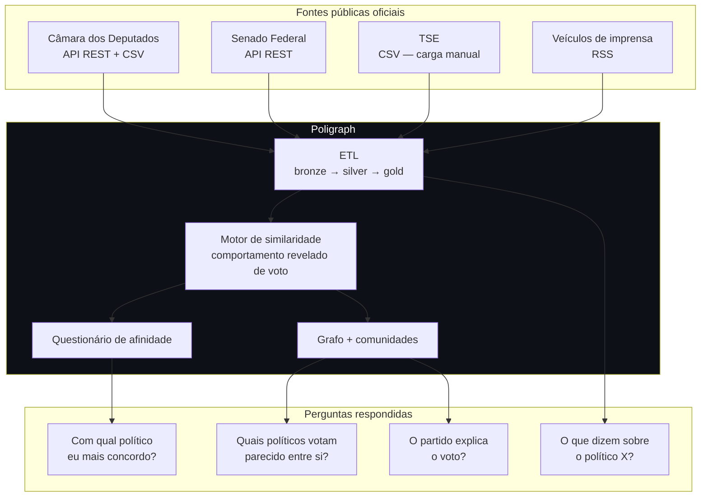
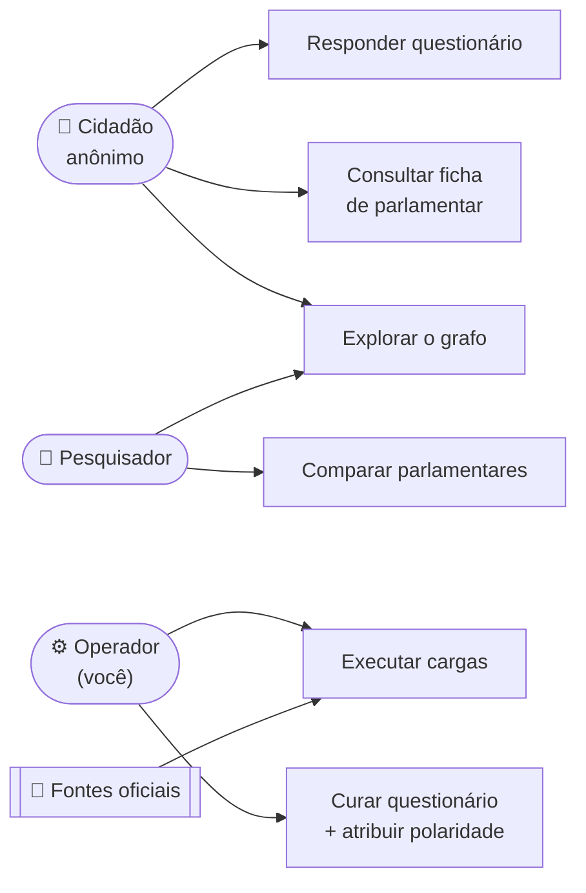
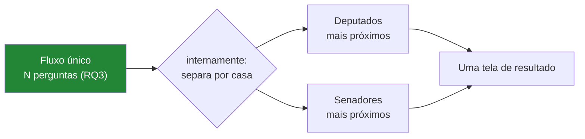
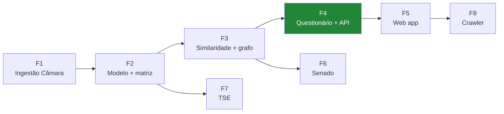

# Requisitos — funcionais e não funcionais

> **Status:** v1.0 — 2026-08-22
> Deriva do [00-discovery.md](00-discovery.md). Regras de negócio marcadas com 📊 vêm de
> **medição real** nos dados, não de suposição.

---

## 1. A premissa

**A premissa central, em uma frase:**

> Afinidade política medida por **comportamento revelado** — como o parlamentar
> efetivamente votou — é mais informativa que autodeclaração ideológica.

### 1.1 Atores

⚠️ **Não existe ator "usuário cadastrado".** É decisão de projeto, não omissão — ver
RNF-12 e o risco R7.

---

## 2. Requisitos funcionais

### 2.1 Ingestão

| ID | Requisito | Prioridade |
|---|---|---|
| **RF-01** | Ingerir votações, votos e orientações da Câmara a partir dos **CSVs anuais consolidados** | 🔴 Essencial |
| **RF-02** | Ingerir incrementalmente o ano corrente pela **API REST**, sem reprocessar o histórico | 🔴 Essencial |
| **RF-03** | Ingerir o cadastro de parlamentares, incluindo **CPF** | 🔴 Essencial |
| **RF-04** | Ligar cada votação à **proposição** correspondente e obter sua ementa | 🔴 Essencial |
| **RF-05** | Ingerir a **classificação temática** oficial das proposições | 🟡 Importante |
| **RF-06** | Ingerir dados do **TSE** a partir de arquivos depositados manualmente, com manifesto e verificação de hash | 🟡 Importante |
| **RF-07** | Ingerir votações e votos do **Senado** | 🟢 Desejável |
| **RF-08** | Registrar toda carga em log auditável (fonte, período, volume, duração, erros) | 🟡 Importante |
| **RF-09** | Ser **idempotente**: reexecutar uma carga não duplica registros | 🔴 Essencial |

### 2.2 Tratamento e identidade

| ID | Requisito | Prioridade |
|---|---|---|
| **RF-10** | Manter camada **bronze imutável**, permitindo reprocessar silver/gold sem reacessar as fontes | 🔴 Essencial |
| **RF-11** | Atribuir **ID sintético próprio** a cada pessoa e mapear os IDs externos | 🔴 Essencial |
| **RF-12** | Conciliar Câmara ↔ TSE por **CPF** (determinístico) | 🟡 Importante |
| **RF-13** | Conciliar Senado ↔ TSE por *fuzzy match*, com **fila de revisão manual** | 🟢 Desejável |
| **RF-14** | Registrar o **método e a confiança** de cada ligação (`CPF` \| `FUZZY` \| `MANUAL`) | 🟡 Importante |
| **RF-15** | Classificar cada votação em `PROCEDIMENTAL` \| `DESTAQUE` \| `SUBSTANTIVA` \| `AUTORIDADE` | 🔴 Essencial |
| **RF-16** | Preservar **partido e UF no momento do voto** | 🔴 Essencial |

### 2.3 Análise

| ID | Requisito | Prioridade |
|---|---|---|
| **RF-17** | Calcular similaridade entre todos os pares de parlamentares da mesma casa | 🔴 Essencial |
| **RF-18** | Oferecer **ao menos duas métricas** (concordância simples e cosseno) e permitir comparação | 🟡 Importante |
| **RF-19** | Detectar **comunidades** no grafo de similaridade | 🔴 Essencial |
| **RF-20** | Comparar comunidades detectadas × filiação partidária, com métrica formal | 🟡 Importante |
| **RF-21** | Projetar parlamentares em **eixos ideológicos** via SVD/PCA | 🟡 Importante |
| **RF-22** | Calcular **disciplina partidária** e **governismo** cruzando voto individual × orientação de bancada | 🟡 Importante |
| **RF-23** | Calcular métricas comparativas **entre as duas casas** | 🟢 Desejável |

### 2.4 Questionário e afinidade

| ID | Requisito | Prioridade |
|---|---|---|
| **RF-24** | Selecionar votações candidatas aplicando os filtros de RN-04 a RN-07 | 🔴 Essencial |
| **RF-25** | Permitir ao operador **curar** o questionário: reescrever ementas e atribuir **polaridade** | 🔴 Essencial |
| **RF-26** | Apresentar o questionário com opções **Sim / Não / Não sei** | 🔴 Essencial |
| **RF-27** | Calcular afinidade cidadão ↔ parlamentar aplicando polaridade e comparação *pairwise* | 🔴 Essencial |
| **RF-28** | Exibir **os mais próximos E os mais distantes** | 🔴 Essencial |
| **RF-29** | Exibir o resultado como **"concordaram em X de Y perguntas"**, não como percentual solto — atende RNF-19 e RNF-30 de uma vez | 🔴 Essencial |
| **RF-30** | Exibir a **ementa original** ao lado da pergunta reescrita | 🟡 Importante |
| **RF-41** | Apresentar **fluxo único** de perguntas, sem que o usuário escolha casa ou órgão; separar por casa apenas na tela de resultado | 🔴 Essencial |

### 2.5 Consulta e visualização

| ID | Requisito | Prioridade |
|---|---|---|
| **RF-31** | Ficha do parlamentar: dados cadastrais, histórico de votos, mais similares | 🔴 Essencial |
| **RF-32** | Enriquecer a ficha com dados do TSE | 🟢 Desejável |
| **RF-33** | Visualizar o grafo com layout *force-directed*, filtro por limiar e coloração por comunidade/partido | 🔴 Essencial |
| **RF-34** | Buscar parlamentar por nome, partido e UF | 🟡 Importante |
| **RF-35** | Exibir notícias recentes associadas ao parlamentar | 🟢 Desejável |
| **RF-36** | Expor API REST pública documentada (OpenAPI) | 🟡 Importante |

### 2.6 Notícias

| ID | Requisito | Prioridade |
|---|---|---|
| **RF-37** | Coletar referências noticiosas via **RSS**, priorizando busca por nome | 🟢 Desejável |
| **RF-38** | Armazenar **apenas** URL, título, veículo, data e trecho curto | 🔴 Essencial *(se RF-37)* |
| **RF-39** | Deduplicar notícias replicadas | 🟢 Desejável |
| **RF-40** | Marcar grau de confiança da associação e ocultar abaixo do limiar | 🟢 Desejável |

---

## 3. Requisitos não funcionais

### 3.1 Desempenho

| ID | Requisito | Meta | Justificativa |
|---|---|---|---|
| **RNF-01** | Cálculo de afinidade do cidadão | **< 200 ms** (p95) | 📊 20 respostas × 552 = 11 mil comparações |
| **RNF-02** | Carga completa de um ano da Câmara | < 10 min | 📊 167 mil linhas via `COPY` |
| **RNF-03** | Job de similaridade (152 mil pares) | < 15 min | 📊 ~80 M comparações |
| **RNF-04** | Resposta de consulta (ficha, busca) | < 500 ms (p95) | — |
| **RNF-05** | Carga do Senado (ano inteiro) | < 1 min | 📊 uma chamada de 2,4 MB |

### 3.2 Confiabilidade e manutenibilidade

| ID | Requisito |
|---|---|
| **RNF-06** | Falha em uma fonte **não** impede o processamento das demais |
| **RNF-07** | Toda carga é reexecutável sem efeito colateral (idempotência — RF-09) |
| **RNF-08** | Camada bronze permite reprocessar tudo **sem rede** |
| **RNF-09** | Erros de conciliação vão para **fila de exceção**, nunca são descartados em silêncio |
| **RNF-10** | Cobertura de testes automatizados nas regras de negócio, com **caso obrigatório para a polaridade** (RN-08) |
| **RNF-11** | Detecção de depreciação: registrar em log o bloco `Metadados.Descontinuacao` do Senado |

### 3.3 Privacidade, ética e conformidade legal

| ID | Requisito | Origem |
|---|---|---|
| **RNF-12** | **Não persistir respostas identificáveis** do questionário: sem login, sem IP, sem cookie de sessão | R7 / LGPD |
| **RNF-13** | **Não republicar CPF**. Uso interno como chave; persistir apenas hash | LGPD |
| **RNF-14** | Exibir *disclaimer* em toda tela de resultado: ferramenta acadêmica, **não** recomendação de voto | R7 |
| **RNF-15** | Não exibir dado de candidatos **não eleitos** | 12-fonte-tse §5 |
| **RNF-16** | Nenhum juízo de valor sobre parlamentares na interface | Discovery §3 |
| **RNF-17** | Acesso restrito durante o **período eleitoral de 2026**, ou publicação apenas posterior | R7 |
| **RNF-18** | Crawler respeita `robots.txt`, usa User-Agent identificável e nunca contorna paywall | 20-crawler §5 |

⚠️ **RNF-17 é o requisito mais fácil de esquecer e o de maior consequência.** As eleições
gerais são em **outubro de 2026**; hoje é agosto de 2026. Uma ferramenta pública do tipo
"descubra seu político" durante o período eleitoral pode ser enquadrada como propaganda
eleitoral ou pesquisa de intenção de voto.

### 3.4 ⭐ Zero alfabetização institucional exigida

> **Princípio de projeto:** o cidadão **não precisa saber como o Congresso funciona** para
> usar o produto. Toda a complexidade institucional documentada em
> [01-camara](01-camara-dos-deputados.md) e [02-senado](02-senado-federal.md) é
> **encanamento interno** — alimenta o modelo, nunca a interface.

| ID | Requisito |
|---|---|
| **RNF-27** | O usuário **nunca escolhe** uma comissão, um órgão, um tipo de proposição ou um regime de tramitação |
| **RNF-28** | O usuário **nunca escolhe entre Câmara e Senado** — ver §3.4.1 |
| **RNF-29** | Nenhum jargão institucional aparece na interface do cidadão: *votação nominal*, *destaque*, *requerimento*, *proposição*, *substitutivo*, *conclusivo*, *polaridade*, *obstrução* |
| **RNF-30** | Resultados são expressos em termos das **perguntas que o usuário respondeu**, não em termos de votações — ver §3.4.2 |
| **RNF-31** | Termos institucionais só aparecem como **contexto descritivo** na ficha do parlamentar ("membro da Comissão de Saúde"), nunca como controle que exija decisão |

#### 3.4.1 Consequência: o seletor de casa está proibido

Isso **corrige uma decisão anterior**. O rascunho do
[Cenário C](arq/03-cenario-c-tres-bases.md) previa "UI com seletor de casa" e "dois
questionários". Pelo RNF-28, isso é inaceitável: escolher entre Câmara e Senado exige
justamente o conhecimento que o usuário não tem.

**Desenho correto:** o usuário responde **um fluxo único** de perguntas. Como as duas
casas votam matérias diferentes (achado #7), o questionário simplesmente **contém
perguntas das duas**, embaralhadas. O usuário não sabe nem precisa saber de qual casa veio
cada pergunta.

⚠️ **O número de perguntas ainda NÃO está definido** — é a pendência **RQ3**. O discovery
sugere a faixa de **15–25** como ponto de partida, mas o número final depende de uma
medição que ainda não foi feita: quantas das ~100 proposições substantivas anuais
sobrevivem ao corte de unanimidade (RN-05) e à cobertura temática (RN-06). Qualquer
número concreto citado neste documento é **ilustrativo**.

O resultado apresenta **duas listas** ("Deputados mais próximos de você" / "Senadores mais
próximos de você"), o que é autoexplicativo e não exige escolha prévia.

#### 3.4.2 Como expressar afinidade sem jargão — e sem perder honestidade

O RNF-19 exige mostrar o **n** de votações comparadas. Isso parece conflitar com a
linguagem simples, mas a solução resolve os dois:

| ❌ Jargão | ✅ Plano **e** transparente |
|---|---|
| "83% de afinidade em 18 votações nominais" | "Vocês concordaram em **15 das 18 perguntas** que você respondeu" |
| "Similaridade 0,72 (n=25)" | "Concordaram em 18 de 25" |

Expressar o resultado em **perguntas respondidas** é simultaneamente mais compreensível e
**mais honesto** que um percentual — o denominador fica explícito por construção, em vez
de escondido numa nota de rodapé.

### 3.5 Transparência metodológica

| ID | Requisito |
|---|---|
| **RNF-19** | Toda afinidade exibida vem acompanhada do **n** de votações comparadas |
| **RNF-20** | A **ementa original** fica sempre acessível ao lado da pergunta reescrita |
| **RNF-21** | O método de cálculo é documentado e acessível ao usuário final |
| **RNF-22** | Arquivos de carga manual são versionados com **hash SHA-256** e data de obtenção |

### 3.6 Portabilidade e operação

| ID | Requisito |
|---|---|
| **RNF-23** | Executável em máquina única de desenvolvimento — 📊 a matriz inteira ocupa **290 KB** |
| **RNF-24** | Banco em PostgreSQL, sem extensões proprietárias |
| **RNF-25** | Ambiente reproduzível por script, exceto a carga manual do TSE (RNF-22) |
| **RNF-26** | Interface responsiva; o grafo deve degradar de forma graciosa em tela pequena |

---

## 4. Regras de negócio

> 📊 = derivada de medição real nos dados.

| ID | Regra | Origem |
|---|---|---|
| **RN-01** | Similaridade é calculada **apenas** sobre votações em que ambos votaram. **Ausência nunca é imputada como zero** | Discovery §7.1 |
| **RN-02** | 📊 Pares com **menos de 20 votações em comum** são descartados — exclui 14 de 552 deputados (2,5%) | Medido |
| **RN-03** | 📊 `Abstenção`, `Obstrução`, `Artigo 17` e vazio viram `null` — somam **0,7%** dos registros | Medido |
| **RN-04** | 📊 O questionário usa **apenas** votações `SUBSTANTIVA` — 58,4% das nominais são procedimentais | Medido |
| **RN-05** | Votações com mais de **85% de um lado** são descartadas do questionário | Discovery §7.2 |
| **RN-06** | O questionário deve cobrir **múltiplos temas**, usando a classificação oficial | 📊 96% de cobertura |
| **RN-07** | Toda pergunta do questionário tem ementa **reescrita em linguagem simples** pelo operador | Discovery §7.2 |
| **RN-08** | ⚠️ Toda votação do questionário tem **`polaridade` (+1/−1)** atribuída manualmente, mapeando "Sim" para "a favor da medida" | 📊 14% têm sinal invertido |
| **RN-09** | 📊 Requerimentos **permanecem** na matriz de similaridade — são o sinal mais limpo de governo × oposição | Achado #11 |
| **RN-10** | Parlamentares de casas diferentes **nunca** entram na mesma matriz | 📊 Achado #7 |
| **RN-11** | Partido e UF são gravados **no momento do voto** | 📊 14 trocas em 2025 |
| **RN-12** | A matriz é sempre filtrada por **legislatura** | Discovery |
| **RN-13** | PEC votada em dois turnos deve ser deduplicada ou ter o efeito reportado | 01-camara §9.4 |
| **RN-14** | Sabatinas de autoridade (`AUTORIDADE`) ficam fora do questionário e dentro da similaridade | 02-senado §3.1 |

---

## 5. Restrições

| ID | Restrição | Natureza |
|---|---|---|
| **RE-01** | 📊 O TSE bloqueia acesso automatizado (HTTP 403) → carga manual obrigatória | Externa, sem contorno |
| **RE-02** | 📊 Apenas **3,5%** das votações da Câmara são nominais | Institucional |
| **RE-03** | 📊 As duas casas não compartilham votações | Institucional |
| **RE-04** | 📊 O Senado não expõe CPF | Externa |
| **RE-05** | 📊 `/plenario/lista/votacao` do Senado está depreciado | Externa |
| **RE-06** | Curadoria do questionário é **manual e não escala** | De projeto |
| **RE-07** | Stack principal em .NET (definida pelo repositório) | De projeto |
| **RE-08** | Prazo de TCC | De projeto |

---

## 6. Rastreabilidade

| Fase | Requisitos | Entrega defensável? |
|---|---|---|
| **F1** | RF-01→04, RF-08→10, RF-15, RF-16 | Não |
| **F2** | RF-05, RF-11, RF-14 | Não |
| **F3** | RF-17→22 | Parcial |
| **F4** | RF-24→30, RF-36 | ✅ **Sim — corte mínimo do TCC** |
| **F5** | RF-31, RF-33, RF-34 | ✅ Produto completo |
| **F6** | RF-07, RF-13, RF-23 | Incremento |
| **F7** | RF-06, RF-12, RF-32 | Incremento |
| **F8** | RF-37→40 | Incremento |

**F4 é a linha de corte.** Tudo antes é infraestrutura sem resultado; a partir dali, o
trabalho já sustenta uma defesa mesmo que F6–F8 não sejam concluídas.

---

## 7. Pendências

| # | Pendência | Bloqueia |
|---|---|---|
| **RQ1** | Definir o **limiar de similaridade** para renderização do grafo | RF-33 |
| **RQ2** | Definir a métrica formal de comparação comunidade × partido (ARI? modularidade?) | RF-20 |
| **RQ3** | Definir o **N final** de perguntas do questionário | RF-24 |
| **RQ4** | Confirmar se existe orientação de bancada no Senado | RF-22 no Senado |
| **RQ5** | Decidir a forma de **RNF-17** (acesso restrito): autenticação simples, ambiente local, ou adiar publicação | RNF-17 |
| **RQ6** | Definir critérios de aceitação mensuráveis para os RF essenciais | Validação |
