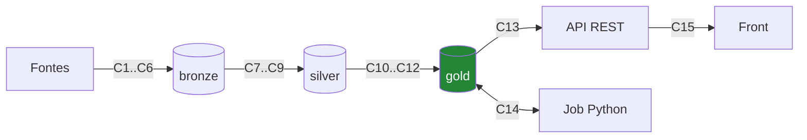
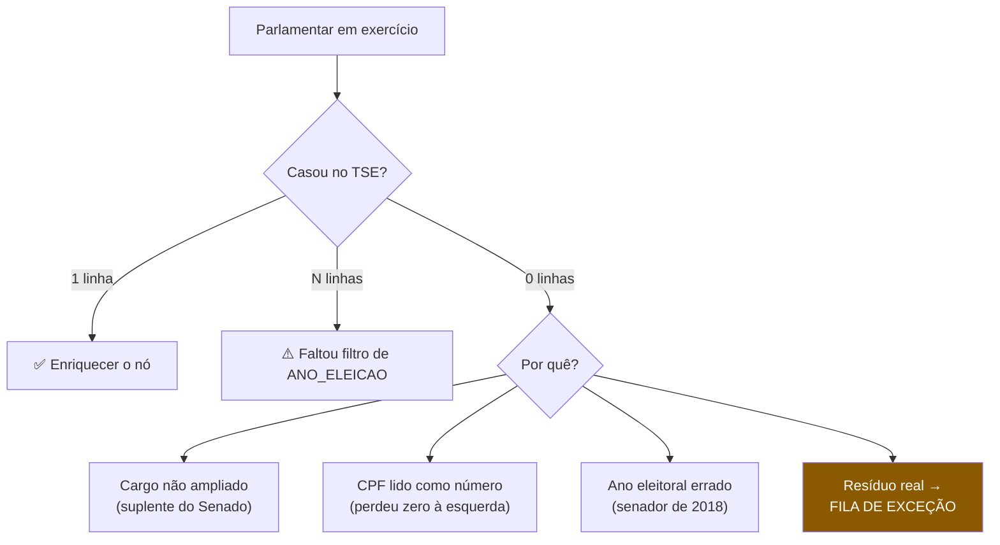
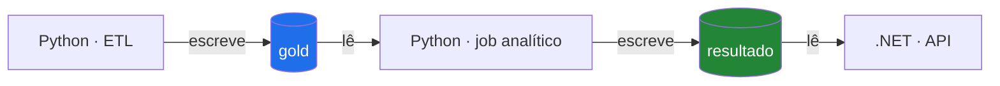
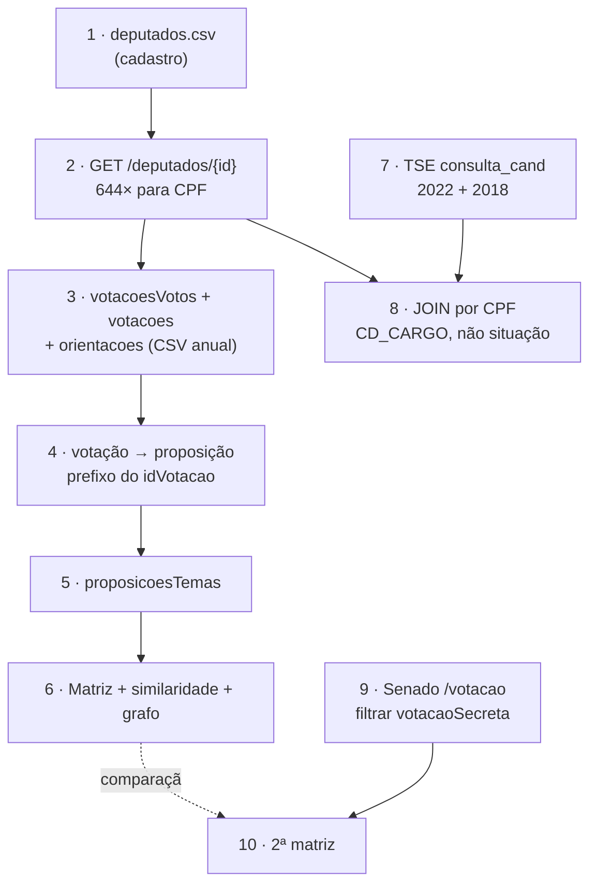

# Contratos — entradas, saídas e uso

> **Status:** v1.4 — 2026-08-23
> **v1.4:** §5.2 — `votacao_candidato_munzona` medido (609 MB, fora de escopo); §9.6 —
> fronteira Python↔Postgres (C14). CT1, CT4 e API6 resolvidas.
> **v1.3:** §5.1 — `bem_candidato` validado (CT1); §9.5 — contrato da API REST (C13);
> regra metodológica anti-generalização no topo.
> **v1.2:** §6.1 — domínio de `voto` medido nos 4 anos; obstrução cai 35× na legislatura.
> CT5 e CT6 resolvidas.
> **v1.1:** §7.1–7.3 — suplente é tratado de forma diferente em cada casa; §9 — contrato
> do grafo (kNN k=10).
> **Regra deste documento: nada aqui é suposição.** Todo formato, cardinalidade e domínio
> foi medido contra o dado real. Onde algo não pôde ser validado, está marcado
> ⛔ **NÃO VALIDADO**.

---

## ⚠️ Regra metodológica — a lição mais cara deste projeto

> **Medir um ano e generalizar foi a origem de quase todos os erros cometidos aqui.**

Cinco afirmações erradas, todas pelo mesmo motivo:

| Afirmação | Base | Realidade |
|---|---|---|
| "15.037 votações em 2025" | `cut` linha-a-linha | **13.825** — multilinha |
| "Obstrução é 0,2%, irrelevante" | só 2025 | **2,50% em 2023** |
| "O Senado tem 56 votações" | só 2025 | **182** na legislatura |
| "CPF a 100% no `deputados.csv`" | índice de coluna quebrado | **0 de 7.889** |
| "O grafo tem ~500 nós" | nº de cadeiras | **644** |

**Três hábitos que teriam evitado todos:**

1. **Medir ≥ 2 períodos antes de afirmar uma proporção.** Se os dois divergem, o número é
   por ano, não do projeto.
2. **Conferir toda contagem por dois caminhos independentes.** Foi a discordância entre
   `itens=1000` e paginação que revelou o achado #20.
3. **Desconfiar de 100% e de 0%.** Ambos costumam ser bug de extração, não propriedade do
   dado.

⚠️ **Para o TCC:** todo número no texto final precisa dizer **sobre qual recorte** foi
medido. "3,8% das votações são nominais" sem dizer "em 2025" é a mesma armadilha, escrita
na dissertação.

---

## 0. Índice de contratos



| # | Contrato | Validado? |
|---|---|---|
| C1–C4 | Câmara: CSVs anuais | ✅ |
| C5 | Câmara: API REST (CPF) | ✅ |
| C6 | Senado: `/votacao` | ✅ |
| C7 | TSE: `consulta_cand` | ✅ |
| C8 | Normalização de voto | ✅ |
| C9 | Entity resolution | ✅ testado |
| C10 | Matriz de votos | ✅ dimensionado |
| C11 | Similaridade | ✅ dimensionado |
| C12 | Grafo | ✅ **kNN k=10, medido** |
| C7b | TSE: `bem_candidato` | ✅ |
| C7c | TSE: `votacao_candidato_munzona` | ✅ medido — **fora de escopo** |
| C13 | API REST pública | 🔶 **especificada**, não implementada |
| C14 | Fronteira Python ↔ Postgres | 🔶 **especificada** |

---

## 1. 🔴 Regra transversal de parsing — leia antes de tudo

**Os CSVs da Câmara contêm campos com quebra de linha e aspas escapadas.** Isto não é
detalhe: é a diferença entre um número certo e um errado.

**Evidência medida:**

```
votacoes-2025.csv       17.421 linhas físicas  →  13.825 registros reais
votacoesOrientacoes     5.020 linhas físicas   →   4.947 registros reais
votacoesVotos-2025.csv  167.296 linhas         →  167.296 registros  (não afetado)
```

Exemplo de campo `descricao` real, com aspas escapadas em RFC4180 (`""`):

```
"Aprovada a matéria destacada. Fica mantido o texto do Relator. Resultado:
 44 votos ""Sim"", 14 votos ""Não"". Quórum de votação: 58 votos."
```

⚠️ **Consequência já observada neste projeto:** contar votações com
`cut -d';' -f1 | sort -u` devolveu **15.037**; a contagem correta é **13.825**. As
1.212 extras eram fragmentos de linhas de continuação interpretados como ids.

> 🔑 **Contrato de parsing:** use um leitor CSV compatível com **RFC 4180**
> (`CsvHelper` no .NET, `csv`/`pandas` no Python). **`split(';')` e leitura linha-a-linha
> produzem números errados sem falhar.**

**Checklist obrigatório para todo CSV da Câmara:**

| Item | Tratamento |
|---|---|
| Separador | `;` |
| Aspas escapadas | `""` dentro de campo entre aspas |
| **Quebra de linha dentro de campo** | Parser RFC 4180 obrigatório |
| **BOM UTF-8** | Remover, ou a 1ª coluna vem com nome corrompido |
| Encoding | UTF-8 (Câmara) · **ISO-8859-1 (TSE)** |

---

## 2. C1–C4 · Câmara — CSVs anuais

**Endpoint:** `https://dadosabertos.camara.leg.br/arquivos/{dataset}/csv/{dataset}-{ano}.csv`
**Autenticação:** nenhuma · **Reconstrução:** ✅ diária, ~07:00 GMT (achado #19)

### C1 · `votacoesVotos-{ano}` — a base da matriz

```
idVotacao;uriVotacao;dataHoraVoto;voto;deputado_id;deputado_uri;deputado_nome;
deputado_siglaPartido;deputado_uriPartido;deputado_siglaUf;deputado_idLegislatura;
deputado_urlFoto
```

| Aspecto | Valor medido (2025) |
|---|---|
| Tamanho | 55,5 MB |
| Registros | **167.296** (= linhas físicas; ✅ sem multilinha) |
| Votações distintas | **526** |
| Deputados distintos | 552 |
| Domínio de `voto` | `Sim` 96.839 · `Não` 68.923 · *vazio* 421 · `Artigo 17` 401 · `Obstrução` 375 · `Abstenção` 336 |

**Cobertura por ano (legislatura 57):**

| Ano | Tamanho | Votações nominais | Das quais PLEN | Votos |
|---|---|---|---|---|
| 2023 | 40,8 MB | 447 | 300 | 128.679 |
| 2024 | 36,9 MB | 448 | 273 | 116.400 |
| 2025 | 55,5 MB | 526 | 410 | 167.296 |
| 2026* | 16,0 MB | 149 | 120 | 50.581 |
| **Total** | ~149 MB | **1.570** | **1.103** | **~463.000** |

\* parcial, até agosto. Série completa disponível de **2001 a 2026**.

### C2 · `votacoes-{ano}` — metadados da votação

```
id;uri;data;dataHoraRegistro;idOrgao;uriOrgao;siglaOrgao;idEvento;uriEvento;aprovacao;
votosSim;votosNao;votosOutros;descricao;ultimaAberturaVotacao_*;ultimaApresentacaoProposicao_*
```

| Aspecto | Valor medido (2025) |
|---|---|
| Registros reais | **13.825** ⚠️ (a contagem ingênua dá 15.037 — ver §1) |
| Linhas físicas | 17.421 |
| **Taxa de nominais** | **526 / 13.825 = 3,8 %** |
| `votosSim`/`votosNao` preenchidos | ✅ nas 526 nominais · ⛔ **zerados nas simbólicas** |

⚠️ **As votações simbólicas não trazem nem contagem agregada** — 16.868 registros com
`votosSim+votosNao = 0`. Não dá para estimar o quão dividida foi a decisão.

### C3 · `votacoesOrientacoes-{ano}` — ⭐ rótulo governo × oposição

```
idVotacao;uriVotacao;siglaOrgao;descricao;siglaBancada;uriBancada;orientacao
```

| Aspecto | Valor medido (2025) |
|---|---|
| Registros reais | **4.947** (5.020 linhas físicas) |
| Bancadas distintas | 264 |
| **Pseudo-bancadas** | ✅ `Governo`, `Maioria`, `Minoria`, `Oposição` |

⚠️ `orientacao` pode vir **string vazia** = bancada liberou o voto. ≠ ausência de dado.
⚠️ `siglaBancada` mistura partido, bloco (`"Bl PlFdrPTUniPp..."`, truncado) e
pseudo-bancada. **Não usar como chave estrangeira.**

### C4 · Demais CSVs

| Dataset | Uso | Chave |
|---|---|---|
| `proposicoes-{ano}` | Ementa da matéria | `id` |
| `proposicoesTemas-{ano}` | Classificação temática | `uriProposicao` |
| `proposicoesAutores-{ano}` | Aresta de coautoria | `idProposicao`, `idDeputadoAutor` |
| `proposicoesTramitacoes-{ano}` | Relatoria, rito conclusivo | `uriProposicao` |
| `deputados` | Cadastro | `uri` ⚠️ **sem coluna `id`** |
| `orgaos` | Comissões | `uri` |

---

## 3. C5 · Câmara — API REST

**Base:** `https://dadosabertos.camara.leg.br/api/v2` · sem autenticação

### 3.1 🔴 O único dado que **exige** a API: o CPF

| Fonte | CPF disponível? |
|---|---|
| `deputados.csv` | ⛔ **0 de 7.889 linhas** — coluna existe, está vazia |
| `GET /deputados/{id}` | ✅ Sim |

**Contrato:**

```
GET /api/v2/deputados/{id}
Accept: application/json
→ 200  { "dados": { "id":204528, "cpf":"12519851813",
                    "nomeCivil":"ADRIANA MIGUEL VENTURA",
                    "ultimoStatus":{ "siglaPartido":"NOVO", "situacao":"Exercício",
                                     "condicaoEleitoral":"Titular" },
                    "redeSocial":[…] } }
```

**Custo:** ~644 chamadas por legislatura. **Uso:** uma vez, no *bootstrap*; depois só para
novos parlamentares.

⚠️ **CPF com zero à esquerda existe** (`05585378805`). Tratar como `string`.

### 3.2 ⚠️ `GET /deputados` — devolve duplicatas (achado #20)

| Medido (`idLegislatura=57`) | |
|---|---|
| Registros | **878** |
| Deputados distintos | **647** |
| Máx. repetições do mesmo `id` | 4 |

Causa: **produto cartesiano** dos valores distintos de nome × partido. As combinações
**não são estados históricos reais**.

> 🔑 **Contrato:** deduplicar por `id`. Nunca usar como histórico de partido.

⚠️ `links[rel=last]` com `itens=1` aponta 878 — total de **linhas**, não de pessoas.

### 3.3 Outros endpoints — comportamento validado

| Endpoint | Contrato |
|---|---|
| `/votacoes/{id}/votos` | ⛔ **rejeita `itens`/`pagina`** (HTTP 400). Devolve tudo de uma vez. Votação simbólica → `{"dados":[]}` |
| `/votacoes/{id}` | `proposicoesAfetadas` = matéria real ✅ · `uriProposicaoCitada` = parecer ⛔ |
| `/votacoes/{id}/orientacoes` | Orientação por bancada, com pseudo-bancadas |
| `/proposicoes/{id}/temas` | ✅ 24 de 25 proposições têm ≥1 tema |
| `/orgaos/{id}/membros` | `titulo` (Titular/Suplente/Presidente/Vice), `dataInicio`, `dataFim` |
| `/deputados/{id}/orgaos` | ~12 vínculos/deputado |
| `/deputados/{id}/frentes` | ⛔ **102 a 317 por deputado** — inútil como aresta |
| `/proposicoes/{id}/relatores` | ⛔ **HTTP 405** — não existe |

⚠️ **`campo `deputado_`** (com underscore final) no payload de `/votos`. Erro de
desserialização silencioso se ignorado.

---

## 4. C6 · Senado — `/votacao`

```
GET https://legis.senado.leg.br/dadosabertos/votacao?dataInicio=YYYY-MM-DD&dataFim=YYYY-MM-DD
Accept: application/json
Cache-Control do servidor: max-age=600
```

⚠️ **Estrutura aninhada**, não plana:

```json
[{ "codigoSessaoVotacao":6918, "identificacao":"PLP 22/2025",
   "ementa":"Dispõe sobre prazo para liquidação de restos a pagar…",
   "votacaoSecreta":"N",                     ← ⭐ campo decisivo
   "votos":[ { "codigoParlamentar":5672, "nomeParlamentar":"Alan Rick",
               "siglaPartidoParlamentar":"UNIÃO", "siglaUFParlamentar":"AC",
               "siglaVotoParlamentar":"Sim" } ] }]
```

**Cardinalidade medida (2025):** 128 objetos · 128 `votos[]` · **10.368** votos individuais.

### 4.1 🔴 Filtro obrigatório: `votacaoSecreta`

| | Votações | `Sim`/`Não` | `"Votou"` |
|---|---|---|---|
| `"S"` secreta | **72 (56%)** | 0 | 3.774 |
| `"N"` aberta | 56 (44%) | 3.572 | 0 |

> 🔑 **Contrato:** descartar `votacaoSecreta == "S"` **antes** da matriz. `"Votou"` é
> presença, nunca posição.

### 4.2 Domínio de `siglaVotoParlamentar` — 12 valores

| Entra na matriz | Não entra |
|---|---|
| `Sim` (3.023) · `Não` (549) · `Abstenção` (15, peso menor) | `Votou` (3.774) · `P-NRV` (1.544) · `AP` (761) · `MIS` (251) · `LS` (251) · `LP` (89) · `Presidente (art. 51 RISF)` (59) · `NCom` (37) · `NA` (15) |

⚠️ **Só 34% dos registros são posição de voto** — contra 99,3% na Câmara. **Mapeamentos
diferentes por casa; não reaproveite.**

### 4.3 Cobertura e endpoints auxiliares

| Ano | Votações | Secretas | **Abertas** |
|---|---|---|---|
| 2023 | 141 | 91 | 50 |
| 2024 | 95 | 37 | 58 |
| 2025 | 128 | 72 | 56 |
| 2026* | 57 | 39 | 18 |
| **Leg. 57** | 421 | 239 | **182** |

| Endpoint | Situação |
|---|---|
| `/senador/lista/atual` | ✅ Envelope XML de 4 níveis |
| `/senador/{id}` | ✅ ⛔ **sem CPF**, sem rede social |
| `/processo/relatoria?codigoParlamentar=` | ✅ Array plano, com datas |
| `/senador/{id}/relatorias` | ⚠️ **Depreciado** → usar `/processo/relatoria` |
| `/plenario/lista/votacao/{data}` | ⛔ **Depreciado** |
| Orientação de bancada | ⛔ **NÃO EXISTE** (`/orientacao`, `/votacao/orientacao`, `/processo/orientacao` → 404) |

---

## 5. C7 · TSE — `consulta_cand`

```
GET https://cdn.tse.jus.br/estatistica/sead/odsele/consulta_cand/consulta_cand_{ano}.zip
```

🔴 **Headers obrigatórios** — sem o conjunto completo, o WAF devolve 403:

```
User-Agent: Mozilla/5.0 (Windows NT 10.0; Win64; x64) AppleWebKit/537.36
            (KHTML, like Gecko) Chrome/131.0.0.0 Safari/537.36
Accept: */*
Accept-Language: pt-BR,pt;q=0.9
Accept-Encoding: gzip, deflate, br        ← obrigatório
Sec-Fetch-Dest: document
Sec-Fetch-Mode: navigate
Sec-Fetch-Site: none
Upgrade-Insecure-Requests: 1
```

| Aspecto | Valor medido (2022) |
|---|---|
| ZIP | 4,2 MB · 30 arquivos · 31,7 MB descompactado |
| Usar | `consulta_cand_2022_BRASIL.csv` (15,7 MB) |
| Encoding | **ISO-8859-1** · CRLF · `;` |
| Campos | **50** |
| Registros | **29.323** |
| Eleitos | Dep. federal **513** · Senador **27** |

**Campos-chave (posição):** 11 `SG_UF` · 14 `CD_CARGO` · 16 `SQ_CANDIDATO` ·
18 `NM_CANDIDATO` · **21 `NR_CPF_CANDIDATO`** · 37 `DT_NASCIMENTO` · 50 `DS_SIT_TOT_TURNO`

⚠️ **32% dos CPFs começam com zero** (9.477 de 29.322). Ler como número quebra o join
**em silêncio**. Sentinelas: `#NULO#`, `#NE#`, `-4`.

**Arquivos necessários:** `consulta_cand_2022` (Câmara + 27 senadores) **e**
`consulta_cand_2018` (os outros **54 senadores** — renovação escalonada).

---

### 5.1 ✅ C7b · `bem_candidato` — validado (CT1)

```
DT_GERACAO;HH_GERACAO;ANO_ELEICAO;CD_TIPO_ELEICAO;NM_TIPO_ELEICAO;CD_ELEICAO;
DS_ELEICAO;DT_ELEICAO;SG_UF;SG_UE;NM_UE;SQ_CANDIDATO;NR_ORDEM_BEM_CANDIDATO;
CD_TIPO_BEM_CANDIDATO;DS_TIPO_BEM_CANDIDATO;DS_BEM_CANDIDATO;VR_BEM_CANDIDATO;
DT_ULT_ATUAL_BEM_CANDIDATO;HH_ULT_ATUAL_BEM_CANDIDATO
```

| Aspecto | Valor medido (2022) |
|---|---|
| ZIP | 5,1 MB → 47 MB · 30 arquivos |
| Campos | **19** |
| Registros (BRASIL) | **96.223** — um por **bem** |
| Candidatos com bem declarado | **19.589** de 29.323 (**67 %**) |
| Encoding | ISO-8859-1 · `;` |
| `VR_BEM_CANDIDATO` | ⚠️ **vírgula decimal** — `395122,26` |

🔴 **`bem_candidato` NÃO tem CPF.** A chave é **`SQ_CANDIDATO`** — ou seja, o join é de
**dois saltos**:

```
CPF ──► consulta_cand.SQ_CANDIDATO ──► bem_candidato.SQ_CANDIDATO
```

⚠️ **E `SQ_CANDIDATO` muda a cada eleição.** Para a *evolução* do patrimônio (o uso mais
interessante), o caminho é:

```
CPF → todas as candidaturas da pessoa → um SQ_CANDIDATO por eleição
    → somar bens de cada SQ separadamente → série temporal
```

**Teste real** (deputado federal eleito, `SQ_CANDIDATO=20001614181`):

```
Quotas ou quinhões de capital      R$  10.000,00
Quotas ou quinhões de capital      R$  10.000,00
Apartamento                        R$ 300.000,00
Depósito bancário em conta corrente R$     536,68
→ 4 bens · total R$ 320.536,68
```

⚠️ **Um mesmo tipo de bem aparece repetido** (duas linhas de "Quotas"). Agregar por
`SQ_CANDIDATO`, nunca supor unicidade por tipo.

⚠️ **33% dos candidatos não declararam bem algum** — ausência ≠ patrimônio zero. Na
ficha, isso é "não declarou", não "R$ 0,00" (RNF-31, degradação graciosa).

**Tipos mais frequentes:** veículo (17.315) · terreno (9.180) · casa (8.863) · depósito
bancário (8.506) · apartamento (6.869) · quotas de capital (6.094).

---

### 5.2 🔴 C7c · `votacao_candidato_munzona` — **medido, e recomendo NÃO usar**

| Aspecto | Valor medido |
|---|---|
| Tamanho do ZIP | 🔴 **609,2 MB** |
| Variante por UF | ⛔ **Não existe** (404 em `_2022_SP.zip`, `_2022_AC.zip`) |

**Comparação que decide:**

| Arquivo | Tamanho |
|---|---|
| `consulta_cand_2022` | 4,2 MB |
| `consulta_cand_2018` | 4,5 MB |
| `bem_candidato_2022` | 5,1 MB |
| **Subtotal — tudo que o projeto usa** | **13,8 MB** |
| `votacao_candidato_munzona_2022` | **609,2 MB** |

> **Este único arquivo é 44× maior que todos os outros somados.**

⚠️ **Aqui está a origem do meu erro anterior.** Este documento afirmava que os arquivos do
TSE tinham "centenas de MB". Estava errado para `consulta_cand` e `bem_candidato` — e
**certo para este**. A generalização foi feita a partir do arquivo errado.

**O que ele entrega:** votos recebidos por município e zona eleitoral — a "distribuição
geográfica" da ficha do parlamentar.

**Custo × benefício:**

| | |
|---|---|
| Custo | 609 MB de download, sem opção de recorte por UF |
| Benefício | Um mapa na ficha do parlamentar |
| Bloqueia algo? | ⛔ Não — nenhuma entrega do título depende |
| Conflito | ⚠️ O uso mais atraente (recomendar "políticos da sua região") esbarra no **RNF-12** |

> 🔑 **Recomendação: fora do escopo.** O ganho é um enfeite da ficha; o custo é 44× o
> resto do TSE, sem possibilidade de carga parcial. Se um dia entrar, que seja como fase
> própria e isolada.

⚠️ **Para o texto do TCC:** isto é exemplo de decisão de engenharia orientada a dado —
o arquivo foi medido, o custo comparado, e a exclusão justificada. Melhor do que omitir
em silêncio.

---

## 6. C8 · Normalização de voto

| Origem (Câmara) | Interno | | Origem (Senado) | Interno |
|---|---|---|---|---|
| `Sim` | `+1` | | `Sim` | `+1` |
| `Não` | `-1` | | `Não` | `-1` |
| `Abstenção` | `0` | | `Abstenção` | `0` |
| `Obstrução`, `Artigo 17`, *vazio* | `null` | | os outros 9 valores | `null` |

### 6.1 ⚠️ O domínio varia por ano — medido nos 4 anos da legislatura

A justificativa anterior (*"os descartados somam 0,7%"*) vinha **só de 2025**. Medindo
todos os anos:

| Ano | `Sim` | `Não` | `Obstrução` | `Abstenção` | `Artigo 17` | *(vazio)* |
|---|---|---|---|---|---|---|
| 2023 | 74.884 | 49.937 | **3.222** | 359 | 277 | — |
| 2024 | 67.580 | 46.630 | **1.640** | 294 | 256 | — |
| 2025 | 96.839 | 68.923 | 375 | 336 | 401 | **422** |
| 2026* | 32.020 | 18.312 | 35 | 127 | 87 | — |

🔴 **`Obstrução` cai 35× ao longo da legislatura:**

| Ano | % dos votos |
|---|---|
| **2023** | **2,50 %** |
| 2024 | 1,41 % |
| 2025 | 0,22 % |
| 2026 | 0,07 % |

→ **Correção do número:** na legislatura inteira, obstrução são **5.272 de ~463.000
(1,1 %)** — não 0,2%. A conclusão (mandar para `null`) **não muda**, mas o argumento
precisa ser feito sobre a legislatura, não sobre 2025.

⚠️ **Quem analisar 2023 isoladamente encontra 2,5%** — dez vezes o de 2025. Se o recorte
temporal mudar, revisar esta decisão.

⭐ **A queda em si é um achado potencial para o TCC.** Obstrução é tática de oposição
([01-camara §9.2](01-camara-dos-deputados.md)). Um colapso de 2,50% para 0,07% em quatro
anos sugere mudança de estratégia da oposição ou da correlação de forças — vale um
parágrafo na discussão, com a ressalva de que a causa não é demonstrável só com este dado.

⚠️ **O valor vazio só existe em 2025** (422 ocorrências). Não aparece em 2023, 2024 nem
2026. Anomalia não explicada — tratar como `null` e registrar.

**Justificativa consolidada:** `Sim`+`Não` = **98,7%** dos votos da legislatura 57.

---

## 7. C9 · Entity resolution — ✅ testado

```
Câmara.cpf  ──────────────►  TSE.NR_CPF_CANDIDATO     determinístico
Senado      ──fuzzy───────►  TSE (nome+nascimento+UF)  81 pessoas, revisão manual
```

**Resultado do teste (60 deputados da legislatura 57):**

| Filtro no TSE | Casaram |
|---|---|
| `DS_SIT_TOT_TURNO LIKE 'ELEITO%'` | 46 / 59 — 78% |
| **`CD_CARGO = 6` (sem filtro de situação)** | ✅ **59 / 59 — 100%** |

Os 13 ausentes do primeiro filtro estavam no arquivo como `SUPLENTE` (11) e
`NÃO ELEITO` (2) — assumiram por sucessão.

> 🔑 **Contrato:** filtrar por **`CD_CARGO`**, nunca por `DS_SIT_TOT_TURNO`. A pergunta é
> *"concorreu a este cargo?"*, não *"venceu?"*.

### 7.1 🔴 O suplente é tratado de forma DIFERENTE em cada casa

Este é o desdobramento que quase passou batido, e ele quebra o join do Senado **em
silêncio** se ignorado.

| Casa | Como o suplente aparece no TSE |
|---|---|
| **Câmara** | **Mesmo cargo** (`CD_CARGO = 6`), com `DS_SIT_TOT_TURNO = SUPLENTE` — 4.195 registros em 2022 |
| **Senado** | 🔴 **CARGO SEPARADO**: `CD_CARGO = 9` (1º Suplente) e `10` (2º Suplente), **cada um com seu próprio `ELEITO`** |

Medido em 2022:

```
CD_CARGO  5 = SENADOR        →  27 ELEITO · 200 NÃO ELEITO · 16 #NULO
CD_CARGO  9 = 1º SUPLENTE    →  27 ELEITO ·  …
CD_CARGO 10 = 2º SUPLENTE    →  27 ELEITO · 200 NÃO ELEITO · 49 #NULO
CD_CARGO  6 = DEPUTADO FED.  → 513 eleitos (3 valores) · 4.195 SUPLENTE
```

→ **Um suplente de senador que assume o mandato NÃO está em `CD_CARGO = 5`.** Ele é, para
o TSE, candidato eleito a *"1º Suplente"*. Se o join filtrar só por cargo 5, essa pessoa
some — sem erro, sem exceção.

**Impacto medido nos 81 senadores em exercício:**

| Filtro no TSE 2022 | Casaram |
|---|---|
| `CD_CARGO = 5` | 24 |
| **`CD_CARGO IN (5, 9, 10)`** | ✅ **27** |

Os 3 recuperados são suplentes que assumiram:
`ANTONIA JUSSARA GOMES ALVES SOUSA LIMA` · `HERMES ARTUR KLANN` ·
`MARIA DE LOURDES PEREIRA E PEREIRA`.

⚠️ E os 27 de 81 confirmam a renovação escalonada: **os outros 54 estão em
`consulta_cand_2018`**, que precisa do mesmo filtro ampliado.

### 7.2 ✅ Contrato final do join — os quatro filtros

```sql
-- CÂMARA  (legislatura 57 ← eleição 2022)
WHERE ANO_ELEICAO = 2022
  AND CD_CARGO    = 6              -- inclui SUPLENTE automaticamente
  AND NR_CPF_CANDIDATO = :cpf      -- string, com zeros à esquerda

-- SENADO  (legislatura 57 ← eleições 2018 E 2022)
WHERE ANO_ELEICAO IN (2018, 2022)
  AND CD_CARGO IN (5, 9, 10)       -- 🔴 titular + 1º e 2º suplentes
  AND <fuzzy: nome + DT_NASCIMENTO + SG_UF>
```

| # | Filtro | Por quê |
|---|---|---|
| 1 | **`ANO_ELEICAO`** | Sem ele, um deputado com candidaturas em 2014/2018/2022 devolve N linhas |
| 2 | **`CD_CARGO`** | Define a população; **nunca** `DS_SIT_TOT_TURNO` |
| 3 | **Ampliar cargo no Senado** | 9 e 10 são suplentes que podem estar em exercício |
| 4 | **CPF como `string`** | 32% começam com zero |

### 7.3 O que fazer com cada resultado do join



> 🔑 **Nenhum não-casamento é descartado em silêncio** (RNF-09). Vai para fila de exceção
> com o motivo, e o número final de exceções é **resultado a reportar** no TCC — mede a
> qualidade do *entity resolution* (objetivo específico #2).

⚠️ **`#NULO` como situação existe** (660 em deputado federal, 16 em senador). São
candidaturas indeferidas ou retiradas antes da apuração. **Não filtre por situação** e
elas deixam de importar — mais um argumento para o contrato de §7.2.

**`DS_SIT_TOT_TURNO` — domínio completo:** `SUPLENTE` 14.623 · `NÃO ELEITO` 11.276 ·
`#NULO` 1.662 · `ELEITO POR QP` 1.182 · `ELEITO POR MÉDIA` 390 · `ELEITO` 137 ·
`2º TURNO` 52.
⚠️ **"Eleito" são 3 valores.** `= 'ELEITO'` captura 137 de 1.709.

---

## 8. C10–C11 · Matriz e similaridade

| Estrutura | Dimensão | Memória |
|---|---|---|
| Matriz Câmara (leg. 57) | **644 × 1.103** | ~710 KB |
| Matriz Senado (leg. 57) | ~90 × 182 | ~16 KB |
| Pares Câmara | **207.046** | ~3 MB |

**Contrato de similaridade:**

```
para cada par (A,B) da MESMA casa:
    comuns = { v : voto_A(v) ≠ null ∧ voto_B(v) ≠ null }
    se |comuns| < 20 → descartar par
    concordancia = |{v ∈ comuns : voto_A(v) = voto_B(v)}| / |comuns|
```

**Cobertura do corte de 20, medida:**

| Casa | Pares que passam |
|---|---|
| Câmara | 97,5% (exclui 14 de 552) |
| Senado | **88%** (2.980 de 3.403; sobreposição média 33) |

**Saída:** `similaridade(pessoa_a, pessoa_b, metrica, valor, n_votacoes_comuns, calculado_em)`

⚠️ **Precisão declarada:** IC 95% de **±5,5 pp** na Câmara (n≈329) e **±17 pp** no Senado
(n≈33). Não afirmar gradações finas no Senado.

---

## 9. C12 · Grafo — ✅ especificado e medido

### 9.1 🔴 O limiar global **não funciona** — medido

Amostra de 200 deputados, plenário 2025, **18.393 pares válidos**:

| | |
|---|---|
| **Similaridade média entre dois deputados quaisquer** | **0,663** |

Densidade resultante por limiar:

| Limiar | Arestas (amostra) | Densidade | Extrapolado p/ 644 nós |
|---|---|---|---|
| ≥ 0,60 | 11.885 | **64,6 %** | ~134.000 arestas |
| ≥ 0,70 | 9.138 | 49,7 % | ~103.000 |
| ≥ 0,75 | 7.604 | 41,3 % | ~86.000 |
| ≥ 0,80 | 5.985 | 32,5 % | ~67.000 |
| ≥ 0,85 | 4.066 | 22,1 % | ~46.000 |
| ≥ 0,90 | 2.134 | **11,6 %** | ~24.000 |

🔴 **Mesmo a 0,90 a densidade é 11,6%** — ~24 mil arestas para 644 nós. Ilegível em
qualquer layout *force-directed*, e caro de transmitir ao navegador.

**A causa é institucional:** a média de concordância é **0,663**, não ~0,5. Dois deputados
aleatórios já concordam em dois terços das votações, porque boa parte das matérias é
pouco disputada. Um limiar só vira informativo **muito acima da média** — e aí corta nós
inteiros para fora do grafo.

⚠️ **E o limiar global tem um defeito estrutural, não só de volume:** ele produz
**nós isolados**. Quem tem perfil atípico fica sem nenhuma aresta e some da visualização —
justamente os casos mais interessantes.

### 9.2 ✅ Contrato adotado: **kNN**, não limiar

> **Cada nó mantém suas `k` arestas mais fortes.** A aresta entra no grafo se estiver no
> top-`k` de **qualquer uma das duas pontas** (kNN mutualizado).

| Propriedade | Limiar global | **kNN** |
|---|---|---|
| Nº de arestas | Imprevisível (24k–134k) | ✅ **Limitado a ~`n × k`** |
| Nós isolados | 🔴 Sim | ✅ **Nenhum** |
| Densidade | Varia com a casa | ✅ Controlada diretamente |
| Comparável entre Câmara e Senado | ⛔ Não (médias diferentes) | ✅ **Sim** |

**Parâmetro recomendado: `k = 10`.**

| Casa | Nós | Arestas (≈ n·k) | Densidade |
|---|---|---|---|
| Câmara | 644 | ~6.400 | **~1,5 %** |
| Senado | ~90 | ~900 | ~11 % |

⚠️ **O `k` é o parâmetro a justificar no TCC**, e é honesto reportar a análise de
sensibilidade — rodar Louvain com k = 5, 10, 20 e mostrar se as comunidades mudam. Se não
mudarem, o resultado é robusto; se mudarem, isso também precisa ser dito.

⚠️ **kNN torna a comparação entre casas legítima.** Com limiar global, Câmara e Senado
teriam densidades incomparáveis (médias de similaridade diferentes) e qualquer diferença
de modularidade seria artefato. Com `k` fixo, as duas redes têm a mesma densidade
relativa — pré-requisito para o RF-23.

### 9.3 Contrato de nó e aresta

```
no(pessoa_id, casa, nome_exibicao, partido_atual, uf, urlFoto,
   comunidade_louvain, eixo_x_svd, eixo_y_svd,
   governismo, disciplina_partidaria,          -- ⛔ só Câmara (P3)
   n_votacoes)                                  -- para o tooltip e o corte

aresta(pessoa_a, pessoa_b, tipo, peso, n_votacoes_comuns)
       tipo ∈ { SIMILARIDADE_VOTO, COMISSAO_COMUM, COAUTORIA }
```

**Invariantes:**

| # | Invariante |
|---|---|
| I1 | `pessoa_a.casa == pessoa_b.casa` — 🔴 **nunca** aresta entre casas (achado #7) |
| I2 | `n_votacoes_comuns >= 20` para `SIMILARIDADE_VOTO` |
| I3 | `pessoa_a < pessoa_b` — aresta não-direcionada, gravada uma vez |
| I4 | Todo nó tem ≥ 1 aresta (garantido pelo kNN) |
| I5 | Grafo por **legislatura** — nunca misturar (RN-12) |

**Saída para o front:**

```json
{ "casa":"CAMARA", "legislatura":57, "k":10,
  "nos":[ {"id":204528,"nome":"Adriana Ventura","partido":"NOVO","uf":"SP",
           "comunidade":3,"x":-0.42,"y":0.18,"nVotacoes":329} ],
  "arestas":[ {"a":204528,"b":223128,"peso":0.87,"n":312} ],
  "meta":{"nos":644,"arestas":6403,"densidade":0.015,
          "modularidade":0.41,"comunidades":5} }
```

⚠️ **Payload estimado:** ~644 nós + ~6.400 arestas ≈ **400–600 KB** em JSON. Aceitável,
mas vale `gzip` e considerar omitir `n` por aresta se apertar.

---

## 9.5 C13 · API REST pública — especificada

> ⚠️ **Especificada, não implementada.** O contrato abaixo é decisão de projeto; a
> validação só acontece contra código.

### Princípios que o contrato precisa respeitar

| Origem | Regra |
|---|---|
| RNF-28 | **Nenhum parâmetro `casa`** onde o usuário decide — só onde o cliente já sabe |
| RNF-29 | Nenhum jargão no payload (`q1`, não `2456731-84`) |
| RNF-30 | Resultado contável (`concordaram`/`de`), nunca percentual solto |
| RNF-12a | A API **nunca recebe** a lista de seguidos |
| I1 (§9.3) | Nunca retornar aresta entre casas |

### Endpoints

| Método | Rota | Uso |
|---|---|---|
| `GET` | `/api/parlamentares?casa=&uf=&partido=&q=` | Busca e listagem (RF-34) |
| `GET` | `/api/parlamentares/{id}` | Ficha completa (RF-31) |
| `GET` | `/api/parlamentares/{id}/similares?limite=10` | Próximos e distantes (RF-28) |
| `GET` | `/api/parlamentares/{id}/noticias?limite=20` | 🔑 **Base do "seguir"** (RF-35) |
| `GET` | `/api/grafo?casa=CAMARA&legislatura=57` | Nós + arestas (RF-33) |
| `GET` | `/api/questionario` | Sem `casa` (RNF-28) |
| `POST` | `/api/afinidade` | Ranking (RF-27) |
| `GET` | `/api/noticias?temas=&limite=` | Componente temático do feed (RF-48) |
| `GET` | `/api/estatisticas` | Home |

⚠️ **Note o que NÃO existe:** não há `/api/feed`, `/api/seguir` nem `/api/usuarios`. O
feed é **montado no cliente** a partir de `/parlamentares/{id}/noticias` e
`/noticias?temas=`. É isso que mantém o RNF-12a — o servidor nunca sabe quem segue quem.

### Contratos de resposta

**`GET /api/parlamentares/{id}/noticias`** — o endpoint que sustenta o "seguir":

```json
{ "pessoaId": 204528,
  "noticias": [
    { "titulo": "…", "veiculo": "Congresso em Foco",
      "url": "https://…", "publicadoEm": "2026-08-22T14:30:00Z",
      "trecho": "…", "confianca": 0.93 } ],
  "total": 7 }
```

⚠️ **`total: 0` é resposta válida e esperada** — a cobertura é enviesada e a maior parte
do Congresso não terá notícia ([arq/20 §10.1](arq/20-crawler-noticias.md)). O cliente
renderiza o estado vazio do RF-47, **não** um erro.

**`POST /api/afinidade`**

```json
→ { "respostas":[ {"id":"q1","resposta":"SIM"}, {"id":"q2","resposta":"NAO_SEI"} ] }

← { "respondidas":18, "ignoradas":2,
    "deputados":{ "maisProximos":[ {"pessoaId":204528,"nome":"…","partido":"NOVO",
                                    "uf":"SP","concordaram":15,"de":18} ],
                  "maisDistantes":[…] },
    "senadores":{ "maisProximos":[…], "maisDistantes":[…] },
    "aviso":"Ferramenta acadêmica. Não constitui recomendação de voto." }
```

⚠️ **`concordaram`/`de` em vez de percentual** (RF-29). E o `de` **difere entre deputados
e senadores** — o cidadão respondeu perguntas das duas casas, mas cada parlamentar só é
comparável nas da sua. Isso precisa ficar visível, não escondido.

### Códigos de erro

| Código | Quando |
|---|---|
| `400` | Corpo inválido, `id` de pergunta desconhecido |
| `404` | Parlamentar inexistente |
| `422` | **Menos de 5 perguntas respondidas** — resultado sem significado |
| `503` | Matriz ainda não carregada (janela de *startup*) |

⚠️ **O `422` é decisão de produto, não técnica.** Com 3 respostas, "concordaram em 3 de 3"
é matematicamente verdadeiro e comunicativamente falso. O limite mínimo precisa ser
definido — **pendência CT7**.

### Cache e versionamento

| Recurso | Estratégia |
|---|---|
| `/grafo`, `/questionario` | `ETag` pela versão da carga; muda no máximo 1×/dia |
| `/parlamentares/{id}` | `Cache-Control: max-age=3600` |
| `/noticias` | `max-age=900` |
| `/afinidade` | `no-store` — não persiste, não cacheia |

---

## 9.6 C14 · Fronteira Python ↔ Postgres — especificada

⚠️ **D1 revisada em 2026-08-23:** o **ETL inteiro** é Python (não só a análise). O .NET fica com a **API**. A fronteira abaixo continua valendo — muda só o que roda de cada lado. A stack é poliglota: **Python** para ingestão e álgebra
linear e grafos. Isso cria uma fronteira, e **o contrato dela é o que impede o
poliglotismo de virar acoplamento**.

### Princípio: a fronteira é o banco, não uma chamada



| Regra | Por quê |
|---|---|
| ⛔ **Sem RPC, sem HTTP, sem fila entre os dois** | Nenhum acoplamento em tempo de execução |
| ✅ Python **lê** de `gold`, **escreve** em tabelas de resultado | Fronteira declarativa |
| ✅ Se o job Python cair, **a API continua servindo** | Degradação graciosa (RNF-06) |
| ✅ O job é **idempotente** e reexecutável | RF-09 |

### Tabelas de fronteira

```sql
-- ENTRADA do Python (escrita pelo .NET)
voto(votacao_id, pessoa_id, valor, partido_no_voto, uf_no_voto)
votacao(id, casa, data, orgao, categoria, legislatura, nominal)

-- SAÍDA do Python (lida pelo .NET)
similaridade(pessoa_a, pessoa_b, metrica, valor, n_votacoes_comuns, execucao_id)
aresta_grafo(pessoa_a, pessoa_b, tipo, peso, execucao_id)
no_metrica(pessoa_id, comunidade, eixo_x, eixo_y, execucao_id)
execucao(id, casa, legislatura, k, iniciada_em, concluida_em, status, versao_carga)
```

### 🔑 `execucao_id` — o que torna a troca segura

Sem ele, o job Python teria de **apagar e reinserir**, e a API leria tabela vazia no meio.

```
1. Python cria execucao(status='EM_ANDAMENTO')
2. Escreve TODOS os resultados com aquele execucao_id
3. Marca status='CONCLUIDA'
4. A API só lê da última execução CONCLUIDA
```

| Ganho | |
|---|---|
| **Zero downtime** | A API nunca vê resultado parcial |
| **Rollback trivial** | Basta apontar para a execução anterior |
| **Comparabilidade** | Rodar k=5, 10 e 20 gera 3 execuções coexistentes — é o que viabiliza a análise de sensibilidade do §9.2 |
| **Auditoria** | `versao_carga` amarra o resultado ao dado que o gerou |

⚠️ **Retenção:** guardar as N últimas execuções e descartar as antigas, senão
`similaridade` cresce 207 mil linhas por execução. Com 10 execuções são ~2 milhões de
linhas — ainda trivial, mas precisa de política.

### Como o job é disparado

Da §5.2 do [discovery](00-discovery.md): **por evento, não por agenda.**

```
carga concluiu → trouxe votações novas? → sim: dispara job
                                        → não: não faz nada
```

⚠️ **Em julho o job não roda nenhuma vez** (recesso), e isso é o comportamento correto.
O monitoramento precisa conhecer o calendário legislativo, senão dispara falso todo
recesso ou fica mudo quando a coleta quebrar de verdade.

### Formato de troca

| Volume | Estratégia |
|---|---|
| Leitura da matriz (~463 mil votos) | `COPY ... TO STDOUT` → `pandas.read_csv` |
| Escrita de 207 mil similaridades | `COPY ... FROM STDIN` — **não** `INSERT` linha a linha |

⚠️ **`psycopg` com `INSERT` individual em 207 mil linhas leva minutos; `COPY` leva
segundos.** É a diferença entre o job caber na janela noturna ou não.

---

## 9.7 C15 · ⛔ Contrato ainda não definido

| # | Contrato | O que falta |
|---|---|---|
| **C13** | API REST pública | Proposta em [arq/10](arq/10-api-e-afinidade.md) §5, não implementada |
| **C14** | Fronteira Python ↔ Postgres | Formato de troca não definido (API6) |
| **C15** | Contrato do front | D5 decidida (**React**); falta o contrato em si — ver CT3 |

**Arestas do grafo — decisões tomadas, dimensões não:**

| Aresta | Fonte | Status |
|---|---|---|
| Similaridade de voto | matriz | ✅ definida, limiar em aberto |
| Comissão em comum | `/orgaos/{id}/membros` | ✅ definida |
| Coautoria | `proposicoesAutores` | ✅ definida |
| ~~Frente parlamentar~~ | — | ⛔ descartada (achado #13) |

---

## 10. Uso — ordem de execução



**Cadência** (§5.2 do [discovery](00-discovery.md)): CSV do ano corrente diário após
09:00 GMT · anos anteriores mensal · cadastro semanal · Senado diário · TSE por eleição ·
job analítico **por evento**, não por agenda.

---

## 11. Pendências deste documento

| # | Pendência |
|---|---|
| ~~CT1~~ | ✅ **RESOLVIDA — 2026-08-23.** `bem_candidato` validado (§5.1); `votacao_candidato_munzona` medido em **609 MB** e recomendado **fora de escopo** (§5.2) |
| **CT7** | Definir o mínimo de perguntas respondidas para o resultado ter significado (o `422` de §9.5) |
| ~~CT2~~ | ✅ **RESOLVIDA** — C12 especificado em §9: kNN k=10, contrato de nó/aresta, 5 invariantes |
| **CT3** | Escrever o OpenAPI da C13 e validar contra o front |
| ~~CT4~~ | ✅ **RESOLVIDA** — C14 especificado em §9.6: fronteira é o banco, `execucao_id` para troca atômica, `COPY` em vez de `INSERT` |
| ~~CT5~~ | ✅ **RESOLVIDA — 2026-08-23.** Medido nos 4 anos (§6.1). Obstrução cai 35×: 2,50% em 2023 → 0,07% em 2026. Total da legislatura: 1,1%, não 0,2% |
| ~~CT6~~ | ✅ **RESOLVIDA** — `proposicoesAutores` tem **2 registros** multilinha; `proposicoesTemas` tem **0**. Raro, mas o parser RFC 4180 (§1) segue obrigatório |
