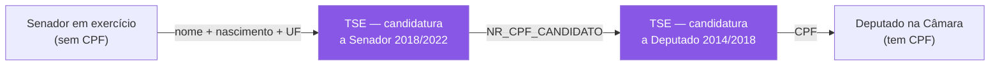

# TSE — Dados Abertos Eleitorais

> **Status:** v1.1 — 2026-08-22
> **v1.1:** §1.1 — o papel do TSE no desenho consolidado: passa de enriquecimento a
> **infraestrutura de identidade**, por ser a chave que torna determinística a ponte
> deputado→senador (achado #18). P4 retestada: segue sem espelho acessível.
> ⚠️ **Aviso de confiabilidade.** Diferente dos documentos 10 e 11, **este documento não
> pôde ser validado ao vivo**: o TSE bloqueou o acesso automatizado deste ambiente
> (HTTP 403, ver seção 2). Tudo que está marcado **`[A CONFIRMAR]`** vem de conhecimento
> prévio sobre o formato e **precisa ser verificado no primeiro download manual**. O que
> está marcado ✅ foi testado.

---

## 1. O que o TSE oferece — e o papel dele no projeto

O TSE **não** tem dados de votação parlamentar. Ele tem dados **eleitorais**: quem se
candidatou, com que partido, quanto declarou de patrimônio, quantos votos recebeu, como
gastou a campanha.

No Poligraph, o TSE é **fonte de enriquecimento de nó**, não de aresta:

| O que agrega | Onde entra |
|---|---|
| Histórico de candidaturas (quantas vezes tentou, por quais partidos) | Ficha do parlamentar |
| **Patrimônio declarado** e sua evolução entre eleições | Ficha; potencial análise própria |
| Votos recebidos e distribuição geográfica | Ficha; mapa |
| Escolaridade, ocupação, cor/raça, gênero, idade | Atributos do nó no grafo |
| Financiamento de campanha | Fase futura |

→ **O TSE não afeta o algoritmo de afinidade.** Ele torna o produto mais rico e sustenta o
objetivo específico #1 do TCC (integrar fontes heterogêneas), mas **não está no caminho
crítico**. Isso é deliberado — ver seção 2.

---

## 1.1 ⭐ Onde o TSE entra no desenho que se consolidou

O papel do TSE mudou desde a v1.0 deste documento. Situando-o no desenho atual — dois
grafos independentes, matriz por legislatura, achado #18:

### 1.1.1 Sendo honesto: o TSE não sustenta o núcleo

| Entrega do título | Precisa do TSE? |
|---|---|
| Arquitetura ETL | 🟡 Reforça (é a fonte heterogênea de verdade), mas Câmara+Senado já exercitam |
| Modelagem em Grafos | ⛔ Não — arestas vêm de voto, coautoria e comissão |
| Mensuração de Afinidade | ⛔ Não — vem só de votação |
| Recomendação de Notícias | ⛔ Não — vem de tema + parlamentar |

**Nenhuma das quatro entregas do título depende do TSE.** É preciso dizer isso com todas as
letras, porque é a fonte de **maior atrito** (403, carga manual, layout ainda
`[A CONFIRMAR]`) e **menor carga estrutural**.

⚠️ **Mas o objetivo específico #1 nomeia as três fontes** — *"TSE, Câmara e Senado"*.
Cortar o TSE obriga a reescrever o objetivo. É decisão de escopo, não de engenharia.

### 1.1.2 ⭐ O papel novo: o TSE é a chave da ponte entre as casas

Este é o uso que **não existia** quando este documento foi escrito, e é o mais valioso.

O achado #18 mostrou que **41 dos 81 senadores já foram deputados**. Para explorar isso
(F9), é preciso casar a pessoa nas duas casas. E aí está o problema:

```
Câmara  →  tem CPF        ✅
Senado  →  NÃO tem CPF    ⛔
```

Sem o TSE, ligar "Senador X hoje" a "Deputado X em 2019" depende de **fuzzy match por
nome** — frágil e sujeito a homônimo.

**Com o TSE, o join vira determinístico dos dois lados:**



O *fuzzy match* fica confinado a **um único salto** (senador → TSE), e todo o resto é CPF.
Melhor ainda: esse salto é conferível à mão, porque são 81 pessoas.

→ **O TSE deixa de ser só enriquecimento e passa a ser infraestrutura de identidade.**
É o argumento mais forte para mantê-lo no escopo.

### 1.1.3 Mapeamento eleição → legislatura

O desenho atual segmenta tudo por legislatura (RN-12). O TSE se alinha a isso
naturalmente, **exceto no Senado**:

| Casa | Legislatura 57 (2023–2027) | Arquivos TSE necessários |
|---|---|---|
| **Câmara** | 513 deputados, todos eleitos de uma vez | `consulta_cand_2022` |
| **Senado** | 81 senadores, eleitos em **duas** eleições | `consulta_cand_2018` **e** `consulta_cand_2022` |

⚠️ **Pegadinha da renovação escalonada.** Em 2018 cada estado elegeu **2** senadores
(27 × 2 = **54**); em 2022, **1** (27 × 1 = **27**). Logo, dos 81 senadores atuais,
**54 vêm da eleição de 2018** — a maioria. Buscar só em 2022 encontraria **um terço** deles
e falharia silenciosamente nos outros dois terços.

Para a F9 (ponte deputado→senador), soma-se `consulta_cand_2014` e `_2018` para cobrir a
fase de deputado.

### 1.1.4 O que o TSE agrega, por ordem de valor

| # | Uso | Valor | Fase |
|---|---|---|---|
| 1 | **Chave de identidade para a ponte entre casas** | ⭐⭐ Estrutural | F9 |
| 2 | Atributos de nó: escolaridade, ocupação, cor/raça, idade | ⭐ Enriquece o grafo e permite correlações | F7 |
| 3 | Histórico de candidaturas (quantas vezes, por quais partidos) | ⭐ Ficha | F7 |
| 4 | Patrimônio declarado e evolução | 🟡 Atraente, mas sensível — apresentar sem juízo | F7 |
| 5 | Votos recebidos por município | 🟡 Ver ressalva abaixo | F7 |

⚠️ **Ressalva sobre o item 5 e a recomendação de notícias.** É tentador usar a geografia do
TSE para recomendar *"políticos da sua região"*. Isso exigiria saber onde o usuário está —
o que **conflita com o RNF-12** (não coletar dado identificável). Se for adiante, tem de
ser **opt-in explícito e efêmero**: o usuário informa o estado, usa-se na resposta e não se
persiste nada.

---

---

## 2. ✅ Achado crítico #5 — bloqueio de acesso automatizado

**Testado em 2026-08-22:**

| URL | Resultado |
|---|---|
| `https://dadosabertos.tse.jus.br/` | ⛔ **HTTP 403** |
| `https://dadosabertos.tse.jus.br/dataset/candidatos-2022` | ⛔ **HTTP 403** |
| `https://cdn.tse.jus.br/estatistica/sead/odsele/consulta_cand/consulta_cand_2022.zip` | ⛔ **HTTP 403** |
| Mesma URL com `User-Agent: Mozilla/5.0 (Windows NT 10.0; Win64; x64)` | ⛔ **HTTP 403** |

O 403 persiste com User-Agent de navegador, o que indica proteção mais sofisticada que
filtro de UA — provavelmente WAF com *fingerprinting* de TLS/JA3, verificação de cookie de
sessão, ou bloqueio por reputação de IP/datacenter.

### 2.1 Consequências arquiteturais

1. **O TSE não pode ser um job de ingestão agendado.** Qualquer arquitetura que assuma
   "worker baixa o TSE toda semana" é inviável.
2. **Modelo adotado: carga manual versionada.**
   - baixar o ZIP **pelo navegador**, manualmente, uma vez;
   - depositar em um diretório de *landing* conhecido (ou storage);
   - registrar em um manifesto (`fonte`, `ano`, `arquivo`, `sha256`, `data_download`,
     `url_origem`);
   - o ETL lê **do disco**, nunca da rede.
3. **Vantagem inesperada:** dados eleitorais são **imutáveis** depois da diplomação. Não
   há motivo real para reingestão periódica. O que parecia limitação é, na prática,
   adequado ao domínio.

⚠️ **Reprodutibilidade do TCC.** Como o download é manual, a banca não consegue reproduzir
o pipeline do zero sem esse passo. **Documente o hash de cada arquivo** e descreva o
procedimento de obtenção no texto. Isso transforma uma fragilidade em rigor metodológico.

### 2.2 Alternativas a investigar

| Alternativa | Observação |
|---|---|
| Download manual via navegador | ✅ Caminho adotado |
| Pacote `electionsBR` (R) / `cepesp` | Wrappers que podem ter caminhos alternativos — **`[A CONFIRMAR]`** |
| Base dos Dados (BigQuery público) | Espelha dados do TSE tratados. Reduz o trabalho de limpeza, mas **adiciona um intermediário** entre você e a fonte primária — precisa ser declarado no TCC |
| Portal de dados abertos gov.br | Pode espelhar os mesmos arquivos sem o WAF — **`[A CONFIRMAR]`** |

---

## 3. `[A CONFIRMAR]` Estrutura dos arquivos

### 3.1 Formato

| Característica | Valor esperado |
|---|---|
| Distribuição | ZIP por ano, contendo um CSV por UF (+ `BRASIL`) |
| Encoding | **Latin-1 (ISO-8859-1)** — ⚠️ **não é UTF-8** |
| Separador | `;` |
| Delimitador de texto | `"` |
| Datas | `dd/MM/yyyy` |
| Decimais | vírgula (`1234,56`) |
| Nulos | `#NULO#`, `#NE#` (não existe), `-1`, `-3` como sentinelas |
| Tamanho | centenas de MB por ano |

⚠️ **O encoding Latin-1 é a causa número um de bug nesse dataset.** Ler como UTF-8
corrompe todo nome com acento — e depois o *fuzzy match* com o Senado falha por motivo
que parece misterioso. No .NET:
`new StreamReader(path, Encoding.GetEncoding("ISO-8859-1"))` (precisa de
`Encoding.RegisterProvider(CodePagesEncodingProvider.Instance)`).

⚠️ **Sentinelas `#NULO#` e `#NE#` não são nulos SQL.** Se não forem tratados, viram
strings literais e poluem agregações.

### 3.2 Datasets relevantes

| Dataset | Conteúdo | Prioridade |
|---|---|---|
| `consulta_cand_{ano}` | Cadastro de candidaturas — **o principal** | 🔴 Alta |
| `bem_candidato_{ano}` | Patrimônio declarado, item a item | 🟡 Média |
| `votacao_candidato_munzona_{ano}` | Votos por município/zona | 🟡 Média |
| `prestacao_de_contas_*` | Receitas e despesas de campanha | 🟢 Baixa |
| `perfil_eleitorado_{ano}` | Perfil do eleitorado (agregado, não por candidato) | 🟢 Baixa |

### 3.3 `[A CONFIRMAR]` Campos de `consulta_cand`

Os que importam para o projeto:

| Campo | Uso |
|---|---|
| **`NR_CPF_CANDIDATO`** | 🔑 **Join com a Câmara** |
| **`SQ_CANDIDATO`** | 🔑 Chave interna do TSE — liga aos outros datasets (bens, votação) |
| `NM_CANDIDATO` | Nome civil |
| `NM_URNA_CANDIDATO` | ⚠️ Nome de urna — **instável entre eleições**, nunca usar como chave |
| `NM_SOCIAL_CANDIDATO` | Nome social |
| `DT_NASCIMENTO` | 🔑 Chave de *fuzzy match* com o Senado |
| `SG_UF` / `SG_UE` | Unidade eleitoral |
| `CD_CARGO` / `DS_CARGO` | Filtrar por Deputado Federal / Senador |
| `NR_TURNO` | 1 ou 2 |
| `SG_PARTIDO` / `NR_PARTIDO` | Partido **na época da eleição** |
| `DS_COMPOSICAO_COLIGACAO` | Coligação/federação |
| `DS_SIT_TOT_TURNO` | 🔑 **Resultado**: eleito, suplente, não eleito |
| `DS_GRAU_INSTRUCAO` | Atributo do nó |
| `DS_OCUPACAO` | Atributo do nó |
| `DS_COR_RACA`, `DS_GENERO` | Atributos do nó |
| `VR_DESPESA_MAX_CAMPANHA` | Teto declarado |
| `DS_SITUACAO_CANDIDATURA` | Deferida / indeferida — **filtrar** |

⚠️ **`DS_SIT_TOT_TURNO` tem categorias que confundem.** Espera-se algo como *ELEITO POR
QP* (quociente partidário), *ELEITO POR MÉDIA*, *SUPLENTE*, *NÃO ELEITO*. "Eleito" não é
um valor único — filtrar por igualdade a `"ELEITO"` perde a maioria dos deputados.
**Confirmar o domínio real no primeiro download.**

⚠️ **`NR_CPF_CANDIDATO` precisa ser lido como texto.** CPF com zero à esquerda vira
número e perde o dígito → o join com a Câmara falha exatamente para essas pessoas, de
forma silenciosa.

---

## 4. Correlação com as outras bases

| Alvo | Chave | Força |
|---|---|---|
| **→ Câmara** | `NR_CPF_CANDIDATO` ↔ `cpf` (de `deputados.csv`) | 🔑 **Determinística** |
| **→ Senado** | `NM_CANDIDATO` + `DT_NASCIMENTO` + `SG_UF` | ⚠️ Fuzzy |
| **Interno** | `SQ_CANDIDATO` liga candidatura → bens → votos | ✅ Forte |

⚠️ **`SQ_CANDIDATO` muda a cada eleição.** É chave da *candidatura*, não da *pessoa*. Para
o histórico de uma pessoa ao longo de várias eleições, a chave é o **CPF**.

⚠️ **Senadores exigem buscar em mais de um ano eleitoral** — a renovação é escalonada
(1/3 e 2/3), então o Senado atual foi eleito em duas eleições distintas. Ver
[02-senado-federal.md](02-senado-federal.md) §2.

Detalhes em [13-correlacao-entre-fontes.md](13-correlacao-entre-fontes.md).

---

## 5. ⚠️ LGPD e ética

O dado é público e oficial, mas é **dado pessoal de pessoas identificadas**. Recomendações
já registradas no risco R7 do discovery:

- **Não republicar CPF.** Use-o como chave interna e armazene apenas um **hash** se
  precisar persistir (`cpf_hash` no modelo).
- Patrimônio declarado é público, mas é sensível — apresente como dado, **sem** juízo
  ("enriqueceu", "suspeito").
- Nada de dado de candidatos **não eleitos** no produto final: eles não são agentes
  públicos em exercício, e o interesse público que justifica a exposição é muito menor.

---

## 6. Pendências

| # | Pendência | Bloqueia |
|---|---|---|
| **P1** | Fazer o **primeiro download manual** e validar todo o `[A CONFIRMAR]` deste documento | Tudo do TSE |
| **P2** | Confirmar o domínio real de `DS_SIT_TOT_TURNO` | Filtro de eleitos |
| **P3** | Confirmar layout de `bem_candidato` e `votacao_candidato_munzona` | Enriquecimento |
| ~~P4~~ | 🔶 **RETESTADA em 2026-08-22, sem solução.** `cdn.tse.jus.br` segue 403 com UA de navegador; `dados.gov.br` exige credencial (401). Carga manual confirmada | — |
| **P5** | Decidir se usa **Base dos Dados** como atalho e como declarar isso no TCC | Metodologia |
| **P6** | Definir onde versionar arquivos de centenas de MB (**não** no Git — usar Git LFS, storage externo, ou só o manifesto com hash) | Repositório |
