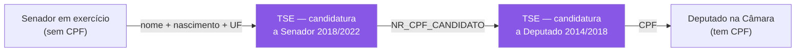

# TSE — Dados Abertos Eleitorais

> 🔄 **v3.0 — 2026-08-27: O TSE SAIU DO PAPEL.** A prestação de contas de 2022 está
> **ingerida**: 22.511 receitas de campanha, **642 dos 643** deputados, R$ 907,7 mi de
> Fundo Especial. O acesso descrito em §2.0 foi **reconferido ao vivo** — `HEAD` continua
> devolvendo 403 e `GET` com `Range`, 200.
>
> 🔴 **E apareceu uma armadilha que o discovery ⛔ não tinha visto**, porque só aparece
> ao abrir o ZIP: o **DF ⛔ não tem arquivo estadual próprio**, e o consolidado duplica os
> estaduais. 📐 [Achado #23](achados/023-consolidado-do-tse-e-o-unico-com-df.md).
>
> ⚠️ **O que continua valendo desta página:** §1.1.2 — o TSE como **infraestrutura de
> identidade** para a ponte deputado→senador. Esse uso ⛔ ainda não foi implementado, e
> segue sendo o argumento mais forte para manter o TSE no escopo.

> **Status:** v2.0 — 2026-08-23
> 🔄 **v2.0 — REESCRITO APÓS VALIDAÇÃO REAL.** O **achado #5 foi derrubado**: o TSE **é**
> automatizável, com o conjunto completo de headers de navegador. O
> `consulta_cand_2022.zip` foi baixado, extraído e analisado por script. Pendências
> **P1, P2, P4 e P6 resolvidas**. Ver §2.0, §3 e §3.4.
> **v1.1:** §1.1 — o TSE como infraestrutura de identidade para a ponte deputado→senador.
>
> ✅ **Este documento passou de especulativo a validado.** O que restava marcado
> `[A CONFIRMAR]` foi verificado no arquivo real.

---

## 1. O que o TSE oferece — e o papel dele no projeto

O TSE **não** tem dados de votação parlamentar. Ele tem dados **eleitorais**: quem se
candidatou, com que partido, quanto declarou de patrimônio, quantos votos recebeu, como
gastou a campanha.

No Poligraph, o TSE é **fonte de enriquecimento de nó**, não de aresta:

| O que agrega | Onde entra |
|---|---|
| Histórico de candidaturas (quantas vezes tentou, por quais partidos) | Ficha do parlamentar |
| **Patrimônio declarado** e sua evolução entre eleições | Ficha; potencial análise própria |
| Votos recebidos e distribuição geográfica | Ficha; mapa |
| Escolaridade, ocupação, cor/raça, gênero, idade | Atributos do nó no grafo |
| Financiamento de campanha | Fase futura |

→ **O TSE não afeta o algoritmo de afinidade.** Ele torna o produto mais rico e sustenta o
objetivo específico #1 do TCC (integrar fontes heterogêneas), mas **não está no caminho
crítico**. Isso é deliberado.

---

## 1.1 ⭐ Onde o TSE entra no desenho que se consolidou

O papel do TSE mudou desde a v1.0 deste documento. Situando-o no desenho atual — dois
grafos independentes, matriz por legislatura, achado #18:

### 1.1.1 Sendo honesto: o TSE não sustenta o núcleo

| Entrega do título | Precisa do TSE? |
|---|---|
| Arquitetura ETL | 🟡 Reforça (é a fonte heterogênea de verdade), mas Câmara+Senado já exercitam |
| Modelagem em Grafos | ⛔ Não — arestas vêm de voto, coautoria e comissão |
| Mensuração de Afinidade | ⛔ Não — vem só de votação |
| Recomendação de Notícias | ⛔ Não — vem de tema + parlamentar |

**Nenhuma das quatro entregas do título depende do TSE.** É preciso dizer isso com todas as
letras, porque é a de **menor carga estrutural**. (O atrito de acesso caiu muito: o TSE
se mostrou automatizável — §2.0 — e o layout está validado.)

⚠️ **Mas o objetivo específico #1 nomeia as três fontes** — *"TSE, Câmara e Senado"*.
Cortar o TSE obriga a reescrever o objetivo. É decisão de escopo, não de engenharia.

### 1.1.2 ⭐ O papel novo: o TSE é a chave da ponte entre as casas

Este é o uso que **não existia** quando este documento foi escrito, e é o mais valioso.

O achado #18 mostrou que **41 dos 81 senadores já foram deputados**. Para explorar isso
(F9), é preciso casar a pessoa nas duas casas. E aí está o problema:

```
Câmara  →  tem CPF        ✅
Senado  →  NÃO tem CPF    ⛔
```

Sem o TSE, ligar "Senador X hoje" a "Deputado X em 2019" depende de **fuzzy match por
nome** — frágil e sujeito a homônimo.

**Com o TSE, o join vira determinístico dos dois lados:**



O *fuzzy match* fica confinado a **um único salto** (senador → TSE), e todo o resto é CPF.
Melhor ainda: esse salto é conferível à mão, porque são 81 pessoas.

→ **O TSE deixa de ser só enriquecimento e passa a ser infraestrutura de identidade.**
É o argumento mais forte para mantê-lo no escopo.

### 1.1.3 Mapeamento eleição → legislatura

O desenho atual segmenta tudo por legislatura (RN-12). O TSE se alinha a isso
naturalmente, **exceto no Senado**:

| Casa | Legislatura 57 (2023–2027) | Arquivos TSE necessários |
|---|---|---|
| **Câmara** | 513 deputados, todos eleitos de uma vez | `consulta_cand_2022` |
| **Senado** | 81 senadores, eleitos em **duas** eleições | `consulta_cand_2018` **e** `consulta_cand_2022` |

⚠️ **Pegadinha da renovação escalonada.** Em 2018 cada estado elegeu **2** senadores
(27 × 2 = **54**); em 2022, **1** (27 × 1 = **27**). Logo, dos 81 senadores atuais,
**54 vêm da eleição de 2018** — a maioria. Buscar só em 2022 encontraria **um terço** deles
e falharia silenciosamente nos outros dois terços.

Para a F9 (ponte deputado→senador), soma-se `consulta_cand_2014` e `_2018` para cobrir a
fase de deputado.

### 1.1.4 O que o TSE agrega, por ordem de valor

| # | Uso | Valor | Fase |
|---|---|---|---|
| 1 | **Chave de identidade para a ponte entre casas** | ⭐⭐ Estrutural | F9 |
| 2 | Atributos de nó: escolaridade, ocupação, cor/raça, idade | ⭐ Enriquece o grafo e permite correlações | F7 |
| 3 | Histórico de candidaturas (quantas vezes, por quais partidos) | ⭐ Ficha | F7 |
| 4 | Patrimônio declarado e evolução | 🟡 Atraente, mas sensível — apresentar sem juízo | F7 |
| 5 | Votos recebidos por município | 🟡 Ver ressalva abaixo | F7 |

⚠️ **Ressalva sobre o item 5 e a recomendação de notícias.** É tentador usar a geografia do
TSE para recomendar *"políticos da sua região"*. Isso exigiria saber onde o usuário está —
o que **conflita com o RNF-12** (não coletar dado identificável). Se for adiante, tem de
ser **opt-in explícito e efêmero**: o usuário informa o estado, usa-se na resposta e não se
persiste nada.

---

---

## 2. 🔄 Achado #5 **DERRUBADO** — o TSE É automatizável

> ⚠️ **Esta seção foi reescrita em 2026-08-23.** A versão anterior afirmava que o TSE
> bloqueava acesso automatizado e que a carga teria de ser **manual**. **Isso está errado.**
> O arquivo foi baixado, extraído e validado por script. Tudo abaixo é medido.

### 2.0 O que destravou: o **conjunto** de headers, não o User-Agent

O 403 não dependia da URL nem do User-Agent isolado. Depende de o cliente **parecer um
navegador de verdade**, com o conjunto completo de cabeçalhos. Isolamento feito em
`consulta_cand_2022.zip`:

| Tentativa | Resultado |
|---|---|
| `curl` padrão | ⛔ 403 |
| Só `User-Agent` de navegador | ⛔ 403 |
| `User-Agent` + `Accept-Encoding` | ⛔ 403 |
| Conjunto completo **sem** `Accept-Encoding` | ⛔ 403 |
| **Conjunto completo COM `Accept-Encoding`** | ✅ **200 — 4.378.231 bytes** |

**Receita que funciona:**

```
User-Agent: Mozilla/5.0 (Windows NT 10.0; Win64; x64) AppleWebKit/537.36
            (KHTML, like Gecko) Chrome/131.0.0.0 Safari/537.36
Accept: */*
Accept-Language: pt-BR,pt;q=0.9
Accept-Encoding: gzip, deflate, br          ← obrigatório
Sec-Fetch-Dest: document
Sec-Fetch-Mode: navigate
Sec-Fetch-Site: none
Upgrade-Insecure-Requests: 1
```

⚠️ **`Accept-Encoding` é a peça que faltava**, mas sozinho não basta — é o conjunto que
passa. Comportamento típico de WAF que pontua "parece navegador?" por combinação de sinais.

### 2.0.1 🔴 E o WAF bloqueia `HEAD`, mesmo com a receita completa

> **Descoberto em 2026-08-27**, ao levantar as fontes de gasto.

| Método | Mesma URL, mesmos headers |
|---|---|
| `HEAD` | ⛔ **403** |
| `GET` | ✅ **200 · 4.389.914 bytes** |

🔴 **Isto engana com facilidade.** Verificar disponibilidade com `HEAD` é o reflexo
natural — é a requisição barata, que não baixa o corpo. E aqui ela **mente**: leva a
concluir que *"o TSE fechou de novo"* quando nada fechou.

⭐ **Para checar sem baixar o arquivo inteiro**, use `GET` com `Range`:

```bash
curl -r 0-2000 -H "..." "https://cdn.tse.jus.br/..."   # 206, só o começo
```

⚠️ Vale para todo o CDN — testado em `consulta_cand`, `prestacao_contas` e no ZIP de
fotos de candidato.

⚠️ **Isto é frágil por natureza.** O TSE pode endurecer a regra a qualquer momento. Trate
como **otimização, não como garantia**: o pipeline deve detectar 403 e degradar para carga
manual, que continua sendo o plano B documentado em §2.2.

### 2.1 ✅ Consequências — três decisões revertidas

| Decisão anterior | Agora |
|---|---|
| Carga **manual** obrigatória | ✅ **Automatizável** — job normal de ETL |
| TSE fora do caminho de reprodutibilidade | ✅ **Pipeline reproduzível de ponta a ponta** |
| "Arquivos de centenas de MB" | ❌ **Errado** — ver tamanhos reais abaixo |

📊 **Tamanhos reais medidos** (muito menores do que este documento supunha):

| Arquivo | Tamanho |
|---|---|
| `consulta_cand_2022.zip` | **4,2 MB** |
| `consulta_cand_2018.zip` | **4,5 MB** |
| `bem_candidato_2022.zip` | **5,1 MB** |
| `perfil_eleitorado_ATUAL.zip` | 81,4 MB |

→ **O TSE inteiro que o projeto precisa cabe em ~14 MB.** A pendência B5 (onde versionar
"arquivos de centenas de MB") **deixa de existir** — cabe no repositório, se quiser.

### 2.2 Registro histórico — o bloqueio anterior

**Testado em 2026-08-22, com cliente sem os headers completos:**

| URL | Resultado |
|---|---|
| `https://dadosabertos.tse.jus.br/` | ⛔ **HTTP 403** |
| `https://dadosabertos.tse.jus.br/dataset/candidatos-2022` | ⛔ **HTTP 403** |
| `https://cdn.tse.jus.br/estatistica/sead/odsele/consulta_cand/consulta_cand_2022.zip` | ⛔ **HTTP 403** |
| Mesma URL com `User-Agent: Mozilla/5.0 (Windows NT 10.0; Win64; x64)` | ⛔ **HTTP 403** |

O 403 persiste com User-Agent de navegador, o que indica proteção mais sofisticada que
filtro de UA — provavelmente WAF com *fingerprinting* de TLS/JA3, verificação de cookie de
sessão, ou bloqueio por reputação de IP/datacenter.

### 2.1 Consequências arquiteturais

1. **O TSE não pode ser um job de ingestão agendado.** Qualquer arquitetura que assuma
   "worker baixa o TSE toda semana" é inviável.
2. **Modelo adotado: carga manual versionada.**
   - baixar o ZIP **pelo navegador**, manualmente, uma vez;
   - depositar em um diretório de *landing* conhecido (ou storage);
   - registrar em um manifesto (`fonte`, `ano`, `arquivo`, `sha256`, `data_download`,
     `url_origem`);
   - o ETL lê **do disco**, nunca da rede.
3. **Vantagem inesperada:** dados eleitorais são **imutáveis** depois da diplomação. Não
   há motivo real para reingestão periódica. O que parecia limitação é, na prática,
   adequado ao domínio.

⚠️ **Reprodutibilidade do TCC.** Como o download é manual, a banca não consegue reproduzir
o pipeline do zero sem esse passo. **Documente o hash de cada arquivo** e descreva o
procedimento de obtenção no texto. Isso transforma uma fragilidade em rigor metodológico.

### 2.2 Alternativas a investigar

| Alternativa | Observação |
|---|---|
| Download manual via navegador | ✅ Caminho adotado |
| Pacote `electionsBR` (R) / `cepesp` | Wrappers que podem ter caminhos alternativos — **`[A CONFIRMAR]`** |
| Base dos Dados (BigQuery público) | Espelha dados do TSE tratados. Reduz o trabalho de limpeza, mas **adiciona um intermediário** entre você e a fonte primária — precisa ser declarado no TCC |
| Portal de dados abertos gov.br | Pode espelhar os mesmos arquivos sem o WAF — **`[A CONFIRMAR]`** |

---

## 3. ✅ Estrutura dos arquivos — **VALIDADA** em 2026-08-23

> Todo `[A CONFIRMAR]` desta seção foi verificado no arquivo real
> `consulta_cand_2022.zip` (SHA-256 `1c2b0b59ce498c40…`), baixado e extraído.

### 3.0 Conteúdo do ZIP

```
leiame.pdf                          208 KB   ← documentação oficial do layout
consulta_cand_2022_AC.csv           290 KB
consulta_cand_2022_AL.csv           270 KB
…                                            (um CSV por UF)
consulta_cand_2022_BRASIL.csv      15,7 MB   ← consolidado nacional
                                   30 arquivos, 31,7 MB descompactado
```

→ **Use o `_BRASIL.csv`.** Os arquivos por UF são subconjuntos dele; ingerir os 27 mais o
consolidado duplicaria tudo.

⚠️ **O `leiame.pdf` traz o dicionário de dados oficial.** Vale ler antes de escrever o
parser — é a única documentação autoritativa do layout.

### 3.1 ✅ Formato — confirmado

| Característica | **Medido** |
|---|---|
| Encoding | ✅ **ISO-8859-1 (Latin-1)** — confirmado por `file` |
| Separador | ✅ `;` |
| Quebra de linha | ⚠️ **CRLF** — detalhe novo, não estava documentado |
| Delimitador de texto | `"` |
| Campos | ✅ **50** |
| Linhas (`BRASIL`, 2022) | **29.323** |

📊 **Contagem de eleitos por cargo em 2022** — bate exatamente com o esperado:

| Cargo | `CD_CARGO` | Eleitos |
|---|---|---|
| **Deputado federal** | **6** | ✅ **513** |
| **Senador** | **5** | ✅ **27** |
| Deputado estadual | 7 | 1.035 |
| Deputado distrital | 8 | 24 |
| Governador / Vice | 3 / 4 | 27 / 27 |
| Presidente / Vice | 1 / 2 | 1 / 1 |
| 1º / 2º Suplente (Senado) | 9 / 10 | 27 / 27 |

→ Os **27 senadores** confirmam a renovação escalonada (§1.1.3): em 2022 cada estado
elegeu **um**. Os outros 54 estão em `consulta_cand_2018`.

### 3.1.1 🔴 A armadilha do CPF — quantificada

📊 **9.477 dos 29.322 CPFs (32%) começam com zero.**

Ler `NR_CPF_CANDIDATO` como número **perde o dígito inicial de um terço dos registros**, e
o join falha **em silêncio** exatamente para eles. Não há erro, não há exceção — só
casamentos que não acontecem.

→ **Regra: `string` do início ao fim, nas duas pontas.** Vale também para o lado da
Câmara: o deputado 221328 tem CPF `05585378805`.

⚠️ **Sentinela não documentada:** 29 registros têm CPF com **2 caracteres** — valor `-4`.
Some-se às sentinelas já conhecidas (`#NULO#`, `#NE#`). Tratar como `null`.

### 3.1.2 Como ler em .NET

⚠️ **O encoding Latin-1 é a causa número um de bug nesse dataset.** Ler como UTF-8
corrompe todo nome com acento — e depois o *fuzzy match* com o Senado falha por motivo
que parece misterioso. No .NET:
`new StreamReader(path, Encoding.GetEncoding("ISO-8859-1"))` (precisa de
`Encoding.RegisterProvider(CodePagesEncodingProvider.Instance)`).

⚠️ **Sentinelas `#NULO#` e `#NE#` não são nulos SQL.** Se não forem tratados, viram
strings literais e poluem agregações.

### 3.2 Datasets relevantes

| Dataset | Conteúdo | Prioridade |
|---|---|---|
| `consulta_cand_{ano}` | Cadastro de candidaturas — **o principal** | 🔴 Alta |
| `bem_candidato_{ano}` | Patrimônio declarado, item a item | 🟡 Média |
| `votacao_candidato_munzona_{ano}` | Votos por município/zona | 🟡 Média |
| `prestacao_de_contas_*` | Receitas e despesas de campanha | 🟢 Baixa |
| `perfil_eleitorado_{ano}` | Perfil do eleitorado (agregado, não por candidato) | 🟢 Baixa |

### 3.3 ✅ Campos de `consulta_cand` — posições confirmadas

Todos existem, nas posições medidas no header real:

| # | Campo | # | Campo |
|---|---|---|---|
| 11 | `SG_UF` | 27 | `SG_PARTIDO` |
| 14 | **`CD_CARGO`** | 37 | `DT_NASCIMENTO` |
| 15 | `DS_CARGO` | 42 | `DS_GRAU_INSTRUCAO` |
| 16 | **`SQ_CANDIDATO`** | 46 | `DS_COR_RACA` |
| 18 | `NM_CANDIDATO` | 48 | `DS_OCUPACAO` |
| 19 | `NM_URNA_CANDIDATO` | 49 | `CD_SIT_TOT_TURNO` |
| 21 | **`NR_CPF_CANDIDATO`** | 50 | **`DS_SIT_TOT_TURNO`** |

#### ✅ Pendência B2 resolvida — domínio real de `DS_SIT_TOT_TURNO`

📊 Medido nos 29.322 registros de 2022:

| Valor | Ocorrências |
|---|---|
| `SUPLENTE` | 14.623 |
| `NÃO ELEITO` | 11.276 |
| `#NULO` | 1.662 |
| **`ELEITO POR QP`** | 1.182 |
| **`ELEITO POR MÉDIA`** | 390 |
| **`ELEITO`** | 137 |
| `2º TURNO` | 52 |

🔴 **"Eleito" são TRÊS valores distintos.** Filtrar por `= 'ELEITO'` captura **137 de
1.709** — menos de 8%. O alerta da versão anterior estava certo, e agora está quantificado.

→ Se precisar filtrar eleitos: `DS_SIT_TOT_TURNO LIKE 'ELEITO%'`.

⚠️ **Mas para o nosso join, não filtre por situação — ver §3.4.**

### 3.4 ⭐ Join Câmara ↔ TSE — **testado, 100%**

Teste com amostra de 60 deputados que votaram na legislatura 57:

| Etapa | Resultado |
|---|---|
| CPFs obtidos via API da Câmara | 59 de 60 |
| Casaram com **`DS_SIT_TOT_TURNO LIKE 'ELEITO%'`** | 46 (78%) |
| Casaram com **`CD_CARGO = 6`**, sem filtro de situação | ✅ **59 (100%)** |

**Os 13 que "faltavam" não estavam faltando** — estavam no arquivo com outra situação:

```
11 × SUPLENTE      ← assumiram por sucessão
 2 × NÃO ELEITO    ← idem
```

Faz todo sentido: quem exerce mandato inclui suplentes convocados, que **não** foram
eleitos. Filtrar por "eleito" os elimina justamente quando eles são parte da população.

> 🔑 **Regra de ouro do join: filtre por `CD_CARGO`, nunca por `DS_SIT_TOT_TURNO`.**
> A pergunta é *"esta pessoa concorreu a este cargo?"*, não *"ela venceu?"*.

#### 🔴 CORREÇÃO IMPORTANTE — o CPF **não** está no CSV consolidado

Uma versão anterior deste projeto afirmava *"CPF a 100% dos deputados ativos"* no
`deputados.csv`. **Estava errado** — a medição usou um índice de coluna quebrado.

📊 Medido: **0 de 7.889 linhas** do `deputados.csv` têm `cpf` preenchido. A coluna existe e
está **vazia**.

| Fonte do CPF | Disponível? |
|---|---|
| `arquivos/deputados/csv/deputados.csv` | ⛔ **Coluna vazia** |
| `GET /api/v2/deputados/{id}` | ✅ **Sim** |

→ **Consequência para o ETL:** obter CPF exige **uma chamada REST por deputado** (~644 na
legislatura), não um download de CSV. É barato, mas precisa estar no plano — e é o único
ponto do pipeline da Câmara que **não** pode usar a via de arquivos.

### 3.5 Outros campos de interesse

| Campo | Uso |
|---|---|
| **`NR_CPF_CANDIDATO`** | 🔑 **Join com a Câmara** |
| **`SQ_CANDIDATO`** | 🔑 Chave interna do TSE — liga aos outros datasets (bens, votação) |
| `NM_CANDIDATO` | Nome civil |
| `NM_URNA_CANDIDATO` | ⚠️ Nome de urna — **instável entre eleições**, nunca usar como chave |
| `NM_SOCIAL_CANDIDATO` | Nome social |
| `DT_NASCIMENTO` | 🔑 Chave de *fuzzy match* com o Senado |
| `SG_UF` / `SG_UE` | Unidade eleitoral |
| `CD_CARGO` / `DS_CARGO` | Filtrar por Deputado Federal / Senador |
| `NR_TURNO` | 1 ou 2 |
| `SG_PARTIDO` / `NR_PARTIDO` | Partido **na época da eleição** |
| `DS_COMPOSICAO_COLIGACAO` | Coligação/federação |
| `DS_SIT_TOT_TURNO` | 🔑 **Resultado**: eleito, suplente, não eleito |
| `DS_GRAU_INSTRUCAO` | Atributo do nó |
| `DS_OCUPACAO` | Atributo do nó |
| `DS_COR_RACA`, `DS_GENERO` | Atributos do nó |
| `VR_DESPESA_MAX_CAMPANHA` | Teto declarado |
| `DS_SITUACAO_CANDIDATURA` | Deferida / indeferida — **filtrar** |

⚠️ **`DS_SIT_TOT_TURNO` tem categorias que confundem.** Espera-se algo como *ELEITO POR
QP* (quociente partidário), *ELEITO POR MÉDIA*, *SUPLENTE*, *NÃO ELEITO*. "Eleito" não é
um valor único — filtrar por igualdade a `"ELEITO"` perde a maioria dos deputados.
**Confirmar o domínio real no primeiro download.**

⚠️ **`NR_CPF_CANDIDATO` precisa ser lido como texto.** CPF com zero à esquerda vira
número e perde o dígito → o join com a Câmara falha exatamente para essas pessoas, de
forma silenciosa.

---

## 4. Correlação com as outras bases

| Alvo | Chave | Força |
|---|---|---|
| **→ Câmara** | `NR_CPF_CANDIDATO` ↔ `cpf` (de `deputados.csv`) | 🔑 **Determinística** |
| **→ Senado** | `NM_CANDIDATO` + `DT_NASCIMENTO` + `SG_UF` | ⚠️ Fuzzy |
| **Interno** | `SQ_CANDIDATO` liga candidatura → bens → votos | ✅ Forte |

⚠️ **`SQ_CANDIDATO` muda a cada eleição.** É chave da *candidatura*, não da *pessoa*. Para
o histórico de uma pessoa ao longo de várias eleições, a chave é o **CPF**.

⚠️ **Senadores exigem buscar em mais de um ano eleitoral** — a renovação é escalonada
(1/3 e 2/3), então o Senado atual foi eleito em duas eleições distintas. Ver
[02-senado-federal.md](02-senado-federal.md) §2.

Detalhes em [13-correlacao-entre-fontes.md](13-correlacao-entre-fontes.md).

---

## 5. ⚠️ LGPD e ética

O dado é público e oficial, mas é **dado pessoal de pessoas identificadas**. Recomendações
já registradas no risco R7 do discovery:

- **Não republicar CPF.** Use-o como chave interna e armazene apenas um **hash** se
  precisar persistir (`cpf_hash` no modelo).
- Patrimônio declarado é público, mas é sensível — apresente como dado, **sem** juízo
  ("enriqueceu", "suspeito").
- Nada de dado de candidatos **não eleitos** no produto final: eles não são agentes
  públicos em exercício, e o interesse público que justifica a exposição é muito menor.

---

## 6. Pendências

| # | Pendência | Bloqueia |
|---|---|---|
| ~~TS1~~ | ✅ **RESOLVIDA — 2026-08-23.** Arquivo baixado por script e validado: encoding, separador, 50 campos, 513 dep. federais, 27 senadores | — |
| ~~TS2~~ | ✅ **RESOLVIDA** — 7 valores; "eleito" são 3 deles (§3.3). Mas o join deve filtrar por `CD_CARGO`, não por situação (§3.4) | — |
| ~~TS3~~ | ✅ **RESOLVIDA — 2026-08-23.** bem_candidato validado; votacao_candidato_munzona medido (609 MB) e posto fora de escopo | Enriquecimento |
| ~~TS4~~ | ✅ **RESOLVIDA — 2026-08-23.** Desnecessária: o próprio CDN do TSE funciona com o conjunto completo de headers (§2.0) | — |
| **TS5** | Decidir se usa **Base dos Dados** como atalho e como declarar isso no TCC | Metodologia |
| ~~TS6~~ | ✅ **RESOLVIDA** — os arquivos somam ~14 MB, não centenas. Cabem no repositório se quiser | — |
