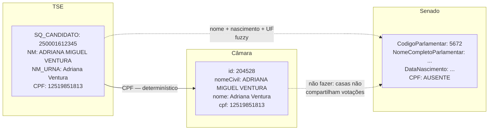
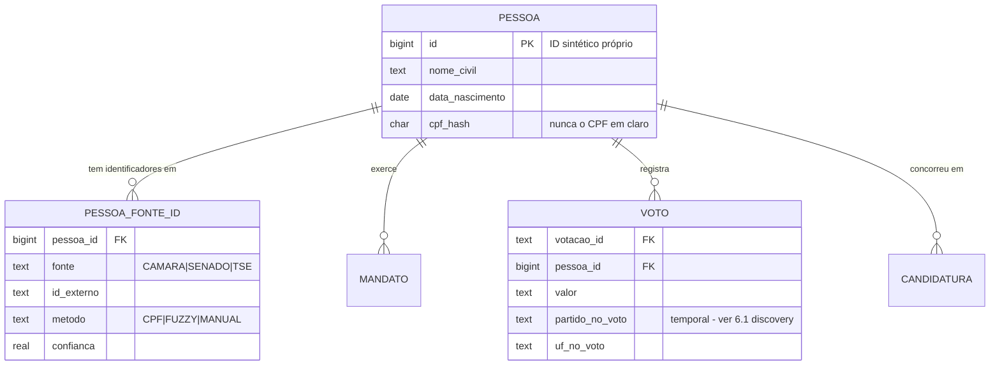
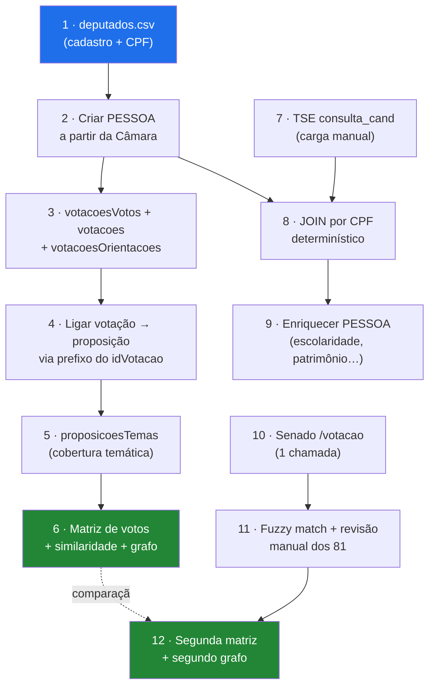

# Correlação entre as fontes — *entity resolution*

> **Status:** v1.0 — 2026-08-22
> Este é o **problema técnico central do ETL** e o que sustenta o objetivo específico #2
> do TCC. Fontes: [10-api-camara.md](10-api-camara.md),
> [11-api-senado.md](11-api-senado.md), [12-fonte-tse.md](12-fonte-tse.md).

---

## 1. O problema em uma frase

A mesma pessoa aparece nas três bases com **identificadores diferentes, nomes diferentes e
partidos diferentes**, e nenhuma das bases conhece as outras.



---

## 2. Mapa das chaves

| De → Para | Chave | Força | Volume | Ação |
|---|---|---|---|---|
| **Câmara → TSE** | `cpf` ↔ `NR_CPF_CANDIDATO` | 🔑 **Determinística** | 552/ano | Automática |
| **Senado → TSE** | `NomeCompletoParlamentar` + `DataNascimento` + UF | ⚠️ Fuzzy | 84 | Semiautomática + revisão manual |
| **Câmara ↔ Senado** | — | ⛔ Não existe | — | **Não fazer** — ver §5 |
| Votação → proposição (Câmara) | prefixo do `idVotacao` | ✅ 30/30 | 526/ano | Automática |
| Votação → matéria (Senado) | `codigoMateria` | ✅ | 128/ano | Automática |
| Candidatura → bens/votos (TSE) | `SQ_CANDIDATO` | ✅ | — | Automática |
| Pessoa através de eleições (TSE) | `NR_CPF_CANDIDATO` | 🔑 | — | Automática |

---

## 3. Modelo de identidade

**Nunca** use o identificador de uma fonte como chave primária do sistema. Se a Câmara
mudar o id de um deputado, ou se você adicionar uma quarta fonte, o modelo inteiro quebra.



O campo **`metodo`** em `PESSOA_FONTE_ID` não é enfeite: ele registra *como* aquela ligação
foi feita. No TCC, poder dizer *"482 ligações determinísticas por CPF, 70 por fuzzy match
com revisão manual, 0 não resolvidas"* é resultado, não detalhe de implementação.

---

## 4. Algoritmo de conciliação

### 4.1 Câmara ↔ TSE — determinístico

```
1. Normalizar CPF: remover máscara, preservar zeros à esquerda, validar 11 dígitos
2. JOIN direto cpf ↔ NR_CPF_CANDIDATO
3. Filtrar TSE: CD_CARGO = Deputado Federal, situação deferida
4. Se CPF não bater → fila de exceção (não descartar silenciosamente)
```

⚠️ **A única armadilha real aqui é tipagem.** CPF lido como número perde zeros à esquerda.
Trate como `string` do início ao fim, nas duas pontas.

⚠️ Um deputado pode ter **várias candidaturas** (2018, 2022, 2026). O join é
`1 pessoa : N candidaturas`. Não use `JOIN` esperando cardinalidade 1.

### 4.2 Senado ↔ TSE — fuzzy com revisão

Sem CPF, o procedimento proposto:

```
1. Normalizar nomes: maiúsculas, remover acentos, colapsar espaços,
   remover partículas ("DE", "DA", "DOS")
2. Bloco de candidatos: CD_CARGO = Senador, UF = UfParlamentar,
   anos eleitorais que compõem o Senado atual (duas eleições)
3. Score = similaridade de nome (Jaro-Winkler ou Levenshtein normalizado)
4. Match automático se: nome ≥ 0,95 E data de nascimento idêntica
5. Match sugerido se: nome ≥ 0,85 E mesma UF        → REVISÃO MANUAL
6. Abaixo disso                                      → REVISÃO MANUAL
7. Registrar metodo='FUZZY' ou 'MANUAL' + score em PESSOA_FONTE_ID
```

**São 81 pessoas.** Revisar à mão é trabalho de uma tarde e produz precisão de 100% —
resultado melhor do que qualquer heurística, e perfeitamente defensável na banca desde
que documentado.

⚠️ **Homônimos existem no Senado.** Casos de pai e filho com o mesmo nome na política
brasileira não são raros. A data de nascimento é o desempate essencial.

### 4.3 Nomes de urna — nunca como chave

`NM_URNA_CANDIDATO` muda entre eleições e é livremente escolhido: *"Tiririca"*,
*"Professor X"*, *"Delegado Y"*. Serve para **exibição** e como sinal fraco de *fuzzy
match*, jamais como chave.

---

## 5. ⛔ O que deliberadamente NÃO se liga

**Câmara ↔ Senado não se conectam no nível da votação.** Verificado:

- `siglaOrgao` nas 526 votações nominais da Câmara em 2025: **nenhuma ocorrência de `CN`**;
- `casaSessao` nas 128 votações do Senado em 2025: **`SF` em 100%**.

As sessões conjuntas do Congresso Nacional — a única ponte plausível — **não aparecem em
nenhuma das duas APIs**. E, mesmo se aparecessem, na apreciação de veto os votos são
apurados **separadamente por casa**, então nem lá existe um colégio único.

→ Consequência: **dois grafos, duas matrizes, duas análises**, e a comparação entre elas
como resultado. Ver achado #7 do discovery e §6 de
[02-senado-federal.md](02-senado-federal.md).

⚠️ Uma pessoa **pode** aparecer nas duas casas ao longo do tempo (deputado que vira
senador). Nesse caso é a **mesma `pessoa`**, com **dois `mandato`s** e votos em duas
matrizes distintas. O modelo suporta; a análise é que não mistura.

---

## 6. Ordem de execução do ETL



**A Câmara é a espinha dorsal.** É a única fonte que tem CPF *e* volume, então ela ancora
a tabela `pessoa`; TSE e Senado penduram-se nela.

---

## 7. Métricas de qualidade a reportar no TCC

Estas métricas **são resultado do trabalho**, não diagnóstico interno. Reserve uma tabela
para elas:

| Métrica | Como medir |
|---|---|
| Taxa de resolução determinística | % de deputados com CPF casado no TSE |
| Taxa de resolução fuzzy | % de senadores casados automaticamente |
| Intervenções manuais | Nº absoluto (esperado: baixo, ~10–20) |
| Falsos positivos detectados na revisão | Nº — mede a qualidade do limiar escolhido |
| Cobertura temática | % de proposições com ao menos um tema (medido: **24/25 = 96%**) |
| Cobertura votação → matéria | % de votações ligadas a uma proposição (medido: **30/30** na amostra) |
| Deputados abaixo do corte de 20 votações | Medido: **14 de 552 (2,5%)** |

---

## 8. Pendências

| # | Pendência | Depende de |
|---|---|---|
| ~~ER1~~ | ✅ **RESOLVIDA — 2026-08-23.** Join testado: 59 de 59 filtrando por CD_CARGO ([04-contratos §7](04-contratos.md)) | Download manual do TSE |
| **ER2** | Escolher a biblioteca de *fuzzy match* (Jaro-Winkler vs Levenshtein) e calibrar o limiar | Decisão D1 |
| ~~ER3~~ | ✅ **RESOLVIDA — 2026-08-23.** Desnecessario — a carga do TSE e automatizavel; o manifesto vira log de carga comum | — |
| ~~ER4~~ | ✅ **RESOLVIDA — 2026-08-23.** Camara: 2022. Senado: 2018 E 2022, com CD_CARGO IN (5,9,10) | Download do TSE |
| **ER5** | Decidir se `cpf_hash` usa salt e qual | Modelagem |
