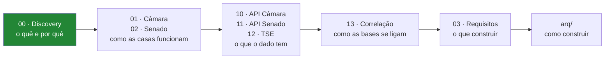

# Documentação do Poligraph

> Índice da documentação do TCC. **Comece pelo discovery.**
> Atualizado em 2026-08-22.

---

## Por onde começar

---

## Índice

### Fundamentos

| Doc | Conteúdo |
|---|---|
| [00-discovery.md](00-discovery.md) | **Documento central.** Escopo, fontes, riscos, decisões, roadmap. Contém os 12 achados de exploração |
| [03-requisitos.md](03-requisitos.md) | Requisitos funcionais e não funcionais, regras de negócio, restrições |

### Contexto institucional — *como o Brasil legisla*

| Doc | Conteúdo |
|---|---|
| [01-camara-dos-deputados.md](01-camara-dos-deputados.md) | 513 deputados, comissões, tipos de proposição, como se vota. **Explica por que o dado é estranho** |
| [02-senado-federal.md](02-senado-federal.md) | 81 senadores, poderes exclusivos, Congresso Nacional, diferenças entre as casas |

### Referência de fontes de dados

| Doc | Conteúdo | Validado ao vivo? |
|---|---|---|
| [10-api-camara.md](10-api-camara.md) | Endpoints, payloads reais, CSVs consolidados, 15 armadilhas | ✅ Sim |
| [11-api-senado.md](11-api-senado.md) | Endpoints, envelopes XML→JSON, endpoint depreciado | ✅ Sim |
| [12-fonte-tse.md](12-fonte-tse.md) | Arquivos CSV, bloqueio 403, carga manual | ⚠️ **Parcial** — 403 impediu validação |
| [13-correlacao-entre-fontes.md](13-correlacao-entre-fontes.md) | *Entity resolution*, chaves, ordem do ETL | ✅ Sim |

### Rascunhos de arquitetura

| Doc | Conteúdo |
|---|---|
| [arq/README.md](arq/README.md) | Índice + como escolher entre os cenários |
| [arq/01-cenario-a-so-camara.md](arq/01-cenario-a-so-camara.md) | Mínimo viável — 1 base |
| [arq/02-cenario-b-camara-tse.md](arq/02-cenario-b-camara-tse.md) | ⭐ **Recomendado** — 2 bases |
| [arq/03-cenario-c-tres-bases.md](arq/03-cenario-c-tres-bases.md) | Completo — 3 bases |
| [arq/10-api-e-afinidade.md](arq/10-api-e-afinidade.md) | API REST + motor de afinidade |
| [arq/20-crawler-noticias.md](arq/20-crawler-noticias.md) | Crawler — quais feeds, qual linguagem |

---

## Os 12 achados de exploração

Resumo do que a investigação nas APIs revelou. Detalhes no
[discovery](00-discovery.md).

| # | Achado | Impacto |
|---|---|---|
| 1 | 📊 Só **3,5%** das votações são nominais (526 de 15.037 em 2025) | Dimensiona o projeto |
| 2 | `/votos` rejeita o parâmetro `itens` (HTTP 400) | Implementação |
| 3 | `idVotacao` é string composta, não inteiro | Modelagem |
| 4 | Endpoint de votações do Senado está **depreciado** | Evita quebra futura |
| 5 | TSE bloqueia acesso automatizado (**403**) | Muda a arquitetura |
| 6 | ✅ Existem **CSVs consolidados por ano** | Elimina o problema N+1 |
| 7 | ⚠️ **As duas casas não compartilham votações** | Define o escopo |
| 8 | `uriProposicaoCitada` aponta para parecer, não para o projeto | Evita questionário inútil |
| 9 | ✅ O **prefixo do `idVotacao` é o id da proposição** (30/30) | Simplifica o join |
| 10 | ✅ Existe **classificação temática oficial** (96% de cobertura) | Elimina trabalho manual |
| 11 | ⚠️ **58%** das votações nominais são procedimentais | Filtro do questionário |
| 12 | ⚠️ **A polaridade de "Sim" não é constante** (14% invertidas) | Corrige erro silencioso |

---

## Números de referência (medidos em 2025)

| Métrica | Câmara | Senado |
|---|---|---|
| Votações totais | 15.037 | — |
| Votações nominais | **526** | **128** |
| Parlamentares distintos que votaram | 552 | 84 |
| Registros de voto | ~167.000 | ~10.400 |
| Votações substantivas | 145 | a medir |
| Proposições distintas (substantivas) | 100 | a medir |
| Comissões permanentes | 30 | 16 |
| Trocas de partido no ano | 14 | a medir |
| Tamanho da matriz de votos | **290 KB** | 11 KB |

---

## Convenções

- 📊 = número **medido** nos dados reais, não estimado
- ✅ = verificado ao vivo · ⚠️ = armadilha · ⛔ = não funciona
- `[A CONFIRMAR]` = conhecimento prévio ainda **não validado**
- Cada documento termina com uma seção **Pendências**
