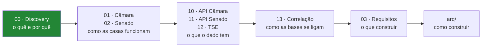

# Documentação do Poligraph

> Índice da documentação do TCC *Arquitetura ETL e Modelagem em Grafos: Mensuração de Afinidade
> Política em Redes Sociais e Análise de Dados Financeiros de Políticos*. Atualizado em 2026-10-18.
>
> Para o estado de hoje, comece pelo [mapa do sistema](../mapa_do_sistema.html) e pelas
> [pendências](PENDENCIAS.md); os documentos abaixo guardam também a história das decisões.

---

## 📖 Perdeu um termo?

[**`glossario.md`**](glossario.md) — o que é *ementa*, *proposição*, *destaque*,
*polaridade*, *poço*, e como cada um se liga aos outros. ⭐ Cada verbete diz **por que
aquilo importa aqui**, ⛔ não só o que é — e a §2 lista os pares que **já produziram
bug** por serem confundidos.

---

## Por onde começar

---

## 🔴 Os quatro tipos de documento

⭐ **A regra que organiza tudo:** cada arquivo tem **um** ciclo de vida. Misturá-los é o
que faz um documento ficar "meio desatualizado", sem ninguém saber qual metade.

| Tipo | Ciclo de vida | Onde |
|---|---|---|
| **Achado** | ⏸️ Nunca muda — foi medido naquele dia. Remedir gera achado **novo** | [`achados/`](achados/README.md) |
| **Método** | 🔄 Muda quando o cálculo muda | [`metodos.md`](metodos.md) |
| **Referência** | 🔄 Precisa estar **sempre** atual; mentir aqui é caro | `01`, `02`, `10`–`13`, `plano/` |
| **Histórico** | 🗄️ Valor documental, zero operacional | [`arq/`](arq/README.md) |

🔴 **Cada número tem UM dono.** Outros documentos citam com link, ⛔ nunca repetem o
valor — número repetido é número que diverge.

---

## Índice

### ⭐ Para a parte teórica

| Doc | Conteúdo |
|---|---|
| [**achados/**](achados/README.md) | 🔬 **Os 24 achados**, um arquivo cada: o que foi medido, como, quando, resultado. **É o que a fundamentação cita** |
| [**metodos.md**](metodos.md) | 📐 **O que cada número significa** — `r` de Pearson, ARI, modularidade, variância explicada. Com intervalo, leitura e valor medido |

> ⚠️ **`r` significa duas coisas neste projeto** — correlação de Pearson (0,862) e razão
> de decaimento (0,86). Não são a mesma grandeza. Ver [`metodos.md`](metodos.md).

### Fundamentos

| Doc | Conteúdo |
|---|---|
| [00-discovery.md](00-discovery.md) | **Documento central.** Título do TCC, escopo, fontes, riscos, decisões, roadmap. ⚠️ Os achados foram extraídos para [`achados/`](achados/README.md) — aqui fica a narrativa |
| [03-requisitos.md](03-requisitos.md) | Requisitos funcionais e não funcionais, regras de negócio, restrições |
| [04-contratos.md](04-contratos.md) | **Contratos** — entradas, saídas e uso, com cardinalidades medidas |
| [14-fontes-de-gasto.md](14-fontes-de-gasto.md) | 💰 **O que enriquece o perfil** — cota, emendas e fundão, **os três ingerindo**. Com o critério que reprova licitações e PNCP |
| [PENDENCIAS.md](PENDENCIAS.md) | ⭐ **Visão consolidada** — 46 abertas, agrupadas pelo que destrava cada uma |
| [REVISAR-ANTES-DA-CONCLUSAO.md](REVISAR-ANTES-DA-CONCLUSAO.md) | ⏳ **Fatos com prazo de validade** — reverificar antes de escrever |

### Contexto institucional — *como o Brasil legisla*

| Doc | Conteúdo |
|---|---|
| [01-camara-dos-deputados.md](01-camara-dos-deputados.md) | 513 deputados, comissões, tipos de proposição, como se vota. **Explica por que o dado é estranho** |
| [02-senado-federal.md](02-senado-federal.md) | 81 senadores, poderes exclusivos, Congresso Nacional, diferenças entre as casas |

### Referência de fontes de dados

| Doc | Conteúdo | Validado ao vivo? |
|---|---|---|
| [10-api-camara.md](10-api-camara.md) | Endpoints, payloads reais, CSVs consolidados, 15 armadilhas | ✅ Sim |
| [11-api-senado.md](11-api-senado.md) | Endpoints, envelopes XML→JSON, endpoint depreciado | ✅ Sim |
| [12-fonte-tse.md](12-fonte-tse.md) | Arquivos CSV, o WAF, prestação de contas | ✅ **v3.0** — prestação de contas de 2022 **ingerida** |
| [13-correlacao-entre-fontes.md](13-correlacao-entre-fontes.md) | *Entity resolution*, chaves, ordem do ETL | ✅ Sim |

### Rascunhos de arquitetura

| Doc | Conteúdo |
|---|---|
| [plano/README.md](plano/README.md) | ⭐ **Plano de implementação** — stack, arquitetura, login, métricas, perguntas |
| [arq/README.md](arq/README.md) | Índice + como escolher entre os cenários |
| [arq/01-cenario-a-so-camara.md](arq/01-cenario-a-so-camara.md) | Mínimo viável — 1 base |
| [arq/02-cenario-b-camara-tse.md](arq/02-cenario-b-camara-tse.md) | 2 bases — não escolhido |
| [arq/03-cenario-c-tres-bases.md](arq/03-cenario-c-tres-bases.md) | ✅ **DECIDIDO** — 3 bases, dois grafos independentes |
| [arq/10-api-e-afinidade.md](arq/10-api-e-afinidade.md) | API REST + motor de afinidade |
| [arq/20-crawler-noticias.md](arq/20-crawler-noticias.md) | Crawler de notícias. Fora do escopo desde 2026-10-02 (Pendência 61), guardado como registro |
| [arq/30-pagina-do-parlamentar.md](arq/30-pagina-do-parlamentar.md) | Página do parlamentar — perfil da "rede social" |

---

## Os 24 achados

Resumo do que a investigação nas APIs revelou. Detalhes no
[discovery](00-discovery.md).

| # | Achado | Impacto |
|---|---|---|
| 1 | 📊 Só **3,8%** das votações da Câmara são nominais | Dimensiona o projeto |
| 2 | `/votos` rejeita o parâmetro `itens` (HTTP 400) | Implementação |
| 3 | `idVotacao` é string composta, não inteiro | Modelagem |
| 4 | Endpoint de votações do Senado está **depreciado** | Evita quebra futura |
| 5 | TSE bloqueia acesso automatizado (**403**) | Muda a arquitetura |
| 6 | ✅ Existem **CSVs consolidados por ano** (2001–2026) | Elimina o problema N+1 |
| 7 | ⚠️ **As duas casas não compartilham votações** | Dois grafos, não um |
| 8 | `uriProposicaoCitada` aponta para parecer, não para o projeto | Evita questionário inútil |
| 9 | ✅ O **prefixo do `idVotacao` é o id da proposição** (30/30) | Simplifica o join |
| 10 | ✅ Existe **classificação temática oficial** (96% de cobertura) | Elimina trabalho manual |
| 11 | ⚠️ **58%** das votações nominais são procedimentais | Filtro do questionário |
| 12 | ⚠️ **A polaridade de "Sim" não é constante** (14% invertidas) | Corrige erro silencioso |
| 13 | ⛔ **Frentes são inúteis como aresta** — 317 de 320 para um deputado | Grafo usa comissão |
| 14 | ⚠️ O ponto cego se repete **dentro** da comissão | Limita a cobertura |
| 15 | ⚠️ Votações de comissão **não** entram na matriz — 3× mais consensuais | Evita bloco falso |
| 16 | ⭐ **Relatoria** é o melhor sinal não-votação (mediana 7/deputado) | Perfil temático |
| 17 | 🔴 **56% das votações do Senado são secretas** | Senado tem 182, não 421 |
| 18 | ⭐ **41 dos 81 senadores já foram deputados** | Ponte temporal entre grafos |

### ⭐ E os que vieram da IMPLEMENTAÇÃO, não do discovery

⚠️ **Estes só apareceram ao rodar o ETL contra a fonte real** — nenhum deles era visível
lendo documentação ou fazendo requisição de amostra. É o argumento empírico a favor de
implementar cedo.

| # | Achado | Impacto |
|---|---|---|
| 19 | Os CSVs são **reconstruídos toda madrugada**, todos os anos | Reingestão precisa ser idempotente |
| 20 | O endpoint devolve **duplicatas** | Deduplicação obrigatória |
| 21 | A CPMI **não publica** votação nominal | ⏳ Prazo de validade |
| 22 | `deputados.csv` **não é anual** e **não tem coluna `id`** | O ETL registrava `0 deputados` em INFO |
| 23 | 🔴 No TSE, o **consolidado é o único com o DF** — e duplica os estaduais | R$ 17,2 mi perdidos em silêncio |
| 24 | ⭐ O `codigoEmenda` embute um id estável de **mandato** | Chave que serve à Câmara **e** ao Senado |

---

## Números de referência

**Por legislatura (57ª — 2023 a agosto/2026):**

| Métrica | Câmara | Senado |
|---|---|---|
| Votações nominais | **1.570** | 421 |
| **Votações utilizáveis** | **1.103** (plenário) | **182** (abertas) |
| Registros de voto | ~463.000 | — |
| Série disponível | **2001–2026** | 2019–2026 testados |

**Em 2025, isoladamente:**

| Métrica | Câmara | Senado |
|---|---|---|
| Votações totais | 13.825 | — |
| Votações nominais | 526 (410 no plenário) | 128 (56 abertas) |
| Parlamentares distintos | 552 | 84 |
| Registros de voto | ~167.000 | ~10.400 |
| Votações substantivas | 145 (sobre 100 proposições) | a medir |
| Comissões permanentes | 30 | 16 |
| Trocas de partido | 14 | a medir |

**Qualidade do dado:**

| | Câmara | Senado |
|---|---|---|
| Registros que são posição de voto | **99,3 %** | **34 %** |
| CPF disponível | ✅ **100 %** dos ativos | ⛔ Não expõe |
| Orientação de bancada | ✅ Sim | ⛔ Não existe |
| Redes sociais | 🟡 64 % | ⛔ Não expõe |
| Estabilidade das posições na legislatura | **r = 0,86** | a medir |

---

## Convenções

- 📊 = número **medido** nos dados reais, não estimado
- ✅ = verificado ao vivo · ⚠️ = armadilha · ⛔ = não funciona
- `[A CONFIRMAR]` = conhecimento prévio ainda **não validado**
- Cada documento termina com uma seção **Pendências**
