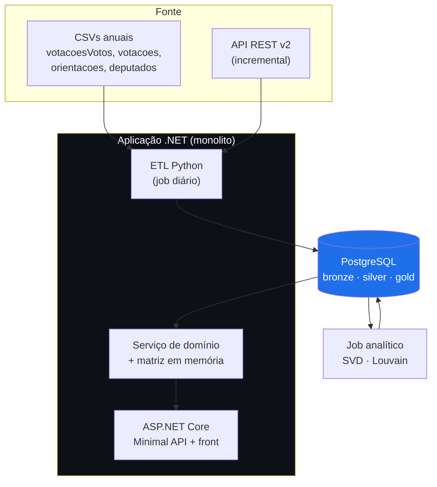

# Cenário A — Mínimo viável (só Câmara)

> **Bases:** Câmara dos Deputados
> **Custo:** 🟢 Baixo · **Prazo estimado:** ~4–6 semanas até F5
> **Veredito:** entrega o produto inteiro, mas **enfraquece o TCC**. Ver §6.

---

## 1. Contexto

Uma fonte só, um monolito. Todo o produto — grafo, questionário, ficha do parlamentar —
sai de `dadosabertos.camara.leg.br`. Não há *entity resolution*, não há carga manual, não
há conciliação.

É o cenário certo **se o objetivo do trabalho for o algoritmo de afinidade e a análise de
redes**, e não a engenharia de dados.

---

## 2. Diagrama

---

## 3. Componentes

| # | Componente | Responsabilidade |
|---|---|---|
| 1 | **Extrator CSV** | Baixa e faz *parse* dos CSVs anuais → bronze. Carga histórica |
| 2 | **Extrator API** | Só o ano corrente, por janela de data → bronze |
| 3 | **Transformador** | Normaliza voto, deriva `categoria` por regex na `descricao`, liga votação→proposição pelo prefixo do id |
| 4 | **Carregador** | Materializa a matriz de votos e as arestas |
| 5 | **Job analítico** | Similaridade, SVD, Louvain → grava de volta |
| 6 | **API + Front** | Consulta o gold |

**Volume total:** ~167 mil votos/ano × 4 anos ≈ 670 mil linhas. Cabe em qualquer máquina.

---

## 4. Stack

| Camada | Escolha | Nota |
|---|---|---|
| Runtime | **.NET 9** | `.gitignore` do repo já é .NET |
| CSV | **CsvHelper** | `descricao` tem `;` — parser de verdade é obrigatório |
| ORM | **Dapper** para leitura em massa, EF Core para o CRUD | EF em 167k inserts é lento |
| Banco | **PostgreSQL 16** | `COPY` para carga em massa |
| Analítico | **Python** (numpy/scipy/networkx) como job separado | Ver D1 |
| Front | ✅ **React + Vite** + Cytoscape.js | D5 decidida |

---

## 5. Pontos fortes

- **Caminho mais curto até um resultado defensável.** Nenhuma dependência externa manual,
  nenhum bloqueio de terceiros.
- **Zero *entity resolution*.** `deputado_id` é chave estável e única; não há ambiguidade
  a resolver.
- **Reprodutibilidade total.** Qualquer pessoa da banca roda `dotnet run` e obtém a mesma
  base — os CSVs são públicos e baixáveis por script.
- **Volume confortável e já medido:** 526 votações nominais, 552 deputados, 167 mil votos
  por ano.
- **O dado mais rico das três fontes.** Só a Câmara tem `/orientacoes` (rótulo oficial
  governo × oposição), classificação temática e CPF.
- **Roda em um notebook.** Sem Docker Compose, sem serviços auxiliares.

---

## 6. Pontos fracos

- 🔴 **Contradiz o objetivo específico #1 do TCC.** *"Ingerir e reconciliar dados de três
  fontes heterogêneas"* — com uma fonte, essa afirmação não se sustenta. **Seria preciso
  reescrever o objetivo**, e o trabalho perde o eixo de engenharia de dados.
- 🔴 **Objetivo específico #2 (*entity resolution*) desaparece por completo.**
- 🟡 A ficha do parlamentar fica pobre: sem TSE, não há patrimônio, escolaridade,
  ocupação, histórico eleitoral nem votos recebidos.
- 🟡 O trabalho fica mais próximo de "análise de dados" do que de "plataforma de dados" —
  o que muda o tipo de banca que o avalia bem.
- 🟢 Nenhum ponto fraco **técnico** relevante. A fragilidade é de escopo acadêmico, não de
  engenharia.

---

## 7. Pendências

| # | Pendência | Bloqueia |
|---|---|---|
| ~~A1~~ | ✅ **RESOLVIDA** — série de 2001 a 2026. Legislatura 57: 1.103 votações de plenário | — |
| **A2** | Definir as regras regex de `categoria` e validar contra amostra rotulada à mão | Filtro do questionário |
| **A3** | Decidir a estratégia de deduplicação de **PEC em dois turnos** | Viés de similaridade |
| **A4** | Medir quantas das 100 proposições substantivas sobrevivem ao corte de unanimidade | Tamanho do questionário |
| **A5** | Se escolher A, **reescrever os objetivos específicos #1 e #2** no texto do TCC | Coerência do trabalho |
