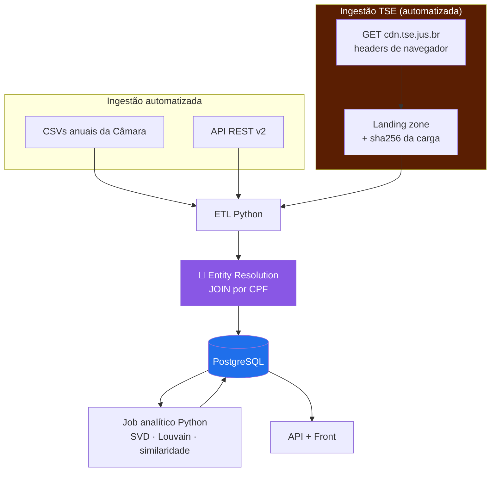

# Cenário B — Câmara + TSE ⭐ recomendado

> **Bases:** Câmara dos Deputados + TSE
> **Custo:** 🟡 Médio · **Prazo estimado:** ~7–9 semanas até F5+F7
> **Veredito:** ⚠️ **não escolhido** — a D3 optou pelo Cenário C. Mantido como registro.
> **Atualizado 2026-08-23:** o TSE deixou de exigir carga manual; B1–B5 resolvidas.

---

## 1. Contexto

Acrescenta ao [Cenário A](01-cenario-a-so-camara.md) a fonte que **realmente** torna o
pipeline heterogêneo. As duas fontes são opostas em quase tudo:

| | Câmara | TSE |
|---|---|---|
| Acesso | API REST + CSV via HTTP | ✅ CSV via HTTP, com headers de navegador |
| Formato | JSON / CSV UTF-8 | CSV **Latin-1**, `;`, sentinelas `#NULO#` |
| Atualização | Contínua | Imutável após diplomação |
| Chave | `id` próprio | `SQ_CANDIDATO` (muda por eleição) |
| Ponte | **`cpf`** ←──────────────→ **`NR_CPF_CANDIDATO`** | |

→ É exatamente esse contraste que sustenta o objetivo específico #1. E o join por CPF é
**determinístico e mensurável** — dá para reportar taxa de casamento como resultado.

---

## 2. Diagrama

O bloco laranja é a diferença em relação ao Cenário A. ⚠️ Era "assumidamente manual" até
2026-08-23; hoje é automatizável, mas mantém a landing zone porque o WAF pode endurecer.

---

## 3. Componentes adicionais

| # | Componente | Responsabilidade |
|---|---|---|
| 7 | **Landing zone versionada** | Diretório/storage com os ZIPs do TSE + manifesto (`fonte`, `ano`, `arquivo`, `sha256`, `data_download`, `url_origem`) |
| 8 | **Leitor TSE** | *Parse* Latin-1, `;`, `dd/MM/yyyy`, sentinelas `#NULO#`/`#NE#` → bronze |
| 9 | **Resolvedor de identidade** | Normaliza CPF (string, zeros à esquerda), faz o join, popula `pessoa_fonte_id` com `metodo='CPF'` |
| 10 | **Enriquecedor de perfil** | Escolaridade, ocupação, cor/raça, patrimônio, votos recebidos → atributos do nó |

---

## 4. Stack

Igual ao Cenário A, mais:

| Necessidade | Escolha | Nota |
|---|---|---|
| Encoding Latin-1 | `Encoding.GetEncoding("ISO-8859-1")` | Exige `CodePagesEncodingProvider.Instance` registrado |
| Arquivos | 13,8 MB no total — `consulta_cand` 2022+2018 e `bem_candidato` | Nada de especial |
| Versionamento dos brutos | Cabem no Git se quiser — 13,8 MB | B5 resolvida |
| Hash | SHA-256 no manifesto | Reprodutibilidade |

---

## 5. Pontos fortes

- ✅ **Sustenta os objetivos específicos #1 e #2 de verdade.** Duas fontes que não poderiam
  ser mais diferentes, unidas por uma chave forte.
- ✅ **O *entity resolution* é demonstrável e quantificável.** "482 de 513 casados por CPF,
  31 em fila de exceção" é resultado, não detalhe.
- ✅ **A ficha do parlamentar fica rica**: patrimônio declarado e sua evolução,
  escolaridade, ocupação, histórico de candidaturas, votos recebidos por município.
- ✅ **Habilita análises próprias** que a Câmara sozinha não permite — por exemplo,
  correlacionar posição no eixo ideológico (SVD) com patrimônio ou com votação recebida.
- ✅ **Custo incremental honesto**: o TSE não está no caminho crítico. Se atrasar, F1–F5
  já entregam produto.
- ✅ **A carga do TSE é automatizável** (headers de navegador) e o dado é imutável após a
  diplomação — baixa-se uma vez por eleição.

---

## 6. Pontos fracos

- ✅ ~~O passo manual quebra a reprodutibilidade~~ — **não há passo manual**: o CDN do TSE
  responde 200 com o conjunto completo de headers de navegador. Pipeline reproduzível de
  ponta a ponta. ⚠️ Mas é frágil: detectar 403 e degradar para carga manual como plano B.
- 🟡 **Risco de terceiro fora do seu controle:** o 403 do TSE pode piorar (bloqueio total)
  ou os arquivos podem mudar de URL. *Mitigação:* uma vez baixado e versionado, o projeto
  fica imune.
- ✅ ~~Layout do TSE não validado~~ — **validado em 2026-08-23**: 50 campos, 513 deputados
  federais, 27 senadores, join testado 59/59.
- ✅ ~~Arquivos de centenas de MB~~ — os usados somam **13,8 MB**.
- 🟡 O `NR_CPF_CANDIDATO` lido como número **perde zeros à esquerda** e o join falha
  silenciosamente só para essas pessoas — bug difícil de perceber.

---

## 7. Pendências

| # | Pendência | Bloqueia | Prioridade |
|---|---|---|---|
| ~~B1~~ | ✅ **RESOLVIDA — 2026-08-23.** Arquivo baixado por script e validado — o TSE e automatizavel | Todo o TSE | 🔴 Alta |
| ~~B2~~ | ✅ **RESOLVIDA — 2026-08-23.** DS_SIT_TOT_TURNO tem 7 valores; o join filtra por CD_CARGO, nao por situacao | Filtro de eleitos | 🔴 Alta |
| ~~B3~~ | ✅ **RESOLVIDA — 2026-08-23.** 59 de 59 na amostra testada | Métrica do TCC | 🟡 Média |
| ~~B4~~ | ✅ **RESOLVIDA — 2026-08-23.** Desnecessario — o proprio CDN do TSE funciona com o conjunto completo de headers | Reprodutibilidade | 🟡 Média |
| ~~B5~~ | ✅ **RESOLVIDA — 2026-08-23.** Desnecessario — os arquivos usados somam 13,8 MB | Repositório | 🟡 Média |
| **B6** | Decidir se usa **Base dos Dados (BigQuery)** como atalho, e como declarar o intermediário no TCC | Metodologia | 🟢 Baixa |
| ✅ ~~B7~~ | Resolvida pela Pendência 77 (2026-10-02): **HMAC-SHA256 com chave secreta** fora do banco | Modelagem / LGPD | — |
| — | Herda todas as pendências **A1–A4** do Cenário A | | |
