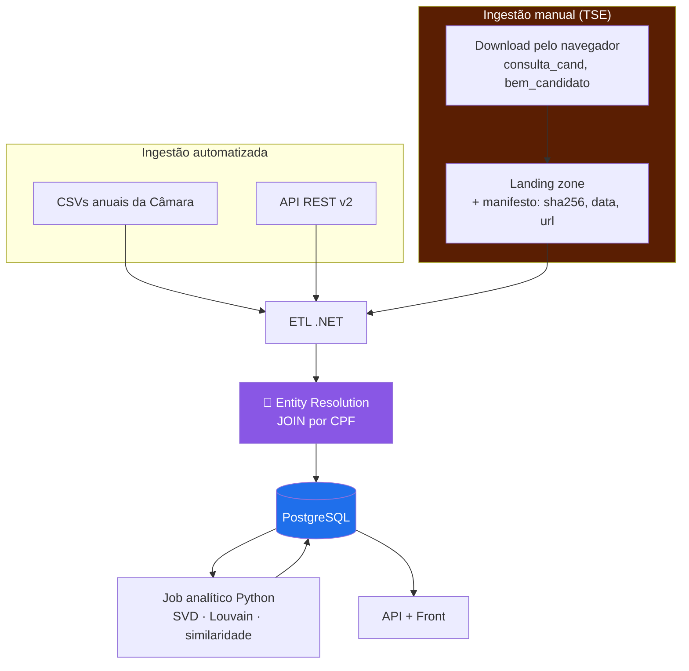

# Cenário B — Câmara + TSE ⭐ recomendado

> **Bases:** Câmara dos Deputados + TSE
> **Custo:** 🟡 Médio · **Prazo estimado:** ~7–9 semanas até F5+F7
> **Veredito:** melhor relação entre esforço e o que o TCC consegue afirmar.

---

## 1. Contexto

Acrescenta ao [Cenário A](01-cenario-a-so-camara.md) a fonte que **realmente** torna o
pipeline heterogêneo. As duas fontes são opostas em quase tudo:

| | Câmara | TSE |
|---|---|---|
| Acesso | API REST + CSV via HTTP | ⛔ **HTTP 403** — carga manual |
| Formato | JSON / CSV UTF-8 | CSV **Latin-1**, `;`, sentinelas `#NULO#` |
| Atualização | Contínua | Imutável após diplomação |
| Chave | `id` próprio | `SQ_CANDIDATO` (muda por eleição) |
| Ponte | **`cpf`** ←──────────────→ **`NR_CPF_CANDIDATO`** | |

→ É exatamente esse contraste que sustenta o objetivo específico #1. E o join por CPF é
**determinístico e mensurável** — dá para reportar taxa de casamento como resultado.

---

## 2. Diagrama

O bloco laranja é a diferença em relação ao Cenário A — e é **assumidamente manual**.

---

## 3. Componentes adicionais

| # | Componente | Responsabilidade |
|---|---|---|
| 7 | **Landing zone versionada** | Diretório/storage com os ZIPs do TSE + manifesto (`fonte`, `ano`, `arquivo`, `sha256`, `data_download`, `url_origem`) |
| 8 | **Leitor TSE** | *Parse* Latin-1, `;`, `dd/MM/yyyy`, sentinelas `#NULO#`/`#NE#` → bronze |
| 9 | **Resolvedor de identidade** | Normaliza CPF (string, zeros à esquerda), faz o join, popula `pessoa_fonte_id` com `metodo='CPF'` |
| 10 | **Enriquecedor de perfil** | Escolaridade, ocupação, cor/raça, patrimônio, votos recebidos → atributos do nó |

---

## 4. Stack

Igual ao Cenário A, mais:

| Necessidade | Escolha | Nota |
|---|---|---|
| Encoding Latin-1 | `Encoding.GetEncoding("ISO-8859-1")` | Exige `CodePagesEncodingProvider.Instance` registrado |
| Arquivos grandes | Leitura *streaming*, nunca `File.ReadAllLines` | Centenas de MB por ano |
| Versionamento dos brutos | **Não no Git.** Git LFS, storage externo, ou só o manifesto com hash | Ver pendência B5 |
| Hash | SHA-256 no manifesto | Reprodutibilidade |

---

## 5. Pontos fortes

- ✅ **Sustenta os objetivos específicos #1 e #2 de verdade.** Duas fontes que não poderiam
  ser mais diferentes, unidas por uma chave forte.
- ✅ **O *entity resolution* é demonstrável e quantificável.** "482 de 513 casados por CPF,
  31 em fila de exceção" é resultado, não detalhe.
- ✅ **A ficha do parlamentar fica rica**: patrimônio declarado e sua evolução,
  escolaridade, ocupação, histórico de candidaturas, votos recebidos por município.
- ✅ **Habilita análises próprias** que a Câmara sozinha não permite — por exemplo,
  correlacionar posição no eixo ideológico (SVD) com patrimônio ou com votação recebida.
- ✅ **Custo incremental honesto**: o TSE não está no caminho crítico. Se atrasar, F1–F5
  já entregam produto.
- ✅ A carga manual do TSE **não é um problema recorrente**: dado eleitoral é imutável
  depois da diplomação. Baixa-se uma vez.

---

## 6. Pontos fracos

- 🔴 **O passo manual quebra a reprodutibilidade automática.** A banca não roda o pipeline
  do zero sem baixar arquivos à mão. *Mitigação:* documentar procedimento + hash SHA-256
  de cada arquivo, e tratar isso como rigor metodológico declarado, não como omissão.
- 🟡 **Risco de terceiro fora do seu controle:** o 403 do TSE pode piorar (bloqueio total)
  ou os arquivos podem mudar de URL. *Mitigação:* uma vez baixado e versionado, o projeto
  fica imune.
- 🟡 **Todo o layout do TSE está `[A CONFIRMAR]`** — nada foi validado ao vivo. Há risco
  real de retrabalho no primeiro download.
- 🟡 Arquivos de centenas de MB exigem decisão sobre onde versionar (não no Git).
- 🟡 O `NR_CPF_CANDIDATO` lido como número **perde zeros à esquerda** e o join falha
  silenciosamente só para essas pessoas — bug difícil de perceber.

---

## 7. Pendências

| # | Pendência | Bloqueia | Prioridade |
|---|---|---|---|
| **B1** | **Fazer o primeiro download manual do TSE** e validar todos os `[A CONFIRMAR]` do [12-fonte-tse.md](../12-fonte-tse.md) | Todo o TSE | 🔴 Alta |
| **B2** | Confirmar o domínio real de `DS_SIT_TOT_TURNO` (filtrar eleitos não é `= 'ELEITO'`) | Filtro de eleitos | 🔴 Alta |
| **B3** | Medir a taxa real de casamento por CPF | Métrica do TCC | 🟡 Média |
| **B4** | Verificar se o portal **gov.br** espelha os arquivos sem WAF — reabilitaria automação | Reprodutibilidade | 🟡 Média |
| **B5** | Decidir onde versionar os brutos: Git LFS, storage externo ou só manifesto | Repositório | 🟡 Média |
| **B6** | Decidir se usa **Base dos Dados (BigQuery)** como atalho, e como declarar o intermediário no TCC | Metodologia | 🟢 Baixa |
| **B7** | Definir política de `cpf_hash` (com ou sem salt) | Modelagem / LGPD | 🟢 Baixa |
| — | Herda todas as pendências **A1–A4** do Cenário A | | |
