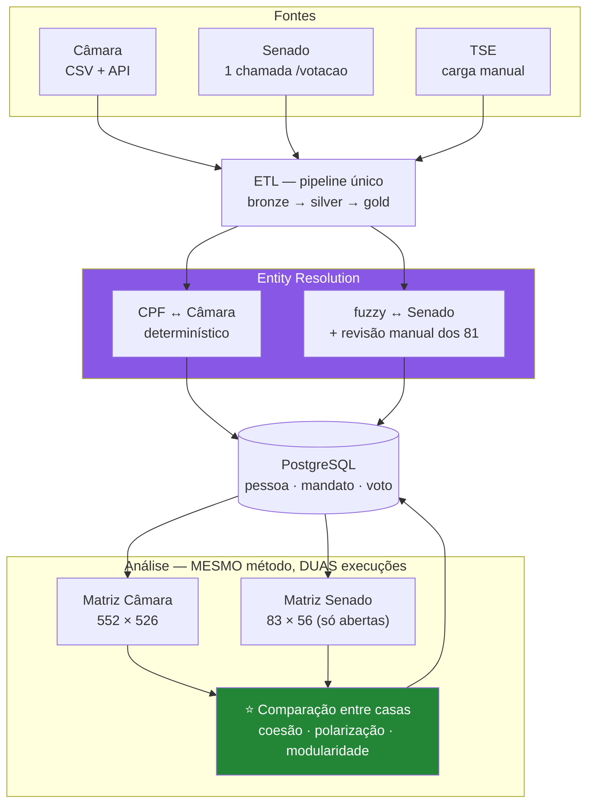
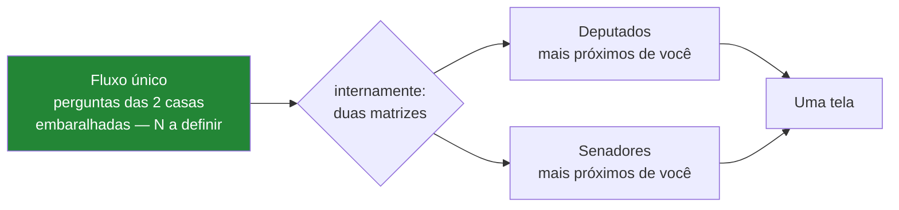
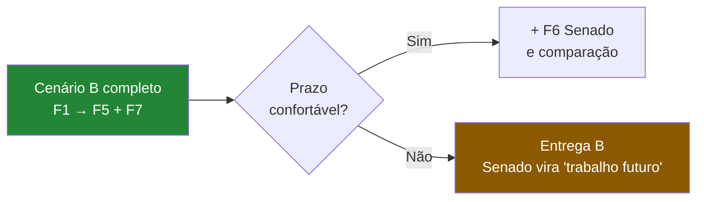

# Cenário C — Três bases (Câmara + TSE + Senado)

> **Bases:** Câmara + TSE + Senado
> **Custo:** 🔴 Alto — mas **não pelo motivo que parece**. Ver §1.
> **Prazo estimado:** ~10–13 semanas
> ✅ **ESCOLHIDO — 2026-08-22.** O Senado entra como **grafo independente**, mesmo com
> poucos dados: 56 votações abertas/ano, mas 88% dos pares com ≥20 em comum. Ver §11.1 do
> [discovery](../00-discovery.md).

---

## 1. Contexto — e a correção de uma intuição errada

A intuição natural é que o Senado é caro de ingerir. **É o contrário: é a fonte mais
barata das três.**

| | Custo de ingestão |
|---|---|
| Câmara | CSV de 58 MB/ano + parser robusto + join votação→proposição |
| TSE | Download manual + Latin-1 + sentinelas + arquivos de centenas de MB |
| **Senado** | **Uma chamada HTTP. 2,4 MB, com ementa inclusa.** ⚠️ Retorno aninhado, não plano |

**O custo real do Cenário C é analítico e de produto, não de ETL:**

> Deputados e senadores **não votam as mesmas matérias** (achado #7, verificado). Não
> existe matriz única. O Senado não *amplia* a análise — ele **duplica** a análise em uma
> população disjunta.

Isso significa **duas matrizes e dois grafos** — mas **não** dois questionários nem duas
telas: o questionário e a interface permanecem únicos (ver §4.1). O trabalho dobra na
**análise e na interpretação**, não na ingestão nem na apresentação.

---

## 2. Diagrama

⚠️ Note que **não há seta ligando M1 a M2** a não ser pela comparação. Elas nunca viram
uma matriz só.

---

## 3. Componentes adicionais em relação ao Cenário B

| # | Componente | Responsabilidade |
|---|---|---|
| 11 | **Extrator Senado** | Uma chamada por ano; desserializar envelope XML→JSON; normalizar listas de 1 elemento |
| 12 | **Conciliador fuzzy** | Jaro-Winkler sobre `NomeCompletoParlamentar` + `DataNascimento` + UF; fila de revisão manual |
| 13 | **Executor parametrizado por casa** | O mesmo job analítico roda duas vezes, com `casa` como parâmetro |
| 14 | **Módulo de comparação** | Métricas comparativas entre as duas casas — **é aqui que está o ganho do cenário** |
| 15 | **UI unificada** | ⚠️ **Sem seletor de casa** — ver abaixo |

---

## 4. O que se ganha: comparação entre casas

Rodar o mesmo método em duas instituições
com desenhos diferentes é um resultado por si só:

| Hipótese testável | Por que é plausível |
|---|---|
| A disciplina partidária é **menor no Senado** | 81 pessoas com peso individual alto; mandato pertence à pessoa, não ao partido |
| A modularidade da partição partidária é **menor no Senado** | Mesma causa |
| O 1º componente do SVD captura **governo × oposição** nas duas casas | Padrão conhecido da literatura brasileira |
| O Senado é **menos polarizado** | Mandato de 8 anos, menos exposição eleitoral contínua |

→ Se confirmadas, viram a seção de discussão do TCC. Se refutadas, viram uma seção ainda
mais interessante. Ver [02-senado-federal.md](../02-senado-federal.md) §4.2 e §8.

---

## 4.1 ⚠️ Correção: "duas casas" é fato interno, não escolha do usuário

A primeira versão deste rascunho previa "seletor de casa" e "dois questionários". **Isso
viola o RNF-28** ([03-requisitos §3.4](../03-requisitos.md)): escolher entre Câmara e
Senado exige exatamente o conhecimento institucional que o cidadão não tem — e boa parte
das pessoas não sabe distinguir as duas casas nem se importa com a distinção.

**Desenho correto:** fluxo único de perguntas, misturando matérias das duas casas. O
usuário responde o questionário sem saber (nem precisar saber) de onde cada pergunta veio
(o total N é a pendência RQ3, ainda em aberto). A
separação por casa aparece **só no resultado**, como duas listas autoexplicativas.

→ **Efeito no custo do cenário:** menor do que o estimado. A duplicação é de **matriz e
job analítico** (parametrizados por casa, custo baixo), não de **interface** — que
permanece única. O "dobra a camada de produto" do §6 vale para o grafo e para a
interpretação dos resultados, não para o questionário.

## 5. Pontos fortes

- ✅ **O ETL do Senado é barato** — uma chamada por ano, com `ementa` e
  `identificacao` já inclusos. Mais simples que o da Câmara.
- ✅ **Cobertura institucional completa** do Congresso Nacional no produto.
- ✅ **A comparação entre casas é um resultado original**, não apenas mais dado.
- ✅ **Exercita dois métodos distintos de *entity resolution*** — determinístico (CPF) e
  probabilístico (fuzzy) — no mesmo trabalho. Isso enriquece muito o objetivo específico
  #2.
- ✅ A conciliação manual dos 81 senadores é **trabalho de uma tarde** e produz precisão
  de 100%.
- ✅ Reaproveita 100% do pipeline: mesmo modelo, mesmo algoritmo, `casa` como parâmetro.

---

## 6. Pontos fracos

- 🔴 **Dobra a análise.** Dois grafos, duas matrizes, dois conjuntos de resultados para
  interpretar e escrever. O custo está no fim do pipeline, onde o prazo já está apertado.
  *(O questionário e a interface **não** dobram — ver §4.1.)*
- 🔴 **Risco de cronograma.** É o cenário com maior chance de o TCC chegar à entrega com o
  Senado pela metade — e um Senado incompleto é pior que nenhum Senado.
- 🟡 **Sem CPF no Senado** → fuzzy match, revisão manual, e uma métrica de qualidade a
  mais para justificar.
- 🟡 **Envelopes XML→JSON** do Senado: listas de um elemento vêm como objeto, tudo é
  string, campos com espaço à direita. Parser precisa ser defensivo.
- 🔴 **CONFIRMADO: não existe orientação de bancada no Senado** (P3 resolvida
  negativamente — `/orientacao`, `/votacao/orientacao` e `/processo/orientacao` retornam
  404). A disciplina partidária e o governismo são calculáveis na Câmara e **não** no
  Senado. Isso **enfraquece diretamente a comparação que motiva este cenário**.
- 🟡 **56% das votações do Senado são secretas** (achado #17). Sobram **56 votações
  utilizáveis por ano**, contra 410 da Câmara. **Mas a matriz continua viável:** medido,
  88% dos pares de senadores têm ≥20 votações em comum, com média de 33. O custo é de
  **precisão** (IC de ±17 pp contra ±5,5 pp na Câmara), não de viabilidade — comunidades e
  eixos do SVD continuam calculáveis. Ver §2.5 do [11-api-senado.md](../11-api-senado.md).
- 🟡 O domínio de `siglaVotoParlamentar` tem **12 valores** (`Votou`, `P-NRV`, `AP`, `MIS`,
  `LS`, `LP`, `NCom`, `NA`…), exigindo normalização **completamente diferente** da Câmara.
- 🟢 Volume de ingestão irrisório: 2,4 MB/ano.

---

## 7. Mitigação recomendada: C incremental

Não trate C como um cenário alternativo a B — trate como **B + uma fase**.

Assim o Senado nunca coloca a entrega em risco: ou entra inteiro, ou vira seção de
trabalhos futuros — que é um lugar perfeitamente respeitável para ele.

---

## 8. Pendências

| # | Pendência | Bloqueia | Prioridade |
|---|---|---|---|
| ~~C1~~ | ✅ **RESOLVIDA** — 12 valores; só 34% dos registros são posição de voto ([11-api-senado §2.4](../11-api-senado.md)) | — | — |
| ~~C2~~ | ✅ **RESOLVIDA (negativamente)** — não existe orientação de bancada no Senado (§4.2) | — | — |
| ~~C3~~ | ✅ **RESOLVIDA** — cobre 2019–2026. Legislatura 57 = **182 votações abertas** | — | — |
| ~~C4~~ | ✅ RESOLVIDA — cobre, mas o volume é irrisório: 1 votação de comissão em 2 anos | — | — |
| **C5** | Escolher e calibrar o algoritmo de *fuzzy match* | Conciliação | 🟡 Média |
| ~~C6~~ | ✅ **RESOLVIDA — 2026-08-23.** Camara 2022; Senado 2018 e 2022 (renovacao escalonada) | Join TSE↔Senado | 🟡 Média |
| **C7** | Definir as métricas formais de comparação entre casas (modularidade, ARI, índice de Rice) | Resultado do TCC | 🟡 Média |
| ~~C8~~ | ✅ RESOLVIDA 2026-08-23 — nem sessão conjunta nem CPMI são publicadas. Achado #21 | — | — |
| — | Herda **A1–A4** e **B1–B7** | | |
