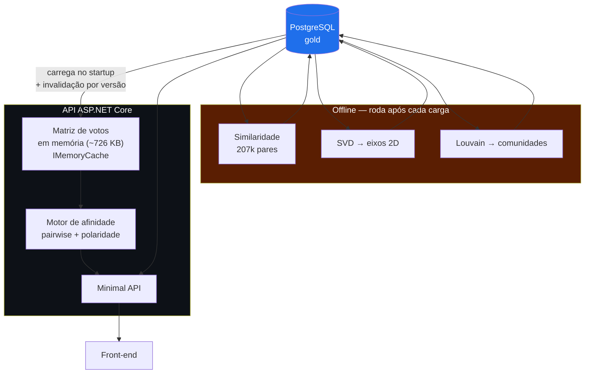
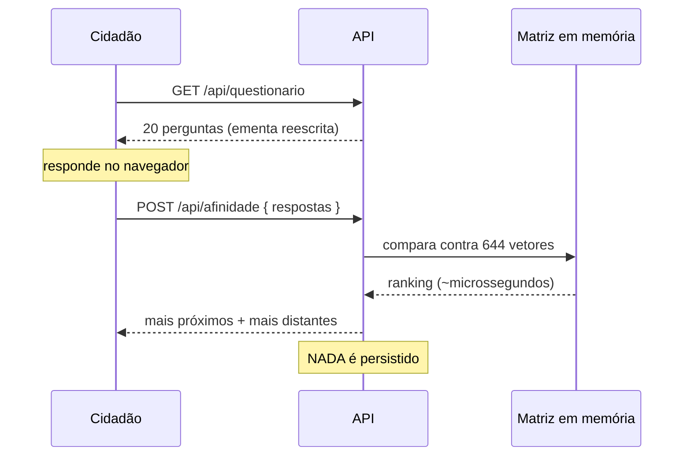

# API REST + motor de afinidade

> **Status:** v1.1 — 2026-08-23
> **v1.1:** números redimensionados para a legislatura inteira (644 × 1.103), não um ano.
> Vale para qualquer um dos cenários A/B/C. A pergunta central: **onde cada cálculo roda**.

---

## 1. A constatação que simplifica tudo: o problema é pequeno

Antes de escolher arquitetura, vale dimensionar. Muita complexidade some quando os
números aparecem:

⚠️ **Números corrigidos para a legislatura inteira.** A v1.0 deste documento dimensionava
sobre **um ano** (552 × 526). Com a matriz por legislatura (RN-12) e a cobertura histórica
confirmada, os valores reais são:

| Estrutura | Dimensão real (medida) | Memória |
|---|---|---|
| Matriz de votos da Câmara | **644 × 1.103** | **~710 KB** como `sbyte[,]` |
| Matriz do Senado | ~90 × 182 | ~16 KB |
| Pares parlamentar × parlamentar (Câmara) | 644 × 643 / 2 = **207.046** | ~3 MB |
| Comparações para a matriz completa | ~228 milhões de células | dezenas de segundos |
| Comparações para **um** cidadão | 20 respostas × 644 = **12.880** | microssegundos |

> **As duas matrizes juntas cabem em menos de 1 MB.** Não há problema de escala aqui, e
> qualquer arquitetura distribuída seria over-engineering — o que, aliás, é uma
> observação defensável no texto do TCC.

**Consequência de projeto:**

| Cálculo | Quando roda | Onde |
|---|---|---|
| Similaridade parlamentar ↔ parlamentar | **Batch**, após cada carga | Job offline |
| SVD / eixos ideológicos | **Batch** | Job offline |
| Detecção de comunidades (Louvain) | **Batch** | Job offline |
| **Afinidade cidadão ↔ parlamentar** | **Sob demanda** | Em memória, na API |

---

## 2. Diagrama



---

## 3. Três opções para o motor analítico

| | **A — Tudo em SQL** | **B — Tudo em .NET** | **C — Híbrido** ⭐ |
|---|---|---|---|
| Similaridade | CTE recursiva / `crosstab` | Loop em C# | numpy (offline) |
| SVD | ⛔ Inviável | `MathNet.Numerics` | scipy |
| Louvain | ⛔ Inviável | Implementar à mão | networkx |
| Afinidade online | Query por requisição | Em memória | **Em memória (.NET)** |
| Linhas de código | Alta (SQL denso) | Alta | **Baixa** |
| Legibilidade no TCC | Ruim | Média | **Boa** |

**Recomendação: C — híbrido.**

- **Offline em Python:** `numpy` + `scipy` + `networkx` resolvem similaridade, SVD e
  Louvain em poucas dezenas de linhas. Em C#, Louvain teria que ser implementado do zero.
- **Online em .NET:** a afinidade do cidadão é aritmética trivial sobre uma matriz de
  ~710 KB. Não justifica um serviço separado, nem chamada entre processos.

⚠️ **Como defender o poliglotismo na banca:** não é gambiarra, é adequação. .NET faz o que
faz bem (API, ETL tipado, concorrência); Python faz o que faz bem (álgebra linear, grafos).
A fronteira entre os dois é o **banco**, não uma chamada RPC — o job Python lê e escreve no
Postgres, e não existe acoplamento em tempo de execução. Se o job Python cair, a API
continua servindo.

---

## 4. O motor de afinidade

### 4.1 Similaridade parlamentar ↔ parlamentar (batch)

```
Para cada par (A, B):
    comuns = { v : voto_A(v) ≠ null  E  voto_B(v) ≠ null }
    se |comuns| < 20:  descartar par        ← corte medido: exclui 2,5% dos deputados
    concordancia = |{ v ∈ comuns : voto_A(v) == voto_B(v) }| / |comuns|
    cosseno      = (a · b) / (‖a‖ ‖b‖)      sobre {-1, 0, +1} restrito a comuns
```

⚠️ **Nunca imputar zero para ausência.** Enviesa a favor de quem falta muito. A comparação
é *pairwise* — só as votações em que ambos votaram.

Grava em `similaridade(pessoa_a, pessoa_b, metrica, valor, n_votacoes_comuns, calculado_em)`.

### 4.2 Afinidade cidadão ↔ parlamentar (online)

```
Entrada: [{ votacao_id, resposta ∈ {SIM, NAO, NAO_SEI} }]

1. Descartar NAO_SEI                          (equivale a null)
2. APLICAR POLARIDADE:                        ← passo fácil de esquecer
       voto_efetivo = resposta × polaridade(votacao)
   e o mesmo à coluna do parlamentar
3. Comparar pairwise contra cada parlamentar
4. Ranquear
5. Devolver os N mais próximos E os N mais distantes
```

⚠️ **O passo 2 é o mais crítico do sistema.** Em 14% das votações nominais, "Sim" significa
*manter o texto* — ou seja, **rejeitar** o destaque (achado #12). Sem a polaridade, o
ranking fica silenciosamente errado e ninguém percebe olhando a tela.

→ **Teste obrigatório:** um caso de regressão com uma votação de polaridade `-1` e
resultado esperado calculado à mão.

### 4.3 Estado do usuário: nenhum



⚠️ **Não persistir respostas** resolve de uma vez o risco R7 (contexto eleitoral) e a
LGPD. Se um dia for necessário guardar para pesquisa, guarde **apenas o vetor anônimo**,
sem IP, sem sessão, sem identificador.

---

## 5. Endpoints propostos

| Método | Rota | Retorno |
|---|---|---|
| `GET` | `/api/parlamentares?casa=&uf=&partido=` | Lista paginada |
| `GET` | `/api/parlamentares/{id}` | Ficha completa (+ TSE nos cenários B/C) |
| `GET` | `/api/parlamentares/{id}/similares?limite=10` | Mais próximos e mais distantes |
| `GET` | `/api/grafo?casa=CAMARA&limiar=0.75` | Nós + arestas para o front |
| `GET` | `/api/votacoes/{id}` | Detalhe + ementa + temas |
| `GET` | `/api/questionario` | Perguntas curadas — **fluxo único, sem parâmetro de casa** |
| `POST` | `/api/afinidade` | Ranking de afinidade |
| `GET` | `/api/estatisticas` | Números agregados para a home |

**`GET /api/questionario`** — ⚠️ **sem parâmetro `casa`** (RNF-28). O fluxo é único; as
perguntas das duas casas vêm embaralhadas e o cliente não sabe de qual casa cada uma veio.

```json
{ "versao":"2026-08-22",
  "perguntas":[
    { "id":"q1",
      "pergunta":"O poder público deve poder requisitar aeronaves privadas para combater incêndios florestais?",
      "ementaOriginal":"Altera a Lei nº 7.565, de 19 de dezembro de 1986 – Código Brasileiro de Aeronáutica…",
      "temas":["Meio Ambiente e Desenvolvimento Sustentável","Administração Pública"],
      "data":"2025-04-29" } ] }
```

⚠️ Note que o identificador exposto é `"q1"`, **não** `"2456731-84"`. O id da votação é
detalhe interno: expô-lo vaza jargão e acopla o cliente ao modelo da Câmara.

⚠️ Expor **`ementaOriginal` junto com a pergunta reescrita** não é opcional: a reescrita é
o passo mais subjetivo do trabalho, e mostrar o texto original é o que torna a curadoria
auditável. Na banca, isso é a diferença entre "método" e "achismo".

**`POST /api/afinidade`**

```json
{ "respostas":[ {"id":"q1","resposta":"SIM"},
                {"id":"q2","resposta":"NAO_SEI"} ] }
```

```json
{ "respondidas":26, "ignoradas":2,
  "deputados":{
    "maisProximos":[
      { "pessoaId":204528,"nome":"Adriana Ventura","partido":"NOVO","uf":"SP",
        "concordaram":15,"de":18 } ],
    "maisDistantes":[ … ] },
  "senadores":{
    "maisProximos":[ { "pessoaId":5672,"nome":"…","concordaram":6,"de":8 } ],
    "maisDistantes":[ … ] },
  "aviso":"Ferramenta acadêmica. Não constitui recomendação de voto." }
```

⚠️ **O par `concordaram`/`de` substitui o percentual solto** (RF-29). "15 de 18" é mais
compreensível *e* mais honesto que "83%": o denominador fica explícito por construção, em
vez de escondido. Uma afinidade de "3 de 3" se autodenuncia; "100%" não.

⚠️ A separação `deputados`/`senadores` acontece **só aqui, na resposta**. O usuário nunca
escolheu casa — ele apenas recebe duas listas autoexplicativas.

---

## 6. Cache e invalidação

| Item | Estratégia |
|---|---|
| Matriz de votos | Carregada no startup em `IMemoryCache`; ~726 KB (as duas casas) |
| Invalidação | Tabela `carga(id, fonte, versao, concluida_em)`; a API compara a versão e recarrega |
| Grafo | Materializado no gold; servido direto |
| Questionário | Estático entre curadorias; `ETag` pela `versao` |

Como o dado muda **no máximo uma vez por dia** (e na prática bem menos), qualquer coisa
mais sofisticada é desnecessária.

---

## 7. Pontos fortes

- ✅ **Dimensionamento honesto:** menos de 1 MB de matriz elimina toda discussão de escala.
- ✅ **Separação limpa** entre batch (analítico, Python) e online (API, .NET), acopladas só
  pelo banco.
- ✅ **API sem estado de usuário** — resolve R7 e LGPD por construção, não por política.
- ✅ Resposta da afinidade em microssegundos, sem cache distribuído nem fila.
- ✅ O job analítico pode cair sem derrubar a API.

## 8. Pontos fracos

- 🟡 **Duas linguagens** = dois ambientes, dois gerenciadores de dependência, dois builds
  no CI. Custo real de setup.
- 🟡 A matriz em memória exige **estratégia de invalidação** — simples, mas é estado
  duplicado.
- 🟡 O campo `polaridade` é **manual** e não tem validação automática possível. Um erro
  de sinal é silencioso.
- 🟡 O questionário depende de **curadoria humana** que não escala e precisa ser refeita a
  cada nova janela de votações.
- 🔴 Se o front for Blazor WebAssembly, a matriz **não** pode ir para o cliente (payload e
  exposição do método). A afinidade tem que ficar no servidor.

## 9. Pendências

| # | Pendência | Prioridade |
|---|---|---|
| **API1** | Decidir **D5** (Blazor vs React) — afeta se o grafo é renderizado com Cytoscape.js | 🔴 Alta |
| ~~API2~~ | ✅ **RESOLVIDA — 2026-08-23.** Limiar global descartado: mesmo a 0,90 a densidade é 11,6% (~24k arestas). Adotado **kNN com k=10** — [04-contratos §9](../04-contratos.md) | — |
| **API3** | Escrever o teste de regressão da **polaridade** | 🔴 Alta |
| **API4** | Definir se a métrica exibida ao usuário é concordância simples ou cosseno (ou ambas) | 🟡 Média |
| **API5** | Decidir se as respostas anônimas serão coletadas para análise agregada — e como declarar isso | 🟡 Média |
| **API6** | Definir o formato de troca do job Python ↔ banco (tabela própria vs `COPY`) | 🟡 Média |
| **API7** | Medir quanto tempo o job de 207k pares leva de fato | 🟢 Baixa |
