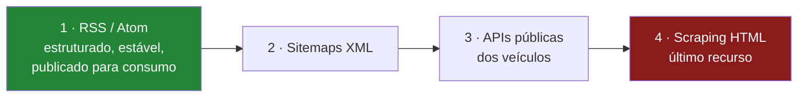
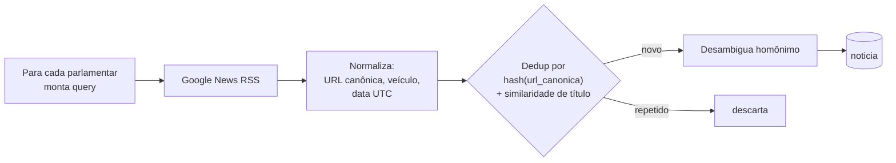

# Crawler de notícias — quais páginas, qual linguagem

> **Status:** v1.0 — feeds testados ao vivo em **2026-08-22**.
> Fase **F8** — a última do roadmap, e a mais frágil. Deliberadamente fora do caminho
> crítico do TCC.

---

## 1. O objetivo, e o que ele NÃO é

**Objetivo:** para cada parlamentar, exibir na ficha as referências noticiosas recentes.

**O que não é:**

- ❌ Não é análise de sentimento. Classificar notícia como "positiva/negativa" sobre um
  político é um problema de pesquisa inteiro, com viés difícil de defender, e abriria uma
  frente que o TCC não tem como fechar.
- ❌ Não é arquivo de conteúdo. **Não armazenamos o texto integral** — ver §5.
- ❌ Não é fonte para o algoritmo de afinidade. Notícia é enfeite da ficha, não sinal.

---

## 2. ⭐ Decisão central: RSS primeiro, HTML por último

A tentação é escrever um scraper de HTML para os grandes portais. **É a pior escolha
possível** — frágil, juridicamente arriscada e desnecessária.

**Hierarquia de preferência:**



Um feed RSS é **publicado justamente para ser consumido por máquina**. Usá-lo não é
scraping — é usar a interface pretendida. Isso resolve de uma vez fragilidade, robots.txt
e boa parte da discussão de direito autoral.

---

## 3. Fontes testadas

Resultados reais de **2026-08-22**:

| Fonte | URL | Status | Itens |
|---|---|---|---|
| **Google News RSS (busca)** | `https://news.google.com/rss/search?q="{nome}"&hl=pt-BR&gl=BR&ceid=BR:pt-419` | ✅ 200 | **100** |
| **Congresso em Foco** | `https://www.congressoemfoco.com.br/feed/` | ✅ 200 | 20 |
| **Agência Senado** | `https://www12.senado.leg.br/noticias/rss` | ✅ 200 | 15 |
| **Poder360** | `https://www.poder360.com.br/feed/` | ✅ 200 | 10 |
| **Agência Câmara** | `https://www.camara.leg.br/noticias/rss/` | ⛔ | Devolve **HTML**, não RSS |

### 3.1 ⭐ Google News RSS é a fonte principal

É a única que permite **busca por nome de parlamentar** — as demais são feeds cronológicos
gerais, que trariam todas as notícias e exigiriam você filtrar por nome no texto.

```
https://news.google.com/rss/search?q=%22Adriana+Ventura%22+deputada&hl=pt-BR&gl=BR&ceid=BR:pt-419
```

Retornou **100 itens** no teste. Vantagens: agrega centenas de veículos, já vem
deduplicado por evento, traz título, link, data e nome do veículo.

⚠️ **Riscos a registrar:** não é uma API oficial com contrato de estabilidade — o Google
pode alterar ou limitar o formato sem aviso. E há *rate limiting* não documentado.
Recomendação: **um request por parlamentar por dia**, no máximo, com backoff.

### 3.2 ⛔ Agência Câmara — pendência aberta

`https://www.camara.leg.br/noticias/rss/` retorna **200 com corpo HTML** (uma página do
portal), não um feed. Caminhos alternativos testados — `/noticias/rss/feed`,
`/noticias/feed`, `/noticias/rss.xml`, `/noticias/rss/todas` — retornaram **HTTP 405
(Method Not Allowed)**, e `/agencia/rss` retornou **404**.

O 405 é curioso: sugere que a rota existe mas não aceita `GET` como enviado. **A
investigar** — ver pendência N1. É uma lacuna sensível, porque a Agência Câmara é
justamente a fonte mais relevante e mais claramente licenciada para deputados.

### 3.3 Veículos a evitar

| Veículo | Motivo |
|---|---|
| Folha, Estadão, O Globo, Valor | **Paywall.** Nunca contornar |
| Portais sem feed e com JS pesado | Exigiriam navegador *headless* — custo e fragilidade altos |
| Agregadores de terceiros | Adicionam intermediário e termos de uso próprios |

---

## 4. Qual linguagem

| Critério | .NET | Python + Scrapy |
|---|---|---|
| Parsing de RSS/Atom | ✅ `System.ServiceModel.Syndication` — **nativo** | `feedparser` |
| Parsing de HTML | `AngleSharp` (bom) | `parsel`/`BeautifulSoup` (bom) |
| Framework de crawling | Não tem equivalente a Scrapy | ✅ Scrapy: retry, throttle, robots.txt, pipelines **de graça** |
| Integração com o resto | ✅ Mesmo processo, mesmo modelo, mesmo EF | Precisa de fronteira |
| Custo de setup | ✅ Zero — já existe | Mais um ambiente |

**Recomendação: .NET.**

O raciocínio é direto: **se a estratégia é RSS-first, não há crawling de verdade a fazer.**
Scrapy resolve problemas — filas de URL, profundidade, throttling por domínio, respeito a
robots.txt — que só existem quando você percorre HTML. Consumir 5 feeds e fazer uma busca
por parlamentar é um `HttpClient` com `SyndicationFeed.Load()`.

⚠️ **Isso é diferente da recomendação da decisão D1**, que sugere Python para a parte
analítica. Não é contradição: lá o Python ganha porque `numpy`/`networkx` não têm
equivalente em .NET. Aqui o .NET ganha porque `SyndicationFeed` **é** o equivalente. A
regra é a mesma nos dois casos — usar a ferramenta que já resolve o problema.

**Reavaliar se** a pendência N1 concluir que a Agência Câmara exige scraping de HTML com
paginação. Aí Scrapy volta à mesa.

---

## 5. ⚠️ Regras não negociáveis

| Regra | Por quê |
|---|---|
| **Armazenar apenas URL, título, veículo, data e trecho curto** | Direito autoral. Não somos um arquivo de conteúdo |
| **Nunca o texto integral** | Idem |
| Respeitar `robots.txt` e `Crawl-delay` | Obrigação básica |
| `User-Agent` identificável **com contato** | Ex.: `PoligraphBot/0.1 (+mailto:...; TCC)` |
| *Rate limit* conservador e backoff exponencial | Não somos um problema para ninguém |
| **Nunca contornar paywall** | Inegociável |
| Sempre linkar para a fonte original | O clique é do veículo |

Essas regras não são só ética — são **o que torna o capítulo do crawler defensável na
banca**. Um TCC que armazena texto integral de jornal tem um problema real.

---

## 6. Modelo e pipeline

```
noticia(id, pessoa_id, url, url_canonica, titulo, veiculo,
        publicado_em, trecho, hash_dedup, coletado_em, fonte_feed)
```



### 6.1 Os dois problemas reais

**Deduplicação.** A mesma notícia aparece replicada em dezenas de portais (agências
distribuem para afiliadas). Estratégia: URL canônica normalizada (remover `utm_*`, `#`,
parâmetros de tracking) + similaridade de título acima de um limiar.

**Homônimos.** É o problema mais sério. Buscar `"Marcos Pereira"` traz notícias de várias
pessoas diferentes. Mitigações, em ordem:

1. Usar o **nome de urna entre aspas** + qualificador (`deputado`, `senador`, sigla do
   partido ou UF);
2. **Descartar nomes ambíguos curtos** — parlamentares cujo nome de urna tem menos de dois
   termos distintivos;
3. Marcar cada notícia com um **grau de confiança** e exibir só acima de um limiar;
4. Aceitar que a precisão não será 100% e **dizer isso na interface** ("possíveis menções").

---

## 7. Pontos fortes

- ✅ **RSS-first elimina a fragilidade** que normalmente condena crawlers de notícia.
- ✅ Google News dá **cobertura de centenas de veículos** com um request por parlamentar.
- ✅ Fica em .NET, dentro do projeto que já existe — sem novo ambiente.
- ✅ A política de "só URL + título + trecho" é **juridicamente segura e simples de
  defender**.
- ✅ Totalmente isolado: se o crawler não for entregue, nada mais no projeto quebra.

## 8. Pontos fracos

- 🔴 **Google News RSS não é contrato estável.** Pode mudar ou limitar sem aviso — e é a
  fonte principal.
- 🔴 **Homônimos são um problema sem solução limpa.** A precisão será menor que 100% e
  precisa ser comunicada ao usuário.
- 🟡 A Agência Câmara — a fonte mais legítima para deputados — **não tem feed localizado**.
- 🟡 Sem análise de sentimento, o valor entregue é modesto: uma lista de links.
- 🟡 Dedup por similaridade de título tem falsos positivos (dois fatos distintos com
  manchete parecida).
- 🟢 Custo computacional irrisório: ~550 requests/dia.

## 9. Pendências

| # | Pendência | Prioridade |
|---|---|---|
| **N1** | **Descobrir o feed real da Agência Câmara** — investigar o HTTP 405, procurar na documentação do portal ou considerar a API de notícias, se houver | 🔴 Alta |
| **N2** | Medir o *rate limit* efetivo do Google News RSS antes de rodar para 552 parlamentares | 🔴 Alta |
| **N3** | Definir a regra de desambiguação de homônimos e **medir a taxa de erro** em amostra manual | 🔴 Alta |
| **N4** | Verificar `robots.txt` de cada veículo que entrar na lista | 🟡 Média |
| **N5** | Definir o limiar de similaridade de título para dedup | 🟡 Média |
| **N6** | Confirmar se Agência Senado cobre senadores nominalmente ou só pauta institucional | 🟡 Média |
| **N7** | Decidir política de retenção (quanto tempo guardar notícia antiga) | 🟢 Baixa |
| **N8** | Avaliar se vale um segundo feed de busca como redundância ao Google News | 🟢 Baixa |
