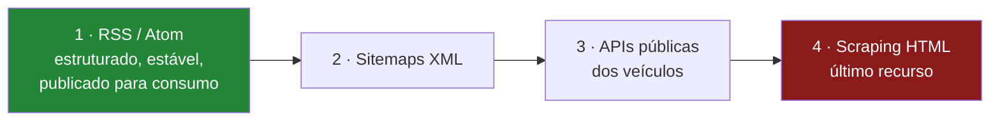
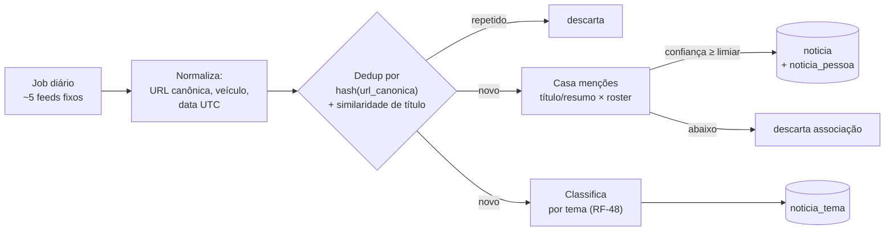

# Crawler de notícias — quais páginas, qual linguagem

> 🔄 **Fora do escopo desde 2026-10-02 (Pendência 61).** O coletor e as tabelas de notícias
> saíram do código, e o título do TCC deixou de citar notícias em 2026-10-18. Este documento
> fica como registro do que foi medido.

> **Status:** v1.3 — feeds testados ao vivo em **2026-08-22**.
> **v1.3:** feed agregado é condicional; se existir, é misto (seguidos + temas). Coleta
> passa a classificar em dois eixos — parlamentar e tema (RF-48), sem custo extra.
> **v1.2:** §10 — escopo decidido: coleta simples de poucos feeds fixos, sem busca por
> parlamentar. Cobertura medida: 9 de 690 parlamentares por coleta, enviesada para
> lideranças. N2 deixa de se aplicar.
> 🔴 **PROMOVIDO AO CAMINHO CRÍTICO — 2026-08-22.** Este documento foi escrito quando o
> crawler era a F8, "a mais frágil e a menos essencial ao argumento". **Isso mudou duas
> vezes:** o título do TCC traz *"Recomendação de Notícias"* como um de quatro elementos, e
> o requisito de **seguir parlamentar** (RF-42) depende
> inteiramente daqui. **Sem crawler, não há o que entregar a quem segue.** O *feed*
> agregado (RF-43) é condicional, mas a **coleta** não é.
> A prioridade sobe; o escopo também — ver §10.

---

## 1. O objetivo, e o que ele NÃO é

**Objetivo:** coletar notícias de poucos feeds fixos e classificá-las em **dois eixos** —
parlamentares citados e temas —, alimentando:

| Destino | Situação |
|---|---|
| Página do parlamentar | ✅ Comprometido |
| Lista "meus parlamentares" (seguidos) | ✅ Comprometido |
| **Feed agregado misto** | 🔶 **Condicional** — [03-requisitos §2.7.3](../03-requisitos.md) |

⚠️ **A coleta é inegociável mesmo se o feed não for construído**: *"Recomendação de
Notícias"* está no título do TCC.

**O que não é:**

- ❌ Não é análise de sentimento. Classificar notícia como "positiva/negativa" sobre um
  político é um problema de pesquisa inteiro, com viés difícil de defender, e abriria uma
  frente que o TCC não tem como fechar.
- ❌ Não é arquivo de conteúdo. **Não armazenamos o texto integral** — ver §5.
- ❌ Não é fonte para o algoritmo de afinidade. Notícia alimenta o feed, não a similaridade.
- ❌ **Não é busca exaustiva.** Coleta-se o que os feeds publicam; o que não vier, não vem.
  Ver §10 e a limitação declarada em §10.1.

---

## 2. ⭐ Decisão central: RSS primeiro, HTML por último

A tentação é escrever um scraper de HTML para os grandes portais. **É a pior escolha
possível** — frágil, juridicamente arriscada e desnecessária.

**Hierarquia de preferência:**



Um feed RSS é **publicado justamente para ser consumido por máquina**. Usá-lo não é
scraping — é usar a interface pretendida. Isso resolve de uma vez fragilidade, robots.txt
e boa parte da discussão de direito autoral.

---

## 3. Fontes testadas

Resultados reais de **2026-08-22**:

| Fonte | URL | Status | Itens |
|---|---|---|---|
| **Google News RSS (busca)** | `https://news.google.com/rss/search?q="{nome}"&hl=pt-BR&gl=BR&ceid=BR:pt-419` | ✅ 200 | **100** |
| **Congresso em Foco** | `https://www.congressoemfoco.com.br/feed/` | ✅ 200 | 20 |
| **Agência Senado** | `https://www12.senado.leg.br/noticias/rss` | ✅ 200 | 15 |
| **Poder360** | `https://www.poder360.com.br/feed/` | ✅ 200 | 10 |
| **Agência Câmara** | `https://www.camara.leg.br/noticias/rss/` | ⛔ | Devolve **HTML**, não RSS |

### 3.1 ⚠️ Google News RSS — testado, mas **fora do escopo decidido**

Permite busca por nome de parlamentar e retornou **100 itens** no teste, agregando centenas
de veículos já deduplicados por evento. Era a fonte principal na v1.0 deste documento.

**Foi descartada** pela decisão de escopo (§10): busca por parlamentar significaria ~594
requisições diárias a um serviço sem contrato de estabilidade, com *rate limiting* não
documentado. O escopo adotado é **coleta de poucos feeds fixos**.

→ Fica registrada como **plano B**: se a cobertura dos feeds fixos se mostrar insuficiente
na prática, este é o caminho para ampliá-la — de preferência apenas para os parlamentares
que o usuário seguiu e que não têm cobertura (§10.2, mitigação 3).

### 3.2 ⛔ Agência Câmara — pendência aberta

`https://www.camara.leg.br/noticias/rss/` retorna **200 com corpo HTML** (uma página do
portal), não um feed. Caminhos alternativos testados — `/noticias/rss/feed`,
`/noticias/feed`, `/noticias/rss.xml`, `/noticias/rss/todas` — retornaram **HTTP 405
(Method Not Allowed)**, e `/agencia/rss` retornou **404**.

O 405 é curioso: sugere que a rota existe mas não aceita `GET` como enviado. **A
investigar** — ver pendência N1. É uma lacuna sensível, porque a Agência Câmara é
justamente a fonte mais relevante e mais claramente licenciada para deputados.

### 3.3 Veículos a evitar

| Veículo | Motivo |
|---|---|
| Folha, Estadão, O Globo, Valor | **Paywall.** Nunca contornar |
| Portais sem feed e com JS pesado | Exigiriam navegador *headless* — custo e fragilidade altos |
| Agregadores de terceiros | Adicionam intermediário e termos de uso próprios |

---

## 4. Qual linguagem

| Critério | .NET | Python + Scrapy |
|---|---|---|
| Parsing de RSS/Atom | ✅ `System.ServiceModel.Syndication` — **nativo** | `feedparser` |
| Parsing de HTML | `AngleSharp` (bom) | `parsel`/`BeautifulSoup` (bom) |
| Framework de crawling | Não tem equivalente a Scrapy | ✅ Scrapy: retry, throttle, robots.txt, pipelines **de graça** |
| Integração com o resto | ✅ Mesmo processo, mesmo modelo, mesmo EF | Precisa de fronteira |
| Custo de setup | ✅ Zero — já existe | Mais um ambiente |

**Recomendação: .NET.**

O raciocínio é direto: **se a estratégia é RSS-first, não há crawling de verdade a fazer.**
Scrapy resolve problemas — filas de URL, profundidade, throttling por domínio, respeito a
robots.txt — que só existem quando você percorre HTML. Consumir 5 feeds e fazer uma busca
por parlamentar é um `HttpClient` com `SyndicationFeed.Load()`.

⚠️ **Isso é diferente da recomendação da decisão D1**, que sugere Python para a parte
analítica. Não é contradição: lá o Python ganha porque `numpy`/`networkx` não têm
equivalente em .NET. Aqui o .NET ganha porque `SyndicationFeed` **é** o equivalente. A
regra é a mesma nos dois casos — usar a ferramenta que já resolve o problema.

**Reavaliar se** a pendência N1 concluir que a Agência Câmara exige scraping de HTML com
paginação. Aí Scrapy volta à mesa.

---

## 5. ⚠️ Regras não negociáveis

| Regra | Por quê |
|---|---|
| **Armazenar apenas URL, título, veículo, data e trecho curto** | Direito autoral. Não somos um arquivo de conteúdo |
| **Nunca o texto integral** | Idem |
| Respeitar `robots.txt` e `Crawl-delay` | Obrigação básica |
| `User-Agent` identificável **com contato** | Ex.: `PoligraphBot/0.1 (+mailto:...; TCC)` |
| *Rate limit* conservador e backoff exponencial | Não somos um problema para ninguém |
| **Nunca contornar paywall** | Inegociável |
| Sempre linkar para a fonte original | O clique é do veículo |

Essas regras não são só ética — são **o que torna o capítulo do crawler defensável na
banca**. Um TCC que armazena texto integral de jornal tem um problema real.

---

## 6. Modelo e pipeline

```
noticia(id, url, url_canonica, titulo, veiculo,
        publicado_em, trecho, hash_dedup, coletado_em, fonte_feed)
noticia_pessoa(noticia_id, pessoa_id, confianca)      -- N:N, uma notícia cita vários
noticia_tema(noticia_id, tema, confianca)             -- RF-48: habilita o feed misto
```



⚠️ **Note que a classificação por tema é um ramo paralelo, não sequencial.** Uma notícia
pode não citar nenhum parlamentar reconhecido e ainda assim ter tema — e continua útil,
porque alimenta o componente temático do feed misto (RF-43/48).

⚠️ **A direção do casamento inverteu** em relação à v1.0. Antes: *para cada parlamentar,
buscar notícias*. Agora: **para cada notícia, procurar quais parlamentares são citados**.
Isso muda o algoritmo — é varredura de nomes sobre um texto pequeno e conhecido, não
consulta a um buscador.

### 6.1 Os dois problemas reais

**Deduplicação.** A mesma notícia aparece replicada em dezenas de portais (agências
distribuem para afiliadas). Estratégia: URL canônica normalizada (remover `utm_*`, `#`,
parâmetros de tracking) + similaridade de título acima de um limiar.

**Homônimos e nomes curtos.** Menor que na busca — o universo de texto é pequeno —, mas
ainda existe: um nome de urna como "Cleitinho" ou "Professor X" pode aparecer em contexto
que não é o parlamentar. Mitigações, em ordem:

1. Usar o **nome de urna entre aspas** + qualificador (`deputado`, `senador`, sigla do
   partido ou UF);
2. **Descartar nomes ambíguos curtos** — parlamentares cujo nome de urna tem menos de dois
   termos distintivos;
3. Marcar cada notícia com um **grau de confiança** e exibir só acima de um limiar;
4. Aceitar que a precisão não será 100% e **dizer isso na interface** ("possíveis menções").

---

## 7. Pontos fortes

- ✅ **RSS-first elimina a fragilidade** que normalmente condena crawlers de notícia.
- ✅ **Custo irrisório e sem risco de bloqueio:** ~5 requisições diárias, contra as ~594 da
  abordagem por busca. Nenhum *rate limit* a gerenciar.
- ✅ **Fontes com RSS próprio**, publicadas para consumo — sem dependência de um agregador
  de terceiros sem contrato.
- ✅ Fica em .NET, dentro do projeto que já existe — sem novo ambiente.
- ✅ A política de "só URL + título + trecho" é **juridicamente segura e simples de
  defender**.
- ✅ **Casamento mais confiável** que na busca: o universo de texto é pequeno e conhecido.

## 8. Pontos fracos

- 🔴 **Cobertura enviesada e esparsa** (§10.1): ~9 de 690 parlamentares por coleta,
  concentrados em lideranças. **A maior parte do Congresso não terá notícia** — e isso
  interage mal com o "seguir" (§10.2).
- 🔴 **Agora está no caminho crítico.** Deixou de ser isolado: se o crawler não for
  entregue, o RF-42/43 cai junto e o título fica com um elemento a descoberto.
- 🟡 A Agência Câmara — a fonte mais legítima para deputados — **não tem feed localizado**,
  o que agrava o viés contra deputados.
- 🟡 Sem análise de sentimento, o valor entregue é modesto: uma lista de links.
- 🟡 Dedup por similaridade de título tem falsos positivos (dois fatos distintos com
  manchete parecida).
- 🟡 Nomes de urna curtos ("Cleitinho") geram falso positivo em texto genérico.

## 10. ✅ Escopo decidido: coleta simples de poucos feeds

**Decisão do autor, 2026-08-22:** *"não deve ser tão complicado — algumas páginas,
coletamos delas, o que vier é isso, sem busca profunda."*

Isso **descarta a busca por parlamentar** (uma consulta ao Google News por nome) e adota
**varredura de poucos feeds fixos**. As duas abordagens são legítimas e têm perfis opostos:

| | **Busca por parlamentar** | **Feeds fixos** ⭐ escolhido |
|---|---|---|
| Requisições/dia | ~594 | **~5** |
| Risco de *rate limit* | 🔴 Real (N2) | ✅ Nenhum |
| Complexidade | Query por pessoa, backoff | ✅ Trivial |
| Cobertura | Ampla, quase todos | 🟡 **Enviesada — ver §10.1** |
| Dependência de terceiro | Google News (sem contrato) | Veículos com RSS próprio |

→ **Efeito colateral bom:** a pendência **N2 deixa de existir**. Com ~5 requisições
diárias, não há limite a medir. E a **N1** (feed da Agência Câmara) deixa de ser bloqueante
— vira só uma fonte a menos.

### 10.1 📊 O que a abordagem simples entrega — medido

Coleta única dos três feeds que funcionam (Congresso em Foco, Poder360, Agência Senado):

| | |
|---|---|
| Linhas de texto coletadas | 95 |
| Parlamentares no roster | 690 |
| **Parlamentares citados** | **9** |

Citados: Davi Alcolumbre, Flávio Bolsonaro, Damares Alves, Cid Gomes, Omar Aziz,
Paulo Paim, Cleitinho, Domingos Sávio, Rogério Carvalho.

⚠️ **Note quem são:** presidente do Senado e figuras de alta projeção nacional. **A
cobertura é enviesada para a liderança e para quem já é notícia** — o "baixo clero"
([01-camara §4.5](../01-camara-dos-deputados.md)) praticamente não aparece.

**Estimativa:** ~9 parlamentares por coleta, com forte repetição dos mesmos nomes. Ao longo
de um mês, algo entre 100 e 200 parlamentares distintos com ao menos uma menção — de 594.
**Boa parte do Congresso nunca terá notícia no sistema.**

### 10.2 ⚠️ A consequência que precisa ser tratada no produto

Isso interage mal com o requisito de seguir (RF-42/43):

> Se o usuário seguir um deputado de baixa projeção, **o feed dele fica vazio** — e a
> funcionalidade parece quebrada, quando na verdade está funcionando como projetada.

**Mitigações:**

1. ✅ **ADOTADA — dizer a verdade na interface.** Na página: *"Ainda não encontramos
   notícias recentes sobre este parlamentar."* Na sugestão de seguir: indicar quem **tem**
   cobertura. (RF-47)
2. ✅ **ADOTADA se houver feed — feed misto.** Decisão do autor, 2026-08-23: *"não sei se
   teremos feed, mas se for, é o misto"*. Além dos seguidos, o feed inclui notícias dos
   **temas** que as respostas do questionário revelaram — assim nunca fica vazio.
   Ver [03-requisitos §2.7.3](../03-requisitos.md).
3. ⛔ **Descartada — fallback por busca** só para seguidos sem cobertura. Reintroduziria a
   complexidade que a decisão de escopo eliminou.

⚠️ **Consequência para este documento:** o crawler precisa classificar cada notícia
**por tema além de por parlamentar** (RF-48). Como os feeds são varridos inteiros de todo
jeito, **isso não adiciona nenhuma requisição** — é um segundo eixo de classificação sobre
o mesmo texto. Fazer desde o início mantém a porta do feed aberta a custo zero.

⚠️ **Isto precisa estar no texto do TCC como limitação declarada**, não descoberto pela
banca: *"a cobertura noticiosa é enviesada para parlamentares de alta projeção, por
consequência direta da estratégia de coleta adotada."*

### 10.3 O que continua valendo

- **A lista de seguidos não é do crawler nem da API.** Vive no navegador
  ([03-requisitos §2.7.2](../03-requisitos.md)). O crawler grava notícia **por
  parlamentar**, a API expõe **por parlamentar**, e o cliente monta o feed. O servidor
  nunca sabe quem segue quem.
- **Coleta diária**, não sob demanda — o feed precisa ter o que mostrar.
- **Precisão da associação continua importante** (RF-40): notícia errada no feed de quem
  escolheu seguir é falha visível. Mas com feeds fixos o risco é menor que na busca, porque
  o universo de texto é pequeno e conhecido.

## 9. Pendências

| # | Pendência | Prioridade |
|---|---|---|
| **N1** | Descobrir o feed real da Agência Câmara (HTTP 405 nos caminhos óbvios) | 🟡 **Rebaixada** — com feeds fixos, é só uma fonte a menos |
| ~~N2~~ | ~~Medir o *rate limit* do Google News~~ | ✅ **Não se aplica** — busca por parlamentar foi descartada (§10) |
| **N3** | Definir a regra de casamento nome→parlamentar e medir a taxa de erro | 🟡 Menor risco com feeds fixos, mas ainda necessária |
| **N9** | Definir o texto de estado vazio no feed e na página (§10.2) | 🔴 Alta |
| ~~N10~~ | ✅ **RESOLVIDA — 2026-08-23.** Sim — RF-48 classifica notica por tema desde o inicio, a custo zero | 🔴 Alta |
| **N11** | Escolher a lista final de feeds e verificar termos de uso de cada um | 🟡 Média |
| **N4** | Verificar `robots.txt` de cada veículo que entrar na lista | 🟡 Média |
| **N5** | Definir o limiar de similaridade de título para dedup | 🟡 Média |
| **N6** | Confirmar se Agência Senado cobre senadores nominalmente ou só pauta institucional | 🟡 Média |
| **N7** | Decidir política de retenção (quanto tempo guardar notícia antiga) | 🟢 Baixa |
| **N8** | Avaliar se vale um segundo feed de busca como redundância ao Google News | 🟢 Baixa |
