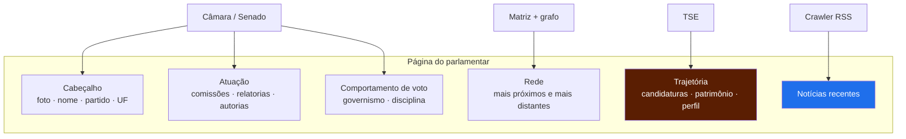
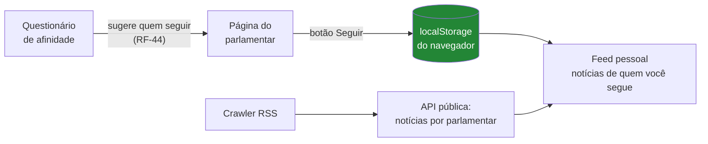

# Página do parlamentar — o perfil da "rede social"

> **Status:** v1.0 — 2026-08-22
> Coberturas medidas ao vivo. Ver [00-discovery](../00-discovery.md),
> [12-fonte-tse](../12-fonte-tse.md).

---

## 1. Por que esta página é entregável de primeira classe

O título do TCC termina em *"em Redes Sociais"*, e a intenção declarada é ter **uma página
para cada político**. Isso resolve boa parte da ambiguidade levantada em §2.2 do discovery:

> **"Rede social" aqui é produto, não só metáfora analítica.** São perfis + conexões — a
> estrutura de uma rede social, aplicada a parlamentares.

E dá à página um papel que nenhuma outra tela tem:

**É o único lugar onde as quatro fontes convergem.** Câmara/Senado, TSE e crawler se
encontram no mesmo perfil. Se o TCC precisa mostrar que a integração de fontes heterogêneas
produziu algo, **é esta tela que mostra** — não o diagrama de arquitetura.

---

## 2. ⚠️ Correção: o TSE **não** é a melhor base para a lista de políticos

A intuição de usar o TSE como base dos políticos é natural, mas o dado medido diz outra
coisa.

| Fonte | O que ela é | Serve como roster? |
|---|---|---|
| **Câmara / Senado** | Quem **está em exercício**, com foto, e-mail, gabinete, status | ✅ **Sim — use esta** |
| **TSE** | Quem **se candidatou** — milhares por eleição, a maioria não eleita | ⛔ Não |

Três motivos:

1. **O roster já vem pronto e completo** das casas — com foto, e-mail, gabinete, situação
   (`Exercício` / `Licenciado`) e condição (`Titular` / `Suplente`). O TSE não tem nada
   disso.
2. **O TSE lista candidatos, não parlamentares.** São milhares por eleição, e o
   **RNF-15 proíbe exibir não eleitos** — eles não são agentes públicos em exercício.
3. **O TSE está bloqueado** (403, carga manual). Fazer o roster depender dele coloca a
   tela mais visível do produto atrás da fonte mais frágil.

→ **Papel correto do TSE aqui: profundidade biográfica sobre quem já está no roster**,
não a definição de quem está nele. Ele responde *"quem é esta pessoa"*, não *"quem são as
pessoas"*.

⚠️ **Exceção que mudaria isso:** se o escopo passar a incluir políticos **fora do Congresso
federal** — governadores, deputados estaduais, prefeitos — aí o TSE passa a ser sim a única
base possível, porque não existe API equivalente para eles. **Pendência PP1.**

---

## 3. Cobertura real dos campos (medido)

Para os **551 deputados ativos em 2025**, no `deputados.csv`:

| Campo | Cobertura |
|---|---|
| **CPF** | **551 / 551 — 100 %** 🔑 |
| **Data de nascimento** | **551 / 551 — 100 %** |
| Redes sociais (`urlRedeSocial`) | 352 / 551 — **64 %** |

✅ **CPF a 100% é excelente notícia**: o join com o TSE tem cobertura total do lado da
Câmara. A conciliação determinística não vai perder ninguém.

⚠️ **Rede social a 64%**: um terço dos deputados não tem perfis no cadastro. A página
precisa **degradar bem** — sem seção fantasma, sem "não informado" ocupando espaço nobre.

⚠️ **O Senado não expõe redes sociais.** Verificado no payload de `/senador/{id}`: não há
campo de Twitter/Instagram/Facebook/YouTube. Só `EmailParlamentar` e
`UrlPaginaParlamentar`. **Assimetria entre as casas** — a seção de redes existirá para
deputados e não para senadores.

---

## 4. O que cada fonte entrega para a página

| Seção | Fonte | Disponibilidade |
|---|---|---|
| **Identificação** — foto, nome, partido, UF, situação, gabinete, e-mail | Câmara / Senado | ✅ 100 % |
| **Redes sociais** | Câmara | 🟡 64 % dep. · ⛔ 0 % sen. |
| **Comissões** (com vigência e cargo) | ambas | ✅ |
| **Relatorias** | Câmara (regex) · Senado (estruturado) | ✅ |
| **Autorias / coautorias** | ambas | ✅ |
| **Governismo e disciplina partidária** | Câmara **apenas** | ⚠️ Assimétrico (P3) |
| **Mais próximos / mais distantes** | matriz de similaridade | ✅ |
| **Comunidade no grafo** | Louvain | ✅ |
| **Perfil temático** (do que ele relata/autora) | relatoria + `/temas` | ✅ |
| **Trajetória eleitoral** — candidaturas, partidos, votos recebidos | **TSE** | 🔶 Depende de carga manual |
| **Escolaridade, ocupação, cor/raça, idade** | **TSE** | 🔶 idem |
| **Patrimônio declarado** | **TSE** | 🔶 idem |
| **Notícias recentes** | Crawler RSS | 🔶 F8 |

⚠️ **Nenhuma seção de TSE é bloqueante.** A página funciona inteira sem ele — só fica menos
rica. Isso é proposital: a tela mais visível não pode depender da fonte mais frágil.

---

## 5. Princípios de apresentação

Herdados do RNF-27 a RNF-31 ([03-requisitos §3.4](../03-requisitos.md)):

| Regra | Aplicação nesta página |
|---|---|
| **Zero jargão** | "Votou com o governo em 8 de cada 10 votações", não "índice de governismo 0,81" |
| **Sem juízo de valor** | Nunca "melhor/pior deputado", nunca ranking de qualidade |
| **Contável, não percentual solto** | "Concordaram em 15 de 18" |
| **Degradação graciosa** | Seção sem dado **não aparece** — nada de "não informado" |
| **Patrimônio sem adjetivo** | Exibir o número e a variação. Não escrever "enriqueceu" |
| **Sem CPF** | Chave interna; nunca renderizado |

⚠️ **A seção mais delicada é patrimônio.** É dado público e oficial, mas é a que mais
convida à leitura sensacionalista. Exibir valores declarados por eleição, lado a lado, sem
texto interpretativo. Deixar o leitor concluir.

---

## 6. ⭐ Seguir — o que torna isto uma rede social

A página do parlamentar não é só consulta: é onde o usuário **segue** (RF-42) e passa a
receber notícias daquele parlamentar no feed (RF-43).

🔴 **O follow NÃO vai para o servidor.** A lista de seguidos vive no `localStorage`; a API
serve apenas *"notícias recentes do parlamentar 204528"* — informação pública — e o
**cliente filtra**. Ver [03-requisitos §2.7.2](../03-requisitos.md): uma base de
"quem segue quem" é base de **convicção política**, que a LGPD trata como dado sensível.

**Três lugares onde a recomendação aparece**, com naturezas diferentes:

| Contexto | Natureza |
|---|---|
| Página do parlamentar | Notícias daquele parlamentar — **filtro**, sem personalização |
| **Feed de seguidos** | **Recomendação por escolha explícita** do usuário |
| Resultado do questionário | **Recomendação inferida** — sugere quem seguir por afinidade e tema |

⚠️ Só os dois últimos são recomendação no sentido forte. É o **feed** que sustenta a
palavra do título, e é ele que exige o crawler no caminho crítico — não em F8.

---

## 7. Pontos fortes

- ✅ **É a vitrine da integração.** Uma tela onde quatro fontes convergem prova o objetivo
  específico #1 melhor que qualquer diagrama.
- ✅ **Roster completo e gratuito** das APIs das casas — foto, contato, status inclusos.
- ✅ **CPF a 100%** nos deputados ativos: o enriquecimento via TSE não perde ninguém.
- ✅ **Independente do TSE para funcionar** — degrada, não quebra.
- ✅ Reaproveita tudo que já é calculado para o grafo e o questionário; custo incremental
  baixo.

## 8. Pontos fracos

- 🔴 **Assimetria entre casas.** Senadores não terão redes sociais nem governismo/disciplina
  (P3). A página de senador será visivelmente mais pobre que a de deputado — e isso vai ser
  notado.
- 🟡 **64% de cobertura de redes sociais** obriga a layout que tolera ausência.
- 🟡 **Patrimônio é risco reputacional** se apresentado sem cuidado.
- 🟡 A "recomendação" nesta página é só filtro por nome — o valor real está no resultado do
  questionário.
- 🟡 Homônimos no crawler podem trazer notícia de outra pessoa para a página
  (pendência N3).

## 9. Pendências

| # | Pendência | Prioridade |
|---|---|---|
| **PP1** | Decidir se o escopo inclui políticos **fora do Congresso federal** (governadores, deputados estaduais). Se sim, o TSE **vira** a base do roster e o levantamento muda | 🔴 Alta |
| **PP2** | Definir como compensar a assimetria da página de senador — ou assumi-la e explicá-la na interface | 🔴 Alta |
| **PP3** | Definir a apresentação de patrimônio (série por eleição? variação absoluta? nenhuma?) | 🟡 Média |
| **PP4** | Decidir se linka para os perfis de rede social ou apenas os lista | 🟡 Média |
| **PP5** | Definir o que mostrar quando o parlamentar tem poucos votos (suplente com <20 votações) | 🟡 Média |
| **PP6** | Definir se a página exibe o perfil temático por relatoria (achado #16) e como | 🟢 Baixa |
