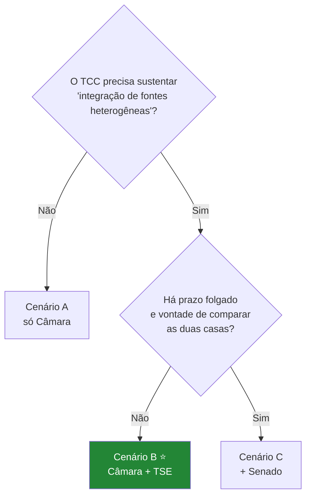

# `docs/arq` — rascunhos de arquitetura

> Espaço para desenhar arquiteturas **alternativas** antes de escolher. Nada aqui é
> decisão final — a decisão vira registro no [00-discovery.md](../00-discovery.md).
> **Status:** v1.0 — 2026-08-22

Todo documento deste diretório segue a mesma estrutura:
**Contexto → Diagrama → Componentes → Stack → Pontos fortes → Pontos fracos → Pendências.**

---

## Índice

### Cenários de integração (quantas bases entram)

| Doc | Cenário | Bases | Custo | Resultado |
|---|---|---|---|---|
| [01](01-cenario-a-so-camara.md) | **A — Mínimo viável** | Câmara | 🟢 Baixo | Produto completo, TCC fraco |
| [02](02-cenario-b-camara-tse.md) | **B — Recomendado** | Câmara + TSE | 🟡 Médio | Produto completo, TCC sólido |
| [03](03-cenario-c-tres-bases.md) | **C — Completo** | Câmara + TSE + Senado | 🔴 Alto | Comparação entre casas |

### Componentes transversais

| Doc | Assunto |
|---|---|
| [10](10-api-e-afinidade.md) | API REST + motor de afinidade (onde cada cálculo roda) |
| [20](20-crawler-noticias.md) | Crawler de notícias — quais páginas, qual linguagem |

---

## Como escolher entre A, B e C

Os três cenários entregam **o mesmo produto para o usuário final**. O que muda é o que o
TCC consegue afirmar.

**O ponto decisivo é o objetivo específico #1 do TCC** — *"pipeline ETL capaz de ingerir e
reconciliar dados de três fontes heterogêneas"*. O Cenário A **não sustenta essa
afirmação**: uma fonte só não é integração. Seria preciso reescrever o objetivo.

**Recomendação: Cenário B**, evoluindo para C se o cronograma permitir. Motivo: Câmara
(API REST, JSON, automatizável) e TSE (CSV Latin-1, sem API, carga manual, join por CPF)
são **genuinamente heterogêneas** — mais do que Câmara e Senado, que são duas APIs
legislativas parecidas. B entrega o argumento metodológico com metade do esforço de C.

---

## O que é comum a todos os cenários

Independente da escolha, estes elementos não mudam:

| Elemento | Decisão | Origem |
|---|---|---|
| Camadas **bronze → silver → gold** | Bronze imutável e reprocessável | Discovery §5 |
| **PostgreSQL** | Grafo tem ~500 nós; cabe em relacional | D2 |
| **Carga base por CSV**, API só incremental | Achado #6 | 10-api-camara §2 |
| `partido_no_voto` **desnormalizado** no voto | Achado da rotatividade | Discovery §6.1 |
| `pessoa` com **ID sintético** + `pessoa_fonte_id` | Nunca usar id de fonte como PK | 13-correlacao §3 |
| Coluna `categoria` na votação | 58% das nominais são procedimentais | Achado #11 |
| Coluna `polaridade` manual por votação do questionário | "Sim" nem sempre é a favor | Achado #12 |
