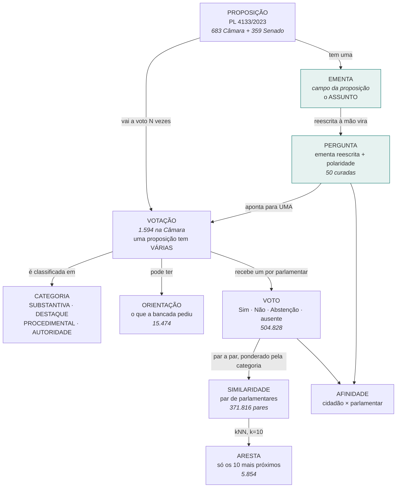

# Glossário — termos e como eles se ligam

> 🔴 **Existe porque a confusão entre dois termos já produziu bug em produção mais de uma
> vez.** ⛔ Não é dicionário de dicionário: cada verbete diz **o que é**, **onde vive no
> banco** e **por que importa neste projeto**.
>
> ⚠️ Todos os números foram medidos em **2026-08-29**, contra o banco local com a
> legislatura 57 ingerida.

📐 **Este documento é para quem constrói.** O glossário que o **cidadão** vê é outro:
`src/web/src/componentes/Termo.tsx`, com verbetes que aparecem sublinhados na própria
tela. A coluna *No produto?* diz quais dos dois o termo tem.

---

## 1. A cadeia do voto

### 📐 As cardinalidades, medidas

| Relação | Medido |
|---|---|
| Proposição → votações | 387 têm **1** · 108 têm 2 · 68 têm 3 · 48 têm 4 · 🔴 **máximo: 19** |
| Votação → proposição | Câmara **1.587 de 1.594** (99,6%) · Senado ⭐ **421 de 421** (100%) |
| 🔴 Proposição, chave | **`(casa, id)`**, ⛔ não `id`: as duas fontes numeram no mesmo espaço e as faixas **se sobrepõem** |
| Par de parlamentares → similaridade | **371.816** pares passam o mínimo de 20 votações comuns |
| Similaridade → aresta | **5.854** — ⛔ só o top-10 de cada um vira linha no desenho |
| Pergunta → votação | **1 para 1**, sempre |

---

## 2. 🔴 Os pares que já custaram caro

⚠️ Nenhuma linha aqui é hipótese: cada uma é um defeito que **existiu**.

| Confundir… | …com | O que aconteceu |
|---|---|---|
| 🔴 **Ementa** | **Descrição da votação** | A ficha listava *"Aprovado o Substitutivo ao Projeto de Lei nº 4.133"* — o **número**, ⛔ não o assunto. Curar pergunta a partir disso era adivinhação (PL40) |
| 🔴 **Ementa** | **O que foi votado** | Corrigido o acima, **43,2%** das linhas passaram a exibir a ementa do projeto sobre um voto de **rito**: *"Institui o IBS"* ao lado de um "Sim" que era sobre requerimento |
| 🔴 **Votos com posição** | **Votos registrados** | `/api/panorama` afirmava **463.994** contando `valor IS NOT NULL`; a posição real eram **462.867**. A diferença — **1.127** — eram as abstenções |
| 🔴 **Votações comparáveis** | **Votações registradas** | Sargento Fahur aparecia com **1.134** na lista e **559** no grafo, com a mesma palavra. Os dois certos, contando coisas diferentes |
| 🔴 **Polaridade** | **Voto** | Em **14%** das nominais, "Sim" significa **rejeitar**. Sinal invertido ⛔ não aparece na tela: aparece como número plausível (RN-08) |
| ⚠️ **Poço de perguntas** | **Questionário** | Curar 22 perguntas novas empurrou o mínimo obrigatório de **17 para 30** — o questionário ficou **pior** por ter mais perguntas |
| ⚠️ **Comunidade** | **Partido** | ARI = **0,272**. A comunidade descreve melhor a estrutura de voto — modularidade **0,557** contra **0,286** ([#26](achados/026-a-comunidade-nao-e-partido-nem-bloco.md)) |
| ⚠️ **Concordância** | **Cosseno** | Duas métricas sobre o mesmo par. A **concordância** vai à tela porque é auditável; o **cosseno** fica no grafo |
| 🔴 **Emenda** *(dinheiro)* | **Emenda** *(texto)* | ⛔ **Duas coisas sem relação nenhuma, com o mesmo nome.** Ver a §3.1 |

---

## 3. 🔴 A palavra "emenda" significa duas coisas

⚠️ **⛔ Não são variações de um mesmo conceito — são assuntos sem relação nenhuma que
dividem a palavra.** Confundi-las leva a perguntas como *"o peso do destaque afeta o
dinheiro que o deputado destina?"*, cuja resposta é **⛔ não, de jeito nenhum**.

| | **Emenda parlamentar** | **Emenda a projeto** |
|---|---|---|
| O que é | O **dinheiro** que o parlamentar destina do Orçamento | Uma alteração ao **texto** de um projeto em votação |
| Nome completo | Emenda **orçamentária** / individual / de bancada | Emenda de plenário, de comissão, aglutinativa, de redação |
| Onde vive | `emendas` · `autores_de_emenda` | `votacoes`, categoria `DESTAQUE` |
| Ordem de grandeza | **24.825** emendas · R$ 70,8 bi | **327** votações de destaque na 57ª |
| Entra na afinidade? | ⛔ **Nunca.** Povoa o perfil | ⭐ **Sim** — com peso 0,7 |
| Na tela | Aba de contas do parlamentar | Lista de votos da ficha |

⭐ **Um jeito de ⛔ não errar:** emenda **parlamentar** tem valor em reais e um
**destino** (município, estado). Emenda **a projeto** tem número, autor e um **texto**.

⚠️ A `Proposta de Emenda à Constituição` (**PEC**) é uma terceira coisa ainda: ⛔ não é
alteração a um projeto, é alteração à **Constituição** — e é voto de **mérito**, ⛔ não de
destaque. Confundi-la com emenda a projeto custou **73 votações** classificadas errado
([#31](achados/031-a-pec-estava-escondida-como-destaque.md)).

---

## 3.1. Os quatro tipos de voto, e quanto cada um pesa

📐 Medido em 2026-08-29, Câmara na legislatura 57. *"Na matriz"* = plenário e ⛔ não
secreta, que é o recorte que a similaridade usa.

| Categoria | Peso | Todas | Na matriz | O que é |
|---|---:|---:|---:|---|
| **SUBSTANTIVA** | **1,0** | 370 | 243 | O mérito do texto — o projeto em si |
| **DESTAQUE** | **0,7** | 327 | 320 | Um **trecho** do texto, recortado para votar à parte |
| **AUTORIDADE** | 0,3 | 1 | 1 | Sabatina — voto em **pessoa**, ⛔ não em política |
| ⛔ **PROCEDIMENTAL** | **0,0** | 896 | 558 | Rito — urgência, retirada de pauta. **Descartadas** |

🔴 **564 votações de fato pesam**, de 1.122 abertas em plenário. As 558 procedimentais
entram na conta com peso zero: elas medem obstrução, ⛔ não posição.

⚠️ **O peso ainda decai com o tempo:** `categoria × 0,86^anos`. Uma substantiva de três
anos atrás vale **0,64** — menos que um destaque de hoje.

🔴 **Os destaques são 320 dos 564 — 57% do que pesa.** ⭐ O grafo é construído mais sobre
**disputa de trecho** do que sobre mérito de projeto
([#30](achados/030-o-destaque-carrega-o-grafo.md)), e o texto do TCC precisa dizer isso:
quem lê *"quem vota junto fica junto"* imagina projetos, e são emendas supressivas.

---

## 4. O que se vota

| Termo | O que é | Onde vive | Por que importa aqui | No produto? |
|---|---|---|---|---|
| **Proposição** | O documento proposto — PL, PEC, PLP, MPV, PDL. Sigla, número e ano | `proposicoes` | ⭐ É onde mora a **ementa**. 🔴 A chave é **`(casa, id)`**: a Câmara vai de 106.701 a 2.638.483 e o Senado de 121.883 a 175.446 — sem a casa, uma sobrescreveria a outra | ✅ |
| **Ementa** | O parágrafo que resume o que a proposição faz | `proposicoes.ementa` | 🔴 Diz o **assunto**. A votação diz o **número** | ✅ |
| **Votação** | Um ato de decidir. Uma proposição vai a voto **várias vezes** | `votacoes` | ⚠️ Duas linhas do mesmo projeto podem ter votos **opostos** sem contradição | — |
| **Descrição** | O registro processual: *"Aprovado o Substitutivo…"* | `votacoes.descricao` | ⭐ Identifica **qual** votação daquele projeto foi | — |
| **Nominal** | Votação em que fica registrado o voto de **cada um** | — | 🔴 Só **3,8%** das da Câmara são nominais. As demais ⛔ não permitem comparar ninguém | ✅ |
| **Plenário** | A sessão com todos, ⛔ não a comissão | `votacoes.plenario` | ⚠️ **125 das 266** substantivas da 57ª são de comissão e ficam **fora** da matriz | ✅ |
| **Substantiva** | Voto no **mérito** do texto principal | `categoria` | ⭐ A única categoria que vira pergunta (RN-04) | — |
| **Destaque** | Voto sobre um **trecho**, ⛔ não sobre o projeto inteiro | `categoria` | 🔴 Onde a polaridade inverte — e **80% da vizinhança** de cada deputado vem daqui ([#30](achados/030-o-destaque-carrega-o-grafo.md)) | — |
| **Procedimental** | Voto sobre o **andamento** — urgência, retirada de pauta | `categoria` | ⛔ Peso **0,0**: mede obstrução, ⛔ não posição. São **56%** das votações | ✅ |
| **Autoridade** | Sabatina — voto em **pessoa**, ⛔ não em política | `categoria` | Peso 0,3. ⛔ Fora do questionário (RN-14) | — |
| **Orientação** | O que a liderança de cada bancada **pediu** antes de votar | `orientacoes` | ⭐ Permite medir **governismo** e **disciplina**. ⛔ O Senado ⛔ não publica ([#28](achados/028-o-senado-nao-publica-orientacao-de-bancada.md)) | ✅ |
| **Secreta** | Votação sem registro individual | `votacoes.secreta` | 🔴 **239 de 421** no Senado ([#17](achados/017-senado-maioria-secreta.md)) | — |

---

## 5. Como se compara

| Termo | O que é | Por que importa aqui | No produto? |
|---|---|---|---|
| 🔴 **Polaridade** | `+1` = "Sim" concorda com a afirmação · `−1` = "Sim" a **rejeita** | 🔴 **O campo mais perigoso do sistema.** Atribuída **à mão**, uma a uma | — |
| **Comparável** | Votação em que os **dois** lados se posicionaram | ⭐ Ausência e abstenção **saem do denominador**, ⛔ não viram discordância | — |
| **Concordância simples** | Fração ponderada de votações em que dois votaram igual | ⭐ A métrica **explicável**: *"votaram igual em 82% das vezes"* | — |
| **Cosseno** | A outra métrica sobre o mesmo par | Fica no grafo. ⛔ *"cosseno 0,84"* ⛔ não é auditável por cidadão | — |
| **Peso** | `categoria × 0,86^anos` | ⭐ O `0,86` é medido (r = 0,862). ⚠️ O do destaque **quase ⛔ não importa**: entre 0,3 e 1,0 o grafo é 92% o mesmo | — |
| **Similaridade** | Um par e o quanto votam junto | **371.816** pares passam o mínimo de **20 votações em comum** (RN-02) | — |
| **Aresta** | A linha desenhada entre dois pontos | ⛔ **Só o top-10 de cada um.** Limiar global ⛔ não funciona: a similaridade média entre dois quaisquer é **0,663** | — |
| **Comunidade** | Grupo detectado **pelo voto** (Louvain), ⛔ não pelo partido | ⚠️ O número é **rótulo**, ⛔ não posição no espectro (RNF-16) | ✅ |
| **Governismo** | Com que frequência votou como o Governo orientou | Explica **79,1%** da variância do eixo X do grafo | — |
| **Execução** | Um retrato do ETL — a matriz de um dia | ⭐ O grafo é **reproduzível**: a banca roda de novo e obtém a mesma figura | — |

---

## 6. O questionário

| Termo | O que é | Por que importa aqui |
|---|---|---|
| 🔴 **Poço** | As **50** perguntas curadas | ⛔ **⛔ NÃO é o questionário.** É de onde se escolhe |
| **Questionário** | As **24** que o cidadão responde | 8 de abertura da Câmara + 9 do Senado + **7 de desempate** |
| **Desempate dirigido** | As 7 últimas, escolhidas contra o empate **deste** cidadão | ⭐ Medido: empate mediano **6**, contra **14** fixas e **16** sorteadas |
| **Empate no topo** | Quantos parlamentares dividem o 1º lugar | Era **44** com as 21 perguntas originais |
| **Curadoria** | Reescrever a ementa em linguagem leiga e atribuir a polaridade | 🔴 Trabalho **humano**, ⛔ não escala (RE-06) |
| **Teste do jantar** | *"Dá para discutir num jantar sem explicar a proposta?"* | Reprova pergunta boa de placar e ruim de sentido |

---

## 7. O dinheiro — ⛔ não entra em afinidade nenhuma

⚠️ **Nenhum termo desta seção participa do cálculo.** Eles povoam o perfil, e existem
porque o critério do autor foi *o que ⛔ não se associa ao perfil do político ⛔ não entra*.

| Termo | O que é | No produto? |
|---|---|---|
| **Cota** (CEAP) | Verba mensal para despesas do mandato — **772.677** lançamentos | ✅ |
| **Emenda parlamentar** | Verba do Orçamento indicada pelo parlamentar — **24.825** | ✅ |
| **Empenho** | A promessa de pagar. ⚠️ **Empenhado ⛔ não é pago** | ✅ |
| **Fundão** (FEFC) | Fundo Eleitoral, dinheiro público de campanha — **R$ 907,7 mi** | ✅ |
| **Emenda de múltiplo** / **nacional** | Tipos que ⛔ não têm autor individual identificável | ✅ |

---

## 8. As pessoas e as fontes

| Termo | O que é | Por que importa aqui |
|---|---|---|
| **Legislatura** | Os 4 anos entre eleições | ⭐ A matriz é **sempre** filtrada por ela (RN-12) |
| **Casa** | Câmara ou Senado | 🔴 ⛔ **Nunca** na mesma matriz: elas ⛔ não votam as mesmas matérias ([#7](achados/007-casas-nao-sao-comparaveis.md)) |
| **Partido no voto** | O partido **no momento** daquele voto | ⚠️ Trocar de partido é comum — 14 trocas em 2025 |
| **`cpf_hash`** | O CPF, guardado **só** como hash | ⛔ **Nunca renderizado.** 0 CPFs em claro (RNF-13) |
| **Vínculo** | Como um id externo foi ligado a uma pessoa: `CPF`, `FUZZY`, `MANUAL` | ⭐ Ambiguidade ⛔ não vira palpite: fica `NAO_RESOLVIDO` |
| **Menção** | Ligação entre notícia e parlamentar, com **confiança** | ⚠️ Abaixo de **0,70** ⛔ não vai à tela — mas **vai ao banco** ([#29](achados/029-o-sobrenome-casa-com-a-instituicao.md)) |

---

## 9. Onde cada termo mora no banco

| Tabela | Guarda |
|---|---|
| `pessoas` · `pessoa_fonte_ids` | Quem é, e como cada fonte a chama |
| `proposicoes` | O projeto e a **ementa** |
| `votacoes` · `votos` · `orientacoes` | O que foi votado, como cada um votou, o que a bancada pediu |
| `perguntas` | A curadoria — **conteúdo do produto**, ⛔ não dado de teste |
| `execucoes` · `similaridades` · `arestas_grafo` · `nos_metrica` | Um retrato reproduzível do grafo |
| `despesas` · `emendas` · `autores_de_emenda` · `receitas_de_campanha` | O dinheiro |
| `noticias` · `noticia_pessoas` · `noticia_temas` | O feed |
| `usuarios` · `segue` · `consentimentos` · `tokens_email` · `avaliacoes` | A conta do cidadão. 🔴 `segue` é **dado sensível** (LGPD art. 5º, II) |
