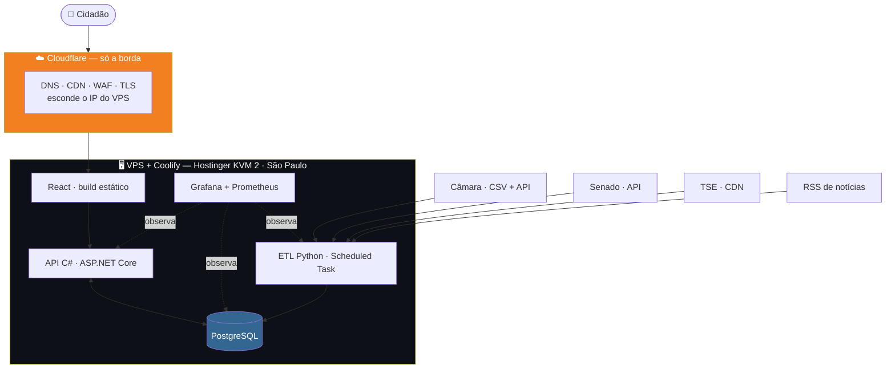
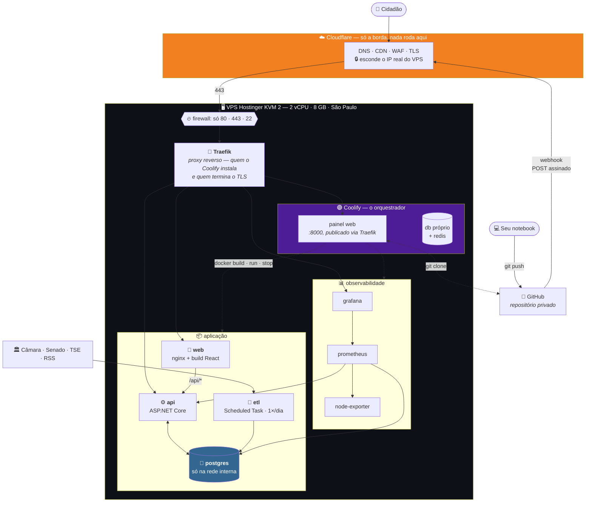
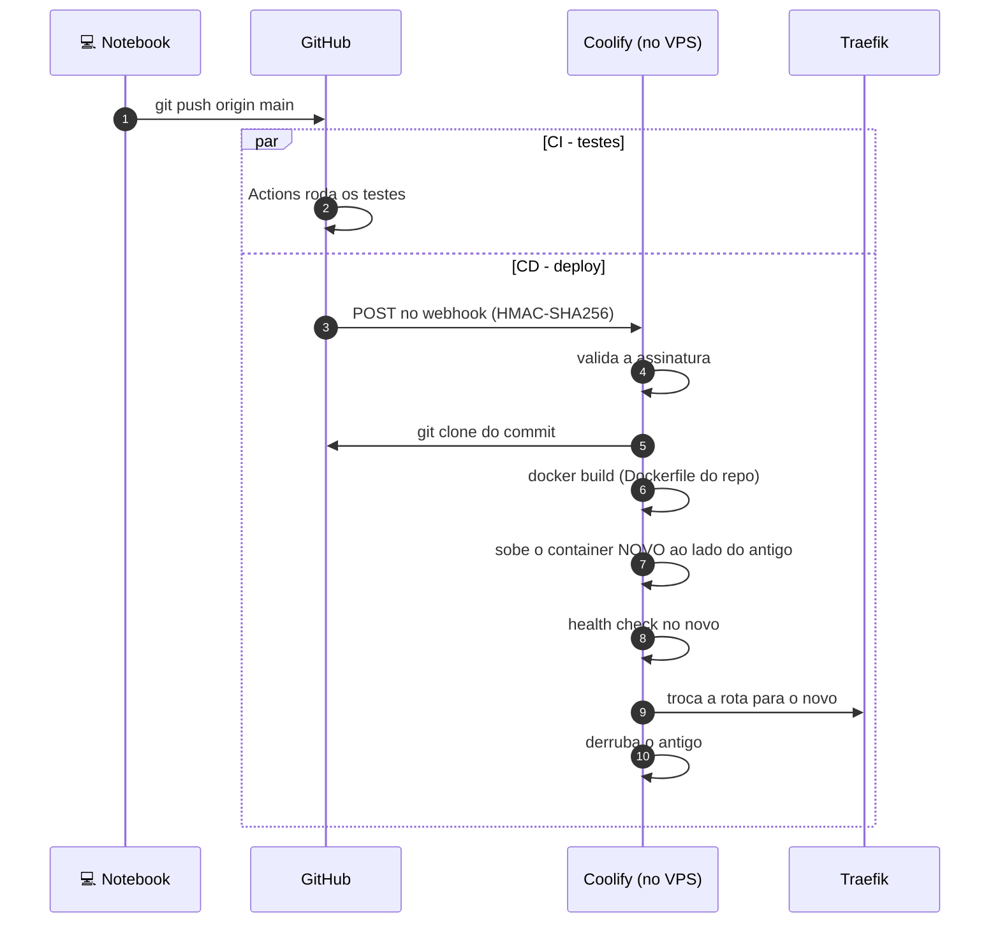
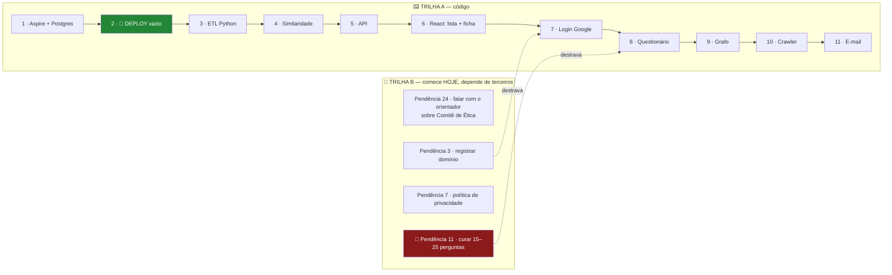

# Plano de implementação — arquitetura macro

> **Status:** v1.5 — 2026-08-26
> **v1.2:** ✅ **DECISÃO — VPS + Coolify** (§3.5). ETL roda em Scheduled Task do Coolify,
> não no GitHub Actions — com Postgres interno, expor o banco não compensa.
> **v1.3:** ✅ **Hostinger VPS KVM 2** (São Paulo) + stack Grafana no mesmo VPS.
> **v1.5:** §8 reescrita — a ordem de construção não conhecia login, e-mail, deploy nem a
> curadoria. Agora são DUAS trilhas: 🚀 deploy virou o passo 2 e 🔴 a Pendência 11 começa no dia 1.
> **v1.4:** §2.1 — desenho detalhado do VPS: Traefik, containers, portas, TLS e o
> caminho de um deploy. 🔴 CI e CD disparam em PARALELO, não em sequência (Pendência 23).
> **v1.1:** §3 — opção D avaliada (compartilhada, Render, Railway, VPS+Coolify) e
> comparação final; Pendência 1 e Pendência 2 decididas.
> **Restrições dadas:** React no front · C# no back · Python no ETL · Postgres ·
> Cloudflare · login só com Google · Aspire para subir infra local · **prazo curto**.
> Este documento escolhe o caminho de menor atrito dentro dessas restrições.

---

## 1. O critério que decide tudo: prazo

O TCC tem 4 elementos no título e **zero linha de código escrita**. Toda escolha aqui é
feita contra um único critério:

> **Quanto tempo isso rouba de escrever o TCC?**

Infra que exige aprendizado, configuração ou manutenção é tempo que não volta. As escolhas
abaixo priorizam *"funciona no primeiro dia e não pede atenção depois"* sobre
*"tecnicamente superior"*.

---

## 2. Desenho macro



**Tudo numa máquina, mas três ciclos de vida diferentes** — e a separação lógica continua
importando:

| Bloco | Roda quando | Se cair |
|---|---|---|
| **Front** (React) | Sempre, estático | CDN da Cloudflare segura |
| **API** (C#) | Sempre, sob demanda | Site fica sem dados |
| **ETL** (Python) | 1× por dia, offline | **Nada quebra** — dado fica velho |

⚠️ **O ETL não é um serviço.** É um job que roda, escreve no banco e morre. Isso elimina
a necessidade de hospedar Python em qualquer lugar permanente — ver §4.

---

## 2.1 ⭐ Desenho detalhado — o que existe dentro do VPS

O desenho acima é o macro. Este é o que você vai realmente instalar.



> 🔑 **Tudo dentro do VPS é container, inclusive o Coolify.** Ele não é um programa
> instalado no sistema: é um conjunto de containers que fala com o Docker da máquina para
> subir e derrubar os outros.

### 2.1.1 O caminho de uma visita

| # | | |
|---|---|---|
| 1 | Cidadão acessa `registroaberto.org.br` | DNS resolve para **um IP da Cloudflare**, não o seu |
| 2 | Cloudflare | Serve o que está em cache; filtra bot e ataque no WAF |
| 3 | Chega no VPS na **443** | Único caminho aberto para a web |
| 4 | **Traefik** olha o domínio | `registroaberto.org.br` → `web` · `api.registroaberto.org.br` → `api` |
| 5 | Container responde | O React chama `/api/*`, que o Traefik roteia para o C# |
| 6 | API consulta o Postgres | Pelo **nome do container**, dentro da rede Docker |

⭐ **O Postgres não tem endereço na internet.** Ele é alcançável por `postgres:5432` de
dentro da rede Docker e mais nada. Não é firewall bem configurado — é **inexistência de
rota**, que é mais forte.

### 2.1.2 O caminho de um deploy



⚠️ 🔴 **Correção do que escrevi antes.** Chamei o arranjo de *"Actions = CI, Coolify = CD"*,
o que sugere uma sequência. **Não é sequência: os dois disparam do mesmo push, ao mesmo
tempo.** O Coolify não espera o teste passar — **ele publica código que quebrou o CI.**

| Se você quer o portão | Como |
|---|---|
| ⭐ **Gate real** | Desligar o *auto-deploy* no Coolify e, **no fim do job de teste**, chamar a API de deploy dele (`POST /api/v1/deploy` com token) |
| Aceitar o paralelo | Simples, e o rollback é um clique. Mas o e-mail do CI chega **depois** do deploy |

> 🔑 Para este projeto, o gate vale a pena por um motivo específico: **o teste de
> polaridade** (API3). Um erro de sinal não aparece na tela — só num número silenciosamente
> invertido. É exatamente o tipo de bug que você não quer ver publicado antes do aviso.

### 2.1.3 O que fica exposto

| Porta | Exposta? | Quem usa |
|---|---|---|
| **443** | ✅ Pública, via Cloudflare | Site, API, painel do Coolify, Grafana |
| **80** | ✅ Redireciona para 443 | Desafio do Let's Encrypt |
| **22** (SSH) | 🟡 **Direto, sem Cloudflare** | ⚠️ Restrinja ao seu IP. A Cloudflare só faz proxy de HTTP/S |
| 8000 (painel) | ⛔ Interna | O Traefik publica em 443 |
| 3000 / 9090 | ⛔ Interna | Grafana e Prometheus, via Traefik |
| 🔴 **5432** | ⛔ **Nunca** | Só a rede Docker |

⚠️ **O SSH fura a Cloudflare.** Quem souber o IP do VPS bate direto na 22. Chave apenas,
sem senha, sem login root — e, se possível, allow-list do seu IP.

### 2.1.4 Armadilhas de TLS com a Cloudflare na frente

| Armadilha | |
|---|---|
| 🔴 **Modo "Flexible"** | Cifra o cidadão→Cloudflare mas deixa **Cloudflare→VPS em texto puro**. Use **Full (strict)** |
| Let's Encrypt atrás do proxy | O desafio HTTP-01 costuma passar, mas se falhar use um **Origin Certificate** da Cloudflare (validade de 15 anos) |
| Redirecionamento em laço | Cloudflare forçando HTTPS + Traefik redirecionando = *too many redirects*. Sintoma clássico do modo Flexible |

---

## 3. Iteração sobre as opções de hospedagem

Fiz três rodadas até chegar na combinação de menor atrito.

### Opção A — Tudo em um VPS (Hetzner/DigitalOcean)

| | |
|---|---|
| Custo | ~US$ 5/mês |
| ✅ | Controle total, um lugar só |
| ⛔ | **Você vira sysadmin**: TLS, systemd, backup, firewall, atualização |
| Veredito | ⛔ **Descartado.** É o que mais rouba tempo |

### Opção B — Azure (App Service + Azure Database for PostgreSQL)

| | |
|---|---|
| ✅ | Aspire tem *deploy* nativo para Azure (`azd up`) |
| ✅ | Integração natural com .NET |
| ⛔ | **Azure Database for PostgreSQL não tem tier gratuito permanente** |
| ⛔ | Crédito de estudante expira, e aí o TCC fica fora do ar |
| Veredito | 🟡 **Viável, mas com risco de custo** |

### Opção C — Cloudflare Pages + host gerenciado + Postgres serverless  ⚠️ não escolhida

| Camada | Escolha | Custo |
|---|---|---|
| Front | **Cloudflare Pages** | Grátis |
| DNS/CDN/WAF | **Cloudflare** | Grátis |
| API C# | ✅ **Azure App Service F1** ⚠️ 60 CPU-min/dia, sem Always On | Grátis |
| Postgres | ✅ **Neon** (Supabase pausa após 1 semana parado) | Grátis |
| ETL Python | **GitHub Actions** (cron) | Grátis |

⚠️ **NÃO escolhida.** Era a recomendação até 2026-08-25, quando o autor optou pela Opção D
(VPS + Coolify) por preferir um painel único. Mantida como registro — e a comparação
continua válida para o texto do TCC.

### Opção D — "Tudo em um lugar só" (Hostinger, HostGator, Render, Railway)

Avaliada em 2026-08-25, porque a vontade por trás é legítima: **uma conta, uma fatura, um
painel**. Mas as quatro caem por motivos diferentes.

#### ⛔ Hospedagem compartilhada (Hostinger, HostGator) — **impossível, não caro**

| Barreira | |
|---|---|
| **Sem PostgreSQL** | Documentação oficial da Hostinger: *"PostgreSQL requer mais recursos e configurações que não estão disponíveis nos planos Web e Cloud — VPS é a opção suportada"*. Compartilhado = **MySQL apenas** |
| **Sem .NET** | Compartilhado é ambiente **PHP/cPanel**. ASP.NET Core não roda |
| **Sem cron para ETL Python** | Mesmo onde há Python via cPanel, é limitado |

> 🔑 **Não é questão de plano mais caro.** Hospedagem compartilhada é uma categoria de
> produto que não atende a esta stack. Trocaria Postgres por MySQL e C# por PHP — ou seja,
> mudaria o projeto para caber na hospedagem.

#### ⛔ Render — o Postgres gratuito **expira em 30 dias**

| | |
|---|---|
| Postgres free | 1 GB, **expira 30 dias após a criação** (era 90 até 2024), depois 14 dias de carência e **os dados são apagados** |
| Web service free | Dorme após 15 min · 750 h/mês |
| Veredito | ⛔ Inviável — o TCC dura meses; o banco morreria três vezes no caminho |

#### 🟡 Railway — US$ 5 de crédito único, depois US$ 1/mês

| | |
|---|---|
| Trial | US$ 5 uma vez, sem cartão |
| Free contínuo | **US$ 1/mês** — 1 vCPU, 0,5 GB RAM, 1 projeto |
| Veredito | 🟡 Funciona, mas na prática vira **~US$ 5/mês**. Deploy num lugar só, isso sim |

#### ✅ VPS + PaaS self-hosted — **ESCOLHIDA** (ver §3.5)

Se o valor for mesmo *"um lugar só"*, o caminho viável é **VPS com Coolify ou Dokploy**
(PaaS auto-hospedado: deploy por `git push`, TLS automático, Postgres em container).

| | |
|---|---|
| Custo | ~R\$ 30–50/mês (Hostinger VPS, Contabo, Hetzner) |
| Setup | ~1 dia — instalar Docker + Coolify, apontar domínio |
| Depois disso | Comporta-se como PaaS: `git push` e pronto |
| ⛔ Custo real | **Atualização de SO, backup, monitoramento, e o dia que cair é você quem levanta** |

### 3.0 Comparação final

| Opção | Custo/mês | Sysadmin? | Serve? |
|---|---|---|---|
| Compartilhada (Hostinger/HostGator) | R\$ 10–30 | Não | ⛔ **Não roda .NET nem Postgres** |
| Render | US\$ 0 | Não | ⛔ Postgres expira em 30 dias |
| Railway | ~US\$ 5 | Não | 🟡 Serve |
| ⭐ **VPS + Coolify** | **R\$ 24–80** | 🟡 Sim, um pouco | ✅ **ESCOLHIDA** — §3.5 |
| Distribuída (Opção C) | R\$ 0 | Não | ✅ Serve — não escolhida |

> 🔑 **A configuração distribuída é gratuita justamente por ser distribuída.** Cada
> provedor cobre uma peça no seu tier gratuito. Concentrar tudo em um lugar significa
> pedir a um único provedor que banque tudo — e aí ele cobra.

⚠️ **O custo real da Opção C não é dinheiro, é atenção:** quatro painéis (Cloudflare,
Azure, Neon, GitHub) em vez de um. Para um projeto que é configurado uma vez e roda,
é troca vantajosa. **Se você prefere pagar ~R\$ 40/mês para ter um painel só, o VPS +
Coolify é escolha defensável** — e vale registrar no TCC como decisão consciente.

---

## 3.5 ✅ DECISÃO — VPS + Coolify (2026-08-25)

O autor optou pela Opção D: **um painel só**. Esta seção dimensiona e escolhe.

### 3.5.1 Dimensionamento — o ETL é quem manda

| Componente | RAM |
|---|---|
| **Coolify** (só ele) | 750 MB – 1,2 GB |
| PostgreSQL (463 mil votos) | ~1 GB |
| API .NET | ~300 MB |
| 🔴 **ETL Python — pico** | **1–2 GB** (`pandas` com CSV de 55 MB + `numpy`) |
| ⭐ **Grafana + Prometheus + exporters** | **~1–1,5 GB** |
| Build (.NET compilando) | CPU-intensivo, picos de RAM |
| **Pico total** | **~5–6 GB** |

> 🔑 **Com o Grafana somado, 8 GB deixa de ser conforto e vira necessidade.** E 1 vCPU
> trava o build .NET — 2 vCPU é o mínimo.

**Disco:** 149 MB de CSV + Postgres + imagens Docker → **40 GB basta**, 80 GB folga.

### 3.5.1.1 🔄 Onde o ETL roda — revisão da sugestão do GitHub Actions

Sugeri manter o ETL no GitHub Actions mesmo com VPS, para poupar memória. **Revendo, é
má ideia neste desenho** — e o motivo é de segurança, não de recurso.

**O que o GitHub Actions é:** o GitHub executa seu código **nas máquinas dele**, de graça,
no horário que você definir. A máquina liga, roda o script, desliga.

**O problema:** essa máquina é do GitHub, não sua. Para o ETL gravar no seu banco, o
**Postgres teria de ficar exposto na internet**.

| | Neon (arquitetura antiga) | Postgres no seu VPS |
|---|---|---|
| Exposição | ✅ Já é público **por projeto** — é serviço gerenciado | 🔴 Ficaria **interno**; expor é escolha sua |
| Restringir por IP | — | ⛔ **Inviável** — os *runners* do GitHub usam faixas enormes e dinâmicas |
| Resultado | Coerente | 🔴 **Banco aberto ao mundo com senha** |

> 🔑 **A sugestão fazia sentido quando o banco era o Neon**, que é público por natureza.
> Com Postgres dentro do VPS, ela obriga a abrir a porta 5432 para a internet — troca ruim
> por ~1 GB de RAM.

### ✅ O ETL roda no próprio Coolify

O Coolify tem **Scheduled Tasks** com sintaxe cron padrão (`* * * * *`), executando dentro
de container — exatamente o que o ETL precisa.

```
Scheduled Task: etl-diario
Comando:        python main.py ingest && python main.py analyze
Cron:           0 9 * * *
```

| Ganho | |
|---|---|
| ✅ **Postgres fica interno** | Nunca exposto à internet |
| ✅ **Um painel só** | Coerente com o motivo de ter escolhido VPS |
| ✅ Logs no mesmo lugar | Sem alternar entre GitHub e Coolify |

⚠️ **Limitação conhecida:** as Scheduled Tasks do Coolify rodam **dentro de container**,
não no host. Para o ETL isso é irrelevante — ele é um container Python. Mas se um dia
precisar de cron no host, aí é `crontab` por SSH, fora do painel.

⚠️ **Consequência do dimensionamento:** com o ETL na mesma máquina, **8 GB passa a ser a
escolha segura**, não 4 GB. A diferença de preço é pequena e evita o job morrer por falta
de memória no meio de uma carga.

### 3.5.2 A escolha real: latência × preço

| Provedor | Config | Preço | Datacenter | Latência BR |
|---|---|---|---|---|
| ⭐ **Hetzner CX32** | 4 vCPU · **8 GB** · 80 GB NVMe | **~€ 7 (~R\$ 45)** | 🇩🇪 EU / 🇺🇸 US | ⚠️ 150–250 ms |
| Hetzner CX22 | 2 vCPU · 4 GB · 40 GB NVMe · 20 TB | € 3,79 (~R\$ 24) | idem | ⚠️ Apertado com o ETL junto |
| **Hostinger VPS KVM** | 4 GB | ~R\$ 40–80 | 🇧🇷 tem BR | ✅ 10–40 ms |
| VPS brasileiro (KingHost, Locaweb…) | 4 GB | **R\$ 80–200** | 🇧🇷 São Paulo | ✅ 10–40 ms |

#### A latência importa aqui?

**Menos do que parece**, por dois motivos:

1. **Cloudflare na frente** cacheia o estático na borda — o React carrega rápido mesmo com
   origem na Alemanha.
2. **O que sobra é chamada de API.** A ficha do parlamentar faz 1–2 chamadas; o
   questionário faz 1. São **+200 ms por chamada**, perceptível mas tolerável.

⚠️ **Onde 200 ms incomoda:** o grafo, que transfere 400–600 KB. Aí o gargalo é
transferência, não latência — e a Cloudflare ajuda menos porque é dado dinâmico.

> **Recomendação: Hetzner CX32 — 8 GB, ~R\$ 45/mês.** Com o ETL rodando na mesma máquina
> (§3.5.1.1), 4 GB fica no limite. Ainda assim sai **mais barato que VPS brasileiro de
> 4 GB**, e 200 ms não compromete um site de consulta.
>
> 💡 Comece no **CX22 (4 GB, ~R\$ 24)** se quiser economizar — a Hetzner permite
> redimensionar depois sem recriar a máquina. Se o ETL morrer por memória, você sobe.
>
> ⚠️ **Escolha um VPS brasileiro se:** você quer suporte em português na véspera da
> entrega, ou se a defesa será em conexão ruim onde cada 200 ms conta.

### 3.5.3 ⚠️ Duas armadilhas de preço

| Armadilha | |
|---|---|
| **Preço promocional** | Hostinger e afins anunciam o valor de contratos de 24–48 meses. **A renovação costuma dobrar.** Confira o preço de renovação, não o da vitrine |
| **Oracle Cloud Always Free** | Tem região São Paulo e oferece ARM com 4 CPU / 24 GB **de graça**. ⛔ **Não recomendo para TCC:** é notório por não haver capacidade disponível e por encerrar contas sem aviso. Perder o ambiente na semana da entrega não compensa a economia |

### 3.5.4 O que muda no plano

| Item | Antes (distribuída) | Agora (VPS + Coolify) |
|---|---|---|
| Front | Cloudflare Pages | 🔄 Coolify (ou manter no Pages) |
| API | Azure App Service F1 | 🔄 **Coolify** |
| Postgres | Neon | 🔄 **Container no Coolify** |
| ETL | GitHub Actions | ✅ **Coolify Scheduled Task** — mantém o Postgres interno |
| Cloudflare | DNS + Pages + WAF | ✅ **Mantém** — DNS, CDN, WAF, TLS na borda |
| Custo | R\$ 0 | **~R\$ 24–80/mês** |

✅ **Some o problema do *cold start*** — sem App Service F1 dormindo e sem Neon pausando,
a demonstração para a banca fica previsível. **Esse ganho sozinho já justifica a escolha.**

⚠️ **Mantenha a Cloudflare na frente** mesmo com VPS: TLS, CDN, WAF e — importante —
**esconde o IP do servidor**, o que reduz superfície de ataque.

⚠️ **Backup do Postgres passa a ser sua responsabilidade.** O Coolify tem agendamento de
backup para S3/storage externo — **configure no primeiro dia**, não depois. Perder o banco
com o TCC em andamento é o pior cenário possível, e é evitável em 10 minutos.

### 3.1 ⭐ A decisão menos óbvia e mais útil: ETL no GitHub Actions

O ETL é **um job diário**, não um serviço. Isso permite algo que economiza muito tempo:

```yaml
# .github/workflows/etl.yml
on:
  schedule: [{ cron: '0 9 * * *' }]   # após o rebuild dos CSVs (~07:00 GMT)
  workflow_dispatch:                   # botão de "rodar agora"
```

| Ganho | |
|---|---|
| **Zero infra** | Não hospeda Python em lugar nenhum |
| **Grátis** | Repositório público tem minutos ilimitados |
| **Log e histórico de graça** | Cada execução fica registrada — vira evidência no TCC |
| **Botão de reexecutar** | `workflow_dispatch` para recarga manual |
| **Secrets gerenciados** | String de conexão do Postgres como secret |

⚠️ **Limite:** job do GitHub Actions tem teto de 6 h. O ETL completo (149 MB de CSV +
similaridade) roda em minutos — folgadíssimo.

⚠️ **Cuidado real:** se o repositório for **privado**, os minutos são limitados (2.000/mês
no plano gratuito). Um job diário de 10 min = 300 min/mês. Ainda cabe, mas fique atento.

---

## 4. Aspire — o que ele resolve e o que ele não resolve

**Aspire 13** é a versão atual e cobre exatamente esta stack: ele orquestra **C#, Python,
React e Postgres** no mesmo *AppHost*.

### 4.0 🔄 Como o AppHost ficou de fato (2026-08-27)

> ⚠️ O trecho da §4.1 abaixo é o **rascunho original**. O que está em
> `src/Poligraph.AppHost/AppHost.cs` divergiu em três pontos, e cada um tem motivo.

**1. O ETL são DOIS recursos, não um** — `ingerir` e `analisar` são comandos distintos,
e cada um vira um botão próprio no painel.

**2. 🔴 `WithExplicitStart()` — o ponto mais importante**

```csharp
var etlIngerir = builder.AddDockerfile("etl-ingerir", "../..", "docker/Dockerfile.etl")
    .WithReference(bancoPoligraph)
    .WaitForCompletion(migracoes)
    .WithExplicitStart()                      // 🔴 sem isto, todo `dotnet run` ingere
    .WithArgs("ingerir", "--anos", "2025")
    .WithVolume("poligraph-etl-cache", "/etl/.cache");
```

⚠️ Sem `WithExplicitStart()`, cada subida do ambiente dispararia a ingestão: dezenas de
MB de CSV baixados da Câmara e **minutos de espera antes de o ambiente ficar usável**.
Com ele, o ambiente sobe completo e o ETL fica pronto, aguardando o clique.

**3. `AddDockerfile`, ⛔ não `AddPythonApp`**

⭐ Roda pela **mesma imagem que o VPS executa**, e ninguém precisa de Python nem venv no
host para subir o projeto. `AddPythonApp` exigiria ambiente Python local — e o que roda
em desenvolvimento deixaria de ser o que roda em produção.

**4. `WaitForCompletion(migracoes)`** — 🔴 o Python **nunca cria tabela**; o EF é dono do
schema. Sem esperar, o ETL correria contra um banco sem estrutura.

> ⚠️ **`WaitForCompletion` é faca de dois gumes.** Se a migration falhar, a API fica
> travada atrás dela **para sempre** — e o sintoma é "o Aspire está demorando", não um
> erro. Já aconteceu: uma FK não aplicava por causa de linhas órfãs, e a espera parecia
> lentidão. Ver [`plano/04 §2.2b`](04-esqueleto.md).

**Comandos, uma vez o ambiente no ar:**

| Recurso | O que faz |
|---|---|
| `etl-ingerir` | Baixa e grava deputados, votações e votos |
| `etl-analisar` | Similaridade, kNN, comunidades e componentes |
| `cota` | ⚠️ Ainda **não** exposto no painel — roda via container |
| `validar` | Idem — mede discriminação e comunidade × partido |

---

### 4.1 O que o Aspire entrega

```csharp
// AppHost.cs — o desenvolvimento local inteiro em um arquivo
var builder = DistributedApplication.CreateBuilder(args);

var pg   = builder.AddPostgres("pg").WithPgAdmin();   // container, senha automática
var db   = pg.AddDatabase("poligraph");

var api  = builder.AddProject<Projects.Poligraph_Api>("api")
                  .WithReference(db);

var etl  = builder.AddPythonApp("etl", "../etl", "main.py")
                  .WithReference(db);

builder.AddNpmApp("web", "../web", "dev")
       .WithReference(api)
       .WithHttpEndpoint(env: "PORT");

builder.Build().Run();
```

| Ganho concreto | |
|---|---|
| **F5 sobe tudo** | Postgres, API, ETL e React de uma vez |
| **Sem `docker-compose` na mão** | O Postgres vem como container gerenciado |
| **Sem string de conexão hardcoded** | `WithReference` injeta por variável de ambiente |
| **Python recebe a conexão** | O container Python lê a env var e usa `psycopg` |
| **Dashboard com logs e traces** | Debug de pipeline multi-linguagem em uma tela |

⭐ **Para o TCC isso vale mais do que parece:** a banca pode rodar o projeto inteiro com um
comando. Reprodutibilidade demonstrável.

### 4.2 ⚠️ O que o Aspire **não** resolve

| Ilusão | Realidade |
|---|---|
| "Aspire faz o deploy" | Faz — **para Azure** (`azd up`). Para Cloudflare + Fly + Neon, **não**. Ali o deploy é manual/CI |
| "Aspire é o ambiente de produção" | ⛔ **Não é.** É ferramenta de *desenvolvimento*. Em produção cada peça vai para o seu host |

> 🔑 **Regra:** Aspire para desenvolver, CI/CD para publicar. Não tente usar o AppHost em
> produção.

---

## 5. Cloudflare — o que usar de fato

| Recurso | Usar? | Para quê |
|---|---|---|
| **Pages** | ✅ | Hospedar o React. `git push` → deploy |
| **DNS + proxy** | ✅ | TLS automático, esconde a origem da API |
| **WAF / Bot Fight** | ✅ | Proteção básica sem configuração |
| **Rate limiting** | ✅ | Protege `/api/afinidade` de abuso |
| Workers | ⛔ | Não roda .NET. Só se precisar de algo em JS na borda |
| D1 / R2 / KV | ⛔ | Já temos Postgres. Não adicionar peça |

⚠️ **Cuidado que morde:** se a API ficar em outro domínio, você tem **CORS**. Solução
simples — servir a API sob o **mesmo domínio** via Cloudflare:

```
registroaberto.org.br      → Cloudflare Pages (React)
registroaberto.org.br/api/* → proxy para a origem da API
```

Isso elimina CORS, elimina *preflight* e simplifica o cookie/token. **Configure assim
desde o primeiro dia**, senão vira retrabalho.

---

## 6. Estrutura de repositório

```
poligraph/
├── docs/                      ← já existe
├── src/
│   ├── Poligraph.AppHost/     ← Aspire (dev local)
│   ├── Poligraph.Api/         ← C# · ASP.NET Core Minimal API
│   ├── Poligraph.Domain/      ← modelo + regras (RN-01..RN-14)
│   ├── Poligraph.Data/        ← EF Core / Dapper · migrations
│   └── web/                   ← React + Vite + TypeScript
├── etl/                       ← Python
│   ├── extract/               ← camara.py · senado.py · tse.py · noticias.py
│   ├── transform/             ← normaliza voto, categoria, polaridade
│   ├── analyze/               ← similaridade · svd · louvain
│   └── main.py
└── .github/workflows/
    ├── etl.yml                ← cron diário
    ├── api.yml                ← deploy da API
    └── web.yml                ← deploy do front
```

⚠️ **Decisão de fronteira:** o ETL **inteiro** vai para Python, inclusive a ingestão —
não só a análise. Motivo: `pandas.read_csv` já resolve RFC 4180, encoding e tipos, que são
justamente as armadilhas do [contrato §1](../04-contratos.md). Fazer ingestão em C# seria
reimplementar isso.

→ Isso **revisa a decisão D1**, que previa ETL em .NET e só a análise em Python. Ver §7.

---

## 7. ⚠️ Revisão da D1 — o ETL migra inteiro para Python

| | D1 original | **Revisado** |
|---|---|---|
| Ingestão | .NET | 🔄 **Python** |
| Análise | Python | Python |
| API | .NET | .NET |
| Front | Blazor **ou** React | 🔄 **React** (decidido) |

**Por quê:** as armadilhas medidas do dado — RFC 4180 com quebra de linha, ISO-8859-1,
vírgula decimal, sentinelas `#NULO#`, CPF com zero à esquerda — são todas resolvidas por
`pandas` com um parâmetro. Em C# cada uma vira código.

**O que o C# ganha em troca:** foco. A API fica só com o que ela faz bem — servir, cachear
a matriz em memória, aplicar polaridade e ranquear.

⚠️ **Custo assumido:** o C# deixa de ter contato com o dado bruto. Se a banca perguntar
*"onde está a engenharia de dados em .NET?"*, a resposta honesta é: **não está — está em
Python, por adequação de ferramenta**. Isso precisa ser defendido no texto, não escondido.

---

## 8. Ordem de construção

> **Status:** ⚠️ **Reescrita em 2026-08-26.** A versão anterior tinha 8 passos e não
> conhecia login, e-mail, deploy nem a curadoria das perguntas — tudo decidido depois.

### 8.1 🔴 São duas trilhas, e a segunda tem prazo que você não controla



⚠️ **A trilha B não é "burocracia para depois".** Ela tem **tempo de espera que não depende
de você** — resposta do orientador, propagação de DNS, e sobretudo os **dias de leitura**
da Pendência 11. Começar isso no fim é o erro clássico.

### 8.2 A trilha A, passo a passo

| # | Passo | Entrega verificável | Esforço |
|---|---|---|---|
| 1 | Aspire + Postgres + "hello world" | `dotnet run` sobe tudo | 🟢 1 dia |
| 2 | 🚀 **Deploy do vazio no VPS** | O "hello world" no ar, com HTTPS | 🟢 **meio dia** |
| 3 | ETL Python — `votacoesVotos` | 463 mil votos no banco | 🟢 1–2 dias |
| 4 | Matriz + similaridade | Tabela `similaridade` populada | 🟡 2 dias |
| 5 | API: `/parlamentares` + `/similares` | Endpoint responde | 🟢 1 dia |
| 6 | React: lista + ficha | Ficha do parlamentar na tela | 🟡 2–3 dias |
| 7 | **Login com Google** | Entrar, seguir, sair | 🟡 1 dia |
| 8 | **Questionário + `/afinidade`** | Ponta a ponta ⚠️ *precisa da Pendência 11* | 🟡 2–3 dias |
| 9 | Grafo (kNN k=10) | Grafo renderizado | 🔴 3–4 dias |
| 10 | Crawler + notícias na ficha | Notícia aparece | 🟡 2 dias |
| 11 | Digest por e-mail | E-mail chega, descadastro funciona | 🟡 2–3 dias |

**Total: ~18 a 23 dias de trabalho** — sem contar a escrita do TCC.

### 8.3 ⭐ Por que o deploy virou o passo 2, e não o último

> **Deploy no fim é onde os projetos de TCC morrem.** Não porque seja difícil, mas porque
> os problemas aparecem todos de uma vez, na semana da entrega.

Três armadilhas já documentadas **só se manifestam num deploy real**:

| | Onde |
|---|---|
| Chaves do Data Protection efêmeras → todo mundo deslogado | [02 §3.6.4](02-autenticacao-e-metricas.md) · Pendência 30 |
| `VITE_*` congelado no build → botão do Google some | [02 §3.2.2.4](02-autenticacao-e-metricas.md) |
| Cookie `Secure` + `SameSite` atrás da Cloudflare | [02 §3.6.1](02-autenticacao-e-metricas.md) |

⭐ **Subir um "hello world" custa meia hora e transforma cada uma dessas de crise em
ajuste.** Depois disso, todo passo seguinte já nasce publicado.

### 8.4 🔴 A Pendência 11 tem que começar no dia 1

> **A curadoria das 15–25 perguntas é o único item que não escala, não automatiza e não
> pode ser feito às pressas.** E ela bloqueia o passo 8.

| | |
|---|---|
| Por que demora | Ler ementas, escolher as respondíveis por leigo, reescrever em linguagem comum, **atribuir polaridade uma a uma** |
| Por que é crítica | É o passo **mais subjetivo do método** — e o mais atacável na banca |
| Onde ela entra | 🔴 **Em paralelo, desde o começo.** Uma hora por dia resolve; três dias seguidos no fim, não |

⚠️ **Ela também alimenta o capítulo de metodologia.** Cada decisão de curadoria registrada
vira parágrafo — deixar para o fim custa duas vezes.

### 8.5 Se o prazo apertar, o que cai

| Ordem de corte | Item | Por quê |
|---|---|---|
| 1º | **Digest por e-mail** (11) | O feed na ficha já entrega "recomendação de notícias" |
| 2º | **Grafo interativo** (9) | Vira imagem estática gerada pelo Python — o título continua honrado |
| 3º | Login (7) | Volta para `localStorage`; perde sincronia, não perde função |
| ⛔ **Nunca** | Questionário (8) e similaridade (4) | São a "Mensuração de Afinidade" do título |

> 🔑 **O passo 3 continua sendo o marco que muda tudo.** A partir dele, a documentação
> passa a ser validada por código em vez de por análise — e 21 achados medidos deixam de
> depender de scripts avulsos.

---
## 9. Pendências deste plano

| # | Pendência | Prioridade |
|---|---|---|
| ~~Pendência 1~~ | ✅ **RESOLVIDA — 2026-08-25: Neon.** O Supabase **pausa o projeto** após 1 semana parado e exige despausar à mão — ruim para demonstração | — |
| **Pendência 2** | Escolher entre **Azure App Service** e **Fly.io** para a API | 🟡 Média |
| **Pendência 3** | Registrar o domínio e apontar para a Cloudflare | 🟢 Baixa |
| **Pendência 4** | Confirmar se o repositório será público (afeta minutos do Actions) | 🟡 Média |
| **Pendência 5** | Decidir biblioteca do grafo no React — Cytoscape.js vs react-force-graph | 🟡 Média |
