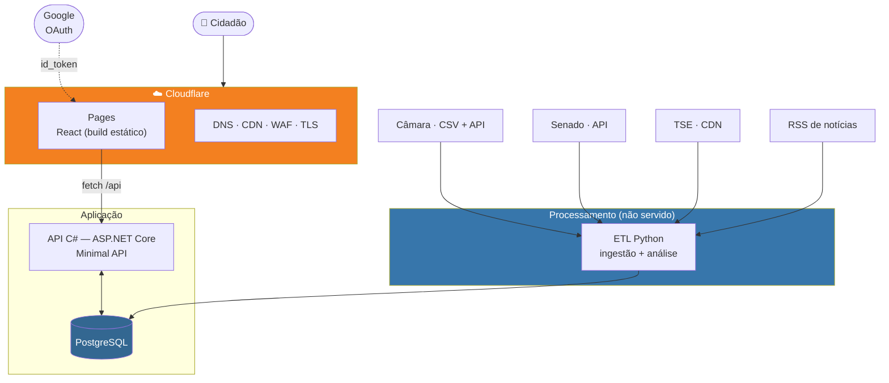

# Plano de implementação — arquitetura macro

> **Status:** v1.0 — 2026-08-23
> **Restrições dadas:** React no front · C# no back · Python no ETL · Postgres ·
> Cloudflare · login só com Google · Aspire para subir infra local · **prazo curto**.
> Este documento escolhe o caminho de menor atrito dentro dessas restrições.

---

## 1. O critério que decide tudo: prazo

O TCC tem 4 elementos no título e **zero linha de código escrita**. Toda escolha aqui é
feita contra um único critério:

> **Quanto tempo isso rouba de escrever o TCC?**

Infra que exige aprendizado, configuração ou manutenção é tempo que não volta. As escolhas
abaixo priorizam *"funciona no primeiro dia e não pede atenção depois"* sobre
*"tecnicamente superior"*.

---

## 2. Desenho macro



**Três blocos, três ciclos de vida diferentes** — e essa separação é o que mantém tudo
simples:

| Bloco | Roda quando | Se cair |
|---|---|---|
| **Front** (Pages) | Sempre, estático | CDN da Cloudflare segura |
| **API** (C#) | Sempre, sob demanda | Site fica sem dados |
| **ETL** (Python) | 1× por dia, offline | **Nada quebra** — dado fica velho |

⚠️ **O ETL não é um serviço.** É um job que roda, escreve no banco e morre. Isso elimina
a necessidade de hospedar Python em qualquer lugar permanente — ver §4.

---

## 3. Iteração sobre as opções de hospedagem

Fiz três rodadas até chegar na combinação de menor atrito.

### Opção A — Tudo em um VPS (Hetzner/DigitalOcean)

| | |
|---|---|
| Custo | ~US$ 5/mês |
| ✅ | Controle total, um lugar só |
| ⛔ | **Você vira sysadmin**: TLS, systemd, backup, firewall, atualização |
| Veredito | ⛔ **Descartado.** É o que mais rouba tempo |

### Opção B — Azure (App Service + Azure Database for PostgreSQL)

| | |
|---|---|
| ✅ | Aspire tem *deploy* nativo para Azure (`azd up`) |
| ✅ | Integração natural com .NET |
| ⛔ | **Azure Database for PostgreSQL não tem tier gratuito permanente** |
| ⛔ | Crédito de estudante expira, e aí o TCC fica fora do ar |
| Veredito | 🟡 **Viável, mas com risco de custo** |

### Opção C — Cloudflare Pages + host gerenciado + Postgres serverless ⭐

| Camada | Escolha | Custo |
|---|---|---|
| Front | **Cloudflare Pages** | Grátis |
| DNS/CDN/WAF | **Cloudflare** | Grátis |
| API C# | **Azure App Service** (F1/B1) ou **Fly.io** | Grátis–US$ 5 |
| Postgres | **Neon** ou **Supabase** | Grátis |
| ETL Python | **GitHub Actions** (cron) | Grátis |

> ✅ **Escolhida.** Nenhum componente exige administração de servidor, e o único que
> pode custar dinheiro é a API — que roda em tier gratuito no volume do TCC.

### 3.1 ⭐ A decisão menos óbvia e mais útil: ETL no GitHub Actions

O ETL é **um job diário**, não um serviço. Isso permite algo que economiza muito tempo:

```yaml
# .github/workflows/etl.yml
on:
  schedule: [{ cron: '0 9 * * *' }]   # após o rebuild dos CSVs (~07:00 GMT)
  workflow_dispatch:                   # botão de "rodar agora"
```

| Ganho | |
|---|---|
| **Zero infra** | Não hospeda Python em lugar nenhum |
| **Grátis** | Repositório público tem minutos ilimitados |
| **Log e histórico de graça** | Cada execução fica registrada — vira evidência no TCC |
| **Botão de reexecutar** | `workflow_dispatch` para recarga manual |
| **Secrets gerenciados** | String de conexão do Postgres como secret |

⚠️ **Limite:** job do GitHub Actions tem teto de 6 h. O ETL completo (149 MB de CSV +
similaridade) roda em minutos — folgadíssimo.

⚠️ **Cuidado real:** se o repositório for **privado**, os minutos são limitados (2.000/mês
no plano gratuito). Um job diário de 10 min = 300 min/mês. Ainda cabe, mas fique atento.

---

## 4. Aspire — o que ele resolve e o que ele não resolve

**Aspire 13** é a versão atual e cobre exatamente esta stack: ele orquestra **C#, Python,
React e Postgres** no mesmo *AppHost*.

### 4.1 O que o Aspire entrega

```csharp
// AppHost.cs — o desenvolvimento local inteiro em um arquivo
var builder = DistributedApplication.CreateBuilder(args);

var pg   = builder.AddPostgres("pg").WithPgAdmin();   // container, senha automática
var db   = pg.AddDatabase("poligraph");

var api  = builder.AddProject<Projects.Poligraph_Api>("api")
                  .WithReference(db);

var etl  = builder.AddPythonApp("etl", "../etl", "main.py")
                  .WithReference(db);

builder.AddNpmApp("web", "../web", "dev")
       .WithReference(api)
       .WithHttpEndpoint(env: "PORT");

builder.Build().Run();
```

| Ganho concreto | |
|---|---|
| **F5 sobe tudo** | Postgres, API, ETL e React de uma vez |
| **Sem `docker-compose` na mão** | O Postgres vem como container gerenciado |
| **Sem string de conexão hardcoded** | `WithReference` injeta por variável de ambiente |
| **Python recebe a conexão** | O container Python lê a env var e usa `psycopg` |
| **Dashboard com logs e traces** | Debug de pipeline multi-linguagem em uma tela |

⭐ **Para o TCC isso vale mais do que parece:** a banca pode rodar o projeto inteiro com um
comando. Reprodutibilidade demonstrável.

### 4.2 ⚠️ O que o Aspire **não** resolve

| Ilusão | Realidade |
|---|---|
| "Aspire faz o deploy" | Faz — **para Azure** (`azd up`). Para Cloudflare + Fly + Neon, **não**. Ali o deploy é manual/CI |
| "Aspire é o ambiente de produção" | ⛔ **Não é.** É ferramenta de *desenvolvimento*. Em produção cada peça vai para o seu host |

> 🔑 **Regra:** Aspire para desenvolver, CI/CD para publicar. Não tente usar o AppHost em
> produção.

---

## 5. Cloudflare — o que usar de fato

| Recurso | Usar? | Para quê |
|---|---|---|
| **Pages** | ✅ | Hospedar o React. `git push` → deploy |
| **DNS + proxy** | ✅ | TLS automático, esconde a origem da API |
| **WAF / Bot Fight** | ✅ | Proteção básica sem configuração |
| **Rate limiting** | ✅ | Protege `/api/afinidade` de abuso |
| Workers | ⛔ | Não roda .NET. Só se precisar de algo em JS na borda |
| D1 / R2 / KV | ⛔ | Já temos Postgres. Não adicionar peça |

⚠️ **Cuidado que morde:** se a API ficar em outro domínio, você tem **CORS**. Solução
simples — servir a API sob o **mesmo domínio** via Cloudflare:

```
poligraph.app          → Cloudflare Pages (React)
poligraph.app/api/*    → proxy para a origem da API
```

Isso elimina CORS, elimina *preflight* e simplifica o cookie/token. **Configure assim
desde o primeiro dia**, senão vira retrabalho.

---

## 6. Estrutura de repositório

```
poligraph/
├── docs/                      ← já existe
├── src/
│   ├── Poligraph.AppHost/     ← Aspire (dev local)
│   ├── Poligraph.Api/         ← C# · ASP.NET Core Minimal API
│   ├── Poligraph.Domain/      ← modelo + regras (RN-01..RN-14)
│   ├── Poligraph.Data/        ← EF Core / Dapper · migrations
│   └── web/                   ← React + Vite + TypeScript
├── etl/                       ← Python
│   ├── extract/               ← camara.py · senado.py · tse.py · noticias.py
│   ├── transform/             ← normaliza voto, categoria, polaridade
│   ├── analyze/               ← similaridade · svd · louvain
│   └── main.py
└── .github/workflows/
    ├── etl.yml                ← cron diário
    ├── api.yml                ← deploy da API
    └── web.yml                ← deploy do front
```

⚠️ **Decisão de fronteira:** o ETL **inteiro** vai para Python, inclusive a ingestão —
não só a análise. Motivo: `pandas.read_csv` já resolve RFC 4180, encoding e tipos, que são
justamente as armadilhas do [contrato §1](../04-contratos.md). Fazer ingestão em C# seria
reimplementar isso.

→ Isso **revisa a decisão D1**, que previa ETL em .NET e só a análise em Python. Ver §7.

---

## 7. ⚠️ Revisão da D1 — o ETL migra inteiro para Python

| | D1 original | **Revisado** |
|---|---|---|
| Ingestão | .NET | 🔄 **Python** |
| Análise | Python | Python |
| API | .NET | .NET |
| Front | Blazor **ou** React | 🔄 **React** (decidido) |

**Por quê:** as armadilhas medidas do dado — RFC 4180 com quebra de linha, ISO-8859-1,
vírgula decimal, sentinelas `#NULO#`, CPF com zero à esquerda — são todas resolvidas por
`pandas` com um parâmetro. Em C# cada uma vira código.

**O que o C# ganha em troca:** foco. A API fica só com o que ela faz bem — servir, cachear
a matriz em memória, aplicar polaridade e ranquear.

⚠️ **Custo assumido:** o C# deixa de ter contato com o dado bruto. Se a banca perguntar
*"onde está a engenharia de dados em .NET?"*, a resposta honesta é: **não está — está em
Python, por adequação de ferramenta**. Isso precisa ser defendido no texto, não escondido.

---

## 8. Ordem de construção

```mermaid
flowchart LR
    S1["1 · Aspire + Postgres<br/>+ 'hello world'"] --> S2["2 · ETL Python<br/>votacoesVotos 2025"]
    S2 --> S3["3 · Matriz + similaridade"]
    S3 --> S4["4 · API: /parlamentares<br/>+ /similares"]
    S4 --> S5["5 · React: lista + ficha"]
    S5 --> S6["6 · Grafo (kNN k=10)"]
    S6 --> S7["7 · Questionário<br/>+ /afinidade"]
    S7 --> S8["8 · Crawler + notícias"]
    style S4 fill:#238636,color:#fff
    style S7 fill:#238636,color:#fff
```



| Passo | Entrega verificável | Esforço |
|---|---|---|
| 1 | `dotnet run` sobe Postgres + API + React | 🟢 1 dia |
| 2 | 167 mil votos no banco | 🟢 1–2 dias |
| 3 | Tabela `similaridade` populada | 🟡 2 dias |
| 4 | `GET /api/parlamentares/{id}/similares` responde | 🟢 1 dia |
| 5 | Ficha do parlamentar na tela | 🟡 2–3 dias |
| 6 | Grafo renderizado | 🔴 3–4 dias |
| 7 | Questionário ponta a ponta | 🟡 2–3 dias |
| 8 | Notícias na ficha | 🟡 2 dias |

> 🔑 **O passo 2 é o marco que muda tudo.** A partir dele, a documentação passa a ser
> validada por código em vez de por análise.

⚠️ **O passo 6 (grafo) é o mais caro e o menos essencial.** Se o prazo apertar, entregue
questionário (7) antes do grafo (6) — o título cobra "Modelagem em Grafos", mas o grafo
pode ser entregue como visualização simples antes de virar interativo.

---

## 9. Pendências deste plano

| # | Pendência | Prioridade |
|---|---|---|
| **PL1** | Escolher entre **Neon** e **Supabase** para o Postgres gerenciado | 🟡 Média |
| **PL2** | Escolher entre **Azure App Service** e **Fly.io** para a API | 🟡 Média |
| **PL3** | Registrar o domínio e apontar para a Cloudflare | 🟢 Baixa |
| **PL4** | Confirmar se o repositório será público (afeta minutos do Actions) | 🟡 Média |
| **PL5** | Decidir biblioteca do grafo no React — Cytoscape.js vs react-force-graph | 🟡 Média |
