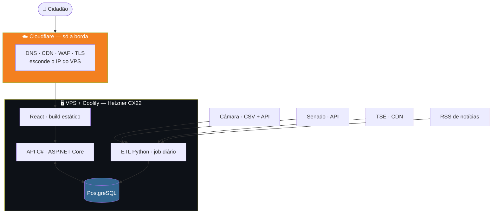

# Plano de implementação — arquitetura macro

> **Status:** v1.2 — 2026-08-25
> **v1.2:** ✅ **DECISÃO — VPS + Coolify** (§3.5), com Hetzner CX22 recomendado.
> **v1.1:** §3 — opção D avaliada (compartilhada, Render, Railway, VPS+Coolify) e
> comparação final; PL1 e PL2 decididas.
> **Restrições dadas:** React no front · C# no back · Python no ETL · Postgres ·
> Cloudflare · login só com Google · Aspire para subir infra local · **prazo curto**.
> Este documento escolhe o caminho de menor atrito dentro dessas restrições.

---

## 1. O critério que decide tudo: prazo

O TCC tem 4 elementos no título e **zero linha de código escrita**. Toda escolha aqui é
feita contra um único critério:

> **Quanto tempo isso rouba de escrever o TCC?**

Infra que exige aprendizado, configuração ou manutenção é tempo que não volta. As escolhas
abaixo priorizam *"funciona no primeiro dia e não pede atenção depois"* sobre
*"tecnicamente superior"*.

---

## 2. Desenho macro



**Tudo numa máquina, mas três ciclos de vida diferentes** — e a separação lógica continua
importando:

| Bloco | Roda quando | Se cair |
|---|---|---|
| **Front** (React) | Sempre, estático | CDN da Cloudflare segura |
| **API** (C#) | Sempre, sob demanda | Site fica sem dados |
| **ETL** (Python) | 1× por dia, offline | **Nada quebra** — dado fica velho |

⚠️ **O ETL não é um serviço.** É um job que roda, escreve no banco e morre. Isso elimina
a necessidade de hospedar Python em qualquer lugar permanente — ver §4.

---

## 3. Iteração sobre as opções de hospedagem

Fiz três rodadas até chegar na combinação de menor atrito.

### Opção A — Tudo em um VPS (Hetzner/DigitalOcean)

| | |
|---|---|
| Custo | ~US$ 5/mês |
| ✅ | Controle total, um lugar só |
| ⛔ | **Você vira sysadmin**: TLS, systemd, backup, firewall, atualização |
| Veredito | ⛔ **Descartado.** É o que mais rouba tempo |

### Opção B — Azure (App Service + Azure Database for PostgreSQL)

| | |
|---|---|
| ✅ | Aspire tem *deploy* nativo para Azure (`azd up`) |
| ✅ | Integração natural com .NET |
| ⛔ | **Azure Database for PostgreSQL não tem tier gratuito permanente** |
| ⛔ | Crédito de estudante expira, e aí o TCC fica fora do ar |
| Veredito | 🟡 **Viável, mas com risco de custo** |

### Opção C — Cloudflare Pages + host gerenciado + Postgres serverless ⭐

| Camada | Escolha | Custo |
|---|---|---|
| Front | **Cloudflare Pages** | Grátis |
| DNS/CDN/WAF | **Cloudflare** | Grátis |
| API C# | ✅ **Azure App Service F1** ⚠️ 60 CPU-min/dia, sem Always On | Grátis |
| Postgres | ✅ **Neon** (Supabase pausa após 1 semana parado) | Grátis |
| ETL Python | **GitHub Actions** (cron) | Grátis |

⚠️ **NÃO escolhida.** Era a recomendação até 2026-08-25, quando o autor optou pela Opção D
(VPS + Coolify) por preferir um painel único. Mantida como registro — e a comparação
continua válida para o texto do TCC.

### Opção D — "Tudo em um lugar só" (Hostinger, HostGator, Render, Railway)

Avaliada em 2026-08-25, porque a vontade por trás é legítima: **uma conta, uma fatura, um
painel**. Mas as quatro caem por motivos diferentes.

#### ⛔ Hospedagem compartilhada (Hostinger, HostGator) — **impossível, não caro**

| Barreira | |
|---|---|
| **Sem PostgreSQL** | Documentação oficial da Hostinger: *"PostgreSQL requer mais recursos e configurações que não estão disponíveis nos planos Web e Cloud — VPS é a opção suportada"*. Compartilhado = **MySQL apenas** |
| **Sem .NET** | Compartilhado é ambiente **PHP/cPanel**. ASP.NET Core não roda |
| **Sem cron para ETL Python** | Mesmo onde há Python via cPanel, é limitado |

> 🔑 **Não é questão de plano mais caro.** Hospedagem compartilhada é uma categoria de
> produto que não atende a esta stack. Trocaria Postgres por MySQL e C# por PHP — ou seja,
> mudaria o projeto para caber na hospedagem.

#### ⛔ Render — o Postgres gratuito **expira em 30 dias**

| | |
|---|---|
| Postgres free | 1 GB, **expira 30 dias após a criação** (era 90 até 2024), depois 14 dias de carência e **os dados são apagados** |
| Web service free | Dorme após 15 min · 750 h/mês |
| Veredito | ⛔ Inviável — o TCC dura meses; o banco morreria três vezes no caminho |

#### 🟡 Railway — US$ 5 de crédito único, depois US$ 1/mês

| | |
|---|---|
| Trial | US$ 5 uma vez, sem cartão |
| Free contínuo | **US$ 1/mês** — 1 vCPU, 0,5 GB RAM, 1 projeto |
| Veredito | 🟡 Funciona, mas na prática vira **~US$ 5/mês**. Deploy num lugar só, isso sim |

#### ✅ VPS + PaaS self-hosted — **ESCOLHIDA** (ver §3.5)

Se o valor for mesmo *"um lugar só"*, o caminho viável é **VPS com Coolify ou Dokploy**
(PaaS auto-hospedado: deploy por `git push`, TLS automático, Postgres em container).

| | |
|---|---|
| Custo | ~R\$ 30–50/mês (Hostinger VPS, Contabo, Hetzner) |
| Setup | ~1 dia — instalar Docker + Coolify, apontar domínio |
| Depois disso | Comporta-se como PaaS: `git push` e pronto |
| ⛔ Custo real | **Atualização de SO, backup, monitoramento, e o dia que cair é você quem levanta** |

### 3.0 Comparação final

| Opção | Custo/mês | Sysadmin? | Serve? |
|---|---|---|---|
| Compartilhada (Hostinger/HostGator) | R\$ 10–30 | Não | ⛔ **Não roda .NET nem Postgres** |
| Render | US\$ 0 | Não | ⛔ Postgres expira em 30 dias |
| Railway | ~US\$ 5 | Não | 🟡 Serve |
| ⭐ **VPS + Coolify** | **R\$ 24–80** | 🟡 Sim, um pouco | ✅ **ESCOLHIDA** — §3.5 |
| Distribuída (Opção C) | R\$ 0 | Não | ✅ Serve — não escolhida |

> 🔑 **A configuração distribuída é gratuita justamente por ser distribuída.** Cada
> provedor cobre uma peça no seu tier gratuito. Concentrar tudo em um lugar significa
> pedir a um único provedor que banque tudo — e aí ele cobra.

⚠️ **O custo real da Opção C não é dinheiro, é atenção:** quatro painéis (Cloudflare,
Azure, Neon, GitHub) em vez de um. Para um projeto que é configurado uma vez e roda,
é troca vantajosa. **Se você prefere pagar ~R\$ 40/mês para ter um painel só, o VPS +
Coolify é escolha defensável** — e vale registrar no TCC como decisão consciente.

---

## 3.5 ✅ DECISÃO — VPS + Coolify (2026-08-25)

O autor optou pela Opção D: **um painel só**. Esta seção dimensiona e escolhe.

### 3.5.1 Dimensionamento — o ETL é quem manda

| Componente | RAM |
|---|---|
| **Coolify** (só ele) | 750 MB – 1,2 GB |
| PostgreSQL (463 mil votos) | ~1 GB |
| API .NET | ~300 MB |
| 🔴 **ETL Python — pico** | **1–2 GB** (`pandas` com CSV de 55 MB + `numpy`) |
| Build (.NET compilando) | CPU-intensivo, picos de RAM |

> 🔑 **4 GB é o piso, 8 GB é confortável.** Em 2 GB o Coolify sozinho come metade e o ETL
> morre por falta de memória.

**Disco:** 149 MB de CSV + Postgres + imagens Docker → **40 GB basta**, 80 GB folga.

⚠️ **O ETL é o pico, e ele é diário e previsível.** Se apertar, a saída é mantê-lo no
**GitHub Actions** mesmo com VPS — aí 4 GB sobram com folga. Vale considerar: o "painel
único" continua valendo para o que é servido; o job diário fica de fora e não compete por
memória.

### 3.5.2 A escolha real: latência × preço

| Provedor | Config | Preço | Datacenter | Latência BR |
|---|---|---|---|---|
| ⭐ **Hetzner CX22** | 2 vCPU · **4 GB** · 40 GB NVMe · 20 TB | **€ 3,79 (~R\$ 24)** | 🇩🇪 EU / 🇺🇸 US | ⚠️ 150–250 ms |
| **Hostinger VPS KVM** | 4 GB | ~R\$ 40–80 | 🇧🇷 tem BR | ✅ 10–40 ms |
| VPS brasileiro (KingHost, Locaweb…) | 4 GB | **R\$ 80–200** | 🇧🇷 São Paulo | ✅ 10–40 ms |

#### A latência importa aqui?

**Menos do que parece**, por dois motivos:

1. **Cloudflare na frente** cacheia o estático na borda — o React carrega rápido mesmo com
   origem na Alemanha.
2. **O que sobra é chamada de API.** A ficha do parlamentar faz 1–2 chamadas; o
   questionário faz 1. São **+200 ms por chamada**, perceptível mas tolerável.

⚠️ **Onde 200 ms incomoda:** o grafo, que transfere 400–600 KB. Aí o gargalo é
transferência, não latência — e a Cloudflare ajuda menos porque é dado dinâmico.

> **Recomendação: Hetzner CX22.** ~R\$ 24/mês por 4 GB é 3× a 8× mais barato que VPS
> brasileiro equivalente, e 200 ms não compromete um site de consulta.
>
> ⚠️ **Escolha um VPS brasileiro se:** você quer suporte em português na véspera da
> entrega, ou se a defesa será em conexão ruim onde cada 200 ms conta.

### 3.5.3 ⚠️ Duas armadilhas de preço

| Armadilha | |
|---|---|
| **Preço promocional** | Hostinger e afins anunciam o valor de contratos de 24–48 meses. **A renovação costuma dobrar.** Confira o preço de renovação, não o da vitrine |
| **Oracle Cloud Always Free** | Tem região São Paulo e oferece ARM com 4 CPU / 24 GB **de graça**. ⛔ **Não recomendo para TCC:** é notório por não haver capacidade disponível e por encerrar contas sem aviso. Perder o ambiente na semana da entrega não compensa a economia |

### 3.5.4 O que muda no plano

| Item | Antes (distribuída) | Agora (VPS + Coolify) |
|---|---|---|
| Front | Cloudflare Pages | 🔄 Coolify (ou manter no Pages) |
| API | Azure App Service F1 | 🔄 **Coolify** |
| Postgres | Neon | 🔄 **Container no Coolify** |
| ETL | GitHub Actions | 🟡 Coolify **ou manter no Actions** |
| Cloudflare | DNS + Pages + WAF | ✅ **Mantém** — DNS, CDN, WAF, TLS na borda |
| Custo | R\$ 0 | **~R\$ 24–80/mês** |

✅ **Some o problema do *cold start*** — sem App Service F1 dormindo e sem Neon pausando,
a demonstração para a banca fica previsível. **Esse ganho sozinho já justifica a escolha.**

⚠️ **Mantenha a Cloudflare na frente** mesmo com VPS: TLS, CDN, WAF e — importante —
**esconde o IP do servidor**, o que reduz superfície de ataque.

⚠️ **Backup do Postgres passa a ser sua responsabilidade.** O Coolify tem agendamento de
backup para S3/storage externo — **configure no primeiro dia**, não depois. Perder o banco
com o TCC em andamento é o pior cenário possível, e é evitável em 10 minutos.

### 3.1 ⭐ A decisão menos óbvia e mais útil: ETL no GitHub Actions

O ETL é **um job diário**, não um serviço. Isso permite algo que economiza muito tempo:

```yaml
# .github/workflows/etl.yml
on:
  schedule: [{ cron: '0 9 * * *' }]   # após o rebuild dos CSVs (~07:00 GMT)
  workflow_dispatch:                   # botão de "rodar agora"
```

| Ganho | |
|---|---|
| **Zero infra** | Não hospeda Python em lugar nenhum |
| **Grátis** | Repositório público tem minutos ilimitados |
| **Log e histórico de graça** | Cada execução fica registrada — vira evidência no TCC |
| **Botão de reexecutar** | `workflow_dispatch` para recarga manual |
| **Secrets gerenciados** | String de conexão do Postgres como secret |

⚠️ **Limite:** job do GitHub Actions tem teto de 6 h. O ETL completo (149 MB de CSV +
similaridade) roda em minutos — folgadíssimo.

⚠️ **Cuidado real:** se o repositório for **privado**, os minutos são limitados (2.000/mês
no plano gratuito). Um job diário de 10 min = 300 min/mês. Ainda cabe, mas fique atento.

---

## 4. Aspire — o que ele resolve e o que ele não resolve

**Aspire 13** é a versão atual e cobre exatamente esta stack: ele orquestra **C#, Python,
React e Postgres** no mesmo *AppHost*.

### 4.1 O que o Aspire entrega

```csharp
// AppHost.cs — o desenvolvimento local inteiro em um arquivo
var builder = DistributedApplication.CreateBuilder(args);

var pg   = builder.AddPostgres("pg").WithPgAdmin();   // container, senha automática
var db   = pg.AddDatabase("poligraph");

var api  = builder.AddProject<Projects.Poligraph_Api>("api")
                  .WithReference(db);

var etl  = builder.AddPythonApp("etl", "../etl", "main.py")
                  .WithReference(db);

builder.AddNpmApp("web", "../web", "dev")
       .WithReference(api)
       .WithHttpEndpoint(env: "PORT");

builder.Build().Run();
```

| Ganho concreto | |
|---|---|
| **F5 sobe tudo** | Postgres, API, ETL e React de uma vez |
| **Sem `docker-compose` na mão** | O Postgres vem como container gerenciado |
| **Sem string de conexão hardcoded** | `WithReference` injeta por variável de ambiente |
| **Python recebe a conexão** | O container Python lê a env var e usa `psycopg` |
| **Dashboard com logs e traces** | Debug de pipeline multi-linguagem em uma tela |

⭐ **Para o TCC isso vale mais do que parece:** a banca pode rodar o projeto inteiro com um
comando. Reprodutibilidade demonstrável.

### 4.2 ⚠️ O que o Aspire **não** resolve

| Ilusão | Realidade |
|---|---|
| "Aspire faz o deploy" | Faz — **para Azure** (`azd up`). Para Cloudflare + Fly + Neon, **não**. Ali o deploy é manual/CI |
| "Aspire é o ambiente de produção" | ⛔ **Não é.** É ferramenta de *desenvolvimento*. Em produção cada peça vai para o seu host |

> 🔑 **Regra:** Aspire para desenvolver, CI/CD para publicar. Não tente usar o AppHost em
> produção.

---

## 5. Cloudflare — o que usar de fato

| Recurso | Usar? | Para quê |
|---|---|---|
| **Pages** | ✅ | Hospedar o React. `git push` → deploy |
| **DNS + proxy** | ✅ | TLS automático, esconde a origem da API |
| **WAF / Bot Fight** | ✅ | Proteção básica sem configuração |
| **Rate limiting** | ✅ | Protege `/api/afinidade` de abuso |
| Workers | ⛔ | Não roda .NET. Só se precisar de algo em JS na borda |
| D1 / R2 / KV | ⛔ | Já temos Postgres. Não adicionar peça |

⚠️ **Cuidado que morde:** se a API ficar em outro domínio, você tem **CORS**. Solução
simples — servir a API sob o **mesmo domínio** via Cloudflare:

```
poligraph.app          → Cloudflare Pages (React)
poligraph.app/api/*    → proxy para a origem da API
```

Isso elimina CORS, elimina *preflight* e simplifica o cookie/token. **Configure assim
desde o primeiro dia**, senão vira retrabalho.

---

## 6. Estrutura de repositório

```
poligraph/
├── docs/                      ← já existe
├── src/
│   ├── Poligraph.AppHost/     ← Aspire (dev local)
│   ├── Poligraph.Api/         ← C# · ASP.NET Core Minimal API
│   ├── Poligraph.Domain/      ← modelo + regras (RN-01..RN-14)
│   ├── Poligraph.Data/        ← EF Core / Dapper · migrations
│   └── web/                   ← React + Vite + TypeScript
├── etl/                       ← Python
│   ├── extract/               ← camara.py · senado.py · tse.py · noticias.py
│   ├── transform/             ← normaliza voto, categoria, polaridade
│   ├── analyze/               ← similaridade · svd · louvain
│   └── main.py
└── .github/workflows/
    ├── etl.yml                ← cron diário
    ├── api.yml                ← deploy da API
    └── web.yml                ← deploy do front
```

⚠️ **Decisão de fronteira:** o ETL **inteiro** vai para Python, inclusive a ingestão —
não só a análise. Motivo: `pandas.read_csv` já resolve RFC 4180, encoding e tipos, que são
justamente as armadilhas do [contrato §1](../04-contratos.md). Fazer ingestão em C# seria
reimplementar isso.

→ Isso **revisa a decisão D1**, que previa ETL em .NET e só a análise em Python. Ver §7.

---

## 7. ⚠️ Revisão da D1 — o ETL migra inteiro para Python

| | D1 original | **Revisado** |
|---|---|---|
| Ingestão | .NET | 🔄 **Python** |
| Análise | Python | Python |
| API | .NET | .NET |
| Front | Blazor **ou** React | 🔄 **React** (decidido) |

**Por quê:** as armadilhas medidas do dado — RFC 4180 com quebra de linha, ISO-8859-1,
vírgula decimal, sentinelas `#NULO#`, CPF com zero à esquerda — são todas resolvidas por
`pandas` com um parâmetro. Em C# cada uma vira código.

**O que o C# ganha em troca:** foco. A API fica só com o que ela faz bem — servir, cachear
a matriz em memória, aplicar polaridade e ranquear.

⚠️ **Custo assumido:** o C# deixa de ter contato com o dado bruto. Se a banca perguntar
*"onde está a engenharia de dados em .NET?"*, a resposta honesta é: **não está — está em
Python, por adequação de ferramenta**. Isso precisa ser defendido no texto, não escondido.

---

## 8. Ordem de construção

```mermaid
flowchart LR
    S1["1 · Aspire + Postgres<br/>+ 'hello world'"] --> S2["2 · ETL Python<br/>votacoesVotos 2025"]
    S2 --> S3["3 · Matriz + similaridade"]
    S3 --> S4["4 · API: /parlamentares<br/>+ /similares"]
    S4 --> S5["5 · React: lista + ficha"]
    S5 --> S6["6 · Grafo (kNN k=10)"]
    S6 --> S7["7 · Questionário<br/>+ /afinidade"]
    S7 --> S8["8 · Crawler + notícias"]
    style S4 fill:#238636,color:#fff
    style S7 fill:#238636,color:#fff
```



| Passo | Entrega verificável | Esforço |
|---|---|---|
| 1 | `dotnet run` sobe Postgres + API + React | 🟢 1 dia |
| 2 | 167 mil votos no banco | 🟢 1–2 dias |
| 3 | Tabela `similaridade` populada | 🟡 2 dias |
| 4 | `GET /api/parlamentares/{id}/similares` responde | 🟢 1 dia |
| 5 | Ficha do parlamentar na tela | 🟡 2–3 dias |
| 6 | Grafo renderizado | 🔴 3–4 dias |
| 7 | Questionário ponta a ponta | 🟡 2–3 dias |
| 8 | Notícias na ficha | 🟡 2 dias |

> 🔑 **O passo 2 é o marco que muda tudo.** A partir dele, a documentação passa a ser
> validada por código em vez de por análise.

⚠️ **O passo 6 (grafo) é o mais caro e o menos essencial.** Se o prazo apertar, entregue
questionário (7) antes do grafo (6) — o título cobra "Modelagem em Grafos", mas o grafo
pode ser entregue como visualização simples antes de virar interativo.

---

## 9. Pendências deste plano

| # | Pendência | Prioridade |
|---|---|---|
| ~~PL1~~ | ✅ **RESOLVIDA — 2026-08-25: Neon.** O Supabase **pausa o projeto** após 1 semana parado e exige despausar à mão — ruim para demonstração | — |
| **PL2** | Escolher entre **Azure App Service** e **Fly.io** para a API | 🟡 Média |
| **PL3** | Registrar o domínio e apontar para a Cloudflare | 🟢 Baixa |
| **PL4** | Confirmar se o repositório será público (afeta minutos do Actions) | 🟡 Média |
| **PL5** | Decidir biblioteca do grafo no React — Cytoscape.js vs react-force-graph | 🟡 Média |
