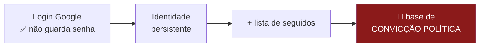
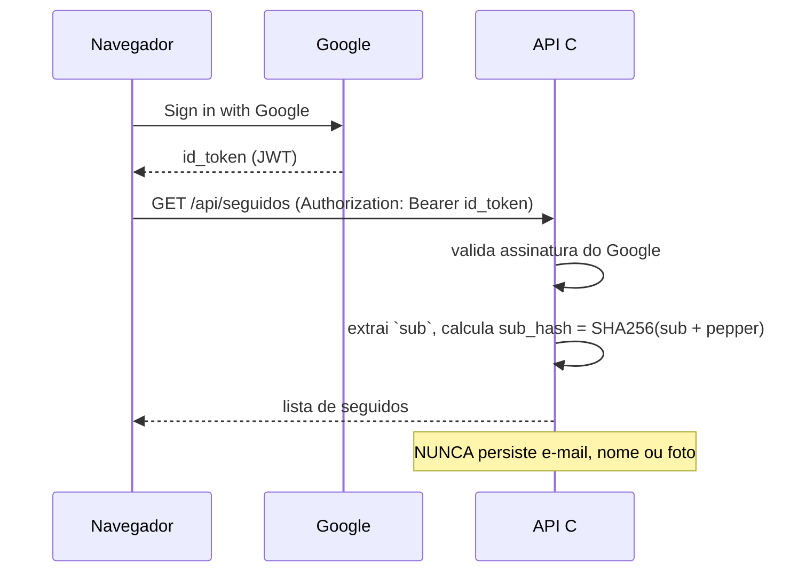

# Autenticação, privacidade e métricas de uso

> **Status:** v1.0 — 2026-08-23
> ⚠️ Este documento contém **a decisão de maior consequência jurídica do projeto**.
> Leia a §1 antes de implementar qualquer login.

---

## 1. 🔴 A tensão: "login com Google" × "nenhum dado sensível"

O pedido foi: *"login com o Google (e somente), não quero manter nenhum dado sensível do
usuário"*. **A intenção está certa e o instinto é bom** — não gerenciar senha é a decisão
correta. Mas há um problema que o login com Google **não** resolve, e que precisa ficar
explícito:

> **O risco não está nas credenciais. Está no que você associa à identidade.**



**LGPD, art. 5º, II** classifica *"convicção religiosa, opinião política"* como **dado
pessoal sensível** — categoria com exigências mais rígidas que dado comum.

Uma tabela `usuario_segue(usuario, parlamentar)` **é exatamente isso**: um registro de
preferência política por pessoa identificada.

⚠️ **E o contexto agrava:** as eleições gerais são em **outubro de 2026**. Uma base de
"quem segue qual político", existindo durante o período eleitoral, é passivo real — não
hipótese acadêmica.

---

## 2. As três formas de resolver

### Opção 1 — Sem login, tudo no navegador ⭐ recomendada para o MVP

```
Lista de seguidos → localStorage
Feed              → montado no cliente
Servidor          → nunca sabe quem segue quem
```

| | |
|---|---|
| ✅ | **Zero dado pessoal.** Não há o que vazar, não há o que declarar |
| ✅ | Nada a implementar — sem OAuth, sem sessão, sem tabela de usuário |
| ✅ | Já é o desenho registrado em [03-requisitos §2.7.2](../03-requisitos.md) |
| ⛔ | Perde a lista ao trocar de navegador ou limpar dados |
| ⛔ | Sem notificação por e-mail |

### Opção 2 — Google login com identidade opaca

```
Guarda APENAS o `sub` do Google (id opaco, ex.: 117482...)
NÃO guarda: e-mail, nome, foto
Tabela: usuario(sub_hash) · segue(sub_hash, pessoa_id)
```

| | |
|---|---|
| ✅ | Sincroniza entre dispositivos |
| ✅ | Sem PII direta armazenada |
| ⚠️ | **Continua sendo dado pessoal** — pseudonimizado ≠ anonimizado (LGPD art. 12) |
| ⚠️ | Exige: consentimento específico, política de privacidade, exclusão sob demanda |

### Opção 3 — Google login completo (e-mail, nome)

| | |
|---|---|
| ✅ | Permite notificação por e-mail |
| 🔴 | **Base de convicção política vinculada a pessoa identificada** |
| 🔴 | Maior exposição possível, no pior momento possível |
| Veredito | ⛔ **Não recomendado** |

---

## 3. Recomendação

> **MVP: Opção 1 (sem login).** Se o cross-device se mostrar necessário, **Opção 2**.
> A Opção 3 só com necessidade concreta de e-mail, e aí com todo o aparato de LGPD.

**O raciocínio:** login existe para resolver *um* problema — lembrar quem você é entre
dispositivos. Pergunte se o TCC precisa disso. Se a resposta for "seria legal ter", não
compensa: você troca zero passivo jurídico por uma conveniência.

### 3.1 Se decidir pela Opção 2 — o desenho mínimo



| Regra | Motivo |
|---|---|
| Validar o `id_token` **no servidor** | Nunca confiar no cliente |
| Persistir só `SHA256(sub + pepper)` | Nem o `sub` cru fica no banco |
| ⛔ Não persistir e-mail, nome, foto | Não são necessários para nada |
| Endpoint de exclusão total | LGPD art. 18 — direito à eliminação |
| Retenção com prazo | Ex.: apagar após 12 meses sem acesso |

⚠️ **`pepper` fora do banco** (variável de ambiente). Se o banco vazar, o hash sozinho não
liga a ninguém.

---

## 4. Métricas de uso — a ferramenta é o Microsoft Clarity

Você mencionou "alguma do Google". São duas coisas diferentes, e a que você descreveu
(**mapa de calor**) não é do Google:

| Precisa de | Ferramenta | Custo |
|---|---|---|
| Tempo de uso, sessões, funil, origem | **Google Analytics 4** | Grátis |
| **Mapa de calor + gravação de sessão** | ⭐ **Microsoft Clarity** | **Grátis, ilimitado** |

### 4.1 Por que Clarity

O Clarity é gratuito com **sessões ilimitadas** — sem cota diária, sem cota mensal,
sem amostragem — enquanto concorrentes como Hotjar cobrariam ~US$ 80/mês no mesmo volume.
Inclui mapa de calor, gravação de sessão e detecção de *rage click* e *dead click*.

**Para o TCC isso é mais útil do que parece.** As métricas viram evidência:

| Métrica do Clarity | O que responde no TCC |
|---|---|
| Taxa de abandono do questionário | O N de perguntas (RQ3) está grande demais? |
| Mapa de calor da tela de resultado | O usuário olha os "mais distantes" ou ignora? |
| *Rage click* no grafo | O grafo está utilizável ou frustrante? |
| Tempo até responder | A ementa reescrita ficou compreensível? |

⭐ **Isso transforma opinião em dado na seção de avaliação.** Em vez de *"acreditamos que a
interface é clara"*, você escreve *"a taxa de conclusão do questionário foi de X%, com
abandono concentrado na pergunta N"*.

### 4.2 🔴 Mas há um conflito — e é sério

> **Gravação de sessão em um site de afinidade política grava a pessoa respondendo o
> questionário.** Ou seja: grava opinião política.

Isso colide com toda a §1 deste documento.

**Mitigações obrigatórias se usar Clarity:**

| # | Medida |
|---|---|
| 1 | **Mascarar todo conteúdo sensível** — Clarity suporta `data-clarity-mask` |
| 2 | **Não gravar a tela de resultado** — é onde a afinidade aparece |
| 3 | Mascarar as respostas selecionadas no questionário |
| 4 | Banner de consentimento antes de carregar o script |
| 5 | ⚠️ **Considerar usar só o mapa de calor**, desligando a gravação |

⚠️ **Alternativa mais segura:** usar Clarity **apenas em ambiente de teste**, com usuários
voluntários que consentiram explicitamente, e **não** em produção aberta. Isso dá o dado
de usabilidade para o TCC sem criar exposição.

→ **Recomendação:** Clarity em fase de avaliação com voluntários (n pequeno, consentido) +
GA4 sem PII em produção. **Pendência PL6.**

---

## 5. Resumo das decisões

| Tema | Decisão |
|---|---|
| Login no MVP | ⭐ **Nenhum** — `localStorage` |
| Se precisar de login | Google, guardando só `SHA256(sub + pepper)` |
| E-mail / nome / foto | ⛔ Nunca persistir |
| Mapa de calor | **Microsoft Clarity**, com máscara e consentimento |
| Analytics de uso | **GA4**, sem PII |
| Gravação de sessão | ⚠️ Só em avaliação consentida, não em produção aberta |

---

## 6. Pendências

| # | Pendência | Prioridade |
|---|---|---|
| **PL6** | Decidir se Clarity roda em produção ou só na avaliação com voluntários | 🔴 Alta |
| **PL7** | Se houver login: escrever política de privacidade e endpoint de exclusão | 🔴 Alta *(se opção 2)* |
| **PL8** | Definir os seletores `data-clarity-mask` antes de subir o script | 🟡 Média |
| **PL9** | Decidir se o banner de consentimento é necessário (depende de PL6) | 🟡 Média |

---

## Fontes

- [Microsoft Clarity — Free Heatmaps & Session Recordings](https://clarity.microsoft.com/)
- [Microsoft Clarity Pricing: Is It Really Free in 2026?](https://clarity-insights.com/blog/microsoft-clarity-pricing.html)
- [9 Best AI Heatmap Tools 2026](https://omidsaffari.com/blog/ai-heatmap-tools-2026-clarity-wins-free-vs-contentsquare)
