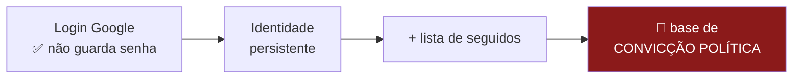

# Autenticação, privacidade e métricas de uso

> **Status:** v2.1 — 2026-08-25
> **v2.1:** §3.6 — como a API valida quem é o usuário em cada requisição: cookie do
> ASP.NET Core, as 4 conferências, e 🔴 a armadilha do Data Protection em container, que
> desloga todo mundo no primeiro redeploy.
> **v2.0:** 🔄 REVOGADO o princípio de minimização a pedido do autor. §3.5 reescrita:
> armazenar o perfil COMPLETO do Google em claro. Caem o hash de `sub`, o `pepper`, o
> `email` anulável e a regra "receber ≠ guardar". ⛔ Nenhum token é armazenado.
> **v1.11:** §3.5.6 — por que o `email` não pode ser hash. ⛔ Superada pela v2.0.
> **v1.10:** §3.5 — inventário consolidado do que fica no banco após um login. Dos 12
> campos recebidos, 11 são descartados. ⭐ A pseudonimização vale POR USUÁRIO e cai no
> momento do opt-in de e-mail.
> **v1.9:** §3.4.0 — autenticação × autorização delegada: não existe `refresh_token`
> neste fluxo, e o cookie de sessão é que faz o papel dele. Guardá-lo violaria a RNF-12d.
> **v1.8:** §3.4.0 — o payload literal do `id_token`, os três blocos do JWT e as TRÊS
> conferências obrigatórias. 🔴 A do `aud` é a que costuma faltar e a que mais importa.
> **v1.7:** §3.2.4 reescrita — "e o token, não vai ser armazenado?". São TRÊS desenhos,
> não dois. ⭐ Recomendação muda para B1 (cookie assinado `HttpOnly`, sem tabela), porque
> a opção A expunha o `id_token` ao XSS. Truque do `sessao_versao` para revogação global.
> **v1.6:** §3.4 — o que o id_token entrega e a regra "receber ≠ guardar". ⭐ Nome e foto
> nunca são persistidos; só o `email` precisa, e só porque o job de digest roda sem o
> usuário presente. `email_verified` do Google DERRUBA o double opt-in.
> **v1.5:** 🔄 §3 — a opção 2 não comporta e-mail; decisão revista para a **opção 3**
> (Google + e-mail armazenado). Nova §3.3: o que a notificação por e-mail traz junto
> (SPF/DKIM/DMARC, serviço de envio, `token_email`, assunto que vaza).
> **v1.4:** ✅ DECIDIDO — login só com Google, identidade opaca (§3). Nova §3.2.4: sem
> senha não significa sem sessão.
> **v1.3:** §3.2 — o passo a passo concreto do login com Google (Google Cloud, escopos,
> código, esforço).
> **v1.2:** ✅ PL6 DECIDIDA — Clarity em produção, gravando tudo, com consentimento
> prévio bloqueante (§4.5). PL8 e PL9 caem junto; nascem PL25 (texto do banner) e PL24 (CEP).
> **v1.1:** §4.2–4.5 reescritas contra a documentação oficial do Clarity. 🔴 Duas
> mitigações da v1.0 estavam erradas: máscara não esconde clique, e "só heatmap" é pior
> que gravação. Consent Mode não protege o Brasil por padrão. Nova pendência PL24 (CEP).
> ⚠️ Este documento contém **a decisão de maior consequência jurídica do projeto**.
> Leia a §1 antes de implementar qualquer login.

---

## 1. 🔴 A tensão: "login com Google" × "nenhum dado sensível"

O pedido foi: *"login com o Google (e somente), não quero manter nenhum dado sensível do
usuário"*. **A intenção está certa e o instinto é bom** — não gerenciar senha é a decisão
correta. Mas há um problema que o login com Google **não** resolve, e que precisa ficar
explícito:

> **O risco não está nas credenciais. Está no que você associa à identidade.**



**LGPD, art. 5º, II** classifica *"convicção religiosa, opinião política"* como **dado
pessoal sensível** — categoria com exigências mais rígidas que dado comum.

Uma tabela `usuario_segue(usuario, parlamentar)` **é exatamente isso**: um registro de
preferência política por pessoa identificada.

⚠️ **E o contexto agrava:** as eleições gerais são em **outubro de 2026**. Uma base de
"quem segue qual político", existindo durante o período eleitoral, é passivo real — não
hipótese acadêmica.

---

## 2. As três formas de resolver

### Opção 1 — Sem login, tudo no navegador  ⚠️ não escolhida

```
Lista de seguidos → localStorage
Feed              → montado no cliente
Servidor          → nunca sabe quem segue quem
```

| | |
|---|---|
| ✅ | **Zero dado pessoal.** Não há o que vazar, não há o que declarar |
| ✅ | Nada a implementar — sem OAuth, sem sessão, sem tabela de usuário |
| ✅ | Já é o desenho registrado em [03-requisitos §2.7.2](../03-requisitos.md) |
| ⛔ | Perde a lista ao trocar de navegador ou limpar dados |
| ⛔ | Sem notificação por e-mail |

### Opção 2 — Google login com identidade opaca  🔄 superada pela §3

```
Guarda APENAS o `sub` do Google (id opaco, ex.: 117482...)
NÃO guarda: e-mail, nome, foto
Tabela: usuario(sub_hash) · segue(sub_hash, pessoa_id)
```

| | |
|---|---|
| ✅ | Sincroniza entre dispositivos |
| ✅ | Sem PII direta armazenada |
| ⚠️ | **Continua sendo dado pessoal** — pseudonimizado ≠ anonimizado (LGPD art. 12) |
| ⚠️ | Exige: consentimento específico, política de privacidade, exclusão sob demanda |

### Opção 3 — Google login + e-mail armazenado  ✅ ESCOLHIDA (§3)

| | |
|---|---|
| ✅ | **Permite notificação por e-mail** — o motivo da escolha |
| ✅ | Continua **sem senha nossa** — a autenticação segue no Google |
| 🔴 | **Base de convicção política vinculada a pessoa identificada** |
| 🔴 | Maior exposição possível, e em ano eleitoral (R7) |
| Mitigações | §3.3 — assunto neutro, opt-in separado, descadastro em um clique |

---

## 3. ✅ DECISÃO — Opção 3: Google + e-mail armazenado (2026-08-25)

> **Ponto do autor:** *"como o usuário vai receber os e-mails de notícias do político dele
> se não tiver uma conta com e-mail válido?"*

**Está correto, e derrubou a opção 2 no mesmo dia em que ela foi decidida.** A opção 2
guarda apenas `sub_hash` — **não há para onde enviar**. Notificação por e-mail não é um
incremento dela: é a **opção 3**.

| | Opção 2 (§3) | ✅ **Opção 3 — decidida** |
|---|---|---|
| Autenticação | Google | **Google, igual** |
| Senha nossa | ⛔ Nenhuma | ⛔ **Nenhuma — isso não muda** |
| Guarda | `sub_hash` | `sub_hash` **+ e-mail** |
| Notificação por e-mail | ⛔ Impossível | ✅ **Possível** |

⭐ **O que se preserva integralmente da decisão anterior:** a **RNF-12d** continua valendo —
nenhuma estrutura de senha no projeto. Guardar e-mail para *enviar* é coisa diferente de
guardar e-mail para *autenticar*. O Google segue sendo o único responsável por provar quem
é a pessoa.

⚠️ **O que muda de verdade:** a base deixa de ser pseudonimizada. `usuario(email)` +
`segue(usuario, parlamentar)` é **preferência política vinculada a pessoa identificada** —
exatamente o cenário da §1. Decisão do autor, registrada, e mitigada pela §3.3.

### 3.0.1 ⭐ E há um ganho que compensa, no argumento do TCC

O **RF-43 (feed agregado) é condicional** — pode não existir. Se não existir, o e-mail
passa a ser **a única entrega de "Recomendação de Notícias"**, que é *metade do título do
trabalho*. Isso muda o cálculo: o e-mail deixa de ser conveniência e vira **o canal que
sustenta um dos quatro elementos do título**.


### 3.0.2 O que se preserva — e por que a justificativa original continua correta

A escolha nasceu de outra frase do autor: *"login com Google justamente para ter mais
segurança, sem estrutura de senhas do nosso lado"*. **Isso não mudou com a entrada do
e-mail** — e vale registrar assim no TCC, porque não guardar senha não é economia de
trabalho, é remoção de uma classe inteira de vulnerabilidade:

| O que deixa de existir no projeto | |
|---|---|
| Tabela de senha, hash, salt, política de complexidade | ⛔ Não existe |
| Fluxo "esqueci minha senha" (e o e-mail que ele exige) | ⛔ Não existe |
| *Rate limit*, bloqueio por tentativa, *credential stuffing* | ⛔ **Problema do Google** |
| Vazamento de senha em caso de invasão do banco | ⛔ **Não há o que vazar** |
| 2FA, anti-phishing, detecção de conta comprometida | ✅ **Herdados de graça** |

⭐ **É o argumento certo pelo motivo certo.** A superfície de ataque de autenticação passa
a ser zero, porque a autenticação não acontece aqui.

⚠️ **O que a decisão não resolve — e agora pesa mais:** o risco da §1 nunca esteve na
senha, e sim na tabela `segue`, que é base de convicção política. Com o e-mail dentro, ela
deixa de ser pseudonimizada. **São dois riscos diferentes: o Google elimina o de
credencial por completo e não toca no outro** — este se trata na §3.3 e na §3.5.4.

### 3.1 🔴 O desenho obrigatório

```mermaid
sequenceDiagram
    participant U as Navegador
    participant G as Google
    participant A as API C#

    U->>G: Sign in with Google
    G-->>U: id_token (JWT, ~1 h)
    U->>A: POST /api/auth/google  (id_token, uma vez só)
    A->>A: valida assinatura contra as chaves do Google
    A->>A: UPSERT usuario (sub, email, nome, foto, locale)
    A->>A: 🗑️ DESCARTA o id_token
    A-->>U: Set-Cookie: sid=<jwt nosso>; HttpOnly; Secure
    U->>A: GET /api/seguidos  (cookie vai sozinho)
    A->>A: confere assinatura do sid + sessao_versao
    A-->>U: lista de seguidos
    Note over A: guarda o perfil; NUNCA guarda token
```

| Regra | Motivo |
|---|---|
| Validar o `id_token` **no servidor**, uma vez | Nunca confiar no cliente |
| ⛔ **Nunca armazenar o `id_token`** | Validado e descartado — §3.2.4 |
| 🔴 Passar `Audience` na validação | Sem isso, token de outro app é aceito — §3.4.0 |
| Sessão em cookie `HttpOnly` assinado | Script não lê; **sem tabela de sessão** |
| Chave da conta é `google_sub` | 🔄 §3.5 — em claro; o hash foi revogado |
| ⭐ **Persistir o perfil completo** | 🔄 §3.5 — e-mail, nome, sobrenome, foto, locale |
| `ON CONFLICT DO UPDATE` a cada login | O perfil no Google pode ter mudado |
| Endpoint de exclusão total | LGPD art. 18 — direito à eliminação |
| Retenção com prazo | Ex.: apagar após 12 meses sem acesso |

🔄 **O `pepper` deixou de existir** com a decisão da §3.5 — sem hash de `sub`, não há o
que temperar.

⛔ ~~O detalhe do `email` anulável~~ — **revogado pela §3.5.** A base é identificada para
todo mundo que faz login, por decisão explícita.


---

## 3.2 O que é preciso, concretamente, para o login com Google

Não é biblioteca nem código difícil — é **cadastro no Google Cloud**. O trabalho está em
preencher formulário, não em programar.

### 3.2.1 Custo e pré-requisitos

| | |
|---|---|
| Custo | **R$ 0.** O Google Identity é gratuito, sem cota relevante |
| Precisa de cartão? | ⛔ Não. Login não é serviço faturável do Google Cloud |
| 🔴 **Precisa de domínio** | Sim, para produção. `localhost` funciona no desenvolvimento — mas o *Authorized origin* de produção exige domínio real → **depende da PL3** |
| 🔴 **Precisa de política de privacidade publicada** | Sim. É **campo obrigatório** da tela de consentimento → **transforma a PL7 em bloqueante** |

### 3.2.2 Os seis passos

| # | Onde | O que fazer |
|---|---|---|
| 1 | [console.cloud.google.com](https://console.cloud.google.com) | Criar um projeto (nome livre, ex.: `poligraph`) |
| 2 | *APIs & Services → OAuth consent screen* | Tipo **External**. Nome do app, e-mail de suporte, **URL da política de privacidade**, domínio autorizado |
| 3 | Mesma tela → *Scopes* | ⭐ Marcar **apenas** `openid`, `email`, `profile` |
| 4 | *Credentials → Create → OAuth client ID* | Tipo **Web application**. Preencher *Authorized JavaScript origins* (`https://seudominio.com` e `http://localhost:5173`) |
| 5 | — | Copiar o **Client ID**. É público, pode ir no código do front |
| 6 | *Publishing status* | Sair de **Testing** e clicar em **Publish** |

⚠️ **O passo 6 é o que trava projeto de TCC.** Em *Testing*, só entram **e-mails cadastrados
manualmente como testadores, no máximo 100**. Se você abrir o site ao público e esquecer
disso, todo visitante vê erro de acesso negado — e nada no site indica o motivo.

⭐ **A boa notícia do passo 3:** com **apenas** `openid`, `email` e `profile`, o app **não
precisa de verificação do Google**. Publicar é um clique. Se você marcar qualquer escopo
sensível (Gmail, Drive, contatos), cai numa revisão que leva **semanas** e pede vídeo de
demonstração. **Não marque nada além dos três.**

### 3.2.3 O código — as duas metades

**Front (React)** — a biblioteca Google Identity Services devolve um JWT:

```html
<script src="https://accounts.google.com/gsi/client" async></script>
<div id="g_id_onload"
     data-client_id="SEU_CLIENT_ID.apps.googleusercontent.com"
     data-callback="onGoogleSignIn"></div>
<div class="g_id_signin" data-type="standard"></div>
```

```javascript
function onGoogleSignIn(response) {
  // response.credential é o id_token (JWT). Mande para a sua API.
  fetch('/api/auth/google', {
    method: 'POST',
    headers: { Authorization: `Bearer ${response.credential}` }
  });
}
```

**Back (C#)** — `dotnet add package Google.Apis.Auth`:

```csharp
var payload = await GoogleJsonWebSignature.ValidateAsync(idToken,
    new GoogleJsonWebSignature.ValidationSettings {
        Audience = [builder.Configuration["Google:ClientId"]]
    });

// 🔄 §3.5: persiste o perfil completo
await db.UpsertUsuarioAsync(payload.Subject, payload.Email, payload.EmailVerified,
                           payload.Name, payload.GivenName, payload.FamilyName,
                           payload.Picture, payload.Locale);
```

| Segredo | Vai onde |
|---|---|
| **Client ID** | ✅ Público — pode ficar no bundle do React |
| **Client Secret** | ⛔ **Não é usado neste fluxo.** Só existe no fluxo com *redirect* no servidor |
| **Segredo do cookie** | 🔴 Variável de ambiente **no painel do Coolify**, nunca no repositório |

### 3.2.4 🔴 Sem senha ≠ sem sessão — a decisão que sobra

Tirar a senha do projeto **não tira a pergunta "como o servidor sabe que ainda é você na
segunda requisição?"**. O `id_token` do Google **expira em ~1 hora**.

🔴 **Antes de tudo, o que NUNCA é armazenado:** o `id_token` do Google. Nem no banco, nem
em `localStorage`. Ele é **validado e descartado** — é um crachá que se confere na portaria
e se devolve.

A pergunta *"e o token, não vai ser armazenado?"* tem **três respostas possíveis**, não
duas. Eu tinha colapsado as duas últimas:

| | **A — Validar o `id_token` toda vez** | **B1 — Cookie assinado nosso** ⭐ | **B2 — Tabela `sessao`** |
|---|---|---|---|
| Guarda token no banco? | ⛔ Não | ⛔ **Não** | ✅ Sim |
| Estado no servidor | ✅ Nenhum | ✅ **Nenhum** | 🟡 Uma linha por sessão viva |
| Duração da sessão | ⚠️ **~1 h** | ✅ O que definirmos | ✅ O que definirmos |
| Onde o token vive no cliente | 🔴 Memória JS → **XSS lê** | ✅ **Cookie `HttpOnly` — JS não lê** | ✅ Idem |
| "Sair de todos os aparelhos" | n/a | 🟡 Ver o truque abaixo | ✅ Nativo |
| Se revogar o app no Google | ✅ Cai na hora | ⚠️ Cai no fim da sessão | ⚠️ Idem |
| Complexidade | ✅ Mínima | 🟡 Assinar e conferir cookie | 🔴 Tabela + limpeza + índice |

> ⭐ **Recomendação: B1 — cookie de sessão assinado, sem tabela.**
> **Sessão própria não implica guardar token.** Um JWT assinado com um segredo do servidor
> se verifica pela assinatura: se ele é válido, ele é válido — não há o que consultar.

**Por que não a A**, que era minha recomendação anterior: além da sessão morrer de hora em
hora, ela obriga o `id_token` a ficar acessível ao JavaScript para ir no header
`Authorization`. **Um cookie `HttpOnly` não pode ser lido por script** — e num site que
guarda preferência política, essa diferença importa mais do que a economia de código.

```
Set-Cookie: sid=<jwt>; HttpOnly; Secure; SameSite=Lax; Max-Age=604800; Path=/
```

⚠️ **Cookie traz CSRF junto.** `SameSite=Lax` cobre o caso comum; para `POST`, `DELETE` e
afins, some um token anti-CSRF ou exija um header customizado.

#### ⭐ O truque que dá revogação global sem tabela nenhuma

O único ganho real da B2 é *"sair de todos os aparelhos"*. **Dá para ter isso com uma
coluna `SMALLINT`:**

```sql
ALTER TABLE usuario ADD COLUMN sessao_versao SMALLINT NOT NULL DEFAULT 0;
```

| | |
|---|---|
| O JWT carrega | `{ usuario_id, sv: 3 }` |
| A API confere | `sv` do token **é igual** ao `sessao_versao` do usuário? |
| "Sair de todos" | `UPDATE usuario SET sessao_versao = sessao_versao + 1` |

> 🔑 **Uma linha de `UPDATE` invalida todos os JWTs daquela pessoa, em todos os
> dispositivos, instantaneamente** — sem tabela de sessão, sem varredura, sem limpeza de
> registros expirados. E como o `usuario` já é consultado na requisição, não custa um
> acesso a mais.

#### Resumindo o que existe e o que não existe

| Token | Armazenado? |
|---|---|
| `id_token` do Google | ⛔ **Nunca** — validado e descartado |
| Sessão (`sid`) | ⛔ **Não** — assinado, verificado por assinatura |
| ⭐ `token_email` (descadastro) | ✅ **Sim** — é o único, e está no schema |

⚠️ **A validação é obrigatoriamente no servidor.** Um `id_token` vindo do navegador é
texto que o usuário controla; só a checagem de assinatura contra as chaves públicas do
Google o torna confiável. ⛔ **Nunca** decidir identidade por algo que o front afirmou.

→ **PL29:** confirmar B1 e definir a duração da sessão (sugerido: 7 dias).

### 3.2.5 Esforço real

| | |
|---|---|
| Cadastro no Google Cloud | ~30 min |
| Botão no front | ~1 h |
| Validação na API + tabela | ~2 h |
| Política de privacidade (PL7) | 🔴 **Meio dia** — é texto jurídico, não código |
| **Total** | **~1 dia**, dominado pelo item que não é técnico |

### 3.2.6 ⚠️ O ponto que a decisão não cobre

A opção 2 está decidida (§3). Fica registrado, para o texto do TCC e para a banca, o que
ela NÃO resolve — porque a PL6 aumentou esse lado:

> A partir de agora o site **grava a sessão inteira**, incluindo as respostas do
> questionário. Somar login a isso significa **ligar cada gravação de opinião política a
> uma conta Google identificável**.

| Sem login (hoje) | Com login |
|---|---|
| Gravação anônima, com consentimento | Gravação **vinculada a uma identidade persistente** |
| Nenhuma base de convicção política | `usuario_segue` **é** base de convicção política (§1) |
| PL7 opcional | 🔴 PL7 obrigatória, e mais pesada |

⚠️ **E o calendário agrava:** eleições gerais em **outubro de 2026**.

> 🔑 **Isso não contradiz a decisão — delimita.** O login com Google zerou o risco de
> credencial. O risco que resta é o da §1, e ele se trata com a RNF-12b (consentimento
> específico), o endpoint de exclusão (art. 18) e o backup criptografado (PL20).
> **Três medidas concretas, todas já especificadas.**

## 3.3 🔴 O que a notificação por e-mail traz junto

Aqui está a parte que costuma surpreender: **enviar e-mail não é problema de código.** O
código é uma chamada HTTP. O trabalho está em outro lugar.

### 3.3.1 ⛔ Não envie do VPS

| Por quê | |
|---|---|
| **Porta 25 bloqueada** | Quase todo provedor de VPS bloqueia saída na 25 por padrão |
| **Reputação de IP zero** | IP novo, sem histórico → Gmail trata como spam |
| Sem infra de entrega | Sem *bounce handling*, sem *feedback loop*, sem retentativa |

**Use um serviço de envio:**

| Serviço | Gratuito | Nota |
|---|---|---|
| ⭐ **Resend** | 3.000/mês · 100/dia | API simples, DNS guiado. Suficiente com folga |
| **Brevo** | 300/dia | Mais generoso no diário |
| Amazon SES | ~US$ 0,10/mil | Barato, mas exige **sair do sandbox** por pedido aprovado |

⭐ **Com o volume esperado deste TCC, o tier gratuito basta** — e sobra.

### 3.3.2 🔴 SPF, DKIM e DMARC — sem isso, o e-mail não chega

Desde **fevereiro de 2024**, Gmail e Yahoo exigem de quem envia em volume:

| Exigência | Onde se configura |
|---|---|
| **SPF** | Registro TXT no DNS (Cloudflare) |
| **DKIM** | Registro TXT/CNAME que o serviço de envio fornece |
| **DMARC** | Registro TXT `_dmarc` |
| 🔴 **Descadastro em um clique** | Cabeçalho `List-Unsubscribe` + `List-Unsubscribe-Post` (RFC 8058) |

⚠️ **Isso amarra na PL3.** Não dá para configurar SPF/DKIM/DMARC sem domínio próprio —
e-mail é a segunda coisa (depois do login com Google) que torna o domínio bloqueante.

### 3.3.3 ✅ Você tem razão sobre a tabela de tokens — mas não a que imagina

Duas tabelas de token diferentes, e **só uma é necessária**:

| Tabela | Precisa? | Por quê |
|---|---|---|
| `sessao(token, usuario)` — sessão de login | ⛔ **Não** | §3.2.4: cookie assinado (B1). Sessão própria **não** implica guardar token |
| ~~`token_email` com propósito `CONFIRMACAO`~~ | ⛔ **Não** | ⭐ **Cai pela §3.4:** o Google já entrega `email_verified: true`. Double opt-in confirmaria o que já está provado |
| ⭐ `token_email` com propósito `DESCADASTRO` | ✅ **Sim, obrigatória** | O link de descadastro **precisa funcionar sem login**, direto do e-mail |

> 🔑 **O motivo é este:** a pessoa clica em "descadastrar" no cliente de e-mail, às vezes
> em outro dispositivo, muitas vezes sem estar logada. Exigir login para sair de uma lista
> é justamente o que o RFC 8058 proíbe. Por isso o token precisa existir — **e ser opaco,
> longo e não adivinhável.**

```sql
CREATE TABLE token_email (
    token      TEXT PRIMARY KEY,          -- 32 bytes aleatórios, base64url
    usuario_id BIGINT NOT NULL REFERENCES usuario(id) ON DELETE CASCADE,
    proposito  TEXT NOT NULL CHECK (proposito IN ('DESCADASTRO')),  -- CONFIRMACAO nao e necessaria
    criado_em  TIMESTAMPTZ NOT NULL DEFAULT now(),
    expira_em  TIMESTAMPTZ,               -- NULL no descadastro: nunca expira
    usado_em   TIMESTAMPTZ
);
```

⚠️ **O token de descadastro não expira, de propósito.** Um e-mail antigo com link morto
transforma "quero sair" em "vou marcar como spam" — e aí a reputação do domínio cai.

### 3.3.4 🔴 O assunto do e-mail vaza o que o banco protege

> **"Notícias sobre o Deputado Fulano" na caixa de entrada é convicção política
> atravessando o Gmail, o Outlook e o celular na tela de bloqueio.**

De nada adianta cuidado no banco se o assunto do e-mail expõe a preferência em texto puro.

| ⛔ Evitar | ✅ Preferir |
|---|---|
| *"Novidades sobre o Deputado Fulano"* | *"Suas atualizações do Poligraph"* |
| Nome do parlamentar no *preview* | Nomes só **dentro** do corpo |

### 3.3.5 🔴 Consentimento para e-mail é separado do consentimento de login

Entrar com o Google **não autoriza** receber e-mail. São finalidades distintas (LGPD
art. 8º §4 — o consentimento é para finalidades determinadas).

| # | Exigência |
|---|---|
| 1 | *Checkbox* de opt-in **desmarcado por padrão** |
| 2 | Texto explícito: *"quero receber por e-mail notícias dos parlamentares que eu seguir"* |
| 3 | Link de descadastro em **todos** os e-mails |
| 4 | Descadastrar **não** apaga a conta — são ações diferentes |

### 3.3.6 Esforço adicional

| Item | |
|---|---|
| Conta no serviço + SPF/DKIM/DMARC | ~4 h (a maior parte é esperar propagação de DNS) |
| Job de digest (Scheduled Task do Coolify) | ~1 dia |
| `token_email` + endpoint de descadastro | ~4 h |
| Template HTML que não quebra no Outlook | ~4 h — 🔴 mais chato do que parece |
| ⭐ ~~Fluxo de confirmação (double opt-in)~~ | ✅ **Eliminado** pela §3.4.2 — o Google já verifica o e-mail |
| **Total sobre o login** | **~2 a 3 dias** |

⚠️ **Isso não é pequeno.** Some ao ~1 dia do login e à PL7, e a frente de "conta de
usuário" passa de meio dia imaginado para **quase uma semana**. Vale saber disso antes de
começar, para decidir onde ela entra no cronograma — não para desistir dela.

---

## 3.4 ⭐ O que o Google entrega — e a distinção que economiza trabalho

> **Ponto do autor:** *"com o login do Google temos todos os dados necessários do usuário"*.

**Correto — e é verdade justamente porque este projeto precisa de muito pouco.**

### 3.4.0 O que chega, literalmente

O que o navegador entrega em `response.credential` é **uma string**: um JWT, três blocos
base64url separados por ponto, com cerca de 1 KB.

```
eyJhbGciOiJSUzI1NiIsImtpZCI6IjZmN2Y...  .  eyJpc3MiOiJodHRwczovL2FjY2 ...  .  NfV3sZ8Q7k...
      cabeçalho (algoritmo, kid)                    conteúdo                    assinatura
```

**Decodificando o bloco do meio** — é isto que recebemos, e nada além:

```json
{
  "iss": "https://accounts.google.com",
  "aud": "1234567890-abc.apps.googleusercontent.com",
  "sub": "117482910375829104857",
  "email": "fulano@gmail.com",
  "email_verified": true,
  "name": "Fulano de Tal",
  "given_name": "Fulano",
  "family_name": "de Tal",
  "picture": "https://lh3.googleusercontent.com/a/ACg8oc...=s96-c",
  "locale": "pt-BR",
  "iat": 1756100000,
  "exp": 1756103600
}
```

⚠️ **Nada disso é secreto ou confiável por si só.** Base64 não é criptografia — qualquer
pessoa decodifica em [jwt.io](https://jwt.io). **O que dá valor ao conteúdo é a
assinatura**, e conferi-la é obrigação do servidor.

#### 🔴 As três conferências — e a que todo mundo esquece

| # | Conferir | Se falhar |
|---|---|---|
| 1 | **Assinatura** contra as chaves públicas do Google | Token forjado |
| 2 | 🔴 **`aud` == o SEU Client ID** | ⛔ **Um token legítimo, emitido para OUTRO app, entra no seu como se fosse seu** |
| 3 | `iss` é `accounts.google.com` e `exp` não passou | Token de outro emissor, ou vencido |

> 🔑 **A checagem #2 é a que costuma faltar.** Sem ela, qualquer site que use Sign in with
> Google pode pegar o token dos próprios usuários e usá-lo na sua API. O
> `Google.Apis.Auth` só faz essa conferência **se você passar o `Audience`** — não é
> automático:

```csharp
var payload = await GoogleJsonWebSignature.ValidateAsync(idToken,
    new GoogleJsonWebSignature.ValidationSettings {
        Audience = [clientId]      // 🔴 sem esta linha, a #2 não acontece
    });
```

#### ⛔ O que NÃO vem junto

| | |
|---|---|
| **`refresh_token`** | ⛔ Não existe neste fluxo. Só no *authorization code* com troca no servidor |
| Senha, telefone, nascimento, CPF | ⛔ Nunca |
| Contatos, agenda, Drive | ⛔ Exigiriam escopos sensíveis (§3.2.2) |

⭐ **A ausência de `refresh_token` é exatamente por que a §3.2.4 importa:** não há como
renovar o `id_token` no servidor. Ou a sessão é do Google e dura 1 hora, ou é nossa — e foi
por isso que a **B1** foi escolhida.

#### 🔑 Por que não há `refresh_token` — e por que isso é bom

A pergunta *"não precisamos armazenar o refresh token?"* tem uma resposta curta —
**não dá para armazenar o que nunca chega** — mas a razão de fundo vale mais que a resposta:

> **São dois problemas diferentes, e só temos o primeiro.**

| | **Autenticação** — quem é | **Autorização delegada** — agir por ela |
|---|---|---|
| Pergunta | *"Quem está entrando?"* | *"Posso ler o Gmail dela enquanto ela dorme?"* |
| Token | ⭐ **`id_token`** | `access_token` + `refresh_token` |
| Fluxo | Botão do GIS | *Authorization code* + `client_secret` no servidor |
| **Precisamos?** | ✅ **Só disto** | ⛔ **Nunca** |

**O `refresh_token` serve para manter acesso às APIs do Google quando o usuário não está
presente.** Este projeto não chama nenhuma API do Google — só precisa saber **uma vez, no
login**, quem é a pessoa. Depois disso o Google sai da história.

⭐ **E o papel que o `refresh_token` teria — manter a pessoa logada sem perguntar de novo —
é exatamente o que o nosso cookie de sessão faz** (§3.2.4). Ele *é* o nosso mecanismo de
renovação, e não é armazenado.

⚠️ **Guardar `refresh_token` seria o pior dos mundos aqui.** É credencial de vida longa,
sem expiração natural — a coisa mais parecida com senha que existe depois da senha. Exigiria
tabela, rotação, revogação e o `client_secret` no servidor. **Seria justamente a "estrutura
de credenciais" que a RNF-12d proíbe** — reintroduzida pela porta dos fundos.

> 🔑 **O fluxo escolhido não é uma versão simplificada do fluxo completo. É o fluxo certo
> para o problema certo** — e o argumento cabe no TCC como decisão de projeto, não como
> limitação.

### 3.4.0.1 Resumo dos campos

| Claim | Conteúdo | Guardamos? |
|---|---|---|
| `sub` | ID estável e único da conta | ✅ **Só o hash** |
| `email` | Endereço | ⚠️ **Só com opt-in** (§3.1) |
| `email_verified` | O Google já validou o endereço | ⭐ Ver abaixo |
| `name`, `given_name` | Nome | ⛔ **Nunca** |
| `picture` | URL do avatar | ⛔ **Nunca** |
| `iss`, `aud`, `exp` | Emissor, destinatário, expiração | Validação |

### 3.4.1 ~~🔑 Receber ≠ guardar~~ ⛔ REVOGADA pela §3.5

> ⛔ **Esta seção não vale mais.** Mantida como registro do raciocínio. A decisão vigente
> é armazenar o perfil completo — ver [§3.5](#35-✅-decisão-final--armazenar-o-perfil-completo-2026-08-25).

Esta é a distinção que faz a diferença, e ela é boa notícia:

> **Nome e foto chegam a cada login, de graça. Dá para exibir "Olá, Igor" com avatar
> sem persistir uma única linha** — lê do token, renderiza, descarta.

**Então por que o `email` precisa ser guardado?** Por um motivo só, e vale ter clareza dele:

| | |
|---|---|
| ⭐ **O job de digest roda quando o usuário NÃO está** | De madrugada, sem navegador aberto, sem token nenhum disponível |
| Consequência | O endereço tem que estar no banco **naquele momento** |

⭐ **Isso é um teste útil para qualquer campo:** *"preciso disso quando a pessoa não está
presente?"* Se não, **não guarde** — leia do token. Pelo teste, só o `email` passa.

### 3.4.2 ⭐ E isso derruba uma exigência que eu tinha escrito

O Google entrega **`email_verified: true`**. O endereço já está provado.

| | |
|---|---|
| ⛔ **Cai o double opt-in** | Não faz sentido enviar e-mail de confirmação para provar o que o Google já provou |
| ⛔ Cai o propósito `CONFIRMACAO` | A `token_email` fica **só com `DESCADASTRO`** (§3.3.3) |
| ✅ Economia | ~meio dia de fluxo, template e tela de "confira sua caixa de entrada" |

⚠️ **Mas verifique a claim.** `email_verified` pode vir `false` em contas fora do padrão.
Se vier falso, **não envie** — é o único caso em que a confirmação voltaria a ser necessária.

### 3.4.3 🔴 Duas armadilhas do que o Google entrega  ⚠️ ainda valem

| Armadilha | |
|---|---|
| 🔴 **O `email` muda** | O Google permite trocar o endereço principal. **Nunca use e-mail como chave.** A chave é `google_sub`; o `email` é atributo atualizado a cada login |
| **A URL de `picture` apodrece** | Expira e passa a dar 404. É mais um motivo para não persistir — se um dia exibir avatar, leia do token |

### 3.4.4 O que o Google **não** dá

Telefone, data de nascimento, CPF, endereço — **nada disso vem** com `openid email
profile`. Exigiria escopos adicionais e derrubaria a dispensa de verificação (§3.2.2).

⭐ **E não faz falta:** este projeto precisa de **uma coluna** — o e-mail — e mesmo essa só
para quem pediu notificação.

---

## 3.5 ✅ DECISÃO FINAL — armazenar o perfil completo (2026-08-25)

> **Decisão do autor, revogando as regras anteriores deste documento:**
> *"revogue o ponto de não armazenar informações, armazene tudo, menos o refresh_token
> por causa do cookie."*

⛔ **Revogadas:** a regra "receber ≠ guardar" (§3.4.1), o `email` anulável, o `sub` em
hash, e a proibição de persistir nome e foto. **Ficam sem efeito.**

### 3.5.1 O que passa a ser armazenado

**Tudo que chega no `id_token`**, em claro:

```sql
CREATE TABLE usuario (
    id               BIGSERIAL PRIMARY KEY,
    google_sub       TEXT NOT NULL UNIQUE,     -- em claro; era SHA256(sub+pepper)
    email            TEXT NOT NULL,
    email_verificado BOOLEAN NOT NULL DEFAULT FALSE,
    nome             TEXT,
    primeiro_nome    TEXT,
    sobrenome        TEXT,
    foto_url         TEXT,
    locale           TEXT,
    criado_em        TIMESTAMPTZ NOT NULL DEFAULT now(),
    visto_em         TIMESTAMPTZ NOT NULL DEFAULT now(),
    sessao_versao    SMALLINT NOT NULL DEFAULT 0
);
```

Atualizado a cada login (o perfil no Google pode ter mudado):

```sql
INSERT INTO usuario (google_sub, email, email_verificado, nome, primeiro_nome,
                     sobrenome, foto_url, locale)
VALUES (@sub, @email, @ev, @name, @given, @family, @picture, @locale)
ON CONFLICT (google_sub) DO UPDATE SET
    email = EXCLUDED.email, email_verificado = EXCLUDED.email_verificado,
    nome = EXCLUDED.nome, primeiro_nome = EXCLUDED.primeiro_nome,
    sobrenome = EXCLUDED.sobrenome, foto_url = EXCLUDED.foto_url,
    locale = EXCLUDED.locale, visto_em = now();
```

### 3.5.2 O que continua fora — e é só isto

| | Por quê |
|---|---|
| ⛔ **`refresh_token`** | **Não existe neste fluxo** — não chega, não há o que guardar. E o cookie de sessão já faz o papel dele (§3.2.4) |
| ⛔ **`id_token`** | Vida útil de 1 h; guardar credencial vencida não serve para nada |
| ⛔ **Token de sessão** | O cookie é assinado, verificado por assinatura (§3.2.4 — B1) |
| ⛔ Senha | Nunca chega. A autenticação é do Google |

### 3.5.3 ⭐ O que essa decisão SIMPLIFICA

Guardar tudo remove trabalho — vale registrar, porque não é óbvio:

| Some do projeto | |
|---|---|
| `pepper` e sua gestão | ⛔ Não há mais hash de `sub` |
| Coluna anulável e o `CHECK` que a acompanhava | ⛔ `email` é `NOT NULL` |
| Zerar `email` no descadastro | ⛔ Descadastrar agora só marca `consentimento.revogado_em` |
| A regra "leia do token, não persista" no front | ⭐ Nome e foto vêm do banco, como qualquer campo |

⭐ **E habilita o que estava travado:** saudar por nome no digest (**PL28 resolvida — sim**),
exibir avatar em "meus parlamentares", e uma tela de administração que mostra quem se
cadastrou.

### 3.5.4 O que a decisão não altera

Não é preferência de projeto — são obrigações que existem independentemente do desenho:

| | |
|---|---|
| **RNF-12b** | A lista de seguidos continua sendo dado sensível (LGPD art. 5º, II) |
| **PL7** | Política de privacidade — já era bloqueante pelo Google |
| **PL25** | Texto do consentimento |
| **Art. 18** | O endpoint de exclusão continua sendo um `DELETE` com `CASCADE` |
| **PL20** | O backup contém PII — criptografar no destino |

⭐ **O `DELETE` continua sendo um só.** Foi por isso que os `ON DELETE CASCADE` entraram no
schema, e eles seguem valendo com mais colunas do mesmo jeito.

### 3.5.5 Inventário atualizado

Depois de um login, `usuario` fica assim:

```
id               = 1
google_sub       = 117482910375829104857
email            = fulano@gmail.com
email_verificado = true
nome             = Fulano de Tal
primeiro_nome    = Fulano
sobrenome        = de Tal
foto_url         = https://lh3.googleusercontent.com/a/ACg8oc...=s96-c
locale           = pt-BR
criado_em        = 2026-08-25 14:02
visto_em         = 2026-08-25 14:02
sessao_versao    = 0
```

⚠️ **`foto_url` apodrece.** A URL do Google expira e passa a dar 404. Como ela é
reescrita a cada login, isso só afeta quem não entra há muito tempo — trate o 404 no front
com um avatar padrão.

## 3.6 🔴 Como a API sabe que é você — e qual "você"

> **Pergunta do autor:** *"a API precisa do token do usuário, não? Como vamos validar se é
> um usuário válido e qual usuário é?"*

**Sim — mas não o token do Google.** São dois momentos diferentes, com mecanismos
diferentes, e confundi-los é a origem de quase toda confusão sobre login social.

| | **Uma vez, no login** | **Em toda requisição depois** |
|---|---|---|
| O que chega | `id_token` do Google | 🍪 **Cookie de sessão** |
| Quem assinou | Google (RSA, chave pública) | ⭐ **Nós** (chave simétrica no servidor) |
| Como se valida | Baixa as chaves do Google e confere | Confere com o próprio segredo |
| Frequência | 1× por login | Toda chamada |

⭐ **Depois do login, o Google sai da história por completo.** A API nunca mais vê um
`id_token`.

### 3.6.1 O front não faz nada — e isso é o ponto

```javascript
// ⛔ NÃO existe isto:
fetch('/api/seguidos', { headers: { Authorization: `Bearer ${token}` } });

// ✅ É só isto — o navegador manda o cookie sozinho:
fetch('/api/seguidos');
```

Sem interceptor, sem guardar token, sem renovar token no cliente. **O cookie é `HttpOnly`:
o JavaScript nem consegue lê-lo.**

### 3.6.2 ⭐ Em .NET, não escreva JWT à mão

O caminho idiomático é a **autenticação por cookie do próprio ASP.NET Core**. Ela assina
**e criptografa** o cookie via Data Protection — o conteúdo nem é legível pelo cliente,
o que é melhor que um JWT cru.

```csharp
builder.Services.AddAuthentication(CookieAuthenticationDefaults.AuthenticationScheme)
    .AddCookie(o => {
        o.Cookie.Name        = "sid";
        o.Cookie.HttpOnly    = true;
        o.Cookie.SecurePolicy = CookieSecurePolicy.Always;
        o.Cookie.SameSite    = SameSiteMode.Lax;
        o.ExpireTimeSpan     = TimeSpan.FromDays(7);
        o.SlidingExpiration  = true;
    });
```

**No login** — depois de validar o `id_token` e fazer o UPSERT (§3.5.1):

```csharp
var claims = new List<Claim> {
    new("usuario_id",    usuario.Id.ToString()),
    new("sessao_versao", usuario.SessaoVersao.ToString())
};
await ctx.SignInAsync(new ClaimsPrincipal(
    new ClaimsIdentity(claims, CookieAuthenticationDefaults.AuthenticationScheme)));
```

**Em qualquer endpoint protegido** — a validação já aconteceu antes de entrar:

```csharp
app.MapGet("/api/seguidos", async (ClaimsPrincipal user, Db db) => {
    var id = long.Parse(user.FindFirstValue("usuario_id")!);
    return await db.SeguidosDoUsuarioAsync(id);
}).RequireAuthorization();
```

### 3.6.3 As quatro conferências, na ordem

| # | Conferência | Falhou → |
|---|---|---|
| 1 | O cookie existe? | `401` |
| 2 | Assinatura/criptografia batem com o segredo do servidor? | `401` — cookie adulterado |
| 3 | `ExpireTimeSpan` venceu? | `401` |
| 4 | ⭐ `sessao_versao` do cookie == a do banco? | `401` — sessão revogada |

A #4 é o `sessao_versao` (§3.2.4) e exige uma leitura no banco. Faz-se no
`OnValidatePrincipal`:

```csharp
o.Events.OnValidatePrincipal = async ctx => {
    var id = long.Parse(ctx.Principal!.FindFirstValue("usuario_id")!);
    var sv = int.Parse(ctx.Principal.FindFirstValue("sessao_versao")!);
    var db = ctx.HttpContext.RequestServices.GetRequiredService<Db>();
    if (await db.SessaoVersaoAsync(id) != sv) {
        ctx.RejectPrincipal();
        await ctx.HttpContext.SignOutAsync();
    }
};
```

⚠️ **Honestidade sobre "sem estado":** a #4 é uma leitura por requisição. O desenho é
*sem armazenamento de sessão*, não *sem acesso ao banco*. É um `SELECT` por chave
primária — e na maioria dos endpoints protegidos você já ia buscar o usuário mesmo.

### 3.6.4 🔴 A armadilha que aparece no primeiro redeploy

> **As chaves do Data Protection são efêmeras dentro de um container.** No próximo deploy
> pelo Coolify, elas mudam — **e todo mundo é deslogado**.

O sintoma é péssimo de diagnosticar: funciona local, funciona em produção, e **quebra
sozinho depois de um deploy que não mexeu em autenticação**.

```csharp
builder.Services.AddDataProtection()
    .PersistKeysToFileSystem(new DirectoryInfo("/keys"))   // volume do Coolify
    .SetApplicationName("poligraph");
```

⚠️ **`/keys` tem que ser volume persistente**, não pasta do container. Alternativa:
`PersistKeysToDbContext` e guardar no Postgres, que já tem backup.

### 3.6.5 Autenticação é a exceção, não a regra

| Endpoint | Precisa de login? |
|---|---|
| Questionário, resultado, grafo, ficha, notícias, busca | ⛔ **Não** — é site público |
| `/api/seguidos`, `/api/conta`, `/api/preferencias` | ✅ Sim |
| `/api/descadastro?token=…` | ⛔ **Não** — funciona pelo `token_email` (§3.3.3) |

⭐ **Só três endpoints levam `.RequireAuthorization()`.** O resto do site funciona sem
ninguém entrar — o login existe para sincronizar lista e habilitar e-mail, não para abrir
portas.

---

## 4. Métricas de uso — a ferramenta é o Microsoft Clarity

Você mencionou "alguma do Google". São duas coisas diferentes, e a que você descreveu
(**mapa de calor**) não é do Google:

| Precisa de | Ferramenta | Custo |
|---|---|---|
| Tempo de uso, sessões, funil, origem | **Google Analytics 4** | Grátis |
| **Mapa de calor + gravação de sessão** | ⭐ **Microsoft Clarity** | **Grátis, ilimitado** |

### 4.1 Por que Clarity

O Clarity é gratuito com **sessões ilimitadas** — sem cota diária, sem cota mensal,
sem amostragem — enquanto concorrentes como Hotjar cobrariam ~US$ 80/mês no mesmo volume.
Inclui mapa de calor, gravação de sessão e detecção de *rage click* e *dead click*.

**Para o TCC isso é mais útil do que parece.** As métricas viram evidência:

| Métrica do Clarity | O que responde no TCC |
|---|---|
| Taxa de abandono do questionário | O N de perguntas (RQ3) está grande demais? |
| Mapa de calor da tela de resultado | O usuário olha os "mais distantes" ou ignora? ⚠️ Só com o consentimento da §4.5.2 |
| *Rage click* no grafo | O grafo está utilizável ou frustrante? |
| Tempo até responder | A ementa reescrita ficou compreensível? |

⭐ **Isso transforma opinião em dado na seção de avaliação.** Em vez de *"acreditamos que a
interface é clara"*, você escreve *"a taxa de conclusão do questionário foi de X%, com
abandono concentrado na pergunta N"*.

### 4.2 Custo — R$ 0, sem asterisco no preço

| | |
|---|---|
| Preço | **Gratuito, sem tier pago** — não existe versão paga para migrar |
| Limite de tráfego | **Nenhum**. Sessões ilimitadas |
| Cartão de crédito | Não pede |
| O que a Microsoft ganha | Dado agregado de comportamento na web; o produto é isca de ecossistema |

**Retenção** (medida na documentação oficial, 2026-08-25):

| Dado | Retenção |
|---|---|
| **Gravação de sessão** (playback) | **30 dias** |
| Dado de clique / heatmap | 9 meses |
| Sessões marcadas como favoritas | 9 meses |

⚠️ **A retenção de 30 dias é uma armadilha de cronograma, não de privacidade.** Se você
rodar a avaliação de usabilidade em outubro e for escrever o capítulo em janeiro, **as
gravações não existem mais**. Exporte ou anote as conclusões na mesma semana.

### 4.3 🔴 Precisa de consentimento — e o padrão NÃO protege o Brasil

O Clarity tem **Consent Mode**: com ele ligado, nenhum cookie (`_clck`, `_clsk`) é gravado
antes do usuário aceitar.

> 🔴 **Mas ele vem ligado por padrão apenas para EEA, Reino Unido e Suíça.**
> Desde 31/10/2025 a Microsoft **exige** sinal de consentimento nessas regiões. O Brasil
> não está na lista. **No Brasil, o comportamento padrão é gravar cookie sem perguntar.**

✅ **Ação concreta:** *Settings → Setup →* **desligar** "set cookies by default". Depois
passar o sinal via [Consent API](https://learn.microsoft.com/en-us/clarity/setup-and-installation/consent-mode)
no `onClick` do seu banner. Verificação no console:

```javascript
clarity('metadata', (d, upgrade, consent) => console.log('consentStatus:', consent), false, true, true);
// esperado antes do aceite: { analytics_storage: "DENIED", ad_storage: "DENIED" }
```

⚠️ **Não é opcional aqui.** A LGPD trata **convicção política** como dado pessoal sensível
(art. 5º, II) e exige, para tratá-la, **consentimento específico e destacado** (art. 11, I).
*Legítimo interesse não serve para dado sensível.* Some a isso a transferência
internacional (servidores da Microsoft fora do Brasil, art. 33).

### 4.4 🔴 A mitigação que eu tinha escrito não funciona

Duas correções ao que estava neste documento até 2026-08-25:

| O que eu escrevi | Por que está errado |
|---|---|
| *"Mascarar as respostas selecionadas"* | ⛔ O mascaramento esconde **conteúdo** — texto, campos, dropdowns. **Não esconde o clique.** Numa tela de layout conhecido, saber que o clique caiu no 4º botão **é** saber a resposta |
| *"Considerar usar só o mapa de calor, desligando a gravação"* | ⛔ **É a pior das duas.** O mapa de calor **é exatamente a posição do clique agregada**. Desligar a gravação e manter o heatmap remove a evidência e **mantém o dado sensível** |

> 🔑 **Nenhum modo de máscara resolve.** Mesmo em *Strict*, onde todo o conteúdo é ocultado,
> a coordenada do clique continua sendo coletada — é a razão de existir do produto.

**Restam então duas saídas honestas, e só duas:**

| | |
|---|---|
| **A** — não instrumentar | Deixar questionário e resultado fora do script; medir só a navegação |
| **B** — instrumentar tudo, mas **com consentimento que diga a verdade** | ✅ **Foi a escolhida** — ver §4.5 |

> 🔑 **O que muda entre A e B não é a técnica, é quem decide.** Na A, você protege o
> usuário sem perguntar. Na B, você conta exatamente o que vai gravar e ele escolhe. A B só
> é legítima se o texto do consentimento for específico — daí a §4.5.2 ser obrigatória, e
> não uma boa prática.

### 4.5 ✅ DECISÃO — PL6 resolvida (2026-08-25)

> **Clarity em produção aberta, gravando tudo — inclusive questionário e resultado —
> com consentimento prévio obrigatório.**
>
> Decisão do autor. O material serve para a demonstração à banca, e o volume esperado de
> usuários é baixo. Registrado que a alternativa mais conservadora (§4.4) foi apresentada
> e não escolhida.

Isso é defensável **desde que o consentimento seja realmente prévio, específico e
informado**. Como o dado é sensível (LGPD art. 11), não há caminho do meio: ou está tudo
abaixo implementado, ou o script não sobe.

#### 4.5.1 🔴 Obrigatório — não é recomendação

| # | Exigência | Por quê |
|---|---|---|
| 1 | 🔴 **Consent Mode LIGADO** — *Settings → Setup →* desligar "set cookies by default" | O padrão de fábrica **não cobre o Brasil** (§4.3) |
| 2 | 🔴 **Script só carrega DEPOIS do aceite** | Não basta o banner aparecer: o `clarity.js` não pode ser injetado antes |
| 3 | 🔴 **Recusar tem que ser tão fácil quanto aceitar** | Dois botões do mesmo peso. ⛔ Sem "aceitar" destacado e "saiba mais" escondido |
| 4 | 🔴 **Recusar não pode bloquear o site** | LGPD art. 9º §3 — consentimento para finalidade não essencial **não pode ser condição de uso** |
| 5 | 🔴 **Revogar tem que existir** | Um link no rodapé que reabre a escolha e chama a Consent API com `DENIED` |
| 6 | Verificar no console antes de publicar | `consentStatus` deve vir `DENIED` antes do aceite (§4.3) |

#### 4.5.2 🔴 O texto do consentimento precisa dizer estas cinco coisas

Genérico não serve. Um banner de "usamos cookies para melhorar sua experiência" **não
autoriza** o que vai ser gravado aqui.

| Deve constar | Redação-guia |
|---|---|
| **O que é gravado** | *"gravamos sua navegação, incluindo cliques e as respostas que você marcar no questionário"* |
| **Que isso revela opinião política** | *"essas respostas indicam sua posição política"* — 🔴 é o que torna o consentimento *específico* (art. 11) |
| ⭐ **Que será exibido na defesa** | *"as gravações podem ser exibidas na apresentação e na defesa deste trabalho acadêmico"* |
| **Quem recebe** | *"a ferramenta é a Microsoft Clarity; os dados ficam em servidores fora do Brasil"* (art. 33) |
| **Por quanto tempo** | *"gravações por 30 dias; dados de clique por 9 meses"* |

⚠️ **A terceira linha é a que quase todo mundo esquece** — e é a que legitima a sua
finalidade. Exibir a gravação de um terceiro para a banca é **divulgação a outras pessoas**.
Se o texto não disser isso, o consentimento obtido não cobre o uso pretendido.

#### 4.5.3 ⏳ Os 30 dias vão te pegar

> **A gravação que você quer mostrar na banca terá expirado no dia da banca.**

| Ação | Quando |
|---|---|
| 🔴 Marcar as sessões escolhidas como **favoritas** | Sobe a retenção de 30 dias → **9 meses** |
| 🔴 **Gravar a tela** reproduzindo a sessão (OBS, Xbox Game Bar) | O vídeo é seu, não expira, e funciona offline na defesa |
| Exportar os números agregados | O painel do Clarity não é fonte permanente |

⭐ **Grave o vídeo na mesma semana da coleta.** Depender do painel ao vivo na defesa junta
dois riscos numa coisa só: expiração e Wi-Fi da universidade.

#### 4.5.4 Uma escolha que ainda é sua

Para a demonstração, **a sessão de um estranho e a sua própria sessão valem o mesmo**
como evidência de usabilidade — mas custam coisas diferentes. Se der na mesma, prefira
mostrar à banca a gravação de **um voluntário que você avisou pessoalmente**, e use as
sessões do público aberto de forma **agregada** (heatmap, taxa de abandono). O
consentimento cobre as duas; a segunda só é mais confortável de defender se perguntarem.

⚠️ **Pergunte ao orientador sobre o CEP.** Pesquisa com seres humanos costuma exigir
aprovação de Comitê de Ética (Res. CNS 510/2016, via Plataforma Brasil). A resolução
dispensa alguns casos — como pesquisa de opinião com participantes não identificados —
mas **quem decide se o seu caso se enquadra não é você**. É pergunta de 5 minutos que pode
custar meses se ficar para o fim.

---

## 5. Resumo das decisões

| Tema | Decisão |
|---|---|
| ~~Login no MVP~~ | 🔄 Superado — ver linha abaixo |
| Login | ✅ **Google, guardando o perfil completo** (§3.5) — sem senha, sem refresh_token |
| E-mail / nome / foto | ✅ **Persistidos** — decisão de 2026-08-25 (§3.5) |
| Mapa de calor | **Microsoft Clarity** — 🔴 máscara não basta; o que protege é o consentimento (§4.5) |
| Analytics de uso | **GA4**, sem PII |
| Gravação de sessão | ✅ **Em produção, completa** — com consentimento bloqueante (§4.5) |
| Login | ✅ **Google + perfil completo** (§3.5) — ⛔ nenhum token armazenado |
| Notificação por e-mail | ✅ **Sim** — exige serviço de envio, SPF/DKIM/DMARC e `token_email` (§3.3) |

---

## 6. Pendências

| # | Pendência | Prioridade |
|---|---|---|
| ~~PL6~~ | ✅ **Produção aberta, gravando tudo, com consentimento prévio obrigatório** (§4.5) | — |
| **PL7** | Política de privacidade — 🔴 vira BLOQUEANTE se houver login: é campo obrigatório da tela de consentimento do Google (§3.2.1) | 🔴 Alta *(se houver login)* |
| ~~PL8~~ | ✅ **Todas as telas** — a proteção passou a ser o consentimento, não a máscara | — |
| **PL24** | Confirmar com o orientador se o TCC precisa de aprovação em CEP (Plataforma Brasil) | 🔴 Alta |
| ~~PL9~~ | ✅ **Necessário e bloqueante** — decorre da PL6 (§4.5.1) | — |
| **PL25** | Escrever o texto do banner cobrindo as 5 exigências da §4.5.2 | 🔴 Alta |
| **PL26** | Escolher o serviço de envio de e-mail (Resend, Brevo, SES) e configurar SPF/DKIM/DMARC | 🔴 Alta |
| **PL27** | Definir a cadência do digest — diário, semanal, ou por volume de notícia | 🟡 Média |
| **PL29** | Confirmar a duração do cookie (sugerido: 7 dias, sliding) | 🟡 Média |
| **PL30** | 🔴 Definir onde persistir as chaves do Data Protection — volume do Coolify ou Postgres (§3.6.4) | 🔴 Alta |

---

## Fontes

- [Microsoft Clarity — Free Heatmaps & Session Recordings](https://clarity.microsoft.com/)
- [Microsoft Clarity Pricing: Is It Really Free in 2026?](https://clarity-insights.com/blog/microsoft-clarity-pricing.html)
- [9 Best AI Heatmap Tools 2026](https://omidsaffari.com/blog/ai-heatmap-tools-2026-clarity-wins-free-vs-contentsquare)
