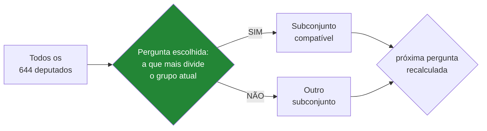

# O questionário — que perguntas, dinâmicas?, e o conteúdo das propostas

> **Status:** v1.0 — 2026-08-23
> Responde às três perguntas em aberto. Os exemplos são **votações reais de 2025**,
> extraídas do dado, não inventadas.

---

## 1. Que perguntas serão? — com exemplos reais

O funil já está medido ([discovery §7.2](../00-discovery.md)):

```
13.825 votações em 2025
   526 nominais                    (3,8%)
   410 no plenário
   145 substantivas                (filtra requerimento e destaque)
   100 proposições distintas
     ?  após descartar unanimidade ← o filtro decisivo
 15–25  perguntas finais
```

### 1.1 As mais divididas de 2025 — candidatas reais

Aplicando o filtro de divisão (≥300 votos, maioria ≤60%, substantiva, plenário):

| Votação | Placar | Maioria | Tema |
|---|---|---|---|
| `2306513-113` | 214 × 204 | **51 %** | Viação, Transporte e Mobilidade |
| `2438459-146` | 221 × 242 | 52 % | Finanças Públicas e Orçamento |
| `2233324-100` | 231 × 202 | 53 % | Direitos Humanos e Minorias |
| `2421211-112` | 178 × 155 | 53 % | Administração Pública |

**Ementas originais e a reescrita proposta:**

---

**1. `2306513-113` — 214 × 204**

> *Ementa oficial:* "Altera a Lei nº 9.503, de 23 de setembro de 1997, para prever
> destinação de recursos arrecadados com multas para custeio do processo de habilitação de
> condutores de baixa renda."

> **Pergunta:** *"O dinheiro arrecadado com multas de trânsito deve ser usado para pagar a
> CNH de pessoas de baixa renda?"*

**Polaridade:** `+1` — "Sim" na votação = a favor da medida.

---

**2. `2233324-100` — 231 × 202**

> *Ementa oficial:* "Institui o Dia Nacional das Defensoras e Defensores de Direitos
> Humanos."

> **Pergunta:** *"O Brasil deve ter um Dia Nacional dos Defensores de Direitos Humanos?"*

⚠️ **Caso instrutivo.** Parece inócuo — "criar uma data comemorativa" —, mas dividiu a
Câmara **231 × 202**. É pauta simbólica de alta carga política, e por isso **discrimina
muito bem**. A aparência de banalidade engana: o filtro de divisão captura isso, a
intuição humana não.

---

**3. `2421211-112` — 178 × 155**

> *Ementa oficial:* "Dispõe sobre a criação de funções comissionadas no Quadro de Pessoal
> do Supremo Tribunal Federal."

> **Pergunta:** *"O Supremo Tribunal Federal deve poder criar novos cargos comissionados?"*

⚠️ **Caso limítrofe.** Discrimina bem, mas exige do cidadão uma opinião sobre estrutura
administrativa do Judiciário — assunto que a maioria não acompanha. **Alto risco de
"Não sei"**, o que reduz o `n` da comparação.

→ **Critério adicional que isso revela:** além de *dividir a casa*, a pergunta precisa ser
**respondível por um leigo**. Nem toda votação divisiva vira boa pergunta.

---

**4. `2438459-146` — 221 × 242**

> *Ementa oficial:* "Institui o Comitê Gestor do Imposto sobre Bens e Serviços — CG-IBS,
> dispõe sobre o processo administrativo tributário relativo ao lançamento de ofício do
> Imposto sobre Bens e Serviços…"

⛔ **Descartar.** Divide perfeitamente (52%), mas é regulamentação da reforma tributária.
Não há como reescrever isso em pergunta honesta e leiga sem distorcer o que foi votado.

---

### 1.2 Os quatro critérios de seleção — agora completos

| # | Critério | Origem |
|---|---|---|
| 1 | **Substantiva** (`categoria = SUBSTANTIVA`) | Achado #11 |
| 2 | **Divide a casa** (maioria ≤ 60–70%) | RN-05 |
| 3 | **Cobertura temática** (usa `/temas`) | Achado #10 |
| 4 | ⭐ **Respondível por leigo** | **Novo — §1.1, caso 3 e 4** |

O critério 4 não estava registrado e é o que mais elimina candidatas. **É subjetivo e
manual**, e precisa ser assumido como tal no texto — é o passo mais atacável do método.

⚠️ **Armadilha do dado:** a ementa pode conter **múltiplas versões concatenadas**. Exemplo
real: `"...condutores de baixa renda.\r\n\r\nNOVA EMENTA: Altera..."`. Sempre inspecionar
antes de reescrever.

---

## 2. Perguntas dinâmicas? — sim, mas não no MVP

### 2.1 O que "dinâmico" pode significar

| Nível | O que é | Viável? |
|---|---|---|
| **A — Estático** | Todos respondem as mesmas N perguntas, na mesma ordem | ✅ MVP |
| **B — Ordem adaptativa** | Mesmo conjunto, ordem escolhida pela informação que cada uma agrega | 🟡 Possível |
| **C — Seleção adaptativa** | A próxima pergunta é escolhida pelas respostas anteriores | 🔴 Ambicioso |

### 2.2 Como o nível C funcionaria

É o mesmo princípio de um **teste adaptativo**: a cada resposta, escolher a pergunta que
**mais separa os parlamentares ainda compatíveis** com o que a pessoa respondeu.



**O ganho é real e mensurável:** convergir para o mesmo resultado com **menos perguntas**.
Um questionário adaptativo de 8 perguntas pode discriminar tanto quanto 20 fixas.

| ✅ Ganhos | ⛔ Custos |
|---|---|
| Menos abandono (questionário mais curto) | Não dá para pré-calcular — cada usuário tem caminho próprio |
| **Contribuição técnica original para o TCC** | Curadoria precisa cobrir mais votações (o pool tem de ser maior) |
| Testável: comparar 8 adaptativas × 20 fixas | Difícil explicar ao usuário por que as perguntas mudam |
| | Complica o cache e o contrato da API |

### 2.3 Recomendação

> **MVP: nível A (estático).** Registrar o nível C como **evolução planejada** — e, se
> houver tempo, implementá-lo como **experimento comparativo**.

⭐ **Por que isso é bom para o TCC:** "questionário adaptativo reduz de 20 para 8 perguntas
mantendo a mesma precisão de classificação" é um **resultado**, não uma funcionalidade. Vale
mais como capítulo de avaliação do que como recurso de produto.

⚠️ **Pré-requisito:** o adaptativo exige o pool curado **maior** que o estático — em vez de
20 perguntas prontas, precisa de 40–60. Isso multiplica o trabalho manual do critério 4.

**Pendência PL10:** decidir se o adaptativo entra como experimento.

---

## 3. O conteúdo das propostas é necessário? — **não**

Pergunta direta, resposta direta:

| Nível de conteúdo | Precisa? | Onde está |
|---|---|---|
| **Ementa** (resumo oficial) | ✅ **Sim — é suficiente** | `proposicoes.ementa` |
| **Temas** | ✅ Sim | `/proposicoes/{id}/temas` |
| **Inteiro teor** (PDF do projeto) | ⛔ **Não** | `urlInteiroTeor` — só linkar |
| Pareceres, emendas, substitutivos | ⛔ Não | — |

### 3.1 Por que a ementa basta

1. **É o resumo oficial** do que a proposição faz — feito pela própria Câmara.
2. **A pergunta é sobre a posição, não sobre o texto legal.** O cidadão responde se
   concorda com a *ideia*, não com a redação do artigo.
3. **O parlamentar também votou no todo**, não em cada dispositivo.

### 3.2 Por que NÃO usar o inteiro teor

| | |
|---|---|
| ⛔ **Volume** | PDF por proposição, sem estrutura, sem API de texto |
| ⛔ **Não melhora a pergunta** | A reescrita leiga sai da ementa, não do texto legal |
| ⛔ **Direito autoral não é problema, mas irrelevância é** | Ninguém vai ler |
| ✅ **Mas linkar é obrigatório** | `urlInteiroTeor` na pergunta = transparência (RNF-20) |

> 🔑 **Regra:** exibir **pergunta reescrita + ementa oficial + link para o inteiro teor**.
> A pessoa que quiser conferir, confere. As três camadas custam quase nada e tornam a
> curadoria auditável.

⚠️ **Isso importa para a banca.** O passo mais subjetivo do método é a reescrita da
ementa. Mostrar o texto original **ao lado** da pergunta é o que separa "método" de
"achismo" — já registrado como RF-30.

---

## 4. Resumo das decisões

| Pergunta | Resposta |
|---|---|
| Que perguntas? | Votações **substantivas, divididas (≤60–70%), com cobertura temática e respondíveis por leigo** |
| Quantas? | 15–25 no MVP (**RQ3** ainda aberta) |
| Dinâmicas? | ⛔ Não no MVP · ⭐ **Sim como experimento**, se houver tempo |
| Conteúdo das propostas? | ⛔ **Não.** Ementa basta. Inteiro teor só como link |

---

## 5. Pendências

| # | Pendência | Prioridade |
|---|---|---|
| **PL10** | Decidir se o questionário adaptativo entra como experimento comparativo | 🟡 Média |
| **PL11** | Curar as 15–25 perguntas: selecionar, reescrever, atribuir polaridade | 🔴 **Alta — trabalho manual, não automatizável** |
| **PL12** | Definir o limiar de "respondível por leigo" e documentá-lo como critério | 🟡 Média |
| **RQ3** | Definir o N final de perguntas | 🔴 Alta |
| **CT7** | Definir o mínimo de respostas para o resultado ter significado | 🟡 Média |
