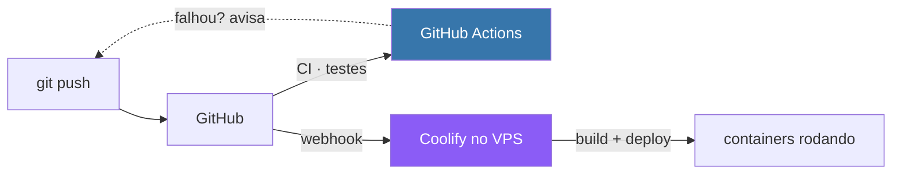

# CI/CD, deploy e monitoramento

> **Status:** v2.0 — 2026-08-25
> 🔄 **Reescrito** para a arquitetura **VPS + Coolify** (a v1 supunha Azure + Cloudflare
> Pages + Neon). Ver [01-arquitetura §3.5](01-arquitetura.md).

---

## 1. Sim — o Coolify **é** Docker

Não é "suporta". **É construído sobre Docker**: tudo que ele implanta vira container.

| Como você entrega | O que o Coolify faz |
|---|---|
| **Dockerfile** no repositório | Usa o seu — controle total |
| **docker-compose.yml** | Sobe a stack inteira |
| **Nada** (só o código) | Detecta a linguagem e gera a imagem via *buildpack* |

Para este projeto, **escreva Dockerfiles**. São três, todos triviais:

```dockerfile
# src/Poligraph.Api/Dockerfile
FROM mcr.microsoft.com/dotnet/sdk:10.0 AS build
WORKDIR /src
COPY . .
RUN dotnet publish Poligraph.Api -c Release -o /app

FROM mcr.microsoft.com/dotnet/aspnet:10.0
WORKDIR /app
COPY --from=build /app .
ENTRYPOINT ["dotnet", "Poligraph.Api.dll"]
```

```dockerfile
# etl/Dockerfile
FROM python:3.12-slim
WORKDIR /etl
COPY requirements.txt .
RUN pip install --no-cache-dir -r requirements.txt
COPY . .
CMD ["python", "main.py"]
```

```dockerfile
# web/Dockerfile — build estático servido por nginx
FROM node:22-alpine AS build
WORKDIR /web
COPY package*.json ./
RUN npm ci
COPY . .
RUN npm run build

FROM nginx:alpine
COPY --from=build /web/dist /usr/share/nginx/html
```

⚠️ **Por que Dockerfile e não *buildpack*:** o *buildpack* adivinha, e adivinha errado em
projeto poliglota. Três Dockerfiles de dez linhas dão controle e são o que você mostra na
banca.

⭐ **Ganho de coerência:** o Aspire já roda os mesmos containers localmente. O que sobe em
produção é o que você depurou no F5.

---

## 2. CI/CD — divisão de trabalho

A pergunta "como fazer CI/CD" tem duas metades, e cada uma vai para um lugar:



| | Onde | Por quê |
|---|---|---|
| **CI** — testes, lint | **GitHub Actions** | Não precisa de banco nem de servidor |
| **CD** — build e deploy | ⭐ **Coolify** | Já é nativo: webhook no push, build, sobe |

> 🔑 **Você não precisa escrever pipeline de deploy.** O Coolify conecta no repositório,
> registra um webhook, e a cada push em `main` ele constrói e publica sozinho.

### 2.1 O que o Coolify faz sozinho

| Recurso | |
|---|---|
| Deploy no push | Webhook do GitHub → build → substitui o container |
| **Zero-downtime** | Sobe o novo, verifica saúde, só então derruba o antigo |
| Rollback | Um clique para a versão anterior |
| TLS | Let's Encrypt automático, com renovação |
| Variáveis e segredos | Painel, sem `.env` no repositório |
| Logs | Por container, na interface |

### 2.2 O que fica no GitHub Actions

Só o que **não** precisa de infraestrutura:

```yaml
name: CI
on: [push, pull_request]

jobs:
  dotnet:
    runs-on: ubuntu-latest
    steps:
      - uses: actions/checkout@v4
      - uses: actions/setup-dotnet@v4
        with: { dotnet-version: '10.x' }
      - run: dotnet test          # 🔴 inclui o teste de polaridade (API3)

  python:
    runs-on: ubuntu-latest
    steps:
      - uses: actions/checkout@v4
      - uses: actions/setup-python@v5
        with: { python-version: '3.12' }
      - run: pip install -r etl/requirements.txt
      - run: pytest etl/tests     # normalização de voto, categoria, CPF com zero
```

⚠️ **O teste da polaridade é o mais importante do projeto** — em 14% das votações "Sim"
significa rejeitar, e um erro de sinal passa despercebido na tela. **Ele precisa rodar em
todo push.**

⚠️ **Nenhum teste aqui toca o banco de produção.** Se precisar de Postgres para teste de
integração, use `services: postgres:` do próprio Actions — container efêmero.

### 2.3 O ETL — Scheduled Task do Coolify

```
Scheduled Task: etl-diario
Container:      etl
Comando:        python main.py ingest && python main.py analyze
Cron:           0 9 * * *        (após o rebuild dos CSVs, ~07:00 UTC)
```

✅ **O Postgres nunca sai do VPS.** Foi o motivo de tirar o ETL do GitHub Actions
([01-arquitetura §3.5.1.1](01-arquitetura.md)).

---

## 3. ⭐ Monitoramento com Grafana

### 3.1 O que subir

| Container | Papel | RAM |
|---|---|---|
| **Grafana** | Painéis | ~250 MB |
| **Prometheus** | Coleta e guarda métricas | ~500 MB–1 GB |
| **node-exporter** | Métricas do host (CPU, RAM, disco) | ~50 MB |
| **cAdvisor** | Métricas por container | ~100 MB |
| **postgres-exporter** | Métricas do banco | ~50 MB |

**Total: ~1–1,5 GB.** Some ao resto e o dimensionamento muda — ver §4.

⚠️ **Comece com Grafana + Prometheus + node-exporter.** cAdvisor e postgres-exporter são
incrementos; adicione quando sentir falta.

### 3.2 🔴 A limitação que precisa ser dita

> **Monitoramento na mesma máquina que ele monitora morre junto com ela.**

Se o VPS cair, o Grafana cai — e você descobre pelo site fora do ar, não pelo painel.

| Mitigação | |
|---|---|
| **Uptime externo** | [UptimeRobot](https://uptimerobot.com) ou Better Stack, grátis: pinga `/api/health` de fora e avisa por e-mail |
| Grafana Cloud | Tier gratuito recebe métricas de fora — mas é outro painel, contrariando sua escolha |

> 🔑 **Recomendo Grafana no VPS + um monitor externo gratuito.** O Grafana responde *"como
> está indo"*; o monitor externo responde *"está no ar?"*. São perguntas diferentes.

### 3.3 ⭐ O painel que vale para o TCC

Aqui está o ganho que não é operacional — **é acadêmico**.

| Painel | Responde |
|---|---|
| ⭐ **Votações ingeridas por dia** | Torna visível o **calendário legislativo**: recesso, terças-a-quintas, dezembro cheio |
| Duração do ETL | O job está degradando com o crescimento da base? |
| Tamanho do Postgres | Curva de crescimento da base |
| RAM do host durante o ETL | 🔴 **Confirma se 8 GB bastam** |
| Latência da API (p95) | Valida o RNF-04 (< 500 ms) |
| Erros 5xx | Saúde |

> ⭐ **O primeiro painel é figura de dissertação.** Um gráfico de votações por dia ao longo
> de meses **mostra o recesso de julho como um vale** e dezembro como um pico. Isso
> transforma o achado institucional em evidência visual — e você não precisa de nada além
> do que já vai coletar.

⚠️ **Configure a retenção do Prometheus** (ex.: 90 dias). Sem limite, ele cresce até
encher o disco — e aí derruba o Postgres junto.

---

## 4. Dimensionamento com Hostinger

**Decisão: Hostinger VPS** — datacenter em São Paulo e suporte em português.

| Componente | RAM |
|---|---|
| Coolify | ~1 GB |
| PostgreSQL | ~1 GB |
| API .NET | ~300 MB |
| ETL (pico) | 1–2 GB |
| **Grafana + Prometheus + exporters** | **~1–1,5 GB** |
| **Pico total** | **~5–6 GB** |

### Planos

| Plano | Config | Serve? |
|---|---|---|
| KVM 1 | 1 vCPU · 4 GB · 50 GB | ⛔ **Não** — RAM apertada e **1 vCPU trava o build .NET** |
| ⭐ **KVM 2** | **2 vCPU · 8 GB · 100 GB NVMe** | ✅ **Escolha certa** |
| KVM 4 | 4 vCPU · 16 GB · 200 GB | 🟡 Folga demais para o TCC |

> **Recomendação: KVM 2.** Com Grafana junto, 8 GB deixa de ser conforto e vira
> necessidade. E 2 vCPU é o mínimo para compilar .NET sem sofrimento.

⚠️ **Armadilha do preço:** o valor anunciado (~R\$ 28 no KVM 1) é de contrato de **24–48
meses**. **Confira o preço de renovação no checkout** — costuma dobrar. Para um TCC que
dura ~1 ano, calcule o custo real do período.

✅ **Vantagens sobre a Hetzner:** São Paulo (10–40 ms em vez de 200 ms), suporte em
português, backup automático incluso, e cobrança em reais.

---

## 5. Segurança — o que passa a ser seu

| Item | Ação |
|---|---|
| 🔴 **Backup do Postgres** | Coolify agenda para S3/storage externo. **Primeiro dia, não depois** |
| **Cloudflare na frente** | TLS, WAF, e **esconde o IP do VPS** |
| **Firewall** | Só 80/443 abertos. ⛔ **Nunca** expor 5432 |
| SSH | Chave, não senha. Desabilitar login root |
| Grafana | **Trocar a senha padrão** (`admin/admin`) — é alvo de varredura automática |
| Atualização | `unattended-upgrades` para patches de segurança |

⚠️ **O backup é o item que mais dói esquecer.** Perder o banco com o TCC em andamento é o
pior cenário possível, e são 10 minutos de configuração.

---

## 6. Ordem de montagem

| # | Passo | Tempo |
|---|---|---|
| 1 | Contratar VPS, apontar DNS na Cloudflare | 30 min |
| 2 | Instalar Coolify (`curl` de uma linha) | 15 min |
| 3 | Subir Postgres pelo painel + **configurar backup** | 30 min |
| 4 | Conectar repositório, deploy da API | 30 min |
| 5 | Deploy do front | 20 min |
| 6 | Scheduled Task do ETL | 20 min |
| 7 | Grafana + Prometheus + node-exporter | 1–2 h |
| 8 | Monitor externo (UptimeRobot) | 10 min |

**Total: ~4 horas** para a infra inteira de pé.

---

## 7. Pendências

| # | Pendência | Prioridade |
|---|---|---|
| ~~PL2~~ | ✅ **Hostinger VPS KVM 2** | — |
| ~~PL4~~ | ✅ Repositório privado | — |
| **PL19** | Escolher retenção do Prometheus e configurar | 🟡 Média |
| **PL20** | Definir o destino do backup do Postgres (S3, Backblaze, outro VPS) | 🔴 Alta |
| **PL21** | Decidir se o Grafana fica público ou só por VPN/túnel | 🟡 Média |
| **PL3** | Registrar domínio | 🟢 Baixa |
