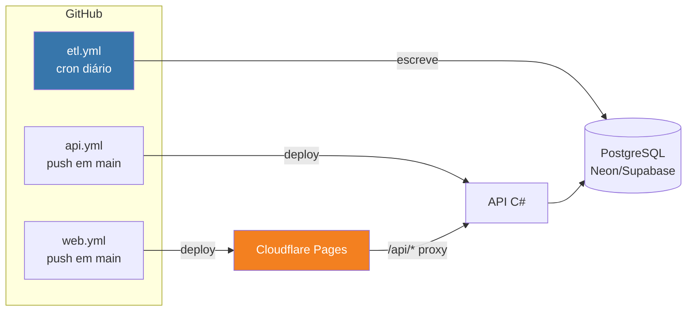

# CI/CD e deploy

> **Status:** v1.1 — 2026-08-25
> **v1.1:** 🔴 correção — o Fly encerrou o free tier; PL2 e PL4 decididas.
> Fecha a parte de infra do plano. Três *workflows*, três destinos, zero servidor
> para administrar.

---

## 1. Panorama



| Componente | Gatilho | Destino |
|---|---|---|
| ETL | **cron diário** + manual | Escreve direto no Postgres |
| API | push em `main` | App Service ou Fly.io |
| Front | push em `main` | Cloudflare Pages |

⚠️ **O front nem precisa de workflow** — o Cloudflare Pages faz *build* e *deploy* ao
conectar o repositório. O `web.yml` só existe se você quiser rodar testes antes.

---

## 2. `etl.yml` — o workflow que carrega o projeto

```yaml
name: ETL
on:
  schedule:
    - cron: '0 9 * * *'      # 09:00 UTC — após o rebuild dos CSVs (~07:00, achado #19)
  workflow_dispatch:          # botão de "rodar agora"
    inputs:
      recarga_completa:
        description: 'Reprocessar a legislatura inteira'
        type: boolean
        default: false

concurrency:
  group: etl                  # ⚠️ nunca duas cargas simultâneas
  cancel-in-progress: false

jobs:
  etl:
    runs-on: ubuntu-latest
    timeout-minutes: 60
    steps:
      - uses: actions/checkout@v4
      - uses: actions/setup-python@v5
        with:
          python-version: '3.12'
          cache: pip

      - run: pip install -r etl/requirements.txt

      - name: Ingestão
        id: ingest
        env:
          PG_CONN: ${{ secrets.PG_CONN }}
        run: |
          python etl/main.py ingest \
            ${{ inputs.recarga_completa && '--full' || '--incremental' }}

      # ⭐ Análise só roda se a ingestão trouxe votação nova (§5.2 do discovery)
      - name: Análise
        if: steps.ingest.outputs.novas_votacoes != '0'
        env:
          PG_CONN: ${{ secrets.PG_CONN }}
        run: python etl/main.py analyze

      - name: Resumo
        run: |
          echo "### Carga de $(date -u +%F)" >> $GITHUB_STEP_SUMMARY
          echo "- Votações novas: ${{ steps.ingest.outputs.novas_votacoes }}" >> $GITHUB_STEP_SUMMARY
          echo "- Análise: ${{ steps.ingest.outputs.novas_votacoes != '0' && 'executada' || 'pulada' }}" >> $GITHUB_STEP_SUMMARY
```

### 2.1 As três decisões embutidas nesse YAML

| Decisão | Por quê |
|---|---|
| **09:00 UTC** | A Câmara reconstrói os CSVs entre 04:00 e 07:01 UTC. Duas horas de margem |
| **`concurrency: etl`** | Duas cargas simultâneas corromperiam o `execucao_id` |
| ⭐ **Análise condicional** | Votação só acontece em dia de sessão. Recalcular 207 mil pares num sábado é desperdício |

### 2.2 🔴 O alerta precisa conhecer o calendário legislativo

**"Zero votações novas" é normal em julho e suspeito em maio.**

```yaml
      - name: Alerta de coleta parada
        if: steps.ingest.outputs.novas_votacoes == '0'
        run: |
          MES=$(date -u +%m); DIA=$(date -u +%d); DOW=$(date -u +%u)
          # recesso: 18–31/07 e 23/12–01/02 · fim de semana · segunda e sexta
          if [ "$DOW" -ge 6 ] || [ "$DOW" = 1 ] || [ "$DOW" = 5 ]; then exit 0; fi
          if [ "$MES" = "01" ] || [ "$MES" = "12" ]; then exit 0; fi
          if [ "$MES" = "07" ] && [ "$DIA" -ge 18 ]; then exit 0; fi
          echo "::warning::Nenhuma votação nova em dia útil de sessão — verificar a coleta"
```

⚠️ **Sem isso, você tem uma de duas falhas:** ou o alarme dispara todo dia de recesso e
você aprende a ignorá-lo, ou não existe alarme e a coleta fica quebrada por semanas sem
ninguém notar. A segunda é pior, e é a que acontece por padrão.

⭐ **Isso também é conteúdo de TCC.** "O monitoramento incorpora o calendário legislativo"
é uma decisão de engenharia derivada do domínio, não configuração genérica.

---

## 3. `api.yml` — depende da PL2

### Opção A — Azure App Service

```yaml
name: API
on:
  push:
    branches: [main]
    paths: ['src/**']
jobs:
  deploy:
    runs-on: ubuntu-latest
    steps:
      - uses: actions/checkout@v4
      - uses: actions/setup-dotnet@v4
        with: { dotnet-version: '10.x' }
      - run: dotnet publish src/Poligraph.Api -c Release -o out
      - uses: azure/webapps-deploy@v3
        with:
          app-name: poligraph-api
          publish-profile: ${{ secrets.AZURE_PUBLISH_PROFILE }}
          package: out
```

| ✅ | ⛔ |
|---|---|
| Aspire tem caminho nativo (`azd up`) | Tier gratuito com limites de CPU |
| Familiar para quem usa .NET | Crédito de estudante **expira** |

### Opção B — Fly.io

```yaml
      - uses: superfly/flyctl-actions/setup-flyctl@master
      - run: flyctl deploy --remote-only
        env:
          FLY_API_TOKEN: ${{ secrets.FLY_API_TOKEN }}
```

| ✅ | ⛔ |
|---|---|
| Deploy simples, Dockerfile único | Sem integração com Aspire |
| Não expira | Precisa cartão cadastrado |

🔴 **CORREÇÃO — 2026-08-25.** O Fly.io **encerrou o free tier em outubro de 2024**. Contas
novas têm um teste de 2 horas de VM ou 7 dias, depois **mínimo de US$ 5/mês** (plano
Hobby). A recomendação anterior por "não expirar" estava errada: ele custa desde o dia 1.

> **Recomendação revisada: Azure App Service F1 (gratuito).** Continua existindo em 2026,
> permite até 10 apps, e o app dorme por inatividade — aceitável para TCC. ⚠️ **Não
> confundir** com o *Azure Database for PostgreSQL*, que **não** tem tier gratuito — o banco
> vai para Neon/Supabase de qualquer forma.
>
> ⚠️ Azure **não tem trava de gasto automática**: se passar do limite do F1, começa a
> cobrar. Configure alerta de orçamento em US$ 1.

⚠️ **Mas se você já tem crédito Azure de estudante com validade longa**, dá para usar um
tier pago pequeno e escapar das limitações abaixo.

### 3.1 🔴 O que cabe no App Service F1 — e o que não cabe

**Limites reais do F1** (verificados em 2026-08-25):

| Limite | Valor |
|---|---|
| **CPU** | 🔴 **60 minutos por dia** |
| **Always On** | ⛔ **Não existe** no Free |
| Consequência | App **descarrega após ~20 min sem tráfego** → *cold start* na próxima visita |
| Apps por plano | até 10 |

**Resposta direta para os três componentes:**

| Componente | Cabe no App Service? | Onde deve ficar |
|---|---|---|
| **API C#** | ✅ **Sim** — é para isso que ele serve | **App Service F1** |
| **Jobs (ETL Python)** | ⛔ **Não** | **GitHub Actions** |
| **Front (React)** | 🟡 Tecnicamente sim, **mas não faça** | **Cloudflare Pages** |

#### Por que o ETL **não** cabe

1. **WebJobs contínuos exigem Always On**, que não existe no Free.
2. Mesmo *WebJob* acionado por gatilho **consome a mesma cota de 60 min/dia** — o ETL
   competiria com a API pelo mesmo orçamento de CPU.
3. Um ETL que processa 149 MB de CSV **estouraria os 60 minutos sozinho**.

> ✅ **O GitHub Actions resolve isso de graça**, com 6 h de teto por job e minutos que não
> concorrem com a API. Era a escolha certa antes de eu saber do limite — e agora tem
> justificativa numérica.

#### Por que o front **não deve** ficar lá

Servir arquivo estático pelo App Service **gasta a cota de 60 CPU-min/dia que a API
precisa**. Cada `index.html`, cada `.js`, cada imagem consome o mesmo orçamento.

O Cloudflare Pages serve estático de graça, por CDN global, **sem tocar na cota**.

> 🔑 **Os três componentes em três lugares não é complicação — é o que faz o custo ser
> zero.** Concentrar tudo no App Service estouraria o Free em um dia.

### 3.2 ⚠️ O *cold start* e a apresentação da banca

Sem Always On, o app dorme após ~20 minutos parado. A primeira requisição depois disso
demora — e o Postgres gerenciado **também** dorme (§7).

**Dois adormecimentos somados. Na demonstração, isso é constrangedor.**

| Mitigação | Como |
|---|---|
| ⭐ **Aquecer antes** | Abrir o site ~5 min antes da apresentação |
| *Ping* periódico | Cron do GitHub Actions batendo em `/api/health` a cada 15 min |
| Tier pago temporário | B1 (~US$ 13/mês) só no mês da defesa |

⚠️ O *ping* periódico **consome a cota de 60 min/dia** — use intervalo largo, e só se
necessário. Para o TCC, **aquecer manualmente antes de apresentar é mais simples e não
custa nada**.

---

## 4. Cloudflare — o proxy que elimina CORS

```
poligraph.app          → Cloudflare Pages (React)
poligraph.app/api/*    → origem da API (App Service ou Fly)
```

**Configure isso no primeiro dia.** Se front e API ficarem em domínios diferentes você
ganha: *preflight* em toda requisição, dor de cabeça com cookie, e configuração de CORS
para manter.

| Recurso Cloudflare | Configuração |
|---|---|
| Pages | Conectar repositório, *build* `npm run build`, saída `dist` |
| DNS | `A`/`CNAME` para a origem, com proxy ativado (nuvem laranja) |
| Rules | `/api/*` → origem da API |
| **Rate limiting** | `/api/afinidade` — ex.: 30 req/min por IP |
| WAF | Regras gerenciadas, modo padrão |

⚠️ **Rate limit em `/api/afinidade` não é paranoia.** É o endpoint que faz cálculo e é o
único `POST` público. Sem limite, é o alvo óbvio.

---

## 5. Secrets

| Secret | Onde | Usado por |
|---|---|---|
| `PG_CONN` | GitHub → Actions | `etl.yml` |
| `AZURE_PUBLISH_PROFILE` **ou** `FLY_API_TOKEN` | GitHub → Actions | `api.yml` |
| `ConnectionStrings__poligraph` | App Service / Fly secrets | API em produção |
| `CLARITY_ID`, `GA4_ID` | Cloudflare Pages env | Front |
| `PEPPER` | App Service / Fly secrets | Só se houver login (PL7) |

✅ **PL4 DECIDIDA — 2026-08-25: repositório PRIVADO.**

| Consequência | |
|---|---|
| GitHub Actions | ⚠️ **2.000 min/mês** (não ilimitado). Job diário de ~10 min = ~300 min/mês — **cabe folgado** |
| Logs dos Actions | ✅ Privados — o risco de vazar segredo em log cai muito |
| Cloudflare Pages | ✅ Funciona com repositório privado |

🔴 **Ainda assim, nunca commitar `.env`.** Repositório privado hoje pode virar público
depois — e o histórico do Git não esquece.

⚠️ **Se o repositório for público**, qualquer pessoa vê os logs dos Actions. **Não imprima
a string de conexão** em nenhum `echo` de diagnóstico.

---

## 6. Ambientes

| | Local | Produção |
|---|---|---|
| Orquestração | ⭐ **Aspire** (`dotnet run`) | Nenhuma — peças independentes |
| Postgres | Container do Aspire | Neon / Supabase |
| API | `localhost` | App Service / Fly |
| Front | Vite dev server | Cloudflare Pages |
| ETL | Manual pelo dashboard | GitHub Actions cron |

> 🔑 **Não existe "ambiente de homologação".** Para um TCC, dois ambientes já são um a
> mais do que o necessário. Local + produção basta.

---

## 7. Custo total

| Item | Custo/mês |
|---|---|
| Cloudflare (Pages, DNS, WAF) | **US$ 0** |
| GitHub Actions (repo privado) | **US$ 0** — 300 de 2.000 min/mês |
| Postgres (Neon/Supabase free) | **US$ 0** |
| API (Azure App Service **F1**) | **US$ 0** ⚠️ app dorme por inatividade |
| Domínio | ~US$ 10/ano |
| **Total** | **US$ 0/mês** + ~US$ 10/ano de domínio |

⚠️ **O free tier do Neon/Supabase suspende o banco após inatividade.** A primeira
requisição depois disso demora alguns segundos. Para um TCC é aceitável — mas **avise a
banca antes da demonstração**, ou faça uma requisição de aquecimento minutos antes.

---

## 8. Pendências

| # | Pendência | Prioridade |
|---|---|---|
| ~~PL2~~ | ✅ **RESOLVIDA — 2026-08-25: Azure App Service F1.** O Fly deixou de ser gratuito em out/2024 | — |
| ~~PL4~~ | ✅ **RESOLVIDA — 2026-08-25: repositório privado.** 300 de 2.000 min/mês | — |
| **PL16** | Definir como o ETL sinaliza `novas_votacoes` (output do step) | 🟡 Média |
| **PL17** | Testar o cold start do Postgres gerenciado e decidir se precisa de *keep-alive* | 🟡 Média |
| **PL3** | Registrar domínio | 🟢 Baixa |
