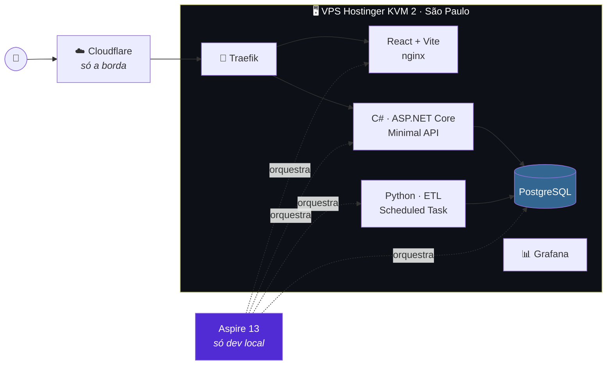

# Plano de implementação

> **Status:** v2.0 — 2026-08-26
> ⚠️ **v1.0 estava obsoleta** — descrevia Cloudflare Pages + Neon + GitHub Actions cron,
> tudo superado pela decisão de **VPS + Coolify** (2026-08-25).
> Deriva de [`docs/00-discovery.md`](../00-discovery.md) e
> [`docs/04-contratos.md`](../04-contratos.md). Aqui começa a construção.

---

## Documentos

| Doc | Conteúdo |
|---|---|
| [01-arquitetura.md](01-arquitetura.md) | Desenho macro e **detalhado do VPS**, hospedagem, Aspire, Cloudflare, ⭐ **ordem de construção (§8)** |
| [02-autenticacao-e-metricas.md](02-autenticacao-e-metricas.md) | 🔴 Login Google × LGPD · fluxo de sessão · Clarity e GA4 |
| [03-questionario.md](03-questionario.md) | Que perguntas, dinâmicas?, conteúdo das propostas |
| [04-esqueleto.md](04-esqueleto.md) | ⭐ **Schema SQL, código da autenticação, AppHost e ETL** |
| [05-cicd-e-deploy.md](05-cicd-e-deploy.md) | Dockerfiles, CI/CD, Grafana, dimensionamento, segurança |
| [06-perguntas-lote-1.md](06-perguntas-lote-1.md) | 🗳️ **As 22 perguntas** medidas e curadas — Pendência 11 |
| [07-grafo-e-afinidade.md](07-grafo-e-afinidade.md) | ⭐ **O núcleo técnico** — nó, aresta, pesos e o cálculo da afinidade |
| [09-apresentacao-validacao-e-valor.md](09-apresentacao-validacao-e-valor.md) | 📊 **Como apresentar e como conferir** — modelos de visualização, filtros, o valor para quem usa, notificações e a validação do dado |
| [10-procedencia-e-modo-analise.md](10-procedencia-e-modo-analise.md) | Procedência por linha, modo análise e cruzamento por CNPJ — a partir de um vídeo sobre os dados do TSE |

---

## Stack decidida

| Camada | Escolha | Custo |
|---|---|---|
| **Hospedagem** | ⭐ **VPS Hostinger KVM 2** (2 vCPU · 8 GB · São Paulo) + **Coolify** | ~R$ 30–60/mês |
| Front | React + Vite, servido por nginx no VPS | — |
| API | **C# · ASP.NET Core Minimal API** | — |
| ETL + análise | **Python** (pandas, scipy, networkx) | — |
| Agendamento do ETL | ⭐ **Scheduled Task do Coolify** — o Postgres nunca sai do VPS | — |
| Banco | **PostgreSQL** em container | — |
| Borda | **Cloudflare** — DNS, CDN, WAF, TLS, esconde o IP | Grátis |
| Observabilidade | Grafana + Prometheus + node-exporter | — |
| Login | ⭐ **Google apenas** — sem senha, sem token armazenado | Grátis |
| Métricas de uso | Microsoft Clarity + GA4 | Grátis |
| E-mail | Serviço de envio (Resend/Brevo) + SPF/DKIM/DMARC | Grátis no volume previsto |

---

## Decisões desta pasta

| # | Decisão |
|---|---|
| **Pendência 2** | Hostinger VPS KVM 2 — não Azure, não Neon, não Render |
| **Pendência 4** | Repositório privado |
| **Pendência 6** | Clarity **em produção, gravando tudo**, com consentimento bloqueante |
| **RQ9** | Login Google com **perfil completo armazenado** (minimização revogada) |
| **D1** | ETL inteiro em Python — não C# |

---

## Por onde começar

1. 📐 **[01-arquitetura §8](01-arquitetura.md)** — a ordem de construção, em duas trilhas
2. ⚠️ **[../PENDENCIAS.md](../PENDENCIAS.md)** — o que ainda bloqueia
3. ⌨️ **[04-esqueleto](04-esqueleto.md)** — o schema e o código do passo 1

> 🔴 **E comece a Pendência 11 hoje**, em paralelo: curar as 15–25 perguntas é o único item que
> não escala e bloqueia o questionário.
