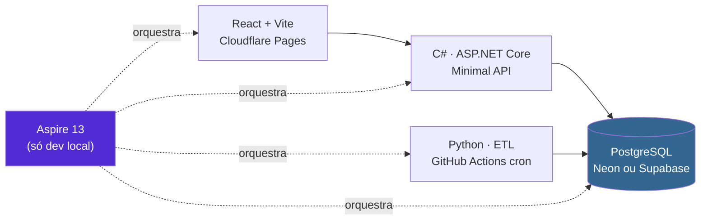

# Plano de implementação

> **Status:** v1.0 — 2026-08-23
> Deriva de [`docs/00-discovery.md`](../00-discovery.md) e
> [`docs/04-contratos.md`](../04-contratos.md). Aqui começa a construção.

---

## Documentos

| Doc | Conteúdo |
|---|---|
| [01-arquitetura.md](01-arquitetura.md) | Desenho macro, hospedagem, Aspire, Cloudflare, ordem de construção |
| [02-autenticacao-e-metricas.md](02-autenticacao-e-metricas.md) | 🔴 Login Google × LGPD · Clarity e GA4 |
| [03-questionario.md](03-questionario.md) | Que perguntas, dinâmicas?, conteúdo das propostas |
| [04-esqueleto.md](04-esqueleto.md) | ⭐ **AppHost, schema SQL e estrutura do ETL** — artefatos do passo 1 |
| [05-cicd-e-deploy.md](05-cicd-e-deploy.md) | Workflows, deploy, secrets, custo — fecha a infra |

---

## Stack decidida

| Camada | Escolha | Custo |
|---|---|---|
| Front | React + Vite → **Cloudflare Pages** | Grátis |
| API | **C# · ASP.NET Core Minimal API** | Grátis–US$ 5 |
| ETL + análise | **Python** (pandas, scipy, networkx) | — |
| Agendamento do ETL | ⭐ **GitHub Actions** (cron diário) | Grátis |
| Banco | **PostgreSQL** gerenciado | Grátis |
| Borda | **Cloudflare** — DNS, CDN, WAF, rate limit | Grátis |
| Dev local | ⭐ **Aspire 13** — sobe tudo com F5 | — |

---

## As três respostas que você pediu

### 1. Login com Google

🔴 **Ele não resolve o problema que você quer resolver.** O risco não está na senha —
está em associar preferência política a uma identidade persistente. Uma tabela
`usuario_segue(usuario, parlamentar)` é, pela LGPD, **base de convicção política**.

> **Recomendação: sem login no MVP.** Lista de seguidos no `localStorage`. Se o
> cross-device virar necessário, login guardando apenas `SHA256(sub + pepper)` — nunca
> e-mail ou nome. Detalhes em [02](02-autenticacao-e-metricas.md) §1–3.

### 2. Métricas de uso e mapa de calor

A ferramenta que você lembrava é do **Google (GA4)**, mas **mapa de calor não é produto
do Google**:

| Precisa de | Ferramenta |
|---|---|
| Tempo de uso, sessões, funil | **Google Analytics 4** |
| ⭐ **Mapa de calor + gravação de sessão** | **Microsoft Clarity** — grátis e ilimitado |

⚠️ Mas gravação de sessão em site de afinidade política **grava opinião política**.
Recomendação: Clarity **só na fase de avaliação com voluntários consentidos**, não em
produção aberta. Ver [02](02-autenticacao-e-metricas.md) §4.2.

### 3. As perguntas

| | |
|---|---|
| **Que perguntas?** | Votações substantivas, divididas (≤60–70%), com cobertura temática **e respondíveis por leigo** |
| **Dinâmicas?** | ⛔ Não no MVP. ⭐ Sim como **experimento comparativo** — "8 adaptativas × 20 fixas" é resultado de TCC |
| **Conteúdo das propostas?** | ⛔ **Não.** A **ementa basta**. Inteiro teor só como link |

Exemplos reais extraídos do dado em [03](03-questionario.md) §1.1.

---

## Duas mudanças em decisões anteriores

| Decisão | Antes | Agora |
|---|---|---|
| **D1** — linguagem do ETL | .NET ingere, Python analisa | 🔄 **Python faz tudo** — `pandas` já resolve RFC 4180, ISO-8859-1 e vírgula decimal, que são as armadilhas medidas |
| **D5** — front | Blazor **ou** React | ✅ **React**, decidido |

⚠️ **Custo assumido na D1:** o C# perde contato com o dado bruto. Se a banca perguntar
onde está a engenharia de dados em .NET, a resposta honesta é *"em Python, por adequação
de ferramenta"* — precisa ser defendido, não escondido.

---

## Ordem de construção

| # | Entrega | Esforço |
|---|---|---|
| 1 | Aspire sobe Postgres + API + React | 🟢 1 dia |
| 2 | ⭐ **ETL: 167 mil votos no banco** | 🟢 1–2 dias |
| 3 | Matriz + similaridade | 🟡 2 dias |
| 4 | API: `/parlamentares` e `/similares` | 🟢 1 dia |
| 5 | React: lista + ficha | 🟡 2–3 dias |
| 6 | Grafo (kNN k=10) | 🔴 3–4 dias |
| 7 | Questionário + `/afinidade` | 🟡 2–3 dias |
| 8 | Crawler + notícias | 🟡 2 dias |

> 🔑 **O passo 2 é o marco.** A partir dele a documentação passa a ser validada por código.

⚠️ Se o prazo apertar: **entregue o 7 antes do 6**. O grafo é o mais caro e pode começar
como visualização estática.

---

## Pendências do plano

| # | Pendência | Prioridade |
|---|---|---|
| **PL11** | 🔴 **Curar as 15–25 perguntas** — manual, não automatizável | 🔴 Alta |
| **PL6** | Clarity em produção ou só na avaliação? | 🔴 Alta |
| **PL10** | Questionário adaptativo entra como experimento? | 🟡 Média |
| **PL1/PL2** | Neon vs Supabase · Azure App Service vs Fly.io | 🟡 Média |
| **PL4** | Repositório público? (afeta minutos do Actions) | 🟡 Média |
| **PL5** | Cytoscape.js vs react-force-graph | 🟡 Média |
| **PL3** | Registrar domínio | 🟢 Baixa |
